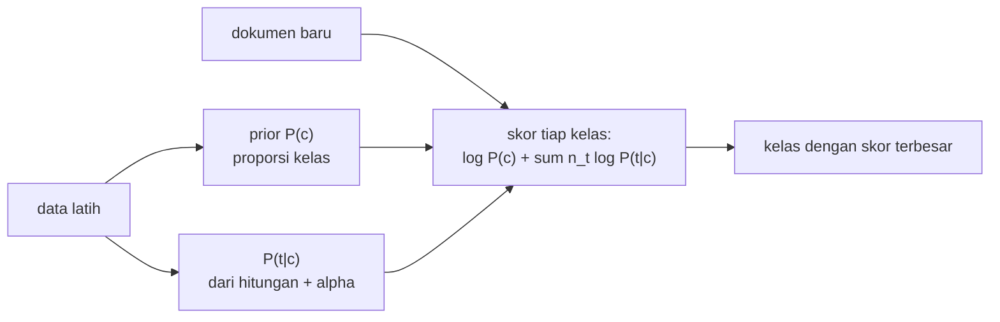

# Multinomial Naive Bayes

!!! abstract "Info materi"
    **Tingkat kesulitan:** Menengah (dengan matematika dasar). **Estimasi waktu:** 120 menit.
    **Jenis kode:** snippet edukatif dan eksperimen kecil (`examples/level-4-classification/04_naive_bayes.py`). Perhitungan manual dicocokkan dengan scikit-learn.

## Tujuan pembelajaran

- [ ] Menjelaskan aturan Bayes dan asumsi "naif" independensi kata.
- [ ] Menghitung prior, probabilitas kata per kelas dengan smoothing Laplace, dan posterior dari contoh kecil.
- [ ] Menjelaskan mengapa perhitungan memakai logaritma.
- [ ] Menafsirkan parameter `alpha` dan kata paling berpengaruh per kelas.
- [ ] Menyebut keterbatasan Naive Bayes pada teks Emergency.

## Prasyarat

- [Pipeline](pipeline-sklearn.md) dan [TF-IDF](../level-3-representasi-teks/tfidf.md).
- Konsep probabilitas dasar: peluang dan peluang bersyarat. Notasi dijelaskan di bawah.

## Pengantar dan motivasi

Pikirkan seorang petugas piket yang sudah melihat ribuan laporan. Ketika
membaca "tolong air naik", ia berpikir: *kata "tolong" dan "air" lebih sering
muncul di laporan darurat daripada di berita biasa, jadi ini kemungkinan
darurat.* Naive Bayes mengerjakan hal yang sama secara hitungan: untuk tiap
kelas, ia menjumlahkan "seberapa mungkin kelas itu mengeluarkan kata-kata ini".
Ia sederhana, cepat, dan sering menjadi baseline kuat untuk teks.

## Konsep dasar

### Aturan Bayes

$$
P(c \mid d) = \frac{P(d \mid c)\,P(c)}{P(d)}
$$

- $c$: kelas (Emergency atau Non-Emergency); $d$: dokumen (teks).
- $P(c \mid d)$: **posterior**, peluang kelas $c$ setelah melihat dokumen $d$ (yang ingin kita ketahui).
- $P(c)$: **prior**, peluang kelas sebelum melihat dokumen (proporsi di data latih).
- $P(d \mid c)$: **likelihood**, seberapa mungkin kelas $c$ menghasilkan dokumen ini.
- $P(d)$: sama untuk semua kelas sehingga diabaikan ketika hanya membandingkan.

### Asumsi "naif"

Dokumen terdiri dari kata $t_1, \dots, t_n$. Likelihood dihitung dengan
**mengandaikan kata-kata saling bebas** bila kelasnya diketahui:

$$
P(d \mid c) \approx \prod_{t \in d} P(t \mid c)^{n_t(d)}
$$

$n_t(d)$ adalah berapa kali kata $t$ muncul di $d$; $\prod$ berarti "kalikan semua". Asumsi
ini jelas tidak benar (kata `air` dan `naik` saling berkaitan), tetapi untuk klasifikasi
sering tetap bekerja baik (McCallum dan Nigam, 1998, membandingkan dua variasi
model Naive Bayes untuk teks).

### Probabilitas kata dengan smoothing Laplace

$$
P(t \mid c) = \frac{N_{tc} + \alpha}{N_c + \alpha V}
$$

- $N_{tc}$: total kemunculan kata $t$ pada seluruh dokumen kelas $c$.
- $N_c$: total semua kata pada kelas $c$.
- $V$: ukuran kosakata.
- $\alpha$ (`alpha`): konstanta smoothing. $\alpha = 1$ disebut *Laplace smoothing* ("tambah satu").

**Mengapa perlu $\alpha$?** Tanpa smoothing, kata yang tidak pernah muncul pada satu
kelas mendapat peluang 0, dan karena kita **mengalikan** peluang, seluruh produk menjadi
0: satu kata asing meniadakan kelas itu. Smoothing memberi sedikit peluang
pada setiap kata.

### Keputusan memakai logaritma

Mengalikan banyak peluang kecil menghasilkan angka yang terlalu kecil untuk
komputer (*underflow*). Karena logaritma mengubah perkalian menjadi penjumlahan:

$$
\log P(c \mid d) \;\propto\; \log P(c) + \sum_{t} n_t(d)\,\log P(t \mid c)
$$

Kelas dengan skor log terbesar yang dipilih.

## Penjelasan mendalam

### Contoh numerik langkah demi langkah

Empat dokumen latih:

| Dokumen | Kelas |
|---|---|
| tolong air masuk rumah | Emergency |
| air naik tolong evakuasi | Emergency |
| webinar mitigasi banjir | Non-Emergency |
| tips siaga banjir gratis | Non-Emergency |

Kosakata $V = 12$. Prior kedua kelas $= 0{,}5$. Total kata Non-Emergency $N = 7$ dan
Emergency $N = 8$. Dengan $\alpha = 1$:

- $P(\text{tolong} \mid \text{Emergency}) = (2 + 1)/(8 + 12) = 0{,}15$
- $P(\text{tolong} \mid \text{Non-Emergency}) = (0 + 1)/(7 + 12) = 0{,}0526$

Kata `tolong` memiliki peluang hampir tiga kali lebih besar pada Emergency.
Bagian 2 mencetak angka ini beserta `banjir` dan `air`.

### TF-IDF pada Naive Bayes

Secara teori, Multinomial NB bekerja pada hitungan. Pada praktik, TF-IDF sering
dipakai sebagai masukan, dengan "hitungan" berupa bobot TF-IDF. Ini tidak
sesuai persis dengan asumsi multinomial, tetapi bekerja baik. Pipeline pada Level 4
memakai TF-IDF agar ketiga algoritma menerima fitur yang sama.

### Probabilitas posterior bukan jaminan kalibrasi

Karena asumsi independensi, Naive Bayes cenderung memberi probabilitas yang
terlalu ekstrem (mendekati 0 atau 1). Gunakan peringkat/keputusannya, bukan
angka probabilitas, sebagai ukuran keyakinan nyata (kalibrasi dibahas di Level 5 dan 7).

## Cara kerja atau alur proses



## Contoh sederhana

Dokumen "tolong banjir air". Dengan angka di atas, `tolong` dan `air` condong ke
Emergency, `banjir` condong ke Non-Emergency; total skor menentukan. Bagian 3 menghitungnya.

## Contoh dalam konteks Twitter/X kebencanaan

Pada teks sintetis, kata yang paling condong ke Emergency (setelah dilatih pada data
latih) mencakup `barusan`, `butuh`, `menimpa`, dan kata alamat seperti `rt`; kata yang
condong ke Non-Emergency mencakup `ini`, `ya`, `saya`, `kayak`. Sebagian cocok dengan
intuisi kita, sebagian merupakan artefak templat (Bagian 5).

## Praktik Python

Berkas: `examples/level-4-classification/04_naive_bayes.py`.

### Bagian 1 — Data kecil dan prior

```python title="Bagian 1"
--8<-- "level-4-classification/04_naive_bayes.py:data_kecil"
```

`CountVectorizer` menghasilkan matriks hitungan `X`; `V` adalah ukuran kosakata; `prior` dihitung sebagai proporsi tiap kelas di `label`.

```text title="Output nyata"
kosakata (V = 12 ): ['air', 'banjir', 'evakuasi', 'gratis', 'masuk', 'mitigasi', 'naik', 'rumah', 'siaga', 'tips', 'tolong', 'webinar']
prior P(c): [0.5 0.5]
```

### Bagian 2 — Probabilitas kata per kelas

```python title="Bagian 2"
--8<-- "level-4-classification/04_naive_bayes.py:probabilitas"
```

- `hitung` adalah $N_{tc}$: jumlah kolom `X` pada baris kelas $c$.
- `total` adalah $N_c$.
- `P_kata = (hitung + alpha) / (total[:, None] + alpha * V)` adalah rumus smoothing; `[:, None]` mengubah vektor menjadi kolom agar dapat dibagi per baris.

```text title="Output nyata"
total token per kelas: [7 8]
P(tolong|Non-Emergency)=0.0526  P(tolong|Emergency)=0.1500
P(banjir|Non-Emergency)=0.1579  P(banjir|Emergency)=0.0500
P(air|Non-Emergency)=0.0526  P(air|Emergency)=0.1500
```

Interpretasi: sesuai perhitungan manual (0,15 dan 0,0526). `banjir` condong ke Non-Emergency
(0,1579 vs 0,05), `air` dan `tolong` condong ke Emergency.

### Bagian 3 — Prediksi manual

```python title="Bagian 3"
--8<-- "level-4-classification/04_naive_bayes.py:prediksi_manual"
```

`x` adalah vektor hitungan dokumen baru. `log_pasca = log(prior) + sum(x * log(P_kata))` adalah rumus log di atas. Skor lalu diubah ke probabilitas dengan mengurangi nilai maksimum sebelum `exp` (agar stabil), dan dibagi jumlahnya agar total 1.

```text title="Output nyata"
log skor [Non-E, E]: [-8.4279 -7.4831]
P(c|dokumen) [Non-E, E]: [0.2799 0.7201]
```

Interpretasi: skor log Emergency (−7,48) lebih besar daripada Non-Emergency (−8,43),
sehingga prediksinya Emergency dengan probabilitas 0,72.

### Bagian 4 — Mencocokkan dengan scikit-learn

```python title="Bagian 4"
--8<-- "level-4-classification/04_naive_bayes.py:cocok"
```

```text title="Output nyata"
probabilitas sklearn  : [0.2799 0.7201]
sama dengan manual    : True
```

Interpretasi: `MultinomialNB(alpha=1.0)` menghasilkan probabilitas yang sama dengan
perhitungan manual. Kita memahami apa yang pustaka lakukan.

### Bagian 5 — Kata berpengaruh pada dataset

```python title="Bagian 5"
--8<-- "level-4-classification/04_naive_bayes.py:dataset"
```

`feature_log_prob_` adalah $\log P(t \mid c)$ tiap kelas. Selisih (Emergency − Non-Emergency) yang besar berarti kata itu lebih khas Emergency. `np.argsort` mengurutkan kata menurut selisih.

```text title="Output nyata"
condong Non-Emergency: ['ini', 'ya', 'saya', 'kayak', 'siaga', 'hari']
condong Emergency    : ['barusan', 'butuh', 'rt', 'menimpa', 'beterbangan', 'menerjang']
```

Interpretasi: kata penanda Emergency (`barusan`, `butuh`, `menimpa`, `menerjang`) sesuai
definisi (kejadian berlangsung, kebutuhan, kejadian). `rt` dan `beterbangan` kemungkinan
besar artefak templat. Kata Non-Emergency (`ini`, `ya`, `saya`, `kayak`) khas percakapan atau opini.
Ini model yang dilatih pada data latih (≈ 60%), bukan pada seluruh data.

### Bagian 6 — Pengaruh `alpha`

```python title="Bagian 6"
--8<-- "level-4-classification/04_naive_bayes.py:alpha"
```

```text title="Output nyata"
alpha=0.01  F1 makro validasi = 0.991
alpha=0.1   F1 makro validasi = 0.991
alpha=0.5   F1 makro validasi = 0.981
alpha=1.0   F1 makro validasi = 0.981
alpha=2.0   F1 makro validasi = 0.991
```

Interpretasi: F1 makro validasi berkisar 0,981–0,991 pada lima nilai `alpha`. Data validasi hanya
117 teks, sehingga selisih 0,01 setara dengan satu atau dua teks. Kita tidak dapat menyimpulkan `alpha`
yang terbaik dari tabel ini; itu pekerjaan validasi silang di halaman
[Tuning](tuning-cross-validation.md).

### Skrip terpadu

Naive Bayes siap pakai: `buat_pipeline("nb", alpha=...)` di `examples/nlp_hub/modeling.py`.

## Kesalahan umum dan debugging

| Gejala | Penyebab | Perbaikan |
|---|---|---|
| `ValueError: Negative values in data passed to MultinomialNB` | Fitur bernilai negatif (mis. hasil `StandardScaler`) | Pakai fitur nonnegatif (hitungan/TF-IDF) |
| Probabilitas selalu mendekati 0 atau 1 | Asumsi independensi, teks panjang | Jangan menganggapnya terkalibrasi |
| Semua prediksi satu kelas | `alpha` besar dengan data kecil, atau prior sangat tidak seimbang | Periksa prior dan `alpha`; lihat confusion matrix |
| Skor `alpha` dipilih dari satu validasi | Bagian kecil, noise | Validasi silang |
| Kata penanda dikira "sebab" | Korelasi bukan sebab | Baca sebagai pola di data, bukan penjelasan |

## Kelebihan dan keterbatasan

**Kelebihan:** sangat cepat dilatih, sedikit parameter, baik pada data kecil, mudah ditafsirkan (peluang kata per kelas).
**Keterbatasan:** asumsi independensi tidak realistis; probabilitas tidak terkalibrasi; tidak
menangkap urutan atau negasi (kecuali lewat fitur n-gram); rentan pada artefak data (kata templat).

## Latihan bertahap

1. **Konseptual.** Mengapa smoothing diperlukan?
2. **Menghitung.** Hitung $P(\text{banjir} \mid \text{Emergency})$ pada contoh kecil dengan $\alpha = 1$ (banjir muncul 0 kali pada kelas Emergency; $N=8$, $V=12$).
3. **Membaca kode.** Mengapa kode mengurangi nilai maksimum sebelum `np.exp`?
4. **Debugging.** Anda memberi `MultinomialNB` fitur hasil `StandardScaler` dan mendapat galat nilai negatif. Mengapa?
5. **Mini-proyek.** Ubah `alpha` menjadi 100 pada Bagian 6 dan jelaskan apa yang terjadi pada prediksi, dengan mengamati confusion matrix atau recall Emergency.

## Kunci jawaban dan pembahasan

??? success "Jawaban 1"
    Tanpa smoothing, kata yang tidak pernah muncul pada satu kelas mendapat peluang 0 dan membuat seluruh produk kelas itu 0. Smoothing menjamin setiap kata punya peluang kecil positif.

??? success "Jawaban 2"
    $(0 + 1)/(8 + 12) = 1/20 = 0{,}05$. Sesuai keluaran Bagian 2 (`P(banjir|Emergency)=0.0500`).

??? success "Jawaban 3"
    Agar eksponen terbesar menjadi 0 ($e^0=1$) dan nilai lain berada pada rentang yang dapat dihitung tanpa *underflow*. Hasil normalisasi akhir tidak berubah karena faktor yang sama dibagi habis.

??? success "Jawaban 4"
    `StandardScaler` menghasilkan nilai negatif (karena mengurangi rata-rata), sedangkan Multinomial NB mensyaratkan hitungan/bobot nonnegatif. Gunakan fitur TF-IDF/hitungan, atau `MinMaxScaler`, atau model lain.

??? success "Jawaban 5"
    Tidak dijawab dari halaman ini; jalankan sendiri. Dugaan yang dapat diuji: `alpha` yang sangat besar menjadikan semua $P(t \mid c)$ mendekati sama ($1/V$), sehingga model hanya mengandalkan prior dan cenderung memprediksi kelas mayoritas (Non-Emergency); recall Emergency turun.

## Kuis singkat

**1.** Apa arti "naif" pada Naive Bayes?

??? success "Jawaban"
    Mengasumsikan kata-kata saling bebas jika kelasnya diketahui.

**2.** Apa fungsi `alpha`?

??? success "Jawaban"
    Konstanta smoothing agar kata yang tidak pernah muncul pada suatu kelas tidak mendapat peluang 0.

**3.** Mengapa memakai logaritma?

??? success "Jawaban"
    Mengubah perkalian peluang kecil menjadi penjumlahan, mencegah underflow.

## Ringkasan

- Naive Bayes: posterior ∝ prior × produk peluang kata per kelas, dengan asumsi kata saling bebas.
- Smoothing Laplace: $P(t \mid c) = (N_{tc}+\alpha)/(N_c+\alpha V)$.
- Perhitungan manual (0,2799 / 0,7201) sama dengan `MultinomialNB`.
- `alpha` 0,01–2 menghasilkan F1 makro validasi 0,981–0,991: selisih sebesar noise.

## Glosarium istilah baru

Aturan Bayes
:   Rumus yang menghubungkan peluang kelas setelah dan sebelum melihat data.

Prior / posterior / likelihood
:   Peluang kelas sebelum data / sesudah data / peluang data bila kelasnya diketahui.

Smoothing Laplace
:   Penambahan konstanta agar tidak ada peluang nol.

Underflow
:   Angka terlalu kecil untuk direpresentasikan komputer.

Kalibrasi
:   Kesesuaian antara probabilitas yang dikeluarkan model dan frekuensi kebenaran sebenarnya.

## Referensi

- McCallum, A., & Nigam, K. (1998). A comparison of event models for Naive Bayes text classification. *AAAI-98 Workshop on Learning for Text Categorization*, 41–48 (makalah akademik; membandingkan model Bernoulli dan multinomial).
- Pang, B., Lee, L., & Vaithyanathan, S. (2002). Thumbs up? Sentiment classification using machine learning techniques. *Proceedings of EMNLP 2002*, 79–86. <https://aclanthology.org/W02-1011/> (makalah akademik; memakai Naive Bayes dengan add-one smoothing pada bagian 5.1).
- Manning, C. D., Raghavan, P., & Schütze, H. (2008). *Introduction to Information Retrieval*. Cambridge University Press, bab *Text classification and Naive Bayes* (buku; tautan daring tidak dapat diakses saat pemeriksaan, jadi tidak dicantumkan).
- Dokumentasi scikit-learn, *Naive Bayes*: <https://scikit-learn.org/stable/modules/naive_bayes.html> (dokumentasi resmi).

## Materi berikutnya

[Logistic Regression](logistic-regression.md)
