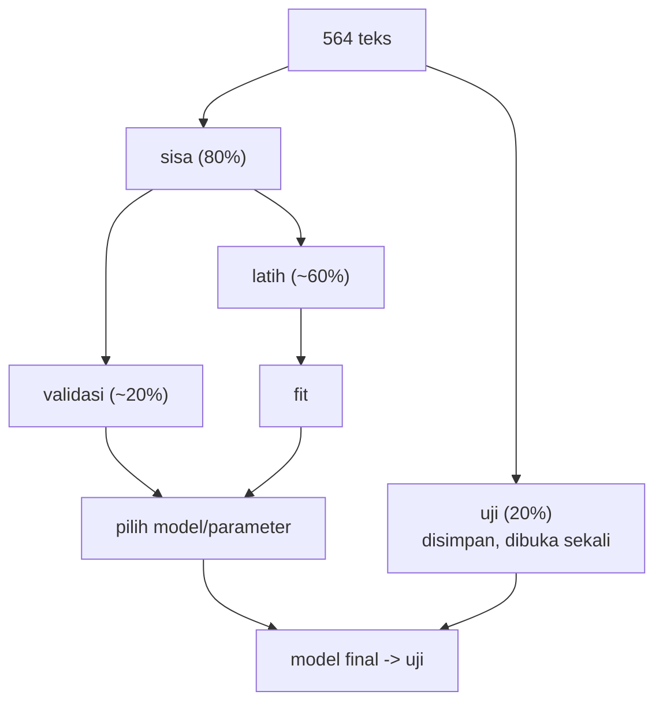

# Pembagian Data: Latih, Validasi, Uji, Stratified, Kelompok, dan Random Seed

!!! abstract "Info materi"
    **Tingkat kesulitan:** Menengah. **Estimasi waktu:** 90 menit.
    **Jenis kode:** **eksperimen** kecil (`examples/level-4-classification/02_pembagian_data.py`) dan fungsi siap pakai (`bagi_latih_uji`, `bagi_latih_val_uji` di `examples/nlp_hub/data.py`).

## Tujuan pembelajaran

- [ ] Menjelaskan fungsi data latih, validasi, dan uji, serta mengapa mengevaluasi pada data latih menyesatkan.
- [ ] Menjelaskan `test_size`, `random_state`, dan `stratify`.
- [ ] Menjelaskan kapan pembagian berkelompok diperlukan.
- [ ] Mengukur seberapa besar skor berubah hanya karena seed pembagian.

## Prasyarat

- [Supervised Learning, X, y](supervised-learning-xy.md).
- [Data Leakage akibat Preprocessing](../level-2-fondasi-teks/leakage-preprocessing.md).

## Pengantar dan motivasi

Bayangkan seorang murid yang berlatih dengan soal-soal tahun lalu, lalu diuji dengan
**soal yang sama persis**. Nilainya tinggi tetapi tidak membuktikan ia menguasai
materi. Model yang diuji pada data yang sama dengan data latih tidak berbeda:
ia bisa saja hanya menghafal. Karena itu data dibagi, dan sebagian disimpan
sebagai "soal ujian" yang tidak pernah dilihat saat berlatih.

## Konsep dasar

| Bagian | Kegunaan | Kapan dipakai |
|---|---|---|
| **Latih** (*train*) | Model belajar | Setiap `fit` |
| **Validasi** (*validation*) | Memilih model, hiperparameter, dan preprocessing | Berkali-kali selama pengembangan |
| **Uji** (*test*) | Perkiraan akhir performa pada data baru | **Sekali**, di akhir |

Pada proyek ini: ± 60% latih, 20% validasi, 20% uji.

**Mengapa validasi dan uji dipisah?** Setiap kali kita memilih sesuatu berdasarkan
skor validasi, kita sedikit "menyesuaikan diri" dengan validasi. Data uji yang
tidak pernah dipakai memilih tetap bersih.

### Parameter penting `train_test_split`

- `test_size`: proporsi (atau jumlah) data uji, mis. `0.2` = 20%.
- `random_state`: seed pengacak. Dengan seed yang sama, pembagian sama persis (reproduksibel).
- `stratify=y`: menjaga proporsi kelas di setiap bagian sama dengan data asli.

## Penjelasan mendalam

### Stratifikasi

Tanpa stratifikasi, pengacakan dapat menghasilkan bagian uji dengan proporsi
kelas yang jauh berbeda, terutama pada data kecil atau kelas minoritas. Pada
tugas dengan Emergency yang jarang, bagian uji tanpa cukup contoh Emergency
membuat recall sangat tidak stabil. Bagian 2 mengukurnya.

### Pembagian berkelompok

Jika beberapa baris saling terkait (postingan satu kejadian, teks yang sama
diulang), pembagian acak menaruhnya di sisi berbeda dan mempercepat model
"mengenali" kejadian itu. Solusinya pembagian **berkelompok**: semua baris satu kelompok
masuk ke sisi yang sama. Paket ini memakai `StratifiedGroupKFold` dengan `event_id`
sebagai kelompok: menjaga proporsi kelas sambil tidak memecah kejadian.

### Seed dan reproduksibilitas

`random_state` membuat hasil dapat diulang. Namun seed **bukan** pengaman kualitas: seed
berbeda memberi pembagian berbeda dan skor berbeda. Satu seed menghasilkan satu
angka; untuk mengetahui seberapa besar variasinya kita jalankan banyak seed (Bagian 4).

### Preprocessing yang mempelajari statistik data

TF-IDF, seleksi fitur, dan penskalaan harus dipelajari hanya dari data latih. Cara aman:
bagi dahulu, lalu bungkus semuanya dalam `Pipeline` ([Pipeline](pipeline-sklearn.md)).

## Cara kerja atau alur proses



## Contoh sederhana

Sepuluh teks, 3 Emergency. Tanpa stratifikasi, pembagian uji 2 dari 10 bisa berisi 0 Emergency
(tidak dapat mengukur recall) atau 2 Emergency (kelebihan). Dengan stratifikasi,
bagian uji berisi sekitar 0 atau 1 sesuai proporsi, dengan variasi jauh lebih kecil.

## Contoh dalam konteks Twitter/X kebencanaan

Satu kejadian banjir (misalnya `E012`) menghasilkan enam postingan. Jika tiga
postingan masuk latih dan tiga masuk uji, model bisa mengenali "kejadian E012" lewat nama jalan
dan kata kunci yang sama, lalu tampak benar pada uji. Pembagian per kejadian mencegahnya.

## Praktik Python

Berkas: `examples/level-4-classification/02_pembagian_data.py`.

### Bagian 1 — Pembagian tiga arah per kejadian

```python title="Bagian 1"
--8<-- "level-4-classification/02_pembagian_data.py:tiga_arah"
```

`bagi_latih_val_uji` memisahkan uji (≈20%) lebih dulu, lalu membagi sisanya menjadi latih dan validasi. Baris terakhir menghitung irisan `event_id` antar-pasangan bagian.

```text title="Output nyata"
latih     baris=335  Emergency=113 (33.7%)  kejadian=48
validasi  baris=117  Emergency= 40 (34.2%)  kejadian=17
uji       baris=112  Emergency= 38 (33.9%)  kejadian=15
kejadian tumpang tindih: 0
```

Interpretasi: 335 / 117 / 112 baris (sekitar 59% / 21% / 20%) dengan proporsi Emergency
hampir sama di tiap bagian (33,7%, 34,2%, 33,9%) dan tanpa tumpang tindih kejadian.
Jumlah kejadian di uji hanya 15 dan di validasi 17: bagian kecil menghasilkan skor yang
tidak stabil.

### Bagian 2 — Efek `stratify`

```python title="Bagian 2"
--8<-- "level-4-classification/02_pembagian_data.py:stratifikasi"
```

Dilakukan 200 kali `train_test_split` dengan seed berbeda (`test_size=0.1`), dengan dan tanpa `stratify`, lalu dicatat proporsi Emergency di bagian uji.

```text title="Output nyata"
proporsi Emergency seluruh data: 0.339
tanpa stratify : min=0.158  maks=0.509
dengan stratify: min=0.333  maks=0.333
```

Interpretasi: tanpa stratifikasi, proporsi Emergency di bagian uji bervariasi dari
15,8% sampai 50,9% pada 200 pengacakan. Dengan stratifikasi, selalu 33,3%, nyaris sama
dengan 33,9% data asli. Stratifikasi menghilangkan sumber variasi yang tidak perlu.

### Bagian 3 — Pembagian acak vs kelompok

```python title="Bagian 3"
--8<-- "level-4-classification/02_pembagian_data.py:kelompok"
```

```text title="Output nyata"
pembagian acak: 100.0% teks uji berasal dari kejadian yang juga ada di data latih
pembagian kelompok: 0.0%
```

Interpretasi: pada pembagian acak, **setiap** teks uji berasal dari kejadian yang juga
ada di latih (karena satu kejadian punya banyak postingan). Pada pembagian kelompok,
tidak ada. Pada data nyata, risiko ini sama: banyak postingan dari kejadian yang sama.

### Bagian 4 — Seberapa jauh skor berubah karena seed?

```python title="Bagian 4"
--8<-- "level-4-classification/02_pembagian_data.py:seed"
```

Untuk tiap seed 0–9, data dibagi per kejadian, satu model (TF-IDF + Logistic Regression) dilatih, dan F1 makro dihitung pada bagian uji.

```text title="Output nyata"
F1 makro tiap seed: [0.979, 0.98, 0.99, 1.0, 0.99, 0.969, 0.979, 0.99, 1.0, 0.99]
rata-rata=0.987  std=0.009  min=0.969  maks=1.000
```

Interpretasi: pada dataset ini F1 makro berkisar antara 0,969 dan 1,000 hanya karena seed
pembagian, dengan simpangan baku 0,009. Selisih antar-model yang lebih kecil dari
itu (misalnya 0,005) tidak boleh dianggap bermakna jika dibandingkan pada satu pembagian
saja. Skor sempurna (1,000) pada dua seed adalah **peringatan**, bukan prestasi:
data ini terlalu mudah (bertemplat), seperti dibahas sebelumnya.

### Skrip terpadu

Fungsi `bagi_latih_val_uji` dan `bagi_latih_uji` di `nlp_hub/data.py` adalah versi siap
pakai; tes: `test_pembagian_tiga_arah_tidak_beririsan_dan_lengkap`,
`test_pembagian_tiga_arah_deterministik`, `test_pembagian_tidak_membocorkan_kejadian`.

## Kesalahan umum dan debugging

| Gejala | Penyebab | Perbaikan |
|---|---|---|
| Skor uji dipakai berulang untuk memilih model | Data uji "bocor" lewat pemilihan | Pilih dengan validasi; uji hanya sekali |
| Bagian uji tidak punya kelas minoritas | Tanpa `stratify` pada data kecil | `stratify=y` |
| `ValueError: The least populated class in y has only 1 member` | `stratify` pada kelas yang terlalu kecil | Kurangi jumlah lipatan atau gabungkan kelas |
| Teks sama di latih dan uji | Duplikat tidak dibuang | Buang duplikat sebelum membagi |
| Hasil tidak bisa diulang | Tidak menetapkan `random_state` | Tetapkan dan catat seed |
| Satu seed dianggap representatif | Mengabaikan variasi | Ulangi dengan beberapa seed |

## Kelebihan dan keterbatasan

**Pembagian tiga arah:** jelas dan murah; tetapi pada data kecil bagian validasi dan uji
menjadi sangat kecil sehingga skornya tidak stabil (di sini hanya 15–17 kejadian).
Validasi silang (halaman [Tuning dan Cross-validation](tuning-cross-validation.md)) memakai data lebih efisien.
**Pembagian berkelompok:** mencegah kebocoran antar-kelompok; membutuhkan definisi kelompok
(tidak selalu tersedia), dan tidak menutup kemiripan antar-templat (lihat Level 2).

## Latihan bertahap

1. **Konseptual.** Mengapa model tidak boleh dievaluasi pada data latih saja?
2. **Membaca output.** Berapa persen data (kira-kira) yang menjadi data uji pada Bagian 1?
3. **Membaca kode.** Apa fungsi `stratify=y` pada `train_test_split`?
4. **Debugging.** Seorang pembaca mengubah `random_state` sampai skor uji terbaik. Mengapa itu salah?
5. **Mini-proyek.** Ubah Bagian 4 menjadi seed 0–29 dan laporkan rata-rata, simpangan baku, dan rentang.

## Kunci jawaban dan pembahasan

??? success "Jawaban 1"
    Model dapat menghafal data latih, sehingga skor di sana tinggi walau gagal pada data baru. Data uji yang tidak dipakai saat berlatih memperkirakan performa pada data baru.

??? success "Jawaban 2"
    112 dari 564 ≈ 19,9% (sekitar 20%).

??? success "Jawaban 3"
    Menjaga proporsi kelas pada bagian latih dan uji sama dengan proporsi `y` asli (di sini ≈ 33,9% Emergency), sehingga bagian uji tidak kebetulan kekurangan atau kelebihan kelas minoritas.

??? success "Jawaban 4"
    Memilih seed berdasarkan skor uji adalah memilih pembagian yang kebetulan menguntungkan; skor itu tidak lagi memperkirakan performa nyata (data uji dipakai untuk memilih). Seed harus ditetapkan sebelumnya dan variasinya dilaporkan.

??? success "Jawaban 5"
    Tidak ada angka tunggal untuk dijawab di sini; jalankan sendiri dengan `range(30)`. Harapan: rata-rata dekat 0,987, simpangan baku dekat 0,009; rentangnya bisa sedikit lebih lebar dengan lebih banyak seed. Laporkan ketiganya, bukan satu angka terbaik.

## Kuis singkat

**1.** Apa fungsi data validasi?

??? success "Jawaban"
    Memilih model dan hiperparameter tanpa menyentuh data uji.

**2.** Mengapa pembagian acak berbahaya pada data kejadian?

??? success "Jawaban"
    Postingan satu kejadian terpecah ke latih dan uji, sehingga model mengenali kejadian itu dan skor terlalu bagus.

**3.** Berapa kali data uji sebaiknya dipakai untuk menilai model akhir?

??? success "Jawaban"
    Sekali, setelah model dan parameter ditetapkan.

## Ringkasan

- Latih untuk belajar, validasi untuk memilih, uji sekali untuk laporan akhir.
- `stratify` menjaga proporsi kelas (0,333 tetap vs 0,158–0,509 tanpa stratify).
- Pembagian berkelompok per kejadian: 0% teks uji dari kejadian yang ada di latih (acak: 100%).
- Seed saja menggeser F1 makro dari 0,969 sampai 1,000; laporkan variasi.

## Glosarium istilah baru

Data latih / validasi / uji
:   Tiga bagian data dengan fungsi belajar, memilih, dan menilai akhir.

Stratifikasi
:   Menjaga proporsi kelas yang sama pada setiap bagian data.

Pembagian berkelompok
:   Pembagian yang tidak memecah baris dari kelompok yang sama.

`random_state` (seed)
:   Nilai awal pengacak agar hasil dapat diulang.

Reproduksibilitas
:   Kemampuan mengulang eksperimen dan mendapat hasil yang sama.

## Referensi

- Dokumentasi scikit-learn, `train_test_split`: <https://scikit-learn.org/stable/modules/generated/sklearn.model_selection.train_test_split.html> (dokumentasi resmi).
- Dokumentasi scikit-learn, *Cross-validation: evaluating estimator performance*: <https://scikit-learn.org/stable/modules/cross_validation.html> (dokumentasi resmi; memuat penjelasan pembagian berkelompok dan stratifikasi).

## Materi berikutnya

[Pipeline scikit-learn](pipeline-sklearn.md)
