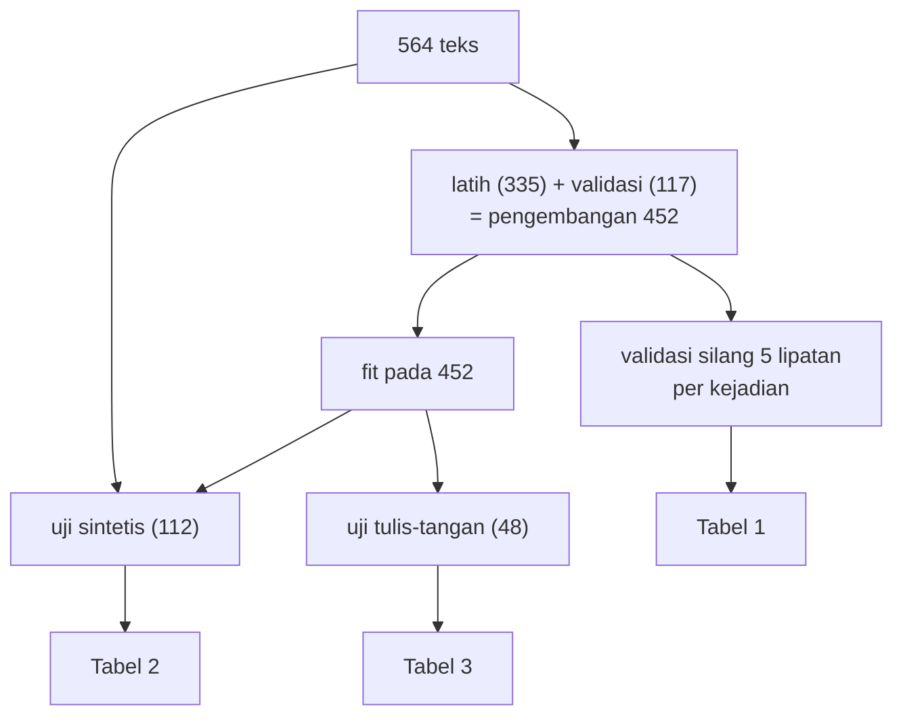

# Perbandingan Algoritma dan Eksperimen yang Adil

!!! abstract "Info materi"
    **Tingkat kesulitan:** Menengah–lanjut. **Estimasi waktu:** 150 menit.
    **Jenis kode:** **eksperimen** (`examples/level-4-classification/07_perbandingan_model.py`). Seluruh angka berasal dari eksekusi nyata (scikit-learn 1.9.1, seed 42) pada dataset **sintetis**. Ini adalah tabel perbandingan Tahap E–F proyek utama.

## Tujuan pembelajaran

- [ ] Menyusun eksperimen yang adil untuk membandingkan beberapa algoritma.
- [ ] Menyertakan baseline sederhana dan menafsirkan perbandingan terhadapnya.
- [ ] Membaca tabel metrik per kelas (presisi, recall, F1) dan hitungan TN/FP/FN/TP.
- [ ] Menjelaskan mengapa peringkat model dapat berubah antara validasi silang, uji sintetis, dan uji tulis-tangan.
- [ ] Menarik kesimpulan yang sesuai dengan bukti, tanpa menyebut satu model "terbaik" secara mutlak.

## Prasyarat

- [Naive Bayes](naive-bayes.md), [Logistic Regression](logistic-regression.md), [Linear SVM](linear-svm.md).
- [Pembagian Data](pembagian-data.md) dan [Pipeline](pipeline-sklearn.md).

## Pengantar dan motivasi

Spesifikasi proyek meminta: "Gunakan TF-IDF sebagai representasi fitur awal dan
ketiga algoritma tersebut sebagai baseline utama. Pemilihan model terbaik harus
didasarkan pada eksperimen, bukan asumsi." Halaman ini menjalankan eksperimen
itu. Prinsipnya: **ubah satu hal saja (algoritma), jaga semuanya sama.**

## Konsep dasar

### Syarat eksperimen yang adil

| Hal | Perlakuan |
|---|---|
| Data | Sama: 564 teks sintetis (duplikat dibuang) |
| Pembagian | Sama: pembagian per `event_id`; seed 42 |
| Preprocessing | Sama: konfigurasi dasar Level 2 |
| Representasi | Sama: TF-IDF unigram |
| Parameter model | Bawaan yang masuk akal; belum di-tuning (tuning di halaman berikutnya) |
| Metrik | Sama: akurasi, presisi/recall/F1 Emergency, F1 makro |
| Model | Dibuat baru tiap lipatan; tanpa informasi bocor |
| Pembanding | Dua baseline tanpa pembelajaran |

### Metrik yang dilaporkan (definisi singkat)

Dengan Emergency sebagai kelas positif:

- **TP** (benar-positif): Emergency yang diprediksi Emergency. **FP**: Non-Emergency yang diprediksi Emergency. **FN**: Emergency yang diprediksi Non-Emergency (pesan darurat terlewat). **TN**: Non-Emergency yang diprediksi Non-Emergency.
- **Presisi** $= \dfrac{TP}{TP+FP}$: dari yang diprediksi Emergency, berapa yang benar.
- **Recall** $= \dfrac{TP}{TP+FN}$: dari Emergency sebenarnya, berapa yang ditemukan.
- **F1** $= \dfrac{2 \cdot \text{presisi} \cdot \text{recall}}{\text{presisi} + \text{recall}}$: rata-rata harmonik keduanya.
- **F1 makro**: rata-rata F1 kedua kelas.

Pembahasan lengkap ada di [Level 5](../level-5-evaluasi/index.md); di sini cukup untuk membaca tabel.

### Baseline

1. **Selalu Non-Emergency** (kelas mayoritas): tidak menemukan satu pun Emergency; menunjukkan skor yang dapat dicapai tanpa belajar.
2. **Kata kunci "tolong"**: aturan yang menganggap Emergency bila ada kata `tolong`. Menguji gagasan bahwa kata kunci cukup. Definisi proyek menyatakan bahwa kata kunci bukan definisi label.

## Penjelasan mendalam

### Tiga tahap evaluasi

1. **Validasi silang 5 lipatan** pada 452 teks pengembangan (latih + validasi), per kejadian: rata-rata ± simpangan baku.
2. **Uji sintetis** (112 teks, 38 Emergency): model dilatih pada 452 teks, diuji sekali.
3. **Uji tulis-tangan** (48 teks, 24 Emergency): data bergaya lain, tidak ikut pelatihan.

### Kesalahan dan biayanya

False negative (Emergency terlewat) dan false positive (Non-Emergency ditandai Emergency)
tidak setara biayanya. FN berarti pesan yang mungkin mendesak tidak ditinjau; FP
menghabiskan sumber daya peninjauan. Karena itu tabel melaporkan jumlah FN dan FP,
bukan hanya skor ringkas.

## Cara kerja atau alur proses



## Contoh sederhana

Bila dua murid mengerjakan soal ujian berbeda tingkat kesulitannya, nilai mereka
tidak dapat dibandingkan. Eksperimen yang adil memberi soal yang sama pada semua.

## Contoh dalam konteks Twitter/X kebencanaan

Pertanyaan yang dijawab: *dari tiga algoritma baseline, mana yang paling sedikit
melewatkan pesan Emergency pada teks yang dilatih dan pada teks bergaya baru, dan berapa
banyak pesan yang salah ditandai?*

## Praktik Python

Berkas: `examples/level-4-classification/07_perbandingan_model.py`.

### Bagian 1 — Kandidat

```python title="Bagian 1"
--8<-- "level-4-classification/07_perbandingan_model.py:kandidat"
```

- `BaselineKataKunci` adalah estimator buatan sendiri: mewarisi `BaseEstimator` dan `ClassifierMixin`, punya `fit` (tidak belajar apa pun) dan `predict` (kata kunci).
- `KANDIDAT` adalah kamus nama → fungsi pembuat model. `lambda:` memastikan model **baru** setiap dipanggil.
- Tiga algoritma memakai `buat_pipeline` yang sama (praproses → TF-IDF → model).

### Bagian 2 — Validasi silang

```python title="Bagian 2"
--8<-- "level-4-classification/07_perbandingan_model.py:cv"
```

`cv_dev` membagi 452 teks pengembangan per kejadian menjadi 5 lipatan, melatih model baru pada tiap lipatan, dan mengumpulkan metrik. `t[k].std(ddof=0)` adalah simpangan baku populasi dari lima lipatan.

```text title="Output nyata"
scikit-learn 1.9.1 | seed 42 | pengembangan: 452 teks | validasi silang 5 lipatan per kejadian
                                      akurasi      presisi_e       recall_e           f1_e       f1_makro
Baseline: selalu Non-Emergency  0.661 ± 0.012  0.000 ± 0.000  0.000 ± 0.000  0.000 ± 0.000  0.398 ± 0.004
Baseline: kata kunci 'tolong'   0.630 ± 0.029  0.363 ± 0.091  0.111 ± 0.018  0.170 ± 0.031  0.466 ± 0.026
Multinomial NB                  0.984 ± 0.009  0.963 ± 0.023  0.994 ± 0.012  0.978 ± 0.013  0.983 ± 0.010
Logistic Regression             0.978 ± 0.012  0.994 ± 0.013  0.941 ± 0.039  0.966 ± 0.020  0.975 ± 0.014
Linear SVM                      0.996 ± 0.005  0.994 ± 0.012  0.994 ± 0.012  0.994 ± 0.008  0.995 ± 0.006
```

Interpretasi:

- **Baseline "selalu Non-Emergency"** mencapai akurasi 0,661 tanpa menemukan satu Emergency pun (recall 0). Ini alasan akurasi saja menyesatkan pada kelas tidak seimbang.
- **Baseline kata kunci `tolong`** hanya mencapai recall 0,111 dan akurasi 0,630, **lebih rendah** daripada selalu menjawab Non-Emergency. Pada dataset ini, `tolong` hadir di banyak teks Non-Emergency (pancingan) dan tidak hadir di sebagian besar laporan. Kata kunci bukan definisi label.
- Ketiga model terlatih jauh di atas baseline: F1 makro 0,975–0,995.
- **Urutan SVM > NB > LR** pada F1 makro; selisih SVM-NB (0,012) mendekati simpangan baku antar lipatan, jadi perlu bukti tambahan (Bagian 4).

### Bagian 3 — Uji akhir: sintetis dan tulis-tangan

```python title="Bagian 3"
--8<-- "level-4-classification/07_perbandingan_model.py:akhir"
```

`uji_akhir` melatih model pada seluruh 452 teks pengembangan, memprediksi data yang diberikan, lalu menghitung metrik dan `confusion_matrix(...).ravel()` yang menghasilkan TN, FP, FN, TP.

```text title="Output nyata"

UJI sintetis (112 teks, 38 Emergency), model dilatih pada 452 teks:
                                akurasi  presisi_e  recall_e   f1_e  f1_makro  TN  FP  FN  TP
Baseline: selalu Non-Emergency    0.661      0.000     0.000  0.000     0.398  74   0  38   0
Baseline: kata kunci 'tolong'     0.705      0.692     0.237  0.353     0.581  70   4  29   9
Multinomial NB                    0.973      0.949     0.974  0.961     0.970  72   2   1  37
Logistic Regression               0.982      1.000     0.947  0.973     0.980  74   0   2  36
Linear SVM                        0.982      0.950     1.000  0.974     0.980  72   2   0  38

TULIS-TANGAN (48 teks, 24 Emergency):
                                akurasi  presisi_e  recall_e   f1_e  f1_makro  TN  FP  FN  TP
Baseline: selalu Non-Emergency    0.500      0.000     0.000  0.000     0.333  24   0  24   0
Baseline: kata kunci 'tolong'     0.521      0.571     0.167  0.258     0.452  21   3  20   4
Multinomial NB                    0.917      1.000     0.833  0.909     0.916  24   0   4  20
Logistic Regression               0.708      1.000     0.417  0.588     0.681  24   0  14  10
Linear SVM                        0.812      1.000     0.625  0.769     0.806  24   0   9  15
```

Interpretasi **uji sintetis** (112 teks): ketiga model hampir tidak dapat dibedakan. F1 makro
0,970 (NB), 0,980 (LR), 0,980 (SVM). FN: NB 1, LR 2, SVM 0. FP: NB 2, LR 0, SVM 2. Perbedaannya
hanya satu atau dua teks.

Interpretasi **uji tulis-tangan** (48 teks): gambarannya berubah drastis.

- **Multinomial NB**: recall 0,833 (20 dari 24 Emergency ditemukan, 4 terlewat), presisi 1,0, F1 makro 0,916.
- **Linear SVM**: recall 0,625 (15 dari 24, **9 terlewat**), F1 makro 0,806.
- **Logistic Regression**: recall 0,417 (10 dari 24, **14 terlewat**), F1 makro 0,681.
- Ketiganya tidak membuat FP (presisi 1,0): tidak ada teks Non-Emergency yang salah ditandai. Kegagalannya murni **pesan darurat terlewat**.
- Baseline kata kunci: 4 TP dan 3 FP; tidak berguna.

Peringkat pada tulis-tangan (NB > SVM > LR) **berbeda dari** peringkat validasi silang (SVM > NB > LR).

### Bagian 4 — Apakah peringkat validasi silang stabil?

```python title="Bagian 4"
--8<-- "level-4-classification/07_perbandingan_model.py:stabil"
```

Validasi silang diulang dengan lima seed pembagi berbeda (0–4); F1 makro rata-rata per seed dicetak.

```text title="Output nyata"

F1 makro validasi silang pada 5 seed pembagi berbeda:
Multinomial NB         0.981 0.981 0.983 0.985 0.986   rata-rata=0.983 std=0.002
Logistic Regression    0.980 0.972 0.980 0.980 0.975   rata-rata=0.978 std=0.003
Linear SVM             0.998 0.995 0.997 0.995 0.998   rata-rata=0.997 std=0.001
```

Interpretasi: pada validasi silang, urutan **SVM > NB ≳ LR** konsisten di kelima seed (SVM 0,995–0,998; NB
0,981–0,986; LR 0,972–0,980), dan selisih SVM–NB (≈ 0,014) jauh lebih besar daripada
variasi antar-seed (≤ 0,003). Selisih NB–LR (≈ 0,005) kecil; NB berada di atas atau sama dengan LR pada
kelima seed, tetapi pembagian-pembagian itu memakai data yang sama dan tidak saling bebas, sehingga
bukan bukti kuat.

Waktu melatih tiap model pada 452 teks (detik; berubah-ubah antar-eksekusi dan mesin):

```text title="Output nyata, waktu berubah-ubah"
WAKTU LATIH (detik): {'Multinomial NB': 0.009, 'Logistic Regression': 0.013, 'Linear SVM': 0.01}
```

Semua kurang dari 0,02 detik; waktu tidak membedakan pilihan pada data sekecil ini.

### Skrip terpadu

Seluruh bagian berada di satu berkas yang dapat dijalankan langsung (sekitar 3 detik).
Hasil disimpan ke `examples/level-4-classification/hasil/perbandingan_model_*.csv`.

### Apa yang boleh disimpulkan

1. **Ketiga algoritma jauh lebih baik daripada baseline**, termasuk "kata kunci tolong" yang bahkan lebih buruk daripada selalu menjawab Non-Emergency (akurasi).
2. **Pada data sintetis bertemplat, tidak ada algoritma yang unggul secara meyakinkan pada uji sintetis**; selisih hanya satu atau dua teks.
3. **Peringkat bergantung pada data yang dipakai mengevaluasi.** SVM terbaik pada validasi silang, NB terbaik pada tulis-tangan, LR terendah pada tulis-tangan. Kita tidak dapat menyebut satu model terbaik tanpa menyebut datanya.
4. **Semua model melewatkan sebagian pesan Emergency pada teks bergaya baru**: recall 0,417–0,833. Untuk tujuan operasional, ini tidak dapat diterima tanpa validasi lebih lanjut pada data nyata.
5. **Penyebab perbedaan peringkat belum diketahui.** Hipotesis yang dapat diuji (bukan kesimpulan): NB memakai probabilitas kata dan prior secara berbeda dari model diskriminatif, sehingga lebih mudah mengenali kata yang tersisa ketika sebagian besar kosakata asing (hanya 54–58% token tulis-tangan dikenali; Level 3). Pengujian hipotesis memerlukan eksperimen terpisah.
6. Keterbatasan: 48 teks tulis-tangan dilabeli satu orang yang juga menulis data sintetis; satu seed untuk model akhir; tidak ada uji signifikansi.

## Kesalahan umum dan debugging

| Gejala | Penyebab | Perbaikan |
|---|---|---|
| Menyebut "model terbaik" dari satu tabel | Mengabaikan data evaluasi dan variasi | Laporkan beberapa evaluasi dan simpangan baku |
| Tidak ada baseline | Tidak tahu apakah model berguna | Selalu sertakan baseline sederhana |
| Model berbeda diuji dengan pembagian berbeda | Ketidakadilan | Pakai pembagian dan seed yang sama |
| Hanya akurasi dilaporkan | Kelas tidak seimbang | Laporkan presisi, recall, F1, dan hitungan FN/FP |
| Parameter satu model di-tuning, yang lain tidak | Perbandingan tidak adil | Tuning semua atau tidak sama sekali (halaman berikutnya) |
| Data uji dipakai berulang untuk memilih | Kebocoran seleksi | Pilih dengan validasi; uji sekali |

## Kelebihan dan keterbatasan

**Kelebihan:** transparan, dapat diulang, memuat baseline dan variasi, dan jujur tentang ketidakpastian.
**Keterbatasan:** dataset sintetis kecil dan bertemplat; satu representasi; parameter belum di-tuning;
tulis-tangan tidak independen dari perancang; tidak ada kesepakatan antaranotator; hasil tidak dapat
dipakai untuk menyatakan kelayakan operasional.

## Latihan bertahap

1. **Konseptual.** Mengapa baseline "selalu Non-Emergency" tetap berguna padahal tidak menemukan Emergency?
2. **Membaca tabel.** Pada uji tulis-tangan, berapa pesan Emergency yang terlewat oleh Linear SVM?
3. **Menghitung.** Hitung presisi, recall, dan F1 Emergency dari TN/FP/FN/TP milik Logistic Regression pada uji sintetis (74, 0, 2, 36).
4. **Debugging.** Seorang pembaca menyimpulkan "NB terbaik" dari tabel tulis-tangan. Sebutkan tiga keberatan.
5. **Mini-proyek.** Tambahkan kandidat `buat_pipeline("lr", C=10)` ke `KANDIDAT` dan jalankan ulang. Apakah peringkat pada tulis-tangan berubah? Tulis kesimpulan jujur.

## Kunci jawaban dan pembahasan

??? success "Jawaban 1"
    Ia menunjukkan skor yang dapat dicapai tanpa belajar apa pun (akurasi 0,661). Model yang tidak jauh melampauinya (terutama pada recall Emergency) tidak berguna.

??? success "Jawaban 2"
    9 (FN = 9; TP = 15 dari 24; recall 15/24 = 0,625).

??? success "Jawaban 3"
    TP=36, FP=0, FN=2. Presisi $=36/36=1{,}000$. Recall $=36/38=0{,}947$. F1 $=2 \times 1{,}000 \times 0{,}947/(1{,}000+0{,}947)=0{,}973$. Sesuai tabel.

??? success "Jawaban 4"
    (1) Hanya 48 teks dan satu sumber label; satu teks menggeser recall 0,042. (2) Peringkat pada validasi silang berbeda (SVM terbaik); tidak ada alasan satu evaluasi lebih benar dari yang lain tanpa mengetahui kebutuhan nyata. (3) Parameter belum di-tuning dan satu seed; penulis data dan tulis-tangan sama, sehingga bias perancang mungkin ada.

??? success "Jawaban 5"
    Tidak dijawab dari halaman ini; jalankan sendiri. Hasil yang diketahui: dengan `C=1` (bawaan) LR menemukan 10 dari 24; bila `C=10` meningkatkan angka itu, laporkan bersama simpangan dan jelaskan bahwa ini bagian dari tuning yang harus dilakukan pada validasi, bukan pada tulis-tangan.

## Kuis singkat

**1.** Mengapa baseline kata kunci "tolong" lebih buruk daripada selalu menjawab Non-Emergency pada akurasi?

??? success "Jawaban"
    `tolong` banyak muncul di teks Non-Emergency (pancingan) dan jarang di laporan, sehingga aturan itu salah pada lebih banyak teks.

**2.** Mengapa melaporkan FN dan FP, bukan hanya F1?

??? success "Jawaban"
    Biaya FN dan FP berbeda; hitungan menunjukkan berapa pesan darurat yang terlewat dan berapa yang salah ditandai.

**3.** Bolehkah menyimpulkan satu model terbaik dari tabel ini?

??? success "Jawaban"
    Tidak; peringkat berubah antar-evaluasi dan datanya sintetis dan kecil.

## Ringkasan

- Eksperimen adil: data, pembagian, preprocessing, representasi, seed, dan metrik sama; ada baseline.
- Validasi silang: SVM 0,995, NB 0,983, LR 0,975 (F1 makro); baseline 0,398 dan 0,466.
- Uji sintetis: ketiganya hampir sama (0,970–0,980). Tulis-tangan: NB 0,916, SVM 0,806, LR 0,681 (F1 makro); recall 0,833 / 0,625 / 0,417.
- Peringkat berubah antar-evaluasi; semua model melewatkan sebagian pesan darurat pada gaya baru.

## Glosarium istilah baru

Baseline
:   Model atau aturan sederhana sebagai pembanding minimum.

Eksperimen yang adil
:   Perbandingan yang menjaga semua faktor sama kecuali satu yang diuji.

Confusion matrix
:   Tabel hitungan TP, FP, FN, TN.

Presisi / recall / F1
:   Ukuran ketepatan, kelengkapan, dan rata-rata harmonik keduanya untuk satu kelas.

Rata-rata harmonik
:   Rata-rata yang lebih dipengaruhi nilai kecil.

## Referensi

- Pang, B., Lee, L., & Vaithyanathan, S. (2002). Thumbs up? Sentiment classification using machine learning techniques. *Proceedings of EMNLP 2002*, 79–86. <https://aclanthology.org/W02-1011/> (makalah akademik; membandingkan Naive Bayes, maximum entropy, dan SVM pada satu data dengan protokol yang sama).
- Dokumentasi scikit-learn, *Metrics and scoring*: <https://scikit-learn.org/stable/modules/model_evaluation.html> (dokumentasi resmi).

## Materi berikutnya

[Hyperparameter, Tuning, dan Cross-validation](tuning-cross-validation.md)
