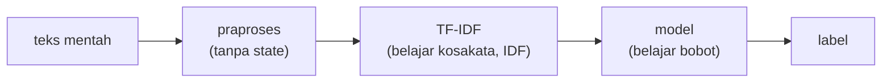

# Pipeline scikit-learn

!!! abstract "Info materi"
    **Tingkat kesulitan:** Menengah. **Estimasi waktu:** 75 menit.
    **Jenis kode:** snippet edukatif (`examples/level-4-classification/03_pipeline.py`) dan fungsi siap pakai `buat_pipeline` (`examples/nlp_hub/modeling.py`).

## Tujuan pembelajaran

- [ ] Menjelaskan apa itu `Pipeline` dan masalah yang diselesaikannya.
- [ ] Menulis pipeline preprocessing → TF-IDF → model.
- [ ] Membuktikan bahwa hasil pipeline sama dengan langkah manual.
- [ ] Mengintip hasil tengah pipeline dan mengubah parameter bersarang.

## Prasyarat

- [Pembagian Data](pembagian-data.md) dan [Representasi dengan scikit-learn](../level-3-representasi-teks/representasi-sklearn.md).
- Pemahaman `fit` dan `transform` (Level 3).

## Pengantar dan motivasi

Pada tahap manual, kita menjalankan tiga langkah dan harus selalu ingat memakai
`fit_transform` pada data latih dan hanya `transform` pada data uji. Satu kali
lupa, data uji ikut dipelajari (kebocoran). `Pipeline` membungkus langkah-langkah
itu dalam satu objek: `pipa.fit(X_latih, y_latih)` melatih semua langkah hanya dari data
latih, dan `pipa.predict(X_uji)` menjalankan semuanya dengan cara yang benar.

## Konsep dasar

| Istilah | Arti |
|---|---|
| **Estimator** | Objek dengan `fit` (belajar) |
| **Transformer** | Estimator dengan `transform` (mengubah data) |
| **Predictor** | Estimator dengan `predict` |
| **Pipeline** | Rangkaian transformer yang diakhiri satu predictor, dipakai sebagai satu estimator |

Aturan `Pipeline`: semua langkah **kecuali yang terakhir** harus transformer;
langkah terakhir boleh model (predictor).

## Penjelasan mendalam

### Apa yang terjadi pada `fit` dan `predict`

`pipa.fit(X, y)`:

1. Langkah 1 `fit_transform(X)`.
2. Keluarannya masuk ke langkah 2 `fit_transform`.
3. Keluaran langkah 2 masuk ke model yang di-`fit` bersama `y`.

`pipa.predict(X_baru)`: untuk tiap transformer **hanya `transform`** (memakai
yang sudah dipelajari), lalu `predict` pada model. Itulah yang membuat uji
tidak ikut dipelajari.

### Memberi nama langkah dan mengatur parameter

Tiap langkah diberi nama (`"praproses"`, `"tfidf"`, `"model"`). Parameter
langkah diakses dengan **nama langkah + dua garis bawah + nama parameter**:
`model__C`, `tfidf__ngram_range`. Konvensi ini dipakai oleh `GridSearchCV`
(halaman Tuning).

### `clone`

`clone(pipa)` membuat salinan dengan parameter sama tetapi **belum dilatih**.
Ini cara aman membuat model baru dengan konfigurasi sama untuk tiap lipatan validasi.

## Cara kerja atau alur proses



## Contoh sederhana

Tanpa `Pipeline`: tiga baris latih, tiga baris uji, dan kemungkinan lupa. Dengan `Pipeline`:
`pipa.fit(latih)` dan `pipa.predict(uji)`: dua baris, tidak ada yang terlupa.

## Contoh dalam konteks Twitter/X kebencanaan

Teks uji "Banjir setinggi pinggang di RT 08, tolong evakuasi" dijalankan melalui praproses
yang sama dengan teks latih, memakai kosakata TF-IDF yang dipelajari **hanya dari teks latih**, lalu
oleh model. Kata di teks uji yang tidak pernah dilihat saat latih diabaikan.

## Praktik Python

Berkas: `examples/level-4-classification/03_pipeline.py`. Bagian awal berkas memuat dan
membagi data per kejadian: `X_latih`, `y_latih`, `X_uji`, `y_uji`.

### Bagian 1 — Tiga langkah manual

```python title="Bagian 1"
--8<-- "level-4-classification/03_pipeline.py:manual"
```

- `praproses.fit_transform(X_latih)` mengembalikan teks bersih (tanpa state, jadi `fit` tidak belajar apa-apa).
- `tfidf.fit_transform(bersih)` **mempelajari** kosakata dan IDF dari data latih, dan menghasilkan matriks.
- `model.fit(matriks, y_latih)` melatih model.
- Pada uji, **hanya** `transform`: `tfidf.transform(uji_bersih)`.

```text title="Output nyata"
list 452 | (452, 582)
[0 0 0 0 1 0 0 1 0 1]
```

Interpretasi: 452 teks latih menjadi matriks 452 × 582 (582 kata di kosakata). Sepuluh
prediksi pertama pada data uji ditampilkan (0 = Non-Emergency, 1 = Emergency).

### Bagian 2 — Pipeline yang sama

```python title="Bagian 2"
--8<-- "level-4-classification/03_pipeline.py:pipeline"
```

`Pipeline([...])` menerima daftar pasangan (nama, objek). `pipa.fit(X_latih, y_latih)` menjalankan seluruh alur.

```text title="Output nyata"
[0 0 0 0 1 0 0 1 0 1]
sama dengan cara manual: True
```

Interpretasi: prediksi identik dengan cara manual. Pipeline bukan algoritma baru; hanya cara
merangkai langkah yang sama dengan lebih aman.

### Bagian 3 — Mengintip hasil tengah

```python title="Bagian 3"
--8<-- "level-4-classification/03_pipeline.py:intip"
```

`pipa.named_steps` adalah kamus nama → objek. `pipa[:-1]` mengambil semua langkah kecuali yang terakhir, sehingga `.transform(X_uji)` menghasilkan matriks fitur sebelum model.

```text title="Output nyata"
['praproses', 'tfidf', 'model']
matriks fitur uji: (112, 582) | ukuran kosakata dipelajari dari latih: 582
['00' '01' '02' '03' '04' '05']
```

Interpretasi: matriks fitur uji berukuran 112 × 582: 112 teks uji dengan kolom yang sama
dengan latih. Enam nama fitur pertama adalah `00`–`05`, yaitu angka yang berdiri
sendiri, bukti bahwa **tanpa normalisasi angka** token angka menjadi fitur. Mengintip hasil
tengah seperti ini adalah cara cepat menemukan keanehan preprocessing.

### Bagian 4 — Parameter bersarang dan `clone`

```python title="Bagian 4"
--8<-- "level-4-classification/03_pipeline.py:params"
```

```text title="Output nyata"
1.0 (1, 1)
10 (1, 2)
model asli tidak berubah: 1.0
salinan sudah dilatih?: False
```

Interpretasi: `get_params()` menampilkan `model__C=1.0` dan `tfidf__ngram_range=(1, 1)`.
Salinan (`clone` + `set_params`) memakai `C=10` dan bigram, sementara model asli tidak berubah.
Salinan **belum dilatih** (`vocabulary_` belum ada), sehingga siap dipakai pada lipatan baru.

### Skrip terpadu

`buat_pipeline(algoritma, ...)` di `examples/nlp_hub/modeling.py` membuat pipeline dengan urutan yang
sama untuk `"nb"`, `"lr"`, `"svm"`. Tes: `test_pipeline_dapat_dilatih_dan_memprediksi`,
`test_param_model_menimpa_bawaan`, `test_pipeline_baru_tiap_dipanggil`.

## Kesalahan umum dan debugging

| Gejala | Penyebab | Perbaikan |
|---|---|---|
| `TypeError: All intermediate steps should be transformers` | Langkah tengah tanpa `transform` | Hanya langkah terakhir boleh model |
| `ValueError: Invalid parameter 'C' for estimator Pipeline` | Lupa awalan langkah | Pakai `model__C`, bukan `C` |
| Memakai pipeline yang sudah dilatih untuk lipatan baru | State tertinggal | `clone` atau buat baru |
| Fitur uji tidak cocok dengan latih | `fit_transform` pada uji | Pakai pipeline; ia hanya `transform` |
| Lupa langkah praproses saat prediksi | Memakai model tanpa pipeline | Selalu simpan dan pakai pipeline utuh |

## Kelebihan dan keterbatasan

**Kelebihan:** mencegah kebocoran, kode ringkas, bisa disimpan sebagai satu objek, kompatibel dengan
`GridSearchCV` dan validasi silang.
**Keterbatasan:** langkah tengah harus transformer; error di dalam langkah kadang sulit dilacak
(mengintip hasil tengah membantu); pipeline tidak otomatis memperbaiki keputusan desain yang salah.

## Latihan bertahap

1. **Konseptual.** Mengapa `Pipeline` mencegah kebocoran data?
2. **Membaca kode.** Apa isi `pipa[:-1]`?
3. **Fill-in.** Tulis perintah untuk mengubah `alpha` model pada pipeline `nb` menjadi 0,5 (nama langkah `model`).
4. **Debugging.** `pipa.set_params(C=10)` menimbulkan galat. Mengapa dan bagaimana perbaikannya?
5. **Mini-proyek.** Buat pipeline dengan `TfidfVectorizer(min_df=2)` dan bandingkan ukuran kosakatanya dengan Bagian 3.

## Kunci jawaban dan pembahasan

??? success "Jawaban 1"
    `fit` pada pipeline hanya melihat data yang diberikan padanya (latih); transformer hanya `transform` pada data baru. Tidak ada kemungkinan "lupa" memakai `fit_transform` pada uji.

??? success "Jawaban 2"
    Semua langkah kecuali yang terakhir (praproses dan TF-IDF); sebagai transformer gabungan, ia menghasilkan matriks fitur.

??? success "Jawaban 3"
    `pipa.set_params(model__alpha=0.5)` (nama langkah, dua garis bawah, nama parameter).

??? success "Jawaban 4"
    `C` bukan parameter `Pipeline`, melainkan parameter langkah `model`. Perbaikan: `pipa.set_params(model__C=10)`.

??? success "Jawaban 5"
    Hasil yang dijalankan sebelumnya pada seluruh data: `min_df=2` mengurangi 592 menjadi 540 fitur. Pada data latih saja (452 teks) angkanya berbeda; jalankan sendiri dan bandingkan dengan 582. Pembahasan: `min_df` membuang kata yang hanya muncul sekali pada data latih.

## Kuis singkat

**1.** Apa yang dilakukan `pipa.predict` pada langkah TF-IDF?

??? success "Jawaban"
    Hanya `transform` dengan kosakata dan IDF yang dipelajari dari data latih.

**2.** Bagaimana cara menulis parameter `C` untuk langkah bernama `model`?

??? success "Jawaban"
    `model__C`.

**3.** Mengapa memakai `clone` untuk lipatan baru?

??? success "Jawaban"
    Agar mendapat estimator dengan parameter sama tetapi belum dilatih.

## Ringkasan

- `Pipeline` merangkai preprocessing, vektorizer, dan model dan menjamin `fit` hanya pada latih.
- Hasilnya identik dengan langkah manual yang benar.
- Parameter bersarang ditulis `langkah__parameter`; `clone` membuat salinan belum dilatih.
- Mengintip hasil tengah (`pipa[:-1]`) membantu menemukan keanehan seperti fitur angka mentah.

## Glosarium istilah baru

Pipeline
:   Rangkaian langkah transformasi dan model yang bekerja sebagai satu estimator.

Estimator, transformer, predictor
:   Objek scikit-learn dengan `fit`, `transform`, dan `predict`.

`clone`
:   Membuat salinan estimator yang belum dilatih.

Parameter bersarang
:   Parameter langkah dalam pipeline, ditulis `langkah__parameter`.

## Referensi

- Dokumentasi scikit-learn, *Pipelines and composite estimators*: <https://scikit-learn.org/stable/modules/compose.html> (dokumentasi resmi).
- Dokumentasi scikit-learn, *Common pitfalls and recommended practices* (bagian Data leakage): <https://scikit-learn.org/stable/common_pitfalls.html>.

## Materi berikutnya

[Multinomial Naive Bayes](naive-bayes.md)
