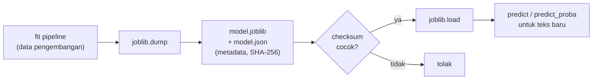

# Menyimpan Model (Serialization) dan Memprediksi Teks Baru

!!! abstract "Info materi"
    **Tingkat kesulitan:** Menengah. **Estimasi waktu:** 90 menit.
    **Jenis kode:** snippet edukatif (`examples/level-4-classification/09_serialisasi.py`). Model yang disimpan **tidak** ikut repository: folder `artefak/` ada di `.gitignore`.

## Tujuan pembelajaran

- [ ] Menyimpan dan memuat pipeline dengan `joblib`, dan memastikan prediksi identik.
- [ ] Menyimpan metadata (versi library, seed, versi model, checksum) bersama model.
- [ ] Memprediksi teks baru dan menafsirkan probabilitas serta skor keputusan dengan benar.
- [ ] Menjelaskan risiko keamanan memuat berkas serialisasi dan batas kompatibilitas versi.

## Prasyarat

- [Pipeline](pipeline-sklearn.md), [Logistic Regression](logistic-regression.md), [Linear SVM](linear-svm.md).

## Pengantar dan motivasi

Melatih model membutuhkan waktu; memakainya (inferensi) seharusnya tidak perlu melatih
ulang. Kita menyimpan model terlatih ke berkas lalu memuatnya di program lain, misalnya
aplikasi web di Level 7. Karena pipeline kita memuat preprocessing dan TF-IDF, **satu
berkas** menyimpan semua langkah itu, sehingga prediksi memakai persis preprocessing
yang sama dengan saat pelatihan.

## Konsep dasar

| Istilah | Arti |
|---|---|
| **Serialisasi** | Mengubah objek Python di memori menjadi berkas |
| **`joblib`** | Pustaka yang efisien untuk menyimpan objek scikit-learn dengan array besar |
| **Artefak** | Hasil percobaan yang disimpan: model, metadata, tabel hasil |
| **Metadata** | Informasi tentang model: versi, seed, data, checksum |
| **Checksum (SHA-256)** | Sidik jari berkas; berubah bila isi berkas berubah |

## Penjelasan mendalam

### Mengapa menyimpan pipeline utuh

Jika hanya bobot model yang disimpan, kita harus mengulang preprocessing dan TF-IDF
secara persis; salah sedikit menghasilkan fitur berbeda dan prediksi tanpa galat tetapi salah.
Menyimpan pipeline utuh menghindari itu.

### Keamanan

Berkas `joblib` (seperti `pickle`) dapat **menjalankan kode saat dimuat**. Memuat berkas model
dari sumber yang tidak dipercaya sama berbahayanya dengan menjalankan program asing.
Praktik:

- muat hanya berkas yang Anda buat atau berasal dari sumber tepercaya;
- simpan checksum dan periksa sebelum memuat (Bagian 2);
- jangan terima berkas model dari pengguna aplikasi;
- jangan menyimpan data pribadi di dalam artefak.

### Kompatibilitas versi

Model hanya dijamin dapat dimuat dengan versi scikit-learn yang **sama**. Karena itu metadata
mencatat versi library. Jangan memperbarui library dan berharap model lama tetap bekerja;
latih ulang bila versi berubah.

### Kode kustom harus tersedia saat memuat

Pipeline kita memuat kelas buatan sendiri (`PraprosesTeks` di `nlp_hub`). `joblib`
menyimpan **rujukan** ke kelas itu, bukan kodenya. Program pemuat harus dapat mengimpor
`nlp_hub` (Bagian 5).

### Probabilitas dan skor keputusan

- `LogisticRegression`: `predict_proba` memberi peluang model. Namun peluang belum tentu terkalibrasi.
- `LinearSVC`: hanya `decision_function`. **Jangan** menamai skor itu probabilitas.
- Ambang 0,5 dan 0 adalah bawaan, bukan ambang operasional. Ambang untuk penggunaan nyata
  harus dipilih lewat evaluasi dan validasi (Level 5), dan keputusan akhir tetap melibatkan manusia.

## Cara kerja atau alur proses



## Contoh sederhana

Latih pipeline, simpan sebagai `model.joblib`, buka program lain, muat, dan panggil
`predict(["air naik tolong"])`. Hasilnya sama dengan sebelum disimpan.

## Contoh dalam konteks Twitter/X kebencanaan

Empat teks sintetis baru diberikan: dua Emergency yang jelas, satu peringatan umum,
satu informasi lama. Perhatikan bahwa salah satu mendapat probabilitas hanya sedikit
di atas 0,5: kasus perbatasan yang seharusnya mendapat perhatian khusus, bukan keputusan otomatis.

## Praktik Python

Berkas: `examples/level-4-classification/09_serialisasi.py`.

### Bagian 1 — Menyimpan model dan metadata

```python title="Bagian 1"
--8<-- "level-4-classification/09_serialisasi.py:simpan"
```

- `joblib.dump(model, berkas)` menyimpan pipeline utuh.
- `hashlib.sha256(berkas.read_bytes()).hexdigest()` menghitung sidik jari berkas.
- `metadata` dicatat ke JSON; `ensure_ascii=False` menjaga huruf non-ASCII tetap terbaca.

```text title="Output nyata"
berkas model ada: True | ukuran > 10 KB: True
{'model_version': 'lr-tfidf-sintetis-0.1', 'scikit_learn': '1.9.1', 'seed': 42}
```

Interpretasi: model tersimpan (ukuran lebih dari 10 KB) dan metadata mencatat versi
scikit-learn 1.9.1 dan seed 42. Metadata juga menyatakan bahwa data **sintetis**.

### Bagian 2 — Memuat dan memverifikasi

```python title="Bagian 2"
--8<-- "level-4-classification/09_serialisasi.py:muat"
```

`assert` menghentikan program bila checksum tidak cocok. `np.allclose` membandingkan probabilitas dengan toleransi kecil.

```text title="Output nyata"
prediksi identik setelah dimuat: True
probabilitas identik: True
```

Interpretasi: model yang dimuat memprediksi persis sama dengan model asli pada 112 teks uji.

### Bagian 3 — Memprediksi teks baru (probabilitas)

```python title="Bagian 3"
--8<-- "level-4-classification/09_serialisasi.py:baru"
```

`predict_proba(baru)[:, 1]` mengambil peluang kelas 1 (Emergency). Ambang 0,5 hanya bawaan.

```text title="Output nyata"
P(Emergency)=0.753 -> Emergency     | Tolong, air sudah masuk rumah kami di Jl. Melati RT 04, ada 
P(Emergency)=0.093 -> Non-Emergency | Musim hujan sudah dekat, waspada banjir ya semuanya
P(Emergency)=0.544 -> Emergency     | gempa barusan kuat bgt, atap sekolah runtuh dan ada yg terti
P(Emergency)=0.069 -> Non-Emergency | Banjir kemarin sudah surut, terima kasih relawan
```

Interpretasi: empat prediksi sesuai definisi label. Namun teks ketiga ("gempa barusan ...
atap sekolah runtuh ...") hanya 0,544: model benar tetapi hampir tidak yakin. Pada teks tulis-tangan
bergaya mirip, model ini sering meleset (halaman *Perbandingan Model*). Skor di dekat 0,5 jangan
diperlakukan sebagai kepastian; sistem nyata memerlukan peninjauan manusia.

### Bagian 4 — Skor keputusan SVM

```python title="Bagian 4"
--8<-- "level-4-classification/09_serialisasi.py:svm_skor"
```

```text title="Output nyata"
skor keputusan=+0.801 -> Emergency     | Tolong, air sudah masuk rumah kami di Jl. Melati RT 04, ada 
skor keputusan=-0.951 -> Non-Emergency | Musim hujan sudah dekat, waspada banjir ya semuanya
skor keputusan=+0.432 -> Emergency     | gempa barusan kuat bgt, atap sekolah runtuh dan ada yg terti
skor keputusan=-1.680 -> Non-Emergency | Banjir kemarin sudah surut, terima kasih relawan
```

Interpretasi: tanda skor memberi label; besar skor memberi urutan "jauhnya dari batas". Skor `+0,432`
pada teks ketiga lebih dekat ke batas daripada `+0,801`. Ini **bukan probabilitas** dan tidak
boleh ditampilkan sebagai persen.

### Bagian 5 — Memuat tanpa paket `nlp_hub`

```python title="Bagian 5"
--8<-- "level-4-classification/09_serialisasi.py:tanpa_paket"
```

Program kecil dijalankan dengan `python -I` (mode terisolasi, tanpa folder `examples/` di jalur impor) dan mencoba memuat model.

```text title="Output nyata"
keluar: 1 | ModuleNotFoundError: No module named 'nlp_hub'
```

Interpretasi: pemuat harus punya paket `nlp_hub` yang sama dengan saat pelatihan. Pada aplikasi
nyata, paket ini harus diinstal (atau diikutkan dalam `PYTHONPATH`) dan versinya dicatat.

### Skrip terpadu

`09_serialisasi.py` membuat folder `artefak/` bila belum ada, menyimpan, memuat, dan memprediksi dalam
satu eksekusi (sekitar 2 detik). Folder itu tidak ikut git.

## Kesalahan umum dan debugging

| Gejala | Penyebab | Perbaikan |
|---|---|---|
| `ModuleNotFoundError: No module named 'nlp_hub'` | Pemuat tidak punya kode kelas kustom | Pasang paket yang sama |
| Peringatan versi saat `joblib.load` | Versi scikit-learn berbeda | Samakan versi, atau latih ulang |
| Memuat berkas dari sumber tak dikenal | Risiko eksekusi kode | Jangan; periksa checksum dan asal |
| Skor SVM ditampilkan sebagai persen | Salah tafsir | Namai `decision_score` |
| Model ikut ter-commit ke git | Folder artefak tidak diabaikan | Tambah ke `.gitignore` |
| Prediksi berbeda setelah dimuat | Preprocessing di luar pipeline | Simpan pipeline utuh |

## Kelebihan dan keterbatasan

**Kelebihan:** inferensi cepat tanpa melatih ulang; satu berkas membawa preprocessing; metadata
mendukung audit.
**Keterbatasan:** terikat versi library dan kode; tidak aman untuk berkas tak tepercaya;
`joblib` bukan format pertukaran lintas bahasa. Model baru berarti latihan baru; perubahan data
memerlukan versi model baru (Level 7: versioning).

## Latihan bertahap

1. **Konseptual.** Mengapa menyimpan pipeline utuh lebih baik daripada hanya menyimpan bobot model?
2. **Membaca output.** Pada Bagian 3, mana prediksi yang paling tidak yakin dan mengapa itu penting?
3. **Membaca kode.** Apa fungsi `assert sha_sekarang == ...`?
4. **Debugging.** Program pemuat menimbulkan `ModuleNotFoundError: No module named 'nlp_hub'`. Apa penyebab dan perbaikannya?
5. **Mini-proyek.** Tulis fungsi `prediksi_aman(model, teks)` yang menolak string kosong dengan `ValueError` dan mengembalikan label serta skor. Tulis satu tes.

## Kunci jawaban dan pembahasan

??? success "Jawaban 1"
    Pipeline membawa preprocessing dan TF-IDF yang dipelajari; menyimpan hanya bobot membuat kita harus mereproduksi langkah itu persis, dan kesalahan kecil menghasilkan prediksi keliru tanpa pesan galat.

??? success "Jawaban 2"
    Teks ketiga (P = 0,544). Prediksi di dekat ambang paling mungkin salah, dan pada sistem darurat paling layak diprioritaskan untuk ditinjau manusia.

??? success "Jawaban 3"
    Memeriksa bahwa checksum berkas yang akan dimuat sama dengan yang dicatat saat disimpan; bila berbeda, berkas berubah (rusak atau diganti) dan tidak boleh dimuat.

??? success "Jawaban 4"
    Model menyimpan rujukan ke kelas `nlp_hub.preprocessing.PraprosesTeks`, dan lingkungan pemuat tidak dapat mengimpor paket itu. Perbaikan: pasang paket yang sama (versi sama) atau tambahkan folder `examples/` ke jalur impor.

??? success "Jawaban 5"
    ```python
    def prediksi_aman(model, teks):
        if not isinstance(teks, str) or not teks.strip():
            raise ValueError("teks tidak boleh kosong")
        p = float(model.predict_proba([teks])[0, 1])
        return ("Emergency" if p >= 0.5 else "Non-Emergency"), p
    ```
    Tes: `with pytest.raises(ValueError): prediksi_aman(model, "   ")`. Pembahasan: validasi masukan di batas (API) mencegah galat membingungkan di dalam model; ini diperlukan pada Level 7.

## Kuis singkat

**1.** Mengapa memeriksa checksum sebelum `joblib.load`?

??? success "Jawaban"
    Berkas serialisasi dapat menjalankan kode saat dimuat; checksum memastikan berkas tidak berubah.

**2.** Apakah `decision_function` SVM adalah probabilitas?

??? success "Jawaban"
    Bukan; ia jarak bertanda terhadap hyperplane.

**3.** Mengapa metadata mencatat versi scikit-learn?

??? success "Jawaban"
    Model hanya dijamin dapat dimuat dengan versi library yang sama.

## Ringkasan

- Simpan pipeline utuh dengan `joblib`; catat metadata dan checksum; model tidak ikut git.
- Model dimuat memberi prediksi dan probabilitas identik.
- Probabilitas LR boleh disebut probabilitas model; skor SVM bukan. Ambang 0,5 hanya bawaan.
- Muat hanya berkas tepercaya; pemuat membutuhkan paket kode yang sama dan versi library yang sama.

## Glosarium istilah baru

Serialisasi
:   Menyimpan objek di memori menjadi berkas.

Artefak
:   Hasil eksperimen yang disimpan, seperti model dan metadata.

Checksum (SHA-256)
:   Sidik jari berkas untuk mendeteksi perubahan.

Inferensi
:   Memakai model terlatih untuk memprediksi data baru.

## Referensi

- Dokumentasi scikit-learn, *Model persistence* (termasuk peringatan keamanan dan versi): <https://scikit-learn.org/stable/model_persistence.html> (dokumentasi resmi).
- Dokumentasi Python, modul `hashlib`: <https://docs.python.org/3/library/hashlib.html> (dokumentasi resmi).

## Materi berikutnya

[Kesalahan Umum dalam Training](kesalahan-umum-training.md)
