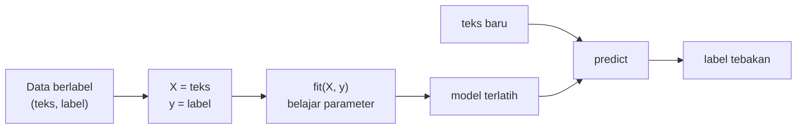

# Supervised Learning, Fitur X, Target y, dan Label Encoding

!!! abstract "Info materi"
    **Tingkat kesulitan:** Pemula–menengah. **Estimasi waktu:** 75 menit.
    **Jenis kode:** snippet edukatif (`examples/level-4-classification/01_supervised_xy.py`).

## Tujuan pembelajaran

- [ ] Menjelaskan *supervised learning* dan membedakannya dari *unsupervised*.
- [ ] Menentukan fitur `X` dan target `y` untuk klasifikasi Emergency / Non-Emergency.
- [ ] Mengkodekan label teks menjadi angka dan menjelaskan mengapa pilihan kode penting.
- [ ] Menghindari jebakan `LabelEncoder` dan `pos_label` pada metrik.

## Prasyarat

- [Level 3](../level-3-representasi-teks/index.md), terutama TF-IDF.
- [Istilah Dasar ML](../level-0-orientasi/istilah-dasar-ml.md) (Level 0): dataset, fitur, label, training, inference.

## Pengantar dan motivasi

Kita ingin komputer **belajar dari contoh yang sudah diberi jawaban**: ratusan
postingan yang sudah dilabeli Emergency atau Non-Emergency. Setelah belajar,
ia diharapkan menebak label postingan baru. Pendekatan ini disebut
*supervised learning* ("belajar dengan pengawasan", karena ada jawaban benar
yang menjadi pembimbing).

## Konsep dasar

| Istilah | Arti | Pada proyek ini |
|---|---|---|
| **Supervised learning** | Belajar pemetaan dari masukan ke label yang diketahui | Teks → Emergency / Non-Emergency |
| **Klasifikasi** | Supervised learning dengan label berupa kategori | Dua kelas (biner) |
| **Fitur `X`** | Masukan yang dipakai model | Teks (diubah menjadi TF-IDF) |
| **Target `y`** | Jawaban yang ingin ditebak | Label |
| **Pelatihan (*training*)** | Mencari parameter model dari `X` dan `y` | `model.fit(X, y)` |
| **Inferensi** | Memakai model untuk menebak data baru | `model.predict(X_baru)` |

*Unsupervised learning*, sebagai pembanding, tidak memakai label: misalnya
mengelompokkan teks yang mirip. Itu tidak dibahas di sini.

Konvensi notasi: huruf besar `X` karena umumnya matriks (banyak baris, banyak
fitur), huruf kecil `y` karena umumnya vektor (satu label per baris).

## Penjelasan mendalam

### Fitur dan target pada teks

Pada tugas ini `X` adalah **teks mentah** (satu baris per postingan), dan
`y` adalah labelnya. Pengubahan `X` menjadi angka (TF-IDF) dilakukan **di
dalam pipeline**, sehingga pada kode kita menyimpan `X` sebagai teks. Alasannya:
agar pengubahan itu dipelajari hanya dari data latih (halaman
[Pipeline](pipeline-sklearn.md)).

### Mengapa label harus dikodekan

Algoritma bekerja dengan angka. Pustaka scikit-learn dapat menerima label
teks pada banyak model, tetapi metrik dan banyak alat lain memerlukan
kesepakatan jelas tentang **kelas positif**. Pada proyek ini:

| Label | Kode |
|---|---|
| Non-Emergency | 0 |
| Emergency | 1 |

Kelas Emergency adalah **kelas positif** (1) karena itu yang ingin kita temukan,
sehingga "recall" berarti "berapa bagian pesan darurat yang berhasil ditemukan".

### Jebakan `LabelEncoder`

`sklearn.preprocessing.LabelEncoder` memberi kode **menurut urutan abjad**.
`Emergency` mendahului `Non-Emergency`, sehingga Emergency menjadi 0, kebalikan
dari yang kita inginkan. Metrik seperti `recall_score` secara bawaan menganggap
kelas `1` sebagai positif; dengan kode terbalik, metrik itu diam-diam menghitung
untuk Non-Emergency. Angkanya tampak wajar, tetapi menjawab pertanyaan yang salah.

Solusinya: tulis pemetaan **secara eksplisit** (paket ini memakai
`kodekan_label` di `nlp_hub/data.py`) dan beri `pos_label` secara
eksplisit pada metrik.

## Cara kerja atau alur proses



## Contoh sederhana

Tiga contoh berlabel: ("air naik tolong", 1), ("promo diskon", 0), ("rumah roboh", 1).
Model mencari pola: kata `tolong` dan `roboh` bersama label 1, kata `promo` dengan 0. Pada
teks baru "tolong rumah terendam", model menebak 1.

## Contoh dalam konteks Twitter/X kebencanaan

Teks sintetis: "Tolong, air sudah masuk ke rumah kami di Jl. Melati RT 08" → label
Emergency (1). "Webinar gratis tentang mitigasi banjir hari Sabtu" → Non-Emergency (0).
Ingat bahwa label berasal dari **definisi operasional**, bukan dari kata kunci
(lihat [Masalah Emergency](../level-0-orientasi/masalah-emergency.md)).

## Praktik Python

Berkas: `examples/level-4-classification/01_supervised_xy.py`.

### Bagian 1 — Memisahkan `X` dan `y`

```python title="Bagian 1"
--8<-- "level-4-classification/01_supervised_xy.py:xy"
```

`df["text"]` mengambil satu kolom sebagai `Series`. `iloc[0]` mengambil baris pertama menurut posisi. `unique()` menampilkan nilai label yang ada.

```text title="Output nyata"
Series (564,) | Series (564,)
Tips menghadapi banjir: kenali jalur evakuasi dan kumpulkan nomor darurat.
Non-Emergency
['Non-Emergency', 'Emergency']
```

Interpretasi: 564 teks dan 564 label (jumlahnya harus sama); label berisi dua nilai.
**Cara memeriksa:** `len(X) == len(y)` selalu harus benar sebelum `fit`.

### Bagian 2 — Pengodean eksplisit

```python title="Bagian 2"
--8<-- "level-4-classification/01_supervised_xy.py:manual"
```

`kodekan_label` memetakan `Non-Emergency` → 0 dan `Emergency` → 1 dan menolak label asing. `value_counts().sort_index()` menghitung per kode; `zip` memasangkan label dan kode agar bisa diperiksa mata.

```text title="Output nyata"
{0: 373, 1: 191}
[('Non-Emergency', 0), ('Non-Emergency', 0), ('Emergency', 1), ('Non-Emergency', 0)]
```

Interpretasi: 373 teks berkode 0 dan 191 berkode 1; pasangan label-kode benar.

### Bagian 3 — Jebakan `LabelEncoder`

```python title="Bagian 3"
--8<-- "level-4-classification/01_supervised_xy.py:labelencoder"
```

```text title="Output nyata"
['Emergency' 'Non-Emergency'] -> [0, 1]
Emergency dikodekan sebagai: 0
```

Interpretasi: `LabelEncoder` memberi kode menurut abjad, sehingga **Emergency = 0**.
Kode ini kebalikan dari kesepakatan proyek.

### Bagian 4 — Akibat pada metrik

```python title="Bagian 4"
--8<-- "level-4-classification/01_supervised_xy.py:jebakan"
```

Data buatan: 10 teks, 4 Emergency. Model hanya menemukan 1 dari 4. `recall_score(..., pos_label=1)` menghitung recall untuk kelas yang kita sebut.

```text title="Output nyata"
accuracy                          : 0.7
recall Emergency (pos_label=1)    : 0.25
recall kelas 0 (Non-Emergency)    : 1.0
recall 'default' pada kode terbalik: 1.0
```

Interpretasi: model ini menemukan hanya 25% pesan darurat, tetapi akurasi 0,7
terdengar lumayan. Bila Emergency dikodekan 0 dan pemanggil memakai `recall_score`
tanpa `pos_label`, hasilnya **1,0**, yaitu recall untuk Non-Emergency, seolah-olah model
sempurna. Kesalahan ini sunyi: tidak ada pesan galat.

### Bagian 5 — Mengembalikan kode ke label

```python title="Bagian 5"
--8<-- "level-4-classification/01_supervised_xy.py:inverse"
```

```text title="Output nyata"
['Emergency', 'Non-Emergency', 'Non-Emergency', 'Non-Emergency', 'Non-Emergency', 'Non-Emergency', 'Non-Emergency', 'Non-Emergency', 'Non-Emergency', 'Non-Emergency']
```

Interpretasi: kamus `KODE_KE_LABEL` mengubah tebakan angka menjadi teks untuk dibaca manusia.

### Skrip terpadu

Pengodean untuk seluruh proyek ada di `kodekan_label` (`examples/nlp_hub/data.py`) dan
diuji di `test_kodekan_label` dan `test_kodekan_label_menolak_label_asing`.

## Kesalahan umum dan debugging

| Gejala | Penyebab | Perbaikan |
|---|---|---|
| Recall tampak sangat tinggi tanpa alasan | Kelas positif tertukar | Tentukan `pos_label` eksplisit; periksa kode |
| `ValueError: Found input variables with inconsistent numbers of samples` | Jumlah `X` dan `y` berbeda | `len(X) == len(y)` |
| `KeyError: 'label'` | Nama kolom salah | Cetak `df.columns` |
| `y` berisi `NaN` | Label kosong | Periksa `y.isna().sum()` |
| Kode label berubah antar-eksperimen | Memakai `LabelEncoder` pada data berbeda | Pemetaan tetap yang ditulis eksplisit |

## Kelebihan dan keterbatasan

**Supervised learning:** kuat bila ada label berkualitas; hasilnya mudah diukur.
**Keterbatasan:** kualitas model dibatasi kualitas label; label dari definisi yang
tidak jelas atau anotator yang tidak sepakat menghasilkan model yang tidak
dapat dipercaya; label mahal untuk didapat.

## Latihan bertahap

1. **Konseptual.** Apa beda fitur `X` dan target `y`?
2. **Membaca output.** Berapa proporsi Emergency pada dataset (564 teks) menurut Bagian 2?
3. **Membaca kode.** Mengapa `kodekan_label` melempar `ValueError` untuk label asing seperti `"Darurat"`?
4. **Debugging.** Seseorang melaporkan recall 1,0 untuk model yang jelas buruk. Apa dua hal yang Anda periksa lebih dahulu?
5. **Mini-proyek.** Tulis fungsi `kembalikan_label(kode)` yang menerima array kode dan mengembalikan daftar label, lalu uji dengan `[1, 0, 1]`.

## Kunci jawaban dan pembahasan

??? success "Jawaban 1"
    `X` adalah masukan yang dipakai model untuk menebak (teks); `y` adalah jawaban yang ingin ditebak (label).

??? success "Jawaban 2"
    191 / 564 ≈ 33,9% Emergency (373 / 564 ≈ 66,1% Non-Emergency).

??? success "Jawaban 3"
    Label asing menandakan data atau definisi tidak sesuai kesepakatan. Gagal keras dengan pesan jelas lebih baik daripada mengubahnya diam-diam menjadi `NaN` yang kemudian merusak hasil.

??? success "Jawaban 4"
    Pertama, kelas positif: apakah `pos_label` mengarah ke Emergency dan bagaimana label dikodekan. Kedua, apakah metrik dihitung pada data latih (bukan uji) atau pada data yang bocor. Periksa juga confusion matrix, bukan hanya satu angka (Level 5).

??? success "Jawaban 5"
    ```python
    KODE_KE_LABEL = {0: "Non-Emergency", 1: "Emergency"}

    def kembalikan_label(kode):
        return [KODE_KE_LABEL[int(k)] for k in kode]

    print(kembalikan_label([1, 0, 1]))  # ['Emergency', 'Non-Emergency', 'Emergency']
    ```
    `int(k)` memastikan elemen NumPy dapat dipakai sebagai kunci kamus.

## Kuis singkat

**1.** Mengapa Emergency dikodekan 1?

??? success "Jawaban"
    Karena Emergency adalah kelas yang ingin kita temukan (kelas positif), dan metrik seperti recall secara bawaan menghitung untuk kelas 1.

**2.** Apa bahaya `LabelEncoder` pada label kita?

??? success "Jawaban"
    Ia mengkodekan menurut abjad sehingga Emergency menjadi 0, dan metrik tanpa `pos_label` dapat menghitung untuk kelas yang salah.

**3.** Mengapa `X` disimpan sebagai teks mentah, bukan matriks TF-IDF?

??? success "Jawaban"
    Agar TF-IDF dipelajari di dalam pipeline hanya dari data latih, mencegah kebocoran.

## Ringkasan

- Supervised learning: belajar dari pasangan (teks, label) lalu menebak label teks baru.
- `X` = teks, `y` = label; Emergency = 1 sebagai kelas positif.
- Tulis pemetaan label secara eksplisit; waspadai `LabelEncoder` dan `pos_label`.
- Pada dataset: 373 kelas 0 dan 191 kelas 1.

## Glosarium istilah baru

Supervised learning
:   Pembelajaran dari contoh berlabel.

Klasifikasi biner
:   Klasifikasi dengan dua kelas.

Kelas positif
:   Kelas yang ingin ditemukan; pada proyek ini Emergency (kode 1).

Label encoding
:   Mengubah label teks menjadi kode angka.

Inferensi
:   Memakai model terlatih untuk menebak data baru.

## Referensi

- Dokumentasi scikit-learn, *Supervised learning*: <https://scikit-learn.org/stable/supervised_learning.html> (dokumentasi resmi).
- Dokumentasi scikit-learn, `LabelEncoder`: <https://scikit-learn.org/stable/modules/generated/sklearn.preprocessing.LabelEncoder.html>.

## Materi berikutnya

[Pembagian Data: Latih, Validasi, Uji, Stratified, dan Seed](pembagian-data.md)
