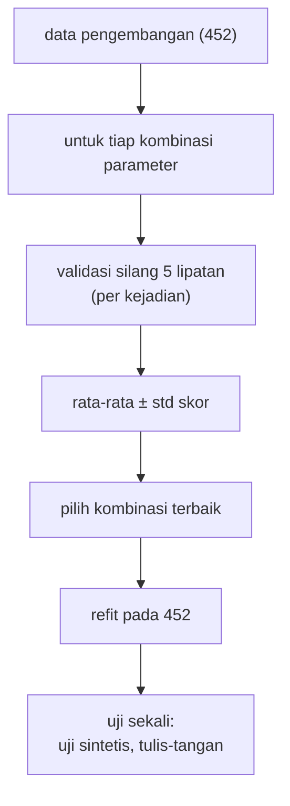

# Hyperparameter, Tuning, GridSearchCV, dan Cross-validation

!!! abstract "Info materi"
    **Tingkat kesulitan:** Menengah–lanjut. **Estimasi waktu:** 120 menit.
    **Jenis kode:** **eksperimen** (`examples/level-4-classification/08_tuning.py`). Angka dari eksekusi nyata (scikit-learn 1.9.1, seed 42) pada dataset sintetis.

## Tujuan pembelajaran

- [ ] Membedakan parameter (dipelajari model) dari hyperparameter (ditetapkan manusia).
- [ ] Menjelaskan validasi silang berkelompok dan membaca skor per lipatan.
- [ ] Memakai `GridSearchCV` dengan pipeline, pembagi berkelompok, dan banyak metrik.
- [ ] Mengenali bahwa skor terbaik hasil pencarian bersifat optimistis, dan mengapa uji harus terpisah.
- [ ] Memilih parameter dengan mempertimbangkan kesetaraan statistik dan kesederhanaan.

## Prasyarat

- [Perbandingan Model](perbandingan-model.md) dan [Pipeline](pipeline-sklearn.md) (parameter bersarang `langkah__parameter`).

## Pengantar dan motivasi

Setiap algoritma punya "tombol" yang harus kita putar sebelum belajar: `alpha`
pada Naive Bayes, `C` pada Logistic Regression dan SVM, `ngram_range` pada
TF-IDF. Tombol ini disebut **hyperparameter**. Mencoba satu per satu dan
mengamati skor uji adalah godaan yang membocorkan data uji. Cara yang benar:
mencoba banyak kombinasi memakai **validasi silang pada data pengembangan**,
memilih yang terbaik, lalu menguji **sekali** pada data uji.

## Konsep dasar

| Istilah | Arti | Contoh |
|---|---|---|
| **Parameter** | Nilai yang dipelajari model dari data | Bobot $w$ pada Logistic Regression |
| **Hyperparameter** | Pengaturan yang ditetapkan sebelum belajar | `C`, `alpha`, `ngram_range`, `min_df` |
| **Validasi silang** | Membagi data pengembangan menjadi *k* lipatan, bergantian satu lipatan jadi data uji | 5 lipatan |
| **Grid search** | Mencoba semua kombinasi nilai dari daftar yang diberikan | $2 \times 2 \times 3 = 12$ kombinasi |

## Penjelasan mendalam

### Validasi silang berkelompok

Pada $k$ lipatan, model dilatih $k$ kali, tiap kali dengan satu lipatan sebagai uji.
Skor dilaporkan sebagai rata-rata dan simpangan baku. Pada proyek ini kita memakai
`StratifiedGroupKFold`: proporsi kelas dijaga dan satu kejadian tidak terpecah. Lima
lipatan pada 452 teks menghasilkan lipatan uji berukuran ~90 teks dengan 11–14 kejadian.

### `GridSearchCV`

`GridSearchCV(pipeline, grid, cv=...)` untuk tiap kombinasi: menjalankan validasi silang,
mencatat skor, lalu memilih kombinasi terbaik. Dengan `refit=...`, ia melatih ulang
pipeline terbaik pada **seluruh** data pengembangan sehingga siap dipakai. Parameter pipeline ditulis `langkah__parameter`.

Jumlah pelatihan $=$ (jumlah kombinasi) $\times$ (jumlah lipatan). Grid dengan 12
kombinasi dan 5 lipatan berarti 60 pelatihan; grid besar mahal.

### Skor terbaik bersifat optimistis

Skor terbaik dari pencarian dipilih **karena** paling tinggi di antara banyak percobaan, sehingga
cenderung lebih tinggi dari performa sebenarnya (*optimism bias*, akibat seleksi). Karena
itu:

- jangan melaporkan `best_score_` sebagai perkiraan performa;
- uji model terpilih pada data yang tidak ikut pencarian (uji sintetis dan tulis-tangan di sini).

### Banyak kombinasi setara

Jika beberapa kombinasi menghasilkan skor yang selisihnya lebih kecil daripada simpangan
bakunya, tidak ada alasan statistik memilih yang "nomor satu". Pilih yang paling sederhana
(parameter lebih konservatif, fitur lebih sedikit), atau yang paling stabil.

### Batas grid

Jika nilai terbaik berada di **tepi** grid (misalnya `C=100` ketika grid berhenti di 100),
nilai yang lebih baik mungkin ada di luar grid. Perluas grid di arah itu, atau terima bahwa
selisihnya mungkin sudah tak berarti.

## Cara kerja atau alur proses



## Contoh sederhana

Mencari `C` terbaik untuk SVM dari {0,1; 1; 10}: tiga kombinasi × 5 lipatan = 15
pelatihan. Skor rata-rata tiap `C` dibandingkan dan yang tertinggi dipilih.

## Contoh dalam konteks Twitter/X kebencanaan

Kita ingin tahu apakah bigram (`tidak ada`, `belum ada`) membantu mengenali pesan Emergency
dan berapa `C` yang cukup. Kita juga mencatat recall Emergency, bukan hanya F1 makro, karena
pesan darurat yang terlewat adalah galat terpenting.

## Praktik Python

Berkas: `examples/level-4-classification/08_tuning.py`. Bagian awalnya menyiapkan data
pengembangan (latih + validasi, 452 teks), kelompok (`event_id`), dan set tulis-tangan.

### Bagian 1 — Validasi silang manual

```python title="Bagian 1"
--8<-- "level-4-classification/08_tuning.py:cv"
```

`lipatan.split(X, y, groups=grup)` menghasilkan indeks latih/uji tiap lipatan. `cross_val_score(..., groups=grup)` menjalankan seluruh siklus untuk satu pipeline.

```text title="Output nyata"
lipatan 1: latih=363 uji=89 Emergency di uji=32 kejadian di uji=11
lipatan 2: latih=362 uji=90 Emergency di uji=31 kejadian di uji=13
lipatan 3: latih=361 uji=91 Emergency di uji=30 kejadian di uji=14
lipatan 4: latih=361 uji=91 Emergency di uji=30 kejadian di uji=13
lipatan 5: latih=361 uji=91 Emergency di uji=30 kejadian di uji=14
F1 makro per lipatan: [0.988 0.988 1.    1.    1.   ] | rata-rata 0.995 | std 0.006
```

Interpretasi: lima lipatan berukuran seimbang (89–91 teks), proporsi Emergency hampir sama
(30–32 per lipatan), dan tidak ada kejadian yang terpecah. Skor 1,000 pada tiga lipatan adalah
tanda data mudah, bukan prestasi.

### Bagian 2 — `GridSearchCV` untuk tiga algoritma

```python title="Bagian 2"
--8<-- "level-4-classification/08_tuning.py:grid"
```

- `GRID` memberi daftar nilai per hyperparameter; nama memakai konvensi `langkah__parameter`.
- `scoring={"f1_makro": "f1_macro", "recall_e": "recall"}` menghitung dua metrik sekaligus; `refit="f1_makro"` memilih kombinasi terbaik menurut F1 makro lalu melatih ulang.
- `gs.fit(X_dev, y_dev, groups=grup)` meneruskan kelompok ke pembagi.

```text title="Output nyata"
nb   kombinasi=12 (fit= 60)  terbaik: F1 makro CV=0.9853  {'model__alpha': 0.1, 'tfidf__min_df': 1, 'tfidf__ngram_range': (1, 2)}
lr   kombinasi=16 (fit= 80)  terbaik: F1 makro CV=0.9976  {'model__C': 100, 'tfidf__min_df': 1, 'tfidf__ngram_range': (1, 1)}
svm  kombinasi=12 (fit= 60)  terbaik: F1 makro CV=0.9951  {'model__C': 1, 'tfidf__min_df': 1, 'tfidf__ngram_range': (1, 1)}
```

Interpretasi: skor terbaik NB 0,9853, LR 0,9976, SVM 0,9951. Logistic Regression
kini setara dengan SVM, naik dari 0,975 (bawaan, halaman sebelumnya) karena `C=100`. Namun:
`C=100` berada di **tepi grid** (nilai terbesar), jadi nilai yang lebih baik mungkin ada
di luar grid; dan skor-skor ini **optimistis** karena dipilih sebagai yang terbaik.

### Bagian 3 — Apakah ada pemenang jelas?

```python title="Bagian 3"
--8<-- "level-4-classification/08_tuning.py:seri"
```

`cv_results_` memuat skor seluruh kombinasi; dilihat lima teratas menurut peringkat.

```text title="Output nyata"

5 kombinasi teratas untuk lr:
param_tfidf__ngram_range  param_tfidf__min_df  param_model__C  mean_test_f1_makro  std_test_f1_makro  rank_test_f1_makro
                  (1, 1)                    1           100.0              0.9976             0.0049                   1
                  (1, 1)                    2            10.0              0.9926             0.0060                   2
                  (1, 1)                    1            10.0              0.9926             0.0060                   2
                  (1, 1)                    2           100.0              0.9926             0.0060                   2
                  (1, 2)                    1            10.0              0.9902             0.0144                   5

5 kombinasi teratas untuk svm:
param_tfidf__ngram_range  param_tfidf__min_df  param_model__C  mean_test_f1_makro  std_test_f1_makro  rank_test_f1_makro
                  (1, 1)                    2             1.0              0.9951             0.0060                   1
                  (1, 1)                    1             1.0              0.9951             0.0060                   1
                  (1, 1)                    2            10.0              0.9951             0.0060                   1
                  (1, 1)                    1            10.0              0.9951             0.0060                   1
                  (1, 2)                    1            10.0              0.9927             0.0098                   5
```

Interpretasi:

- **SVM:** empat kombinasi **seri** di peringkat 1 (0,9951), berbeda hanya pada `min_df` dan `C` (1 atau 10). Skor identik berarti pada lima lipatan ini keempat model membuat kesalahan yang sama. Memilih di antara mereka tidak berdasar; pilih yang paling sederhana (`C=1`, bawaan).
- **Logistic Regression:** peringkat 1 (`C=100`, 0,9976) hanya terpaut 0,005 dari peringkat 2 (0,9926), padahal simpangan baku sekitar 0,005–0,006. Selisih ini tidak lebih besar daripada variasi antar-lipatan, jadi keunggulan `C=100` belum terbukti.
- Pada keduanya, unigram (`(1, 1)`) mendominasi lima besar. Bigram tidak membantu pada data ini.

### Bagian 4 — Menguji model terpilih sekali

```python title="Bagian 4"
--8<-- "level-4-classification/08_tuning.py:akhir"
```

Untuk tiap algoritma, `gs.predict(...)` memakai pipeline terbaik yang sudah dilatih ulang (`refit`) pada seluruh 452 teks pengembangan. `bawaan` adalah model berparameter bawaan sebagai pembanding. Tulis-tangan **tidak** dipakai untuk memilih parameter.

```text title="Output nyata"

Model dengan parameter terbaik (refit pada 452 teks), diuji sekali:
nb   uji sintetis F1 makro=0.980 recall E=1.000 | tulis-tangan F1 makro=0.917 recall E=0.917 | (bawaan, tulis-tangan recall E=0.833)
lr   uji sintetis F1 makro=0.970 recall E=0.974 | tulis-tangan F1 makro=0.758 recall E=0.542 | (bawaan, tulis-tangan recall E=0.417)
svm  uji sintetis F1 makro=0.980 recall E=1.000 | tulis-tangan F1 makro=0.806 recall E=0.625 | (bawaan, tulis-tangan recall E=0.625)
```

Interpretasi:

- **Uji sintetis:** ketiganya 0,970–0,980 F1 makro; hampir tidak ada perbedaan (kesalahan satu atau dua teks dari 112).
- **Tulis-tangan:** NB recall 0,917 (22 dari 24; bawaan 0,833 atau 20 dari 24), LR 0,542 (13 dari 24; bawaan 0,417 atau 10), SVM 0,625 (15 dari 24; sama dengan bawaan).
- Tuning meningkatkan recall tulis-tangan NB dan LR, tetapi perubahan itu masing-masing 2 dan 3 teks dari 24. Satu teks menggeser recall 0,042, dan hanya satu tulis-tangan, satu seed. **Peningkatan itu tidak dapat dianggap bukti kuat.**
- **Peringkat tetap**: NB > SVM > LR pada tulis-tangan, tidak berubah oleh tuning.
- Skor validasi silang terbaik LR (0,9976) dan SVM (0,9951) jauh di atas skor tulis-tangannya (F1 makro 0,758 dan 0,806): contoh nyata bahwa skor pencarian **optimistis** dan bahwa tuning pada data bertemplat tidak menjamin ketahanan pada gaya baru.

### Skrip terpadu

`08_tuning.py` memuat seluruh bagian dan berjalan dalam sekitar 5 detik. Pada data nyata dengan grid
lebih besar, jalankan dengan `n_jobs` lebih dari 1 dan simpan `cv_results_`.

## Kesalahan umum dan debugging

| Gejala | Penyebab | Perbaikan |
|---|---|---|
| Memakai `best_score_` sebagai perkiraan performa | Bias seleksi | Uji model terpilih pada data terpisah |
| Memilih parameter berdasarkan skor uji | Kebocoran seleksi | Pilih dengan validasi silang pada data pengembangan |
| `ValueError: Invalid parameter ... for estimator Pipeline` | Nama parameter tanpa awalan langkah | `model__C`, `tfidf__min_df` |
| `GridSearchCV` tidak memakai kelompok | `groups=` tidak diteruskan ke `fit` | `gs.fit(X, y, groups=grup)` |
| Nilai terbaik di tepi grid | Grid terlalu sempit | Perluas grid di arah itu, atau terima selisih yang kecil |
| Mengabaikan seri | Memilih yang "nomor satu" saja | Lihat simpangan baku; pilih yang paling sederhana |
| Grid sangat besar | Kombinasi meledak | Kurangi, atau pakai `RandomizedSearchCV` |

## Kelebihan dan keterbatasan

**Kelebihan:** otomatis, dapat diulang, tidak menyentuh data uji, dan melaporkan seluruh hasil.
**Keterbatasan:** mahal untuk grid besar; skor terbaik optimistis; pada dataset kecil, lipatan
kecil sehingga banyak seri dan skor tidak stabil; tidak mengatasi perbedaan antara data latih dan data nyata.
(Validasi silang bersarang, *nested cross-validation*, memberi perkiraan yang kurang optimistis
tetapi lebih mahal; tidak dibahas di sini.)

## Latihan bertahap

1. **Konseptual.** Apa beda parameter dan hyperparameter? Beri contoh masing-masing untuk Logistic Regression.
2. **Menghitung.** Grid dengan 3 nilai `C`, 2 `ngram_range`, 2 `min_df` dan 5 lipatan menghasilkan berapa pelatihan?
3. **Membaca output.** Pada Bagian 3 SVM, mengapa empat kombinasi berperingkat 1 sama?
4. **Debugging.** Seseorang melaporkan "F1 makro 0,9976" untuk Logistic Regression sebagai performa akhir. Apa kesalahannya?
5. **Mini-proyek.** Perluas grid LR dengan `C=1000` dan `C=10000`. Apakah `C=100` tetap terbaik? Jelaskan dengan simpangan baku.

## Kunci jawaban dan pembahasan

??? success "Jawaban 1"
    Parameter dipelajari dari data (bobot $w$ dan bias $b$). Hyperparameter ditetapkan sebelum belajar (`C`, `max_iter`, `ngram_range`).

??? success "Jawaban 2"
    $3 \times 2 \times 2 = 12$ kombinasi; $12 \times 5 = 60$ pelatihan. (Sesuai pola NB dan SVM pada Bagian 2: 12 kombinasi → 60 fit.)

??? success "Jawaban 3"
    Skor rata-rata dan simpangan identik karena kelima lipatan memberi kesalahan yang sama pada keempat kombinasi; perbedaan `min_df` dan `C` tidak mengubah prediksi pada lipatan mana pun. Dengan data kecil, perbedaan parameter yang halus sering tidak mengubah satu pun prediksi.

??? success "Jawaban 4"
    0,9976 adalah skor terbaik hasil pencarian: dipilih karena tertinggi, sehingga optimistis. Pada tulis-tangan model itu hanya mencapai F1 makro 0,758 (recall 0,542). Laporkan skor pada data uji terpisah, bukan `best_score_`.

??? success "Jawaban 5"
    Tidak dijawab dari halaman ini; jalankan sendiri. Bandingkan skor rata-rata dengan simpangan bakunya (≈0,005–0,006): bila `C=1000` hanya berbeda beberapa perseribu, anggap setara dan pilih yang paling sederhana.

## Kuis singkat

**1.** Mengapa `best_score_` tidak boleh dilaporkan sebagai performa akhir?

??? success "Jawaban"
    Ia dipilih sebagai skor tertinggi dari banyak percobaan, sehingga cenderung terlalu optimistis.

**2.** Mengapa `groups=grup` diteruskan ke `fit`?

??? success "Jawaban"
    Agar pembagi berkelompok tidak memecah satu kejadian ke lipatan latih dan uji.

**3.** Apa yang dilakukan `refit`?

??? success "Jawaban"
    Melatih ulang kombinasi terbaik pada seluruh data pengembangan agar siap dipakai.

## Ringkasan

- Hyperparameter ditetapkan sebelum belajar; dipilih dengan validasi silang pada data pengembangan.
- `GridSearchCV` + pipeline + `groups`: nama parameter `langkah__parameter`; fit = kombinasi × lipatan.
- Banyak kombinasi seri; skor terbaik optimistis (LR 0,9976, SVM 0,9951 pada CV vs 0,758 dan 0,806 pada tulis-tangan).
- Tuning menaikkan recall tulis-tangan NB (0,833 → 0,917) dan LR (0,417 → 0,542) hanya 2–3 teks; bukan bukti kuat.

## Glosarium istilah baru

Hyperparameter
:   Pengaturan model yang ditetapkan sebelum pelatihan.

Grid search
:   Pencarian semua kombinasi nilai hyperparameter dari daftar.

Validasi silang (*cross-validation*)
:   Evaluasi berulang dengan bergantian memakai lipatan data sebagai uji.

Refit
:   Melatih ulang model terbaik pada seluruh data pengembangan.

Bias seleksi (*optimism bias*)
:   Skor terbaik dari banyak percobaan cenderung lebih tinggi daripada performa sebenarnya.

## Referensi

- Dokumentasi scikit-learn, `GridSearchCV`: <https://scikit-learn.org/stable/modules/generated/sklearn.model_selection.GridSearchCV.html> (dokumentasi resmi).
- Dokumentasi scikit-learn, *Tuning the hyper-parameters of an estimator*: <https://scikit-learn.org/stable/modules/grid_search.html> (dokumentasi resmi).
- Dokumentasi scikit-learn, *Cross-validation: evaluating estimator performance*: <https://scikit-learn.org/stable/modules/cross_validation.html> (dokumentasi resmi).

## Materi berikutnya

[Menyimpan Model dan Memprediksi Teks Baru](serialisasi-prediksi.md)
