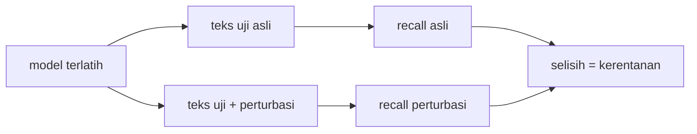

# Ablation Study dan Robustness terhadap Variasi Bahasa

!!! abstract "Info materi"
    **Tingkat kesulitan:** Menengah–lanjut. **Estimasi waktu:** 120 menit.
    **Jenis kode:** **eksperimen** (`examples/level-5-evaluation/06_ablation_robustness.py`) dan modul perturbasi (`examples/nlp_hub/perturbasi.py`, diuji di `tests/test_perturbasi.py`). Angka dari eksekusi nyata pada dataset **sintetis**.

## Tujuan pembelajaran

- [ ] Menjelaskan *ablation study*: mencabut satu komponen dan mengukur dampaknya.
- [ ] Menjalankan ablation pada pipeline klasifikasi teks dan membaca hasilnya terhadap simpangan baku.
- [ ] Menguji ketahanan (*robustness*) model terhadap variasi bahasa dengan perturbasi deterministik.
- [ ] Menjelaskan batas pengujian perturbasi: ia bukan pengganti data nyata dari penulis berbeda.

## Prasyarat

- [Error Analysis](error-analysis.md) dan [Perbandingan Pipeline Preprocessing](../level-2-fondasi-teks/perbandingan-pipeline.md).

## Pengantar dan motivasi

Pipeline kita terdiri dari beberapa keputusan: normalisasi informal, token URL, pemecahan hashtag, emoji,
IDF, n-gram. Apakah masing-masing benar-benar berguna? **Ablation** menjawabnya dengan
mencabut satu komponen sekali waktu. Pertanyaan kedua: jika orang menulis dengan gaya sedikit berbeda
(huruf kapital semua, singkatan, typo), apakah prediksinya berubah? Itulah **robustness**.

## Konsep dasar

| Istilah | Arti |
|---|---|
| **Ablation study** | Mencabut (atau mengganti) satu komponen model/pipeline dan mengukur perubahan skor |
| **Perturbasi** | Perubahan kecil dan terkontrol pada masukan (mis. mengubah menjadi huruf besar) |
| **Robustness** | Seberapa kecil prediksi berubah akibat perturbasi yang tidak mengubah arti |

Prinsip ablation: **ubah satu hal, jaga semua yang lain**; bandingkan dengan simpangan baku,
bukan hanya selisih angka.

## Penjelasan mendalam

### Membaca ablation dengan jujur

- Selisih lebih kecil daripada simpangan baku antar-lipatan → tidak dapat dibedakan dari noise.
- Pada set tulis-tangan, satu teks menggeser recall 0,042 (1/24).
- Komponen yang dicabut tetapi skor **naik** tidak berarti komponen itu merugikan; bisa juga noise.
- Hasil ablation hanya berlaku untuk data dan model yang diuji.

### Perturbasi deterministik

`nlp_hub/perturbasi.py` menyediakan enam perturbasi tanpa pengacak (agar dapat diulang dan diuji):

| Perturbasi | Perubahan |
|---|---|
| huruf besar semua | `Tolong` → `TOLONG` |
| singkatan informal | `tolong` → `tlg`, `tidak` → `gak`, ... (kamus balik) |
| huruf diperpanjang | `cepat` → `cepaaat` pada setiap kata ke-3 yang panjang |
| typo (tukar huruf) | dua huruf tengah kata ke-4 yang panjang ditukar |
| emoji+hashtag+URL | ditambahkan di akhir teks |
| tanpa tanda baca | semua tanda baca dibuang |

Perturbasi meniru variasi permukaan. Ia **tidak** meniru perbedaan kosakata, struktur kalimat, atau
gaya penulis lain, jadi ketahanan terhadap perturbasi tidak menjamin ketahanan pada data nyata.

## Cara kerja atau alur proses



## Contoh sederhana

Teks "Tolong air naik" diubah menjadi "TOLONG AIR NAIK". Model yang sehat memberi label sama
karena artinya sama. Bila labelnya berubah, model rentan terhadap huruf kapital.

## Contoh dalam konteks Twitter/X kebencanaan

Pesan darurat nyata sering ditulis tergesa: huruf kapital, singkatan (`tlg`, `udh`), huruf
diperpanjang (`toloong`), typo. Model yang hanya bekerja pada ejaan baku akan melewatkan pesan seperti itu.

## Praktik Python

Berkas: `examples/level-5-evaluation/06_ablation_robustness.py`.

### Bagian 1 — Ablation

```python title="Bagian 1"
--8<-- "level-5-evaluation/06_ablation_robustness.py:ablation"
```

`VARIAN` adalah kamus nama → fungsi pembuat pipeline, masing-masing mengubah **satu** hal dari rujukan. `evaluasi_pipeline` menjalankan protokol yang sama untuk semua: validasi silang 5 lipatan per kejadian pada 564 teks, ditambah satu model akhir pada 564 teks yang diuji pada 48 teks tulis-tangan.

```text title="Output nyata"
                                           F1 makro CV    Recall E CV F1 makro tangan Recall E tangan
rujukan (preprocessing dasar, unigram)   0.994 ± 0.008  1.000 ± 0.000           0.829           0.667
- normalisasi informal & huruf berulang  0.992 ± 0.012  0.995 ± 0.011           0.873            0.75
- token URL/mention                      0.994 ± 0.008  1.000 ± 0.000           0.829           0.667
- hashtag dipecah (dihapus)              0.994 ± 0.008  1.000 ± 0.000           0.829           0.667
- emoji (dihapus)                        0.994 ± 0.008  1.000 ± 0.000           0.829           0.667
- IDF (hanya TF)                         0.996 ± 0.005  1.000 ± 0.000           0.806           0.625
+ bigram                                 0.992 ± 0.012  0.995 ± 0.011           0.916           0.833
tanpa preprocessing sama sekali          0.992 ± 0.012  0.995 ± 0.011           0.873            0.75
```

!!! note "Mengapa angka rujukan berbeda dari halaman sebelumnya"
    Tabel ini melatih model akhir pada **seluruh 564 teks** (seperti halaman Level 2 dan 3), sehingga
    recall tulis-tangan rujukan 0,667 berbeda dari 0,625 pada halaman Level 5 sebelumnya (model dilatih pada 452 teks
    pengembangan). Perbandingan di dalam tabel ini adil; perbandingan lintas-halaman harus memperhatikan
    data latihnya.

Interpretasi:

- **Validasi silang:** semua varian berada pada F1 makro 0,992–0,996, dengan simpangan baku 0,005–0,012. Tidak ada komponen yang dicabut atau ditambah yang menghasilkan perubahan lebih besar daripada noise.
- **Token URL/mention, hashtag, emoji:** hasilnya **identik** dengan rujukan pada semua kolom. Dicabut atau tidak, tidak ada bedanya pada data ini. Ini sesuai dengan fakta bahwa unsur-unsur itu ditambahkan secara acak dengan peluang yang sama pada kedua kelas.
- **Tulis-tangan:** variasi lebih besar tetapi tidak monoton. Mencabut normalisasi informal **menaikkan** recall 0,667 → 0,75 (dua teks); tanpa preprocessing sama sekali juga 0,75; menambah bigram 0,833 (empat teks); mencabut IDF menurunkannya ke 0,625 (satu teks).
- **Preprocessing tidak terbukti membantu:** model tanpa preprocessing (F1 makro tangan 0,873, recall 0,75) sama baiknya atau sedikit lebih baik daripada rujukan (0,829; 0,667). Dengan 24 teks Emergency, selisih satu hingga empat teks tidak cukup untuk menyimpulkan apa pun.

### Bagian 2 — Robustness terhadap perturbasi

```python title="Bagian 2"
--8<-- "level-5-evaluation/06_ablation_robustness.py:robustness"
```

Dua model dibandingkan, keduanya Linear SVM dilatih pada 452 teks pengembangan: dengan preprocessing dasar dan tanpa preprocessing. Setiap teks uji diubah dengan tiap perturbasi, lalu recall Emergency dihitung.

```text title="Output nyata"

uji sintetis: recall Emergency setelah perturbasi (asli -> perturbasi)
                          dgn preprocessing   tanpa preprocessing
asli                                  1.000                 0.974
huruf besar semua                     1.000                 0.974
singkatan informal                    1.000                 0.947
huruf diperpanjang                    1.000                 0.947
typo (tukar huruf)                    1.000                 0.974
emoji+hashtag+URL                     0.947                 0.947
tanpa tanda baca                      1.000                 0.974

tulis-tangan: recall Emergency setelah perturbasi (asli -> perturbasi)
                          dgn preprocessing   tanpa preprocessing
asli                                  0.625                 0.625
huruf besar semua                     0.625                 0.625
singkatan informal                    0.625                 0.625
huruf diperpanjang                    0.625                 0.750
typo (tukar huruf)                    0.667                 0.667
emoji+hashtag+URL                     0.458                 0.500
tanpa tanda baca                      0.625                 0.625
```

Interpretasi:

- **Uji sintetis:** model dengan preprocessing stabil (recall 1,000, kecuali turun ke 0,947 pada penambahan emoji+hashtag+URL: dua teks). Model tanpa preprocessing sedikit lebih rentan (0,974 → 0,947 pada singkatan dan huruf diperpanjang), perbedaan satu teks.
- **Tulis-tangan:** hampir semua perturbasi tidak mengubah recall 0,625 (huruf kapital, singkatan, tanda baca). Typo menaikkan sedikit (0,667, satu teks).
- **Emoji+hashtag+URL adalah perturbasi yang paling merusak:** recall tulis-tangan turun dari 0,625 menjadi **0,458** (empat teks yang tadinya terdeteksi hilang) dengan preprocessing, dan menjadi 0,500 tanpa preprocessing. Penjelasan yang mungkin (belum diuji): hashtag `#SiagaBencana` dan token URL/emoji membawa kata (`siaga`, `bencana`, `tok_url`) yang di data latih lebih sering muncul pada teks Non-Emergency (peringatan dan edukasi), sehingga menggeser skor ke arah Non-Emergency.
- Kesimpulan penting: pada pesan darurat yang kebetulan menyertakan hashtag dan tautan (kondisi yang sangat umum di media sosial), model ini berisiko melewatkan lebih banyak pesan.

Batas: perturbasi hanya mengubah permukaan teks; ia tidak menguji ketahanan terhadap kosakata baru, struktur
kalimat lain, atau topik berbeda. Sementara gap utama model ini (data bertemplat vs tulis-tangan) tetap lebih besar
daripada pengaruh perturbasi yang diuji di sini.

### Skrip terpadu

`06_ablation_robustness.py` dijalankan dalam sekitar 3 detik dan memuat kedua bagian.

## Kesalahan umum dan debugging

| Gejala | Penyebab | Perbaikan |
|---|---|---|
| Mencabut beberapa komponen sekaligus | Tidak dapat menentukan penyebab | Cabut satu per satu |
| Menyimpulkan komponen "merugikan" karena skor naik | Selisih dalam noise | Bandingkan dengan simpangan baku; ulangi dengan beberapa seed |
| Membandingkan ablation pada pembagian berbeda | Tidak adil | Pakai pembagian dan seed yang sama |
| Menganggap ketahanan terhadap perturbasi = ketahanan di dunia nyata | Perturbasi hanya permukaan | Uji pada data yang ditulis pihak lain |
| Perturbasi mengubah makna | Perturbasi terlalu agresif | Periksa contoh hasilnya; tulis tes (lihat `test_perturbasi.py`) |
| Perturbasi diterapkan pada data latih lalu diuji pada data yang sama | Kebocoran | Perturbasi hanya pada data uji (atau augmentasi hanya pada latih) |

## Kelebihan dan keterbatasan

**Ablation:** sederhana, menunjukkan komponen yang benar-benar berperan; mencegah "kebiasaan" menambah langkah tanpa bukti.
**Perturbasi:** murah, dapat diulang, dan menemukan kerentanan konkret (emoji+hashtag+URL).
**Keterbatasan:** satu model dan satu seed; dataset sintetis kecil; ablation memiliki banyak perbandingan tanpa
koreksi statistik; perturbasi tidak mewakili variasi alami.

## Latihan bertahap

1. **Konseptual.** Mengapa ablation hanya mencabut satu komponen sekali waktu?
2. **Membaca tabel.** Pada Bagian 1, komponen mana yang hasilnya identik dengan rujukan di semua kolom?
3. **Membaca tabel.** Berapa teks Emergency tulis-tangan yang hilang dari deteksi akibat penambahan emoji+hashtag+URL pada model dengan preprocessing?
4. **Debugging.** Seorang pembaca menyimpulkan "normalisasi informal merugikan" karena recall tulis-tangan naik dari 0,667 menjadi 0,75. Mengapa kesimpulan itu terlalu kuat?
5. **Mini-proyek.** Tambahkan perturbasi `tambah_url_saja` ke `PERTURBASI` (hanya menambah URL), tulis dua tes, dan ukur dampaknya.

## Kunci jawaban dan pembahasan

??? success "Jawaban 1"
    Agar perubahan skor dapat dikaitkan pada komponen itu. Bila beberapa dicabut bersamaan, kita tidak tahu mana penyebabnya.

??? success "Jawaban 2"
    Token URL/mention, hashtag dihapus, dan emoji dihapus: semua kolom sama dengan rujukan (0,994 ± 0,008; 1,000 ± 0,000; 0,829; 0,667).

??? success "Jawaban 3"
    Recall turun dari 0,625 (15 dari 24) menjadi 0,458 (11 dari 24): 4 teks.

??? success "Jawaban 4"
    Selisihnya hanya dua teks dari 24 (0,083); pada validasi silang, mencabut normalisasi tidak mengubah skor lebih dari simpangan baku (0,994 vs 0,992); hanya satu seed; data sintetis dan tulis-tangan tidak independen dari perancang. Hasilnya tidak cukup untuk menyatakan normalisasi merugikan.

??? success "Jawaban 5"
    Contoh implementasi:
    ```python
    def tambah_url_saja(teks):
        return f"{teks} https://contoh.example/0"
    ```
    Dua tes: (1) hasil berawalan teks asli dan memuat `https://`; (2) deterministik (dua panggilan menghasilkan string sama). Dampaknya diukur dengan memanggil `skor_perturbasi`; hasilnya tidak diketahui sampai dijalankan.

## Kuis singkat

**1.** Apa tujuan ablation study?

??? success "Jawaban"
    Mengetahui apakah suatu komponen benar-benar berkontribusi, dengan mencabutnya dan mengukur dampaknya.

**2.** Perturbasi mana yang paling menurunkan recall pada tulis-tangan?

??? success "Jawaban"
    Penambahan emoji+hashtag+URL (0,625 → 0,458 dengan preprocessing).

**3.** Apakah ketahanan terhadap perturbasi menjamin ketahanan pada data nyata?

??? success "Jawaban"
    Tidak; perturbasi hanya mengubah permukaan teks.

## Ringkasan

- Ablation: cabut satu komponen, ukur dampak, bandingkan dengan simpangan baku.
- Pada data ini tidak ada komponen preprocessing yang terbukti membantu: CV 0,992–0,996; tanpa preprocessing recall tulis-tangan 0,75 vs rujukan 0,667.
- Robustness: model stabil terhadap huruf kapital, singkatan, typo, dan tanda baca, tetapi emoji+hashtag+URL menurunkan recall tulis-tangan 0,625 → 0,458.
- Perturbasi tidak menggantikan data nyata dari penulis berbeda.

## Glosarium istilah baru

Ablation study
:   Eksperimen yang mencabut satu komponen untuk mengukur kontribusinya.

Perturbasi
:   Perubahan kecil terkontrol pada masukan untuk menguji ketahanan.

Robustness
:   Ketahanan prediksi terhadap perubahan masukan yang tidak mengubah arti.

Augmentasi data
:   Menambah data latih dengan variasi buatan; hanya pada data latih.

## Referensi

- Ribeiro, M. T., Wu, T., Guestrin, C., & Singh, S. (2020). Beyond accuracy: Behavioral testing of NLP models with CheckList. *Proceedings of ACL 2020*, 4902–4912. DOI: 10.18653/v1/2020.acl-main.442 (makalah akademik tentang pengujian perilaku model NLP; detail diperiksa lewat pencarian daring; dibahas lebih lanjut di Level 7).
- Dokumentasi scikit-learn, `TfidfVectorizer` (parameter `use_idf`, `ngram_range`): <https://scikit-learn.org/stable/modules/generated/sklearn.feature_extraction.text.TfidfVectorizer.html>.

## Materi berikutnya

[Data Leakage, Ketidakpastian Hasil, dan Reproducibility](leakage-reproducibility.md)
