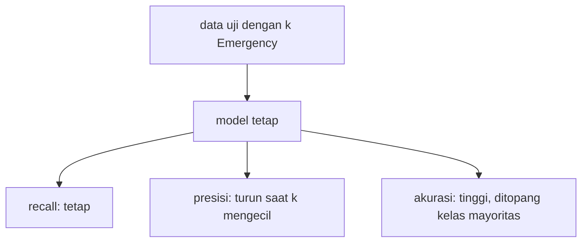

# Class Imbalance dan Baseline Sederhana

!!! abstract "Info materi"
    **Tingkat kesulitan:** Menengah. **Estimasi waktu:** 100 menit.
    **Jenis kode:** **eksperimen** (`examples/level-5-evaluation/03_imbalance_baseline.py`). Angka dari eksekusi nyata pada dataset sintetis.

## Tujuan pembelajaran

- [ ] Menjelaskan *class imbalance* dan metrik mana yang tidak berubah atau berubah ketika proporsi kelas berubah.
- [ ] Mengukur pengaruh proporsi kelas pada presisi, recall, dan akurasi.
- [ ] Menyusun beberapa baseline sederhana dan memakainya untuk menilai kegunaan model.
- [ ] Menjelaskan `class_weight` dan batas kemampuannya.

## Prasyarat

- [Confusion Matrix](confusion-matrix.md) dan [Metrik Klasifikasi](metrik-klasifikasi.md).

## Pengantar dan motivasi

Pada tanggap darurat, pesan darurat biasanya **jauh lebih sedikit** daripada pesan biasa.
Dataset sintetis kita memuat sekitar 34% Emergency; pada aliran media sosial nyata, proporsi sebenarnya
tidak diketahui dari data ini, tetapi kemungkinan jauh lebih kecil. Dua akibatnya:

1. **Akurasi menjadi tidak informatif** (model "selalu Non-Emergency" tampak hebat).
2. **Presisi turun** ketika kelas positif makin jarang, walau model tidak berubah.

## Konsep dasar

| Istilah | Arti |
|---|---|
| **Class imbalance** | Jumlah contoh antarkelas sangat berbeda |
| **Prevalensi** | Proporsi kelas positif di data |
| **Baseline** | Model atau aturan sederhana sebagai pembanding minimum |

### Mengapa presisi bergantung pada prevalensi

Recall $= TP/(TP+FN)$ hanya melibatkan contoh **Emergency**, sehingga tidak bergantung pada
berapa banyak Non-Emergency yang ada. Presisi $= TP/(TP+FP)$ melibatkan $FP$ yang berasal dari contoh
**Non-Emergency**: bila Non-Emergency jauh lebih banyak, jumlah FP naik (pada tingkat kesalahan tetap),
sementara TP turun bersama jumlah Emergency; maka presisi turun.

## Penjelasan mendalam

### Jenis baseline

| Baseline | Aturan | Menguji |
|---|---|---|
| Selalu Non-Emergency | Kelas mayoritas | Skor tanpa belajar; akurasi yang menyesatkan |
| Acak sesuai proporsi | Menebak acak dengan peluang kelas latih | Skor "untung-untungan" |
| Selalu Emergency | Semua dianggap darurat | Recall maksimum tanpa presisi; **tidak berguna operasional** (peninjauan membludak) |
| Kata kunci | Mis. `tolong` | Apakah kata kunci cukup |

Sebuah model hanya bermakna bila melampaui **baseline yang relevan**, bukan hanya yang paling mudah dikalahkan.

### Menangani ketidakseimbangan

- **Metrik yang tepat:** presisi/recall/F1 per kelas dan PR-AUC; bukan akurasi.
- **`class_weight="balanced"`:** memberi bobot lebih pada kelas kecil saat melatih; menggeser keputusan ke arah kelas kecil sehingga biasanya menaikkan recall dan menurunkan presisi.
- **Resampling** (menggandakan kelas kecil atau memangkas kelas besar): dilakukan **hanya pada data latih**; melakukannya sebelum membagi data adalah kebocoran. Tidak dipraktikkan di sini.
- **Ambang keputusan:** halaman berikutnya.

Tidak ada cara "mengatasi" imbalance yang menggantikan data nyata dan evaluasi yang tepat.

## Cara kerja atau alur proses



## Contoh sederhana

Model menandai 2 dari 74 Non-Emergency sebagai Emergency (FP = 2) dan menemukan semua Emergency.
Bila ada 38 Emergency: presisi $=38/40=0{,}95$. Bila hanya 4 Emergency: presisi $=4/6=0{,}667$.
Modelnya sama; hanya proporsi yang berubah.

## Contoh dalam konteks Twitter/X kebencanaan

Pada aliran media sosial nyata, pesan darurat mungkin hanya sebagian kecil dari seluruh pesan.
Model yang tampak presisi 0,95 pada dataset seimbang dapat memiliki presisi jauh lebih rendah
pada aliran nyata, sehingga peninjau dibanjiri alarm palsu. Karena itu laporan metrik harus
menyebut **proporsi kelas** di data evaluasi.

## Praktik Python

Berkas: `examples/level-5-evaluation/03_imbalance_baseline.py`. Model rujukan (Linear SVM) dilatih
pada 452 teks pengembangan dan **tidak berubah** pada bagian 1.

### Bagian 1 — Pengaruh prevalensi

```python title="Bagian 1"
--8<-- "level-5-evaluation/03_imbalance_baseline.py:prevalensi"
```

Untuk tiap jumlah Emergency `k`, 500 subsampel acak dibuat: semua 74 Non-Emergency ditambah `k` Emergency yang dipilih acak. Metrik dihitung untuk model tetap, dan dirata-ratakan.

```text title="Output nyata"
 Emergency  porsi E  akurasi  presisi E  recall E  F1 E  akurasi 'selalu 0'
        38    0.339    0.982      0.950       1.0 0.974               0.661
        19    0.204    0.978      0.905       1.0 0.950               0.796
         8    0.098    0.976      0.800       1.0 0.889               0.902
         4    0.051    0.974      0.667       1.0 0.800               0.949
```

Interpretasi:

- **Recall tetap 1,0** pada semua proporsi, karena model menemukan semua Emergency.
- **Presisi turun** dari 0,950 (34% Emergency) menjadi 0,667 (5%): pada 5%, dari setiap tiga teks yang ditandai, satu adalah alarm palsu.
- **Akurasi tetap tinggi** (0,974–0,982), hampir tidak berubah, sedangkan baseline "selalu Non-Emergency" naik dari 0,661 menjadi 0,949. Pada 5% Emergency, akurasi model hanya 0,025 di atas baseline tanpa belajar.
- Ini simulasi dengan model yang tetap; ia **tidak** memperkirakan proporsi sebenarnya pada data nyata.

### Bagian 2 — Perbandingan dengan baseline

```python title="Bagian 2"
--8<-- "level-5-evaluation/03_imbalance_baseline.py:baseline"
```

`DummyClassifier` adalah model tanpa belajar dari scikit-learn: `most_frequent` (selalu kelas mayoritas), `stratified` (acak sesuai proporsi latih), `constant` (selalu satu kelas). Kata kunci `tolong` adalah aturan buatan.

```text title="Output nyata"
                     model  uji: akurasi  uji: recall E  uji: F1 E  tangan: akurasi  tangan: recall E  tangan: F1 E
      selalu Non-Emergency         0.661          0.000      0.000            0.500             0.000         0.000
acak sesuai proporsi latih         0.554          0.289      0.306            0.479             0.250         0.324
          selalu Emergency         0.339          1.000      0.507            0.500             1.000         0.667
       kata kunci 'tolong'         0.705          0.237      0.353            0.521             0.167         0.258
                Linear SVM         0.982          1.000      0.974            0.812             0.625         0.769
```

Interpretasi:

- **Uji sintetis:** Linear SVM (F1 Emergency 0,974) jauh di atas semua baseline (maksimum 0,507).
- **Tulis-tangan:** SVM (F1 0,769, recall 0,625) di atas baseline, tetapi baseline "selalu Emergency" mencapai F1 Emergency 0,667 dengan recall 1,0, selisih hanya 0,10 dari SVM. Baseline "selalu Emergency" tidak berguna secara operasional (semua pesan masuk antrean), tetapi menunjukkan bahwa F1 Emergency saja belum cukup menggambarkan nilai model pada set seimbang. Presisi dan jumlah FP harus dibaca bersama.
- Baseline kata kunci `tolong` hanya recall 0,167–0,237: kata kunci bukan definisi.

### Bagian 3 — `class_weight`

```python title="Bagian 3"
--8<-- "level-5-evaluation/03_imbalance_baseline.py:bobot"
```

`class_weight="balanced"` mengatur bobot tiap kelas berbanding terbalik dengan frekuensinya saat pelatihan.

```text title="Output nyata"
                     model  uji: recall E  uji: F1 E  tangan: recall E  tangan: F1 E
    svm, class_weight=None          1.000      0.974             0.625         0.769
svm, class_weight=balanced          1.000      0.974             0.667         0.800
     lr, class_weight=None          0.947      0.973             0.417         0.588
 lr, class_weight=balanced          1.000      0.974             0.500         0.667
```

Interpretasi: `balanced` menaikkan recall tulis-tangan SVM dari 0,625 menjadi 0,667 (1 teks) dan LR dari 0,417
menjadi 0,500 (2 teks); pada uji sintetis LR naik dari 0,947 menjadi 1,000. Perubahannya kecil dan sebagian
besar masih dalam kisaran satu atau dua teks dari 24. Bobot kelas tidak mengatasi kesenjangan antara data
sintetis dan tulis-tangan; ia hanya menggeser keputusan sedikit. Dataset kita tidak terlalu tidak seimbang (34%), jadi
manfaat `balanced` pada data yang jauh lebih timpang tidak dapat disimpulkan dari sini.

### Skrip terpadu

`03_imbalance_baseline.py` memuat ketiga bagian dan berjalan beberapa detik. `buat_pipeline(..., class_weight=...)`
meneruskan parameter ke model (`LogisticRegression` dan `LinearSVC` sama-sama mendukungnya).

## Kesalahan umum dan debugging

| Gejala | Penyebab | Perbaikan |
|---|---|---|
| Akurasi 0,95 dianggap bagus | Tidak ada baseline | Bandingkan dengan "selalu kelas mayoritas" |
| Presisi turun di produksi | Prevalensi berbeda dari data evaluasi | Laporkan prevalensi; evaluasi pada proporsi mendekati penggunaan |
| Resampling sebelum membagi data | Kebocoran | Resampling hanya pada data latih |
| Menganggap `class_weight` menyelesaikan segalanya | Hanya menggeser keputusan | Evaluasi ulang; tinjau ambang |
| Baseline terlalu lemah | Hanya membandingkan dengan acak | Sertakan aturan kata kunci dan baseline yang realistis |

## Kelebihan dan keterbatasan

**Baseline dan simulasi prevalensi:** murah, memperlihatkan efek proporsi, dan menghindari kepercayaan palsu.
**Keterbatasan:** simulasi mengasumsikan kesalahan model pada Non-Emergency tetap; proporsi nyata tidak diketahui;
dataset sintetis kecil; `class_weight` dan resampling bukan pengganti data nyata.

## Latihan bertahap

1. **Konseptual.** Mengapa recall tidak berubah ketika proporsi Non-Emergency berubah, sedangkan presisi berubah?
2. **Menghitung.** Pada 8 Emergency dengan FP = 2 dan semua Emergency ditemukan, berapa presisinya?
3. **Membaca tabel.** Pada 5% Emergency, berapa selisih akurasi model dengan baseline "selalu Non-Emergency"?
4. **Debugging.** Seorang pembaca menggandakan teks Emergency di **seluruh** dataset sebelum membagi latih dan uji agar kelas seimbang. Mengapa ini bermasalah?
5. **Mini-proyek.** Tambahkan baseline "selalu Emergency" ke perbandingan untuk lr dan svm di Bagian 3 dan jelaskan mengapa F1 Emergency-nya tidak boleh dipakai sebagai satu-satunya alasan menolak model.

## Kunci jawaban dan pembahasan

??? success "Jawaban 1"
    Recall hanya melibatkan contoh Emergency (TP dan FN). Presisi melibatkan FP yang berasal dari Non-Emergency; jumlah Non-Emergency relatif terhadap Emergency menentukan seberapa besar FP dibanding TP.

??? success "Jawaban 2"
    $8/(8+2) = 0{,}8$ (sesuai baris "8" pada tabel Bagian 1: 0,800).

??? success "Jawaban 3"
    Model 0,974 dan baseline 0,949: selisih 0,025.

??? success "Jawaban 4"
    Salinan teks yang sama akan jatuh ke data latih dan uji sekaligus, sehingga model diuji pada teks yang pernah dilihat (kebocoran), dan skor naik tanpa alasan sah. Resampling harus dilakukan hanya pada data latih setelah pembagian.

??? success "Jawaban 5"
    Dari tabel, baseline "selalu Emergency" mencapai F1 Emergency 0,667 pada tulis-tangan (recall 1,0, presisi 0,5). Tetapi ia menandai **semua** pesan sebagai darurat: tidak ada penyaringan sama sekali sehingga tidak berguna secara operasional. Ini menunjukkan perlunya melihat presisi, jumlah FP, dan biaya peninjauan, bukan F1 sendirian.

## Kuis singkat

**1.** Metrik mana yang berubah ketika prevalensi berubah dan model tetap?

??? success "Jawaban"
    Presisi (dan akurasi baseline); recall tidak berubah.

**2.** Apa yang dilakukan `class_weight="balanced"`?

??? success "Jawaban"
    Memberi bobot lebih besar pada kelas yang jarang saat pelatihan, menggeser keputusan ke arah kelas kecil.

**3.** Mengapa baseline "selalu Emergency" tidak berguna secara operasional?

??? success "Jawaban"
    Semua pesan masuk antrean peninjauan sehingga tidak ada penyaringan.

## Ringkasan

- Imbalance membuat akurasi tidak informatif dan menurunkan presisi; recall tidak bergantung pada Non-Emergency.
- Simulasi: presisi 0,950 → 0,667 saat porsi Emergency 34% → 5%, recall tetap 1,0.
- Baseline wajib: selalu Non-Emergency, acak, selalu Emergency, kata kunci.
- `class_weight="balanced"` hanya menggeser sedikit (recall tulis-tangan SVM 0,625 → 0,667).

## Glosarium istilah baru

Class imbalance
:   Jumlah contoh antarkelas sangat berbeda.

Prevalensi
:   Proporsi kelas positif.

`DummyClassifier`
:   Model scikit-learn tanpa belajar yang dipakai sebagai baseline.

Resampling
:   Mengubah jumlah contoh kelas (menggandakan atau memangkas) pada data latih.

## Referensi

- Dokumentasi scikit-learn, `DummyClassifier`: <https://scikit-learn.org/stable/modules/generated/sklearn.dummy.DummyClassifier.html> (dokumentasi resmi).
- Saito, T., & Rehmsmeier, M. (2015). The precision-recall plot is more informative than the ROC plot when evaluating binary classifiers on imbalanced datasets. *PLoS ONE*, 10(3), e0118432. DOI: 10.1371/journal.pone.0118432 (makalah akademik; detail bibliografi diperiksa lewat pencarian daring; berargumen bahwa plot presisi-recall lebih informatif daripada ROC pada data tidak seimbang).

## Materi berikutnya

[Threshold, Kurva Precision-Recall, dan ROC/AUC](threshold-pr-roc.md)
