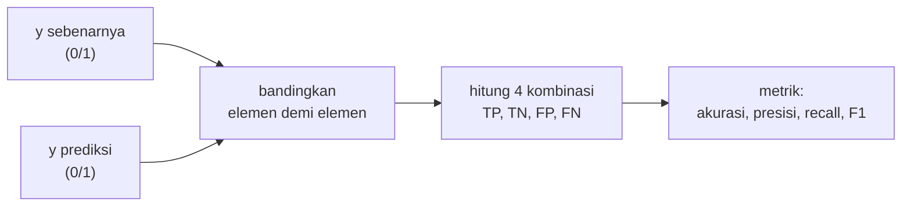
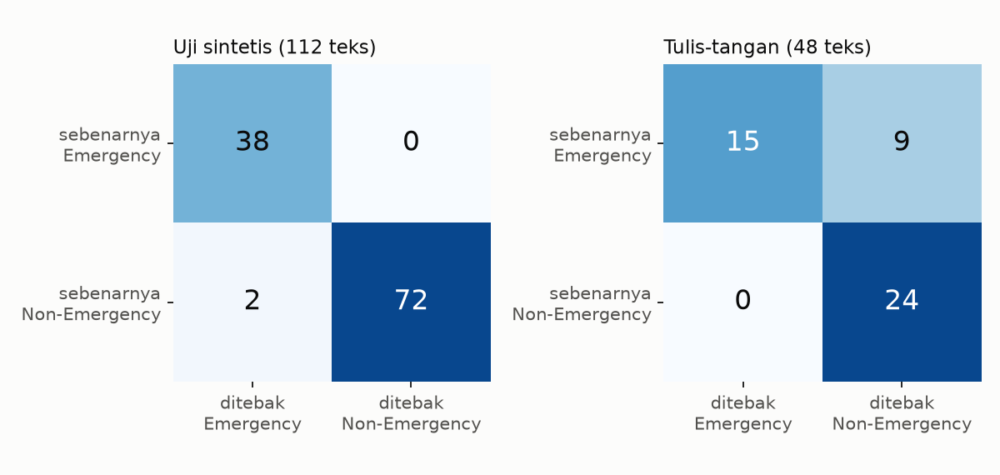

# Confusion Matrix: TP, TN, FP, dan FN

!!! abstract "Info materi"
    **Tingkat kesulitan:** Pemula–menengah. **Estimasi waktu:** 75 menit.
    **Jenis kode:** snippet edukatif (`examples/level-5-evaluation/01_confusion_matrix.py`) dan pembuat gambar (`gambar_level5.py`). Model rujukan Level 5: **Linear SVM** (preprocessing dasar, TF-IDF unigram, `C=1`), dilatih pada 452 teks pengembangan.

## Tujuan pembelajaran

- [ ] Menjelaskan empat hasil prediksi biner: TP, TN, FP, dan FN, pada konteks Emergency / Non-Emergency.
- [ ] Menghitung keempatnya dari dua array, dengan tangan dan dengan scikit-learn.
- [ ] Membaca confusion matrix dan memeriksa bahwa jumlahnya sama dengan jumlah data.
- [ ] Menjelaskan mengapa FN dan FP berbeda konsekuensinya pada tanggap darurat.

## Prasyarat

- [Level 4](../level-4-machine-learning/index.md), terutama [Perbandingan Model](../level-4-machine-learning/perbandingan-model.md) dan [Label Encoding](../level-4-machine-learning/supervised-learning-xy.md) (Emergency = 1).

## Pengantar dan motivasi

Satu angka seperti "akurasi 0,92" menyembunyikan **jenis** kesalahan. Dua model dapat
sama-sama akurat 92%, tetapi satu salah dengan melewatkan pesan darurat, satu lagi salah
dengan terlalu banyak "alarm palsu". Confusion matrix memisahkan kedua jenis
kesalahan itu, dan semua metrik di Level 5 dihitung darinya.

## Konsep dasar

Dengan **Emergency sebagai kelas positif**:

| | Ditebak Emergency | Ditebak Non-Emergency |
|---|---|---|
| **Sebenarnya Emergency** | **TP** (*true positive*): pesan darurat, terdeteksi | **FN** (*false negative*): pesan darurat, **terlewat** |
| **Sebenarnya Non-Emergency** | **FP** (*false positive*): bukan darurat, salah ditandai | **TN** (*true negative*): bukan darurat, benar diabaikan |

Cara mengingat: kata kedua (*positive*/*negative*) adalah **tebakan model**; kata pertama
(*true*/*false*) menyatakan **apakah tebakan itu benar**. FN = tebakan negatif yang salah.

Jumlah keempatnya harus sama dengan jumlah data:

$$
TP + TN + FP + FN = N
$$

## Penjelasan mendalam

### Konsekuensi FN dan FP

| Kesalahan | Arti pada sistem darurat | Konsekuensi |
|---|---|---|
| **FN** | Pesan yang mungkin mendesak tidak masuk antrean peninjauan | Respons terlambat atau tidak ada; paling serius |
| **FP** | Pesan biasa masuk antrean peninjauan | Waktu dan sumber daya peninjau terbuang; terlalu banyak FP membuat peninjau lelah dan akhirnya mengabaikan peringatan |

Keduanya harus diukur. Mana yang lebih diprioritaskan bergantung pada kapasitas
respons dan harus ditetapkan melalui evaluasi dan validasi; spesifikasi proyek menegaskan agar
tidak menetapkan ambang produksi tanpa itu.

### Urutan sumbu

`confusion_matrix` pada scikit-learn secara bawaan memakai urutan label terurut:
`[[TN, FP], [FN, TP]]` untuk label `[0, 1]`. Pada tabel di halaman ini, kita
memakai `labels=[1, 0]` agar Emergency berada di baris dan kolom pertama; ini hanya
perbedaan tampilan. Selalu periksa urutan sebelum membaca angkanya.

### Matriks ternormalisasi

Membagi tiap baris dengan jumlah barisnya menghasilkan proporsi per kelas sebenarnya:
baris Emergency menunjukkan TP/(TP+FN) = recall. Pembagian itu berguna bila kelas tidak seimbang.

## Cara kerja atau alur proses



## Contoh sederhana

Sepuluh teks, 4 Emergency. Model menemukan 3 Emergency dan salah menandai 1 Non-Emergency:
TP = 3, FN = 1, FP = 1, TN = 5. Total $3+1+1+5 = 10$. ✓

## Contoh dalam konteks Twitter/X kebencanaan

- **TP:** "Tolong, air sudah masuk rumah kami..." ditebak Emergency.
- **FN:** "Astaga dapur tetangga meledak, apinya udah ngejalar ke atap..." ditebak Non-Emergency (terlewat).
- **FP:** "Butuh bantuan: ada yang bisa ajarin Python dasar?" ditebak Emergency.
- **TN:** "Musim hujan sudah dekat, waspada banjir ya" ditebak Non-Emergency.

## Praktik Python

Berkas: `examples/level-5-evaluation/01_confusion_matrix.py`. Bagian awal berkas
menyiapkan data lewat `nlp_hub.proyek.siapkan()`, melatih Linear SVM (`model_rujukan`), dan menghitung prediksi
pada uji sintetis (112 teks) dan tulis-tangan (48 teks).

### Bagian 1 — Menghitung dengan tangan

```python title="Bagian 1"
--8<-- "level-5-evaluation/01_confusion_matrix.py:manual"
```

Setiap baris membuat topeng boolean (`(y_benar == 1) & (y_pred == 1)`) dan menjumlahkannya. `int(...)` mengubah hasil NumPy menjadi bilangan biasa. `ravel()` meratakan matriks 2 × 2 menjadi urutan `TN, FP, FN, TP`.

```text title="Output nyata"
uji sintetis: TP=38 TN=72 FP=2 FN=0 | total=112 = 112
sama dengan scikit-learn: True
```

Interpretasi: pada 112 teks uji, 38 Emergency ditemukan semuanya (FN = 0), tetapi 2 teks Non-Emergency salah
ditandai (FP = 2). Totalnya 112, sesuai jumlah data (**cara memeriksa:** jumlah
keempat sel = jumlah baris). Perhitungan manual sama dengan scikit-learn.

### Bagian 2 — Tabel berlabel

```python title="Bagian 2"
--8<-- "level-5-evaluation/01_confusion_matrix.py:tabel"
```

```text title="Output nyata"
UJI SINTETIS (112 teks)
                          ditebak Emergency  ditebak Non-Emergency
sebenarnya Emergency                     38                      0
sebenarnya Non-Emergency                  2                     72

TULIS-TANGAN (48 teks)
                          ditebak Emergency  ditebak Non-Emergency
sebenarnya Emergency                     15                      9
sebenarnya Non-Emergency                  0                     24
```



Interpretasi:

- **Uji sintetis:** hampir sempurna: tidak ada Emergency yang terlewat; dua alarm palsu.
- **Tulis-tangan:** 15 dari 24 pesan Emergency terdeteksi, **9 terlewat** (FN = 9), dan tidak ada
  alarm palsu (FP = 0). Pola kesalahannya berbalik: pada data bergaya baru, kesalahannya hampir seluruhnya
  FN. Ini kesalahan jenis yang paling mahal pada tugas ini.
- Satu angka seperti akurasi akan menyembunyikan pembalikan ini: akurasi uji sintetis (110/112 = 0,982)
  dan tulis-tangan (39/48 = 0,812) tidak memberi tahu **jenis** kesalahannya.

### Bagian 3 — Melihat teks yang salah

```python title="Bagian 3"
--8<-- "level-5-evaluation/01_confusion_matrix.py:contoh"
```

`np.where(...)` mengambil indeks teks yang memenuhi kombinasi (label sebenarnya, tebakan); `[:n]` membatasi jumlahnya; teks dipotong 75 karakter agar muat.

```text title="Output nyata"
FN (Emergency terlewat), tulis-tangan:
  - Astaga dapur tetangga meledak, apinya udah ngejalar ke atap. Siapa punya AP
  - Mohon info: jalur Puncak km 12 baru saja longsor, 2 mobil keseret ke jurang
  - Banjir bandang!!! jembatan putus, desa kami terisolasi, stok obat diabetes 
FP (Non-Emergency ditandai Emergency), uji sintetis:
  - Butuh bantuan: ada yang bisa ajarin Python dasar? #Cuaca
  - BUTUH BANTUAN: ADA YANG BISA AJARIN PYTHON DASAR?
```

Interpretasi: tiga FN adalah pesan darurat jelas yang ditulis dengan kosakata di luar templat
(`meledak`, `keseret`, `terisolasi`). Kedua FP memuat "butuh bantuan" tetapi bertopik Python: model menangkap
**kata kunci**, bukan situasi, persis kegagalan yang diperingatkan di definisi label proyek.
Dua FP itu juga duplikat dengan variasi huruf kapital. Analisis kesalahan lebih
mendalam ada di halaman [Error Analysis](error-analysis.md).

### Skrip terpadu

Fungsi `metrik_emergency` di `examples/nlp_hub/eksperimen.py` menghitung semua metrik turunan; hitungan
dasarnya sama dengan Bagian 1 dan diuji di `examples/tests/test_eksperimen.py`.

## Kesalahan umum dan debugging

| Gejala | Penyebab | Perbaikan |
|---|---|---|
| FN dan FP tertukar | Membaca baris sebagai tebakan, bukan sebenarnya | Periksa label sumbu; cetak tabel berlabel |
| `ravel()` menghasilkan urutan tak terduga | `labels` tidak ditetapkan | Beri `labels=[0, 1]` agar urutan `TN, FP, FN, TP` pasti |
| Kelas positif tertukar | Emergency dikodekan 0 | Pastikan Emergency = 1 (Level 4) |
| Jumlah sel tidak sama dengan jumlah data | Label di luar `labels` diabaikan | Periksa nilai unik `y` |
| Hanya akurasi dilaporkan | Menyembunyikan jenis kesalahan | Laporkan FN, FP, TP, TN |

## Kelebihan dan keterbatasan

**Kelebihan:** menunjukkan **jenis** kesalahan; dasar semua metrik; mudah diperiksa.
**Keterbatasan:** untuk satu ambang saja (ambang lain, matriks lain); hitungan absolut sulit dibandingkan antar-dataset
berukuran berbeda; tidak memberi tahu *mengapa* model salah (perlu analisis teks).

## Latihan bertahap

1. **Konseptual.** Mengapa "Emergency terlewat" disebut false negative, bukan false positive?
2. **Membaca tabel.** Berapa TP, FN, FP, TN pada uji tulis-tangan, dan berapa total datanya?
3. **Menghitung.** Hitung akurasi tulis-tangan dari confusion matrix.
4. **Debugging.** `confusion_matrix(y, p).ravel()` menghasilkan `(24, 0, 9, 15)`, dan Anda membaca "TP = 24". Apa kesalahannya?
5. **Analisis.** Mengapa FP = 0 pada tulis-tangan tidak berarti model baik?

## Kunci jawaban dan pembahasan

??? success "Jawaban 1"
    Tebakan model adalah "negatif" (Non-Emergency), dan tebakan itu salah (sebenarnya Emergency). *False* menyatakan tebakan salah; *negative* menyatakan tebakannya.

??? success "Jawaban 2"
    TP = 15, FN = 9, FP = 0, TN = 24; total 48.

??? success "Jawaban 3"
    (TP + TN)/N = (15 + 24)/48 = 39/48 ≈ 0,8125.

??? success "Jawaban 4"
    Urutan bawaan `ravel()` untuk label `[0, 1]` adalah `TN, FP, FN, TP`, jadi `(24, 0, 9, 15)` berarti TN = 24, FP = 0, FN = 9, TP = 15. Nilai 24 pertama adalah TN, bukan TP.

??? success "Jawaban 5"
    FP = 0 hanya berarti tidak ada alarm palsu; model yang jarang memberi alarm juga akan FP = 0. Di sini 9 dari 24 pesan darurat justru terlewat (FN = 9). Kedua kesalahan harus dibaca bersama.

## Kuis singkat

**1.** Apa isi sel kanan-atas pada tabel `sebenarnya` × `ditebak` di halaman ini?

??? success "Jawaban"
    FN (Emergency yang ditebak Non-Emergency).

**2.** Apa rumus yang menghubungkan keempat sel dengan jumlah data?

??? success "Jawaban"
    $TP + TN + FP + FN = N$.

**3.** Mengapa FN dianggap lebih mahal pada tanggap darurat?

??? success "Jawaban"
    Pesan darurat yang terlewat dapat berarti respons terlambat; FP hanya membuang sumber daya peninjauan (meski juga harus diukur).

## Ringkasan

- Confusion matrix memisahkan TP, TN, FP, FN; jumlahnya sama dengan jumlah data.
- Uji sintetis: TP 38, TN 72, FP 2, FN 0. Tulis-tangan: TP 15, TN 24, FP 0, FN 9.
- Kesalahan pada data bergaya baru hampir seluruhnya FN (pesan darurat terlewat).
- Dua FP berasal dari kata kunci "butuh bantuan" pada topik Python.

## Glosarium istilah baru

Confusion matrix
:   Tabel hitungan hasil prediksi menurut label sebenarnya dan tebakan.

TP / TN / FP / FN
:   True positive / true negative / false positive / false negative.

Kelas positif
:   Kelas yang ingin ditemukan (Emergency).

Alarm palsu
:   Istilah informal untuk false positive.

## Referensi

- Dokumentasi scikit-learn, `confusion_matrix`: <https://scikit-learn.org/stable/modules/generated/sklearn.metrics.confusion_matrix.html> (dokumentasi resmi; menyebut urutan `tn, fp, fn, tp` dari `ravel()` untuk klasifikasi biner).
- Imran, M., Castillo, C., Diaz, F., & Vieweg, S. (2015). Processing social media messages in mass emergency: A survey. *ACM Computing Surveys*, 47(4), artikel 67. DOI: 10.1145/2771588 (survei akademik).

## Materi berikutnya

[Accuracy, Precision, Recall, F1, dan Rata-rata Makro/Mikro/Berbobot](metrik-klasifikasi.md)
