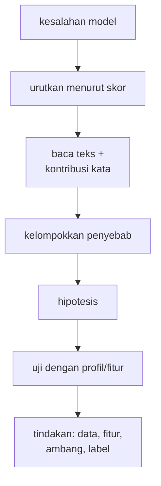

# Error Analysis: False Negative dan False Positive

!!! abstract "Info materi"
    **Tingkat kesulitan:** Menengah–lanjut. **Estimasi waktu:** 120 menit.
    **Jenis kode:** **eksperimen** (`examples/level-5-evaluation/05_error_analysis.py`). Model rujukan: Linear SVM; teks adalah data **sintetis** sehingga aman ditampilkan. Pada data nyata, teks harus dibersihkan dari identitas sebelum ditampilkan.

## Tujuan pembelajaran

- [ ] Menjalankan error analysis secara sistematis: kumpulkan, urutkan, kelompokkan, bentuk hipotesis, uji.
- [ ] Menelusuri kontribusi kata pada satu prediksi model linear.
- [ ] Membandingkan profil kelompok TP, FN, dan TN untuk mencari pola.
- [ ] Mengakui ketika hipotesis awal **tidak** didukung data.
- [ ] Menghubungkan temuan error analysis dengan keputusan perbaikan (data, fitur, ambang).

## Prasyarat

- [Confusion Matrix](confusion-matrix.md) dan [Threshold](threshold-pr-roc.md).
- [Feature Engineering](../level-3-representasi-teks/feature-engineering-kebencanaan.md) (fitur tangan dipakai untuk membuat profil).

## Pengantar dan motivasi

Metrik memberi tahu **seberapa banyak** model salah; error analysis memberi tahu **mengapa**. Pada sistem
darurat, setiap pesan darurat yang terlewat (FN) adalah kasus yang layak dipelajari satu per satu.
Metode ini juga memaksa kita memeriksa data dengan mata, yang sering menemukan masalah
yang tidak terlihat dari angka: label yang ragu, duplikat, atau pola templat.

## Konsep dasar

Langkah error analysis:

1. **Kumpulkan** semua kesalahan (FN dan FP) pada data evaluasi.
2. **Urutkan** menurut keyakinan model (skor), karena kesalahan yang dekat batas berbeda dari yang yakin salah.
3. **Baca** teksnya (bila aman) dan telusuri apa yang mendorong prediksi.
4. **Kelompokkan** menjadi beberapa jenis penyebab.
5. **Bentuk hipotesis** dan uji dengan angka (profil kelompok, fitur).
6. **Putuskan tindakan**: data, fitur, ambang, atau definisi label.

### Taksonomi penyebab yang umum

| Jenis | Contoh |
|---|---|
| Pergeseran kosakata | Kata penting tidak ada di data latih |
| Kata kunci menyesatkan | `butuh bantuan` pada topik non-darurat |
| Isyarat konteks tidak tertangkap | Waktu "baru saja", negasi, sarkasme |
| Label ambigu atau salah | Teks yang kasusnya meragukan |
| Artefak data | Pola templat yang tidak ada di dunia nyata |
| Noise gaya | Singkatan, typo, huruf kapital |

## Penjelasan mendalam

### Menelusuri kontribusi pada model linear

Skor SVM linear adalah $f(x)=\sum_j w_j x_j + b$. Tiap kata memberi **kontribusi** $w_j x_j$:
bobot kata dikali nilai TF-IDF-nya pada teks itu. Kontribusi positif mendorong Emergency;
negatif mendorong Non-Emergency. Jumlah seluruh kontribusi ditambah bias adalah skor. Ini
penjelasan *lokal* dan hanya berlaku pada model linear; pada model lain diperlukan metode seperti
LIME (Ribeiro dkk., 2016) yang dibahas di Level 7.

### Kesalahan dekat batas versus yakin salah

Kesalahan dengan skor mendekati 0 lebih mudah diperbaiki (geser ambang, tambah data), sedangkan
kesalahan yang yakin salah (skor jauh dari 0) menunjukkan kekeliruan yang lebih mendasar.

### Hipotesis harus diuji, dan boleh salah

Sebuah penjelasan masuk akal belum tentu benar. Pada halaman ini kita akan menguji satu hipotesis yang muncul
di halaman sebelumnya (FN karena kosakata asing) dan melihat bahwa data tidak mendukungnya.

## Cara kerja atau alur proses



## Contoh sederhana

Sebuah pesan darurat mendapat skor −0,06. Kata `mohon` dan `bantuan` mendorong ke Emergency (+0,26, +0,25), tetapi
`ibu`, `bulan`, `banjir` mendorong ke Non-Emergency (−0,16, −0,07, −0,06). Jumlahnya sedikit di bawah 0, sehingga
lolos sebagai Non-Emergency.

## Contoh dalam konteks Twitter/X kebencanaan

Pada tulis-tangan, model melewatkan 9 dari 24 pesan darurat. Semua 9 teks adalah laporan darurat yang jelas
bagi manusia. Bagian praktik menelusuri mengapa model meleset.

## Praktik Python

Berkas: `examples/level-5-evaluation/05_error_analysis.py`. Model rujukan dilatih pada 452 teks pengembangan;
ambang bawaan 0 (prediksi Emergency bila skor > 0).

### Bagian 1 — Daftar false negative, diurutkan menurut skor

```python title="Bagian 1"
--8<-- "level-5-evaluation/05_error_analysis.py:daftar"
```

`np.where` mengambil indeks FN (Emergency sebenarnya, ditebak 0). `np.argsort(-skor[fn])` mengurutkan dari skor tertinggi (paling dekat batas). Teks dipotong 88 karakter.

```text title="Output nyata"
skor=-0.03 | Mohon info: jalur Puncak km 12 baru saja longsor, 2 mobil keseret ke jurang. sudah ada t
skor=-0.04 | Ada bau gas menyengat di gang kami dan tabung bocor berdesis, jangan ada yang nyalain ro
skor=-0.06 | Mohon bantuan, ibu hamil 8 bulan terjebak banjir di perumahan Griya Asri blok C, ketuban
skor=-0.06 | ledakan di bengkel las, 2 orang terbakar parah, kami nunggu ambulans di depan gerbang
skor=-0.07 | Astaga dapur tetangga meledak, apinya udah ngejalar ke atap. Siapa punya APAR? Jl. Cenda
skor=-0.07 | gempa barusan kerasa banget, saya di lantai 9, tangga penuh orang panik, ada yang pingsa
skor=-0.17 | arus sungai bawa anak SD yg main di tepi, org2 lagi ngejar, tlg bantu cari ke arah hilir
skor=-0.46 | pohon tumbang nutup jalan sekaligus nimpa mobil, ada org dlm mobil blm bisa keluar. depa
skor=-0.57 | Banjir bandang!!! jembatan putus, desa kami terisolasi, stok obat diabetes ibu habis
```

Interpretasi: tujuh dari sembilan FN memiliki skor antara −0,03 dan −0,17: **dekat batas**; hanya dua yang
jauh (−0,46 dan −0,57). Ini konsisten dengan temuan halaman *Threshold*: menurunkan ambang ke −0,2 menangkap
tujuh dari sembilan FN tanpa FP (dari tabel ambang di halaman itu: TP naik 15 → 22).

### Bagian 2 — Apa yang mendorong prediksi?

```python title="Bagian 2"
--8<-- "level-5-evaluation/05_error_analysis.py:sebab"
```

`sumbangan(teks)` mengubah teks menjadi TF-IDF, mengalikannya elemen demi elemen dengan bobot SVM (`x.multiply(coef)`), dan mengambil kata dengan kontribusi terbesar dan terkecil.

```text title="Output nyata"
Mohon info: jalur Puncak km 12 baru saja longsor, 2 mobil ke
  mendorong Emergency   : [('ke', 0.42), ('mohon', 0.2), ('saja', 0.08)]
  mendorong Non-Emergency: [('sudah', -0.15), ('jalur', -0.09), ('longsor', -0.04)]
Ada bau gas menyengat di gang kami dan tabung bocor berdesis
  mendorong Emergency   : [('gang', 0.17), ('di', 0.14), ('dan', 0.13)]
  mendorong Non-Emergency: [('jangan', -0.08), ('yang', -0.02), ('pemadam', -0.01)]
Mohon bantuan, ibu hamil 8 bulan terjebak banjir di perumaha
  mendorong Emergency   : [('mohon', 0.26), ('bantuan', 0.25), ('di', 0.15)]
  mendorong Non-Emergency: [('ibu', -0.16), ('bulan', -0.07), ('banjir', -0.06)]
```

Interpretasi: pola penjelas yang muncul.

- Pada teks pertama, kata paling pendorong Emergency adalah `ke` (0,42), kata fungsi, sedangkan kata kunci kejadian `longsor` justru sedikit mendorong **Non-Emergency** (−0,04). Kata `sudah` ("sudah ada tim yang ke sana") mendorong Non-Emergency karena di data latih `sudah` berasosiasi dengan informasi lama.
- Pada teks kedua, pendorong Emergency adalah `gang`, `di`, `dan`: kata alamat dan fungsi, bukan `gas`, `bocor`, `berdesis` yang tidak ada di kosakata latih.
- Pada teks ketiga, `mohon` dan `bantuan` mendorong dengan benar, tetapi `banjir` dan `ibu` (yang di data latih sering muncul pada teks edukasi/opini) menariknya kembali.
- Model mengandalkan kata fungsi dan penanda alamat yang khas templat, bukan kata kejadian. Konsisten dengan temuan Level 3-4 bahwa koefisien terbesar mencerminkan artefak templat.

### Bagian 3 — Profil TP, FN, dan TN

```python title="Bagian 3"
--8<-- "level-5-evaluation/05_error_analysis.py:profil"
```

Untuk tiap teks tulis-tangan dihitung kelompoknya (TN, TP, FN), cakupan kosakata (proporsi token yang dikenal vektorizer latih), dan tiga fitur buatan tangan. `groupby("kelompok").agg(...)` merata-ratakan per kelompok.

```text title="Output nyata"
           n  cakupan  lokasi  permintaan  baru_terjadi
kelompok                                               
FN         9     0.57    0.44        0.33          0.11
TN        24     0.54    0.12        0.21          0.17
TP        15     0.59    0.20        0.40          0.40
```

Interpretasi, dengan hipotesis yang diuji:

- **Hipotesis A (dari halaman sebelumnya): FN terjadi karena kosakata asing.** Data **tidak mendukung**: cakupan kosakata FN (0,57) hampir sama dengan TP (0,59) dan TN (0,54). Kosakata asing ada di semua kelompok, jadi ia saja tidak menjelaskan mengapa sebagian Emergency tertangkap dan sebagian tidak.
- **Hipotesis B: FN tidak memuat isyarat "kejadian berlangsung".** Fitur `kata_baru_terjadi` (barusan, tadi, sekarang, masih, sedang): FN 0,11 vs TP 0,40. Hipotesis ini **didukung secara arah**, tetapi dasarnya hanya 9 teks FN dan 15 TP: satu teks menggeser rata-rata 0,11 atau 0,07, dan tidak ada uji signifikansi.
- Fitur `ada_lokasi`: FN 0,44 vs TP 0,20, kebalikan dari dugaan sederhana "FN kurang alamat". Ini mengingatkan bahwa alamat pada tulis-tangan tidak ditulis dengan pola templat.
- Hanya satu set tulis-tangan, satu model, satu seed: angka ini bersifat **menunjukkan arah**, bukan membuktikan.

### Bagian 4 — False positive

```python title="Bagian 4"
--8<-- "level-5-evaluation/05_error_analysis.py:fp"
```

Dua teks uji sintetis berlabel Non-Emergency yang diprediksi Emergency (skor > 0), beserta kata pendorongnya.

```text title="Output nyata"
skor=+0.14 | Butuh bantuan: ada yang bisa ajarin Python dasar? #Cuaca | pendorong: [('butuh', 0.41), ('bantuan', 0.33), ('ada', 0.06)]
skor=+0.24 | BUTUH BANTUAN: ADA YANG BISA AJARIN PYTHON DASAR? | pendorong: [('butuh', 0.46), ('bantuan', 0.36), ('ada', 0.07)]
```

Interpretasi: kedua FP dipicu oleh `butuh` dan `bantuan`. Pada data latih, kedua kata itu hampir
selalu muncul pada permintaan bantuan darurat, tetapi di sini konteksnya belajar pemrograman. Model
menangkap **kata kunci, bukan situasi**, persis jebakan yang diperingatkan di definisi label proyek
(kata kunci bukan definisi). Kedua teks juga hanya variasi dari satu templat yang sama, sehingga satu pola
menghasilkan dua FP; pada data nyata, satu pola seperti ini bisa menghasilkan banyak FP sekaligus.

### Ringkasan temuan

| Temuan | Bukti | Tingkat keyakinan |
|---|---|---|
| FN banyak yang dekat batas (7 dari 9 dengan skor antara −0,17 dan −0,03) | Bagian 1 | Sedang (satu model, 9 teks) |
| Model mengandalkan kata fungsi dan penanda alamat, bukan kata kejadian | Bagian 2 (tiga contoh) | Rendah–sedang (hanya tiga contoh dilihat) |
| Isyarat "baru terjadi" lebih jarang pada FN (0,11 vs 0,40) | Bagian 3 | Rendah (9 vs 15 teks) |
| Kosakata asing **bukan** pembeda FN dan TP | Bagian 3 | Sedang |
| FP berasal dari kata kunci `butuh bantuan` pada topik non-darurat | Bagian 4 | Sedang (dua teks, satu templat) |

### Tindakan yang masuk akal (usulan, bukan hasil)

- **Data:** tambahkan contoh Non-Emergency yang memuat kata kunci permintaan pada topik lain; tambahkan laporan darurat dengan kosakata lebih beragam, dari beberapa penulis.
- **Fitur:** uji fitur isyarat waktu dan kejadian secara terkontrol (halaman *Ablation*).
- **Ambang:** periksa pada data validasi yang representatif, bukan pada data bertemplat.
- **Label:** tinjau kasus ambigu dengan lebih dari satu anotator.

Setiap tindakan harus diuji ulang dengan protokol evaluasi yang sama, dan diukur pada data yang tidak ikut
dipakai merancang tindakannya.

### Skrip terpadu

`05_error_analysis.py` memuat keempat bagian dan berjalan beberapa detik.

## Kesalahan umum dan debugging

| Gejala | Penyebab | Perbaikan |
|---|---|---|
| Hanya melihat contoh yang "menarik" | Bias pemilihan | Urutkan menurut skor dan periksa semua FN pada data kecil |
| Menjelaskan satu contoh lalu menggeneralisasi | Sampel terlalu kecil | Hitung profil kelompok dan beri tingkat keyakinan |
| Hipotesis dianggap benar karena masuk akal | Tidak diuji | Uji dengan angka; terima bila tidak didukung |
| Menampilkan teks nyata berisi identitas | Tidak membersihkan | Ganti mention, URL; jangan simpan ID pengguna |
| Memperbaiki model berdasarkan set uji lalu melaporkan skor set yang sama | Kebocoran seleksi | Ambil perbaikan dari validasi; uji pada data baru |
| Mengabaikan label yang ragu | Menganggap label selalu benar | Tinjau ulang kasus ambigu |

## Kelebihan dan keterbatasan

**Kelebihan:** menjelaskan *mengapa* model salah; menghasilkan hipotesis perbaikan yang konkret; menemukan
masalah label dan data.
**Keterbatasan:** manual dan subjektif; sampel kecil; penjelasan kontribusi kata hanya untuk model linear dan
bersifat lokal; korelasi bukan sebab; hipotesis dapat salah (Hipotesis A pada halaman ini).

## Latihan bertahap

1. **Konseptual.** Mengapa kesalahan diurutkan menurut skor?
2. **Membaca output.** Berapa FN yang berskor dalam rentang −0,17 sampai −0,03? Apa artinya bagi ambang?
3. **Membaca tabel.** Mengapa hipotesis "FN karena kosakata asing" ditolak pada Bagian 3?
4. **Debugging.** Seorang analis membaca satu FN dan menyimpulkan "model tidak mengenali kata `longsor`". Apa yang kurang kuat dari kesimpulan itu?
5. **Mini-proyek.** Lakukan error analysis pada FN dan FP untuk Logistic Regression (`model_rujukan(d, "lr")`) dan bandingkan jenis penyebabnya dengan SVM.

## Kunci jawaban dan pembahasan

??? success "Jawaban 1"
    Kesalahan dekat batas (skor sekitar 0) berbeda dari yang yakin salah: yang pertama mungkin diperbaiki dengan ambang atau data tambahan, yang kedua menunjukkan kekeliruan yang lebih mendasar. Urutan skor memisahkan keduanya.

??? success "Jawaban 2"
    Tujuh FN (skor −0,03; −0,04; −0,06; −0,06; −0,07; −0,07; −0,17). Artinya sebagian besar FN hanya sedikit di bawah ambang 0, dan menurunkan ambang sedikit akan menangkapnya (tetapi juga berisiko menambah FP; lihat halaman *Threshold*).

??? success "Jawaban 3"
    Cakupan kosakata FN (0,57) hampir sama dengan TP (0,59) dan TN (0,54). Jika kosakata asing menjelaskan FN, cakupan FN seharusnya jauh lebih rendah daripada TP. Data tidak menunjukkannya.

??? success "Jawaban 4"
    Satu contoh tidak cukup. Dari Bagian 2, `longsor` justru ada di kosakata (kontribusi −0,04), sehingga bukan "tidak dikenal", hanya berbobot kecil. Perlu melihat banyak contoh dan profil kelompok sebelum menyimpulkan.

??? success "Jawaban 5"
    Tidak dijawab dari halaman ini; jalankan sendiri. Gunakan fungsi `sumbangan` dengan `model.named_steps["model"].coef_` Logistic Regression yang sama bentuknya. Harapkan lebih banyak FN pada LR (recall tulis-tangan 0,417), tetapi jenis penyebabnya mungkin mirip; laporkan dengan tingkat keyakinan.

## Kuis singkat

**1.** Apa kontribusi kata pada model linear?

??? success "Jawaban"
    Bobot kata dikali nilai TF-IDF-nya pada teks itu; jumlah seluruh kontribusi ditambah bias adalah skor.

**2.** Mengapa FP pada Bagian 4 terjadi?

??? success "Jawaban"
    Kata `butuh` dan `bantuan` dipakai model sebagai penanda darurat walau konteksnya belajar Python.

**3.** Apakah hipotesis yang masuk akal selalu benar?

??? success "Jawaban"
    Tidak; Hipotesis A (kosakata asing) masuk akal tetapi tidak didukung data.

## Ringkasan

- Error analysis: kumpulkan, urutkan menurut skor, baca, kelompokkan, hipotesis, uji.
- 7 dari 9 FN tulis-tangan berskor dekat batas (−0,03 sampai −0,17); dua yang lain −0,46 dan −0,57.
- Model mengandalkan kata fungsi dan alamat; cakupan kosakata tidak membedakan FN dari TP (0,57 vs 0,59); isyarat "baru terjadi" lebih jarang pada FN (0,11 vs 0,40) tetapi bukti lemah.
- Kedua FP dipicu kata kunci `butuh bantuan` pada topik Python.

## Glosarium istilah baru

Error analysis
:   Pemeriksaan sistematis terhadap kesalahan model untuk menemukan pola dan penyebab.

Kontribusi kata
:   Bobot kata dikali nilai fitur pada satu teks; penjelasan lokal pada model linear.

Penjelasan lokal
:   Penjelasan yang berlaku untuk satu prediksi, bukan seluruh model.

Hipotesis
:   Dugaan penyebab yang perlu diuji dengan data.

## Referensi

- Ribeiro, M. T., Singh, S., & Guestrin, C. (2016). "Why should I trust you?": Explaining the predictions of any classifier. *Proceedings of KDD 2016*, 1135–1144. DOI: 10.1145/2939672.2939778 (makalah akademik tentang LIME; detail diperiksa lewat pencarian daring; dibahas pada Level 7).
- Dokumentasi scikit-learn, *Inspection*: <https://scikit-learn.org/stable/inspection.html> (dokumentasi resmi).

## Materi berikutnya

[Ablation Study dan Robustness terhadap Variasi Bahasa](ablation-robustness.md)
