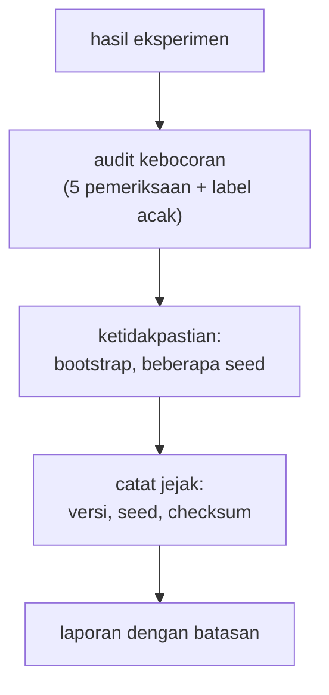

# Data Leakage, Ketidakpastian Hasil, dan Reproducibility

!!! abstract "Info materi"
    **Tingkat kesulitan:** Menengah–lanjut. **Estimasi waktu:** 120 menit.
    **Jenis kode:** **eksperimen** (`examples/level-5-evaluation/07_leakage_reproducibility.py`) dan fungsi bootstrap di `examples/nlp_hub/eksperimen.py` (diuji terhadap scikit-learn di `tests/test_eksperimen.py`). Angka dari eksekusi nyata pada dataset **sintetis**.

## Tujuan pembelajaran

- [ ] Menjalankan audit kebocoran data yang dapat diulang: duplikat, kelompok, templat, dan uji label acak.
- [ ] Mengukur ketidakpastian skor dengan selang kepercayaan bootstrap dan memakainya untuk membandingkan model.
- [ ] Menjelaskan variasi akibat seed pembagian data dan membedakannya dari variasi akibat ukuran data uji.
- [ ] Mencatat jejak reproducibility: versi library, seed, dan identitas data.

## Prasyarat

- [Data Leakage akibat Preprocessing](../level-2-fondasi-teks/leakage-preprocessing.md) dan [Pembagian Data](../level-4-machine-learning/pembagian-data.md).
- Konsep rata-rata dan simpangan baku.

## Pengantar dan motivasi

Dua pertanyaan menentukan apakah sebuah skor boleh dipercaya. **Apakah ada kebocoran?** Dan **seberapa pasti
angkanya?** Skor 0,625 pada 48 teks tidak berarti "tepat 0,625": dengan data lain atau seed lain, angkanya akan berbeda.
Laporan yang baik menyertakan ukuran ketidakpastian dan catatan yang cukup untuk mengulang percobaan.

## Konsep dasar

| Istilah | Arti |
|---|---|
| **Audit kebocoran** | Daftar pemeriksaan otomatis untuk mendeteksi data yang bocor antara latih dan uji |
| **Uji label acak** | Mengacak label; skor yang benar adalah tebakan; skor di atasnya menunjukkan kebocoran |
| **Bootstrap** | Mengambil sampel acak **dengan pengembalian** dari data uji berulang kali untuk melihat sebaran metrik |
| **Selang kepercayaan** | Rentang nilai yang masuk akal untuk metrik; di sini selang persentil 95% bootstrap |
| **Reproducibility** | Kemampuan mengulang eksperimen dan mendapat hasil yang sama |

## Penjelasan mendalam

### Daftar periksa kebocoran

1. **Teks sama** antara latih dan uji (duplikat persis).
2. **Kelompok** (kejadian) di kedua sisi.
3. **Near-duplicate/templat** di kedua sisi.
4. **Fitur turunan label** (kolom yang dibuat dari label).
5. **Statistik korpus** (TF-IDF, seleksi fitur) dihitung di luar pipeline.
6. **Seleksi menggunakan data uji** (parameter, ambang).
7. **Uji label acak** pada pipeline lengkap.

Daftar ini tidak menjamin tidak ada kebocoran; ia hanya menemukan jenis yang kita ketahui untuk dicari.

### Bootstrap untuk ketidakpastian

Dari $N$ teks uji, ambil $N$ teks acak **dengan pengembalian** (sebagian teks muncul dua kali, sebagian tidak
muncul), hitung metrik, ulangi 2.000 kali. Persentil ke-2,5 dan ke-97,5 dari 2.000 nilai itu membentuk
selang 95%. Selang lebar berarti data uji terlalu sedikit untuk menyimpulkan banyak.

**Batas bootstrap:** ia hanya menangkap variasi akibat **pengambilan sampel teks uji**. Ia tidak menangkap variasi
akibat data latih, seed, ketidaksepakatan anotator, atau perbedaan distribusi antara data uji dan data nyata.

### Membandingkan dua model pada data uji yang sama

Gunakan bootstrap **berpasangan**: pada tiap resampel, hitung metrik kedua model pada teks yang sama, lalu catat selisihnya.
Jika selang 95% selisih tidak memuat 0, selisih itu cukup konsisten pada data uji tersebut. Jika memuat 0,
selisihnya tidak dapat dibedakan dari variasi sampel.

### Dua sumber variasi

- **Variasi pembagian/seed:** data latih/uji berbeda memberi skor berbeda.
- **Variasi ukuran uji:** uji kecil → skor tidak stabil, walau pembagian sama.

### Jejak reproducibility

Catat: versi Python dan library, seed, identitas data (checksum), konfigurasi preprocessing dan model, dan kode
(commit). Seed membuat hasil dapat diulang; ia **bukan** jaminan bahwa hasilnya representatif.

## Cara kerja atau alur proses



## Contoh sederhana

Sepuluh teks Emergency; model menemukan 6 (recall 0,6). Dengan bootstrap, pada beberapa resampel model
tampak menemukan 4 dari 10, pada yang lain 8 dari 10. Selang 95% mungkin [0,3; 0,9]: lebar, karena data sedikit.

## Contoh dalam konteks Twitter/X kebencanaan

Dua model dibandingkan pada 48 teks tulis-tangan. Naive Bayes menemukan 20 dari 24 pesan darurat, SVM 15, LR 10.
Apakah selisih itu cukup jelas atau hanya kebetulan pengambilan sampel? Bagian 4 menjawabnya dengan
selang bootstrap berpasangan.

## Praktik Python

Berkas: `examples/level-5-evaluation/07_leakage_reproducibility.py`.

### Bagian 1 — Audit kebocoran

```python title="Bagian 1"
--8<-- "level-5-evaluation/07_leakage_reproducibility.py:audit"
```

`audit(latih, uji)` mengembalikan kamus hasil pemeriksaan: irisan teks, irisan kejadian, irisan templat, dan teks tulis-tangan yang sama dengan teks latih. Fungsi dipanggil dengan data pengembangan (latih + validasi) sebagai "latih".

```text title="Output nyata"
teks sama di latih dan uji                      : 0
kejadian di latih dan uji                       : 0
templat uji yang juga ada di latih              : 59 dari 61
teks tulis-tangan yang sama dengan teks latih   : 0
```

Interpretasi: tidak ada teks yang sama dan tidak ada kejadian di kedua sisi. Namun **59 dari 61 templat uji juga ada
di latih**: kemiripan antar-templat adalah bentuk kebocoran yang tidak tertutup oleh pembagian per kejadian (dibahas di
Level 2-3). Set tulis-tangan tidak berbagi teks dengan data latih (0).

### Bagian 2 — Uji label acak pada pipeline lengkap

```python title="Bagian 2"
--8<-- "level-5-evaluation/07_leakage_reproducibility.py:label_acak"
```

Label diacak pada tiga seed; pipeline lengkap (praproses, TF-IDF, SVM) dievaluasi dengan validasi silang berkelompok. `balanced_accuracy_score` bernilai 0,5 untuk tebakan acak, berapa pun proporsi kelasnya.

```text title="Output nyata"
balanced accuracy, label diacak (pipeline lengkap, CV per kejadian): [0.548 0.5   0.511]
```

Interpretasi: 0,548; 0,500; 0,511: di sekitar 0,5 (acak). Pada tiga seed ini tidak ada tanda kebocoran dari
pipeline ke label. Hasil ini **tidak** membuktikan tidak ada kebocoran lain (mis. kemiripan templat tidak
terdeteksi karena label acak memutus hubungan templat-label).

### Bagian 3 — Selang kepercayaan bootstrap

```python title="Bagian 3"
--8<-- "level-5-evaluation/07_leakage_reproducibility.py:bootstrap"
```

`bootstrap_metrik` menghasilkan 2.000 nilai metrik dari resampel; `selang_persentil` mengambil persentil 2,5 dan 97,5.

```text title="Output nyata"
uji sintetis (112)   recall_e  = 1.000   selang 95% bootstrap [1.000, 1.000]
uji sintetis (112)   f1_makro  = 0.980   selang 95% bootstrap [0.948, 1.000]
tulis-tangan (48)    recall_e  = 0.625   selang 95% bootstrap [0.435, 0.810]
tulis-tangan (48)    f1_makro  = 0.806   selang 95% bootstrap [0.684, 0.913]
```

Interpretasi:

- **Uji sintetis:** recall 1,000 dengan selang [1,000; 1,000], karena seluruh 38 Emergency ditemukan, setiap resampel juga 1,000. Selang yang sempit **bukan** berarti pasti: ia menyatakan bahwa pada data uji **ini**, model sempurna. F1 makro 0,980 dengan selang [0,948; 1,000].
- **Tulis-tangan:** recall 0,625 dengan selang 95% [0,435; 0,810]. Nilai sebenarnya (pada distribusi tulis-tangan) mungkin serendah 0,44 atau setinggi 0,81. F1 makro 0,806 dengan [0,684; 0,913].
- Selang tulis-tangan lebar (sekitar 0,37) karena hanya 24 teks Emergency. Laporan "recall 0,625" tanpa selang menyembunyikan ketidakpastian itu.

### Bagian 4 — Apakah selisih antar-model cukup jelas?

```python title="Bagian 4"
--8<-- "level-5-evaluation/07_leakage_reproducibility.py:bandingkan"
```

Tiap model dilatih pada 452 teks dan memprediksi 48 teks tulis-tangan. `selisih_recall_bootstrap` mengambil resampel **berpasangan**: indeks sama untuk dua model.

```text title="Output nyata"
selisih recall tulis-tangan nb - lr: +0.417  selang 95% [+0.222, +0.625]
selisih recall tulis-tangan nb - svm: +0.208  selang 95% [+0.000, +0.450]
selisih recall tulis-tangan svm - lr: +0.208  selang 95% [+0.045, +0.381]
```

Interpretasi:

- **NB − LR:** +0,417 dengan selang [+0,222; +0,625] yang **tidak memuat 0**: pada set ini, NB menemukan lebih banyak pesan darurat daripada LR secara konsisten.
- **SVM − LR:** +0,208 dengan selang [+0,045; +0,381]: tidak memuat 0, tetapi dekat dengan 0.
- **NB − SVM:** +0,208 dengan selang [+0,000; +0,450]: batas bawahnya tepat 0, **tidak cukup jelas**.
- Ini hanya menunjukkan keandalan perbedaan terhadap pengambilan sampel teks tulis-tangan. Ia tidak membuktikan bahwa NB lebih baik pada data nyata: set itu 48 teks, dilabeli satu orang, dan ditulis oleh perancang yang sama dengan datanya.

### Bagian 5 — Variasi seed dan determinisme

```python title="Bagian 5"
--8<-- "level-5-evaluation/07_leakage_reproducibility.py:seed"
```

Pembagian per kejadian diulang pada 10 seed berbeda; SVM dilatih dan dievaluasi pada tiap uji. Baris terakhir melatih dua pipeline identik dan membandingkan skor keputusan.

```text title="Output nyata"
      f1_makro  recall_e  presisi_e
mean     0.991       1.0      0.977
std      0.007       0.0      0.019
min      0.980       1.0      0.947
max      1.000       1.0      1.000
dua pelatihan dengan seed sama menghasilkan skor identik: True
```

Interpretasi: pada 10 pembagian acak per kejadian, F1 makro berkisar 0,980–1,000 (std 0,007) dan recall selalu
1,0. Variasi akibat seed pembagian **kecil** pada data bertemplat ini; variasi akibat ukuran dan gaya data
(tulis-tangan) jauh lebih besar. Dua pelatihan dengan seed sama menghasilkan skor identik: percobaan dapat diulang.

### Bagian 6 — Jejak reproducibility

```python title="Bagian 6"
--8<-- "level-5-evaluation/07_leakage_reproducibility.py:jejak"
```

`hashlib.sha256` menghitung sidik jari berkas data; 12 karakter pertama cukup untuk membandingkan.

```text title="Output nyata"
scikit-learn=1.9.1 numpy=2.5.4 pandas=3.1.0 scipy=1.18.1
python=3.14.7 | seed=42 | sha256 data (12 awal)=59cb36c1bfde
```

Interpretasi: baris ini adalah "kartu identitas" eksekusi penulis. Dalam laporan, sertakan baris serupa dari
mesin Anda sendiri. Angka-angka di halaman ini hanya dijamin pada versi tersebut; versi library lain dapat
menghasilkan angka berbeda.

### Skrip terpadu

`07_leakage_reproducibility.py` berjalan sekitar 2 detik (bootstrap divektorkan).
`bootstrap_metrik` dicocokkan terhadap `sklearn.metrics` pada resampel yang sama di
`test_bootstrap_cocok_dengan_metrik_sklearn_pada_resampel_yang_sama`.

## Kesalahan umum dan debugging

| Gejala | Penyebab | Perbaikan |
|---|---|---|
| Melaporkan satu angka tanpa selang | Mengabaikan ketidakpastian | Sertakan selang bootstrap dan ukuran data |
| Selang sempit dianggap kepastian | Data uji sangat mudah atau kecil | Jelaskan bahwa selang hanya mencakup variasi sampel |
| Bootstrap pada data dengan kelompok saling terkait | Resampel mengabaikan kelompok | Pada data nyata, resampel per kelompok |
| Membandingkan model dengan selang masing-masing yang tumpang tindih | Tidak memanfaatkan pasangan | Gunakan selisih berpasangan |
| Hasil berbeda antar-mesin | Versi library berbeda | Catat versi; pakai lingkungan terkunci |
| Seed tidak ditetapkan | Hasil tidak dapat diulang | Tetapkan `random_state` di semua tempat |
| Menganggap audit lolos berarti bersih | Audit hanya memeriksa yang diketahui | Tambah pemeriksaan sesuai data Anda |

## Kelebihan dan keterbatasan

**Kelebihan:** audit dan bootstrap murah, otomatis, dan dapat diulang; membuat laporan lebih jujur.
**Keterbatasan:** bootstrap berasumsi data uji mewakili populasi; tidak menangkap pergeseran distribusi atau
dependensi antar-sampel; selang pada data kecil tetap kasar; 2.000 resampel dengan satu seed menghasilkan
estimasi selang yang sendiri memiliki variasi kecil.

## Latihan bertahap

1. **Konseptual.** Mengapa uji label acak mendeteksi kebocoran?
2. **Membaca output.** Apa arti selang 95% [0,435; 0,810] untuk recall tulis-tangan?
3. **Membaca output.** Mengapa selisih NB − SVM tidak cukup jelas, padahal selisih recallnya +0,208?
4. **Debugging.** Seseorang melaporkan "recall uji sintetis 1,000 dengan selang [1,000; 1,000], jadi model sempurna". Apa yang salah?
5. **Mini-proyek.** Tambahkan pemeriksaan ke `audit`: apakah ada teks uji yang *berbeda hanya huruf besar/kecil* dari teks latih? Jelaskan dan tulis tes.

## Kunci jawaban dan pembahasan

??? success "Jawaban 1"
    Dengan label acak, tidak ada hubungan nyata antara teks dan label; skor yang jujur adalah tebakan (balanced accuracy 0,5). Bila skor jauh di atas itu, informasi label bocor melalui jalur yang tidak sah.

??? success "Jawaban 2"
    Pada pengambilan sampel ulang dari 48 teks tulis-tangan, 95% nilai recall berada antara 0,435 dan 0,810. Artinya data ini hanya cukup untuk menyimpulkan bahwa recall berada di sekitar separuh sampai empat perlima.

??? success "Jawaban 3"
    Selang bootstrap berpasangan [+0,000; +0,450] memuat 0 pada batas bawah: pada sebagian resampel, NB tidak lebih baik daripada SVM. Dengan hanya 24 teks Emergency, selisih lima teks (20 vs 15) tidak konsisten terhadap pengambilan sampel.

??? success "Jawaban 4"
    Selang sempit hanya mencerminkan bahwa seluruh 38 Emergency pada data uji ditemukan. Data uji sintetis bertemplat dan mudah (59 dari 61 templat ada di latih), jadi "sempurna" di sini tidak berarti sempurna pada data nyata. Selang hanya mencakup variasi pengambilan sampel teks uji, bukan pergeseran distribusi.

??? success "Jawaban 5"
    ```python
    def beda_huruf_besar_saja(latih, uji):
        a = {t.lower() for t in latih["text"]}
        return sum(t.lower() in a for t in uji["text"])
    ```
    Pada dataset ini kita sudah tahu dua teks FP ("Butuh bantuan ...") dan variasi huruf kapitalnya pada set yang sama; pemeriksaan ini mendeteksi duplikat yang lolos dari perbandingan persis. Tulis tes dengan dua teks kecil (satu `"Tolong"`, satu `"TOLONG"`) dan pastikan hasilnya 1.

## Kuis singkat

**1.** Apa yang ditangkap oleh bootstrap pada data uji?

??? success "Jawaban"
    Variasi akibat pengambilan sampel teks uji; bukan variasi data latih atau pergeseran distribusi.

**2.** Mengapa bootstrap berpasangan untuk membandingkan model?

??? success "Jawaban"
    Agar kedua model dinilai pada teks yang sama di tiap resampel, sehingga selisihnya mencerminkan perbedaan model, bukan perbedaan sampel.

**3.** Apakah seed yang sama menjamin hasil representatif?

??? success "Jawaban"
    Tidak; seed hanya membuat hasil dapat diulang.

## Ringkasan

- Audit: 0 teks sama, 0 kejadian bersama, tetapi 59 dari 61 templat uji ada di latih; uji label acak ≈ 0,5.
- Selang bootstrap 95% recall tulis-tangan [0,435; 0,810]; F1 makro [0,684; 0,913].
- Selisih recall NB − LR jelas ([+0,222; +0,625]); NB − SVM tidak ([+0,000; +0,450]).
- Seed pembagian menghasilkan F1 makro 0,980–1,000 (std 0,007); pelatihan dengan seed sama identik.
- Catat versi, seed, dan checksum data.

## Glosarium istilah baru

Bootstrap
:   Resampling dengan pengembalian untuk memperkirakan sebaran sebuah statistik.

Selang kepercayaan
:   Rentang nilai yang masuk akal untuk sebuah statistik pada tingkat kepercayaan tertentu.

Uji label acak
:   Pemeriksaan kebocoran dengan mengacak label dan memastikan skor menjadi tebakan.

Bootstrap berpasangan
:   Bootstrap dengan indeks sampel yang sama untuk dua model.

Checksum
:   Sidik jari berkas untuk memastikan identitas data.

## Referensi

- Kaufman, S., Rosset, S., Perlich, C., & Stitelman, O. (2012). Leakage in data mining: Formulation, detection, and avoidance. *ACM Transactions on Knowledge Discovery from Data*, 6(4), artikel 15. DOI: 10.1145/2382577.2382579 (makalah akademik).
- Dokumentasi scikit-learn, *Controlling randomness*: <https://scikit-learn.org/stable/common_pitfalls.html#controlling-randomness> (dokumentasi resmi).
- Dokumentasi NumPy, `numpy.random.RandomState`: <https://numpy.org/doc/stable/reference/random/legacy.html> (dokumentasi resmi).

## Materi berikutnya

[Tabel Perbandingan Eksperimen dan Penulisan Laporan](tabel-laporan-eksperimen.md)
