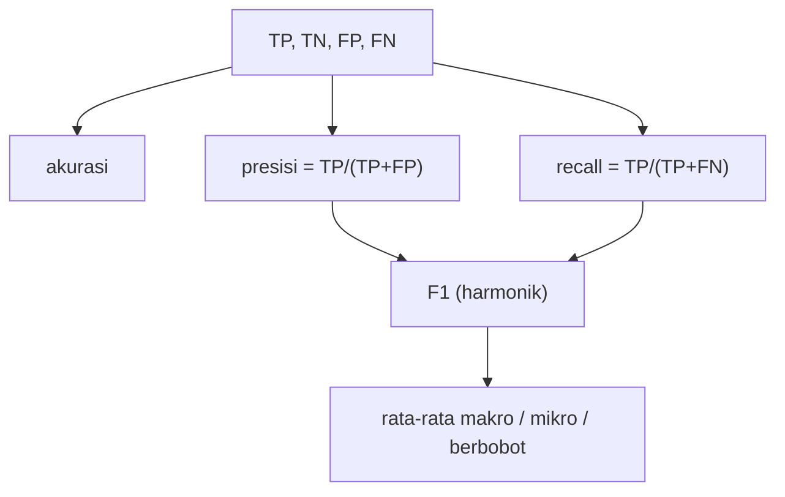

# Accuracy, Precision, Recall, F1, dan Rata-rata Makro / Mikro / Berbobot

!!! abstract "Info materi"
    **Tingkat kesulitan:** Menengah. **Estimasi waktu:** 120 menit.
    **Jenis kode:** snippet edukatif (`examples/level-5-evaluation/02_metrik.py`). Model rujukan: Linear SVM (halaman sebelumnya). Seluruh angka dari eksekusi nyata pada dataset **sintetis**.

## Tujuan pembelajaran

- [ ] Menghitung akurasi, presisi, recall, dan F1 dari confusion matrix, dengan tangan dan dengan scikit-learn.
- [ ] Menjelaskan pertanyaan yang dijawab tiap metrik, dan metrik mana yang peka terhadap FN atau FP.
- [ ] Menjelaskan mengapa F1 memakai rata-rata harmonik.
- [ ] Membedakan rata-rata makro, mikro, dan berbobot dan kapan hasilnya berbeda.
- [ ] Menjelaskan mengapa akurasi menyesatkan pada kelas tidak seimbang.

## Prasyarat

- [Confusion Matrix](confusion-matrix.md).

## Pengantar dan motivasi

Satu confusion matrix berisi empat angka; untuk membandingkan model kita sering
memerlukan ringkasan yang lebih pendek. Tiap ringkasan menjawab **pertanyaan berbeda**.
Memilih metrik berarti memilih pertanyaan yang kita anggap penting. Pada tanggap darurat
pertanyaannya: *dari semua pesan darurat, berapa yang kita temukan?* (recall) dan *dari semua yang
kita tandai darurat, berapa yang benar-benar darurat?* (presisi).

## Konsep dasar

Dengan Emergency sebagai kelas positif dan hitungan TP, TN, FP, FN:

| Metrik | Rumus | Pertanyaan yang dijawab |
|---|---|---|
| **Akurasi** | $\dfrac{TP+TN}{TP+TN+FP+FN}$ | Berapa bagian seluruh tebakan yang benar? |
| **Presisi** (*precision*) | $\dfrac{TP}{TP+FP}$ | Dari yang ditebak Emergency, berapa yang benar Emergency? |
| **Recall** (*sensitivity*) | $\dfrac{TP}{TP+FN}$ | Dari Emergency sebenarnya, berapa yang ditemukan? |
| **F1** | $\dfrac{2 \cdot \text{presisi} \cdot \text{recall}}{\text{presisi} + \text{recall}}$ | Satu angka yang menggabungkan presisi dan recall |

Presisi tinggi berarti **FP rendah**; recall tinggi berarti **FN rendah**.

### Contoh numerik

Sepuluh teks: TP = 3, FN = 1, FP = 1, TN = 5.

- Akurasi $= (3+5)/10 = 0{,}8$.
- Presisi $= 3/(3+1) = 0{,}75$.
- Recall $= 3/(3+1) = 0{,}75$.
- F1 $= 2 \times 0{,}75 \times 0{,}75/(0{,}75+0{,}75) = 0{,}75$.

## Penjelasan mendalam

### Mengapa F1 memakai rata-rata harmonik

Rata-rata biasa dari presisi 1,0 dan recall 0,1 adalah 0,55, seolah-olah cukup baik.
Rata-rata harmonik ($2pr/(p+r)$) memberi $2 \times 1{,}0 \times 0{,}1/1{,}1 = 0{,}18$. Rata-rata harmonik
**dikendalikan nilai yang kecil**: model tidak dapat menutupi recall buruk dengan presisi bagus.

### F-beta: menekankan recall

$$
F_\beta = (1+\beta^2)\,\frac{\text{presisi}\cdot\text{recall}}{\beta^2\cdot\text{presisi} + \text{recall}}
$$

$\beta = 1$ adalah F1. $\beta > 1$ (misalnya $F_2$) membobot **recall** lebih berat; $\beta < 1$ ($F_{0{,}5}$)
membobot presisi. Pemilihan $\beta$ adalah keputusan tentang biaya FN vs FP dan harus
dibenarkan; ia bukan "trik" untuk membuat skor tampak baik.

### Rata-rata untuk beberapa kelas

Untuk metrik per kelas (mis. F1), ada tiga cara merata-ratakan:

- **Makro:** rata-rata sederhana per kelas; semua kelas bobot sama. Peka terhadap kelas kecil.
- **Berbobot** (*weighted*): rata-rata dengan bobot jumlah contoh (*support*) tiap kelas.
- **Mikro:** gabungkan TP, FP, FN seluruh kelas lalu hitung sekali. Pada klasifikasi satu label per contoh, F1 mikro **sama dengan akurasi**.

Pada kelas seimbang, makro dan berbobot sama; pada kelas tidak seimbang, berbobot mendekati kelas besar.

### Akurasi dan kelas tidak seimbang

Pada data dengan 5% Emergency, model yang selalu menjawab Non-Emergency mencapai akurasi 0,95
dan tidak menemukan satu Emergency pun (Bagian 5). Karena itu akurasi tidak boleh menjadi satu-satunya
metrik, dan kita menyertakan baseline ([Class Imbalance dan Baseline](class-imbalance-baseline.md)).

## Cara kerja atau alur proses



## Contoh sederhana

Model A: presisi 1,0 dan recall 0,1 → F1 = 0,18. Model B: presisi 0,6 dan recall 0,6 → F1 = 0,6. Walau
rata-rata biasa model A (0,55) hampir sama dengan model B (0,6), F1 menunjukkan model B jauh lebih seimbang.

## Contoh dalam konteks Twitter/X kebencanaan

Linear SVM pada teks tulis-tangan menghasilkan presisi 1,0 (tidak ada alarm palsu) tetapi recall 0,625
(sembilan pesan darurat terlewat). F1 = 0,769 menggabungkan keduanya, dan F1 saja
tidak memberi tahu bahwa seluruh kesalahannya adalah FN. Itu sebabnya kita melaporkan presisi dan recall terpisah.

## Praktik Python

Berkas: `examples/level-5-evaluation/02_metrik.py`.

### Bagian 1 — Menghitung dengan tangan

```python title="Bagian 1"
--8<-- "level-5-evaluation/02_metrik.py:manual"
```

Empat baris pertama menghitung TP, TN, FP, FN dari topeng boolean. Empat baris berikutnya adalah rumus di atas. `np.allclose` membandingkan dengan empat fungsi scikit-learn.

```text title="Output nyata"
TP=15 TN=24 FP=0 FN=9
akurasi=0.812 presisi=1.000 recall=0.625 F1=0.769
sama dengan scikit-learn: True
```

Interpretasi: pada tulis-tangan, akurasi 0,812; presisi 1,000 karena FP = 0; recall 0,625 =
15/24; F1 = 0,769. Semuanya sama dengan scikit-learn.

### Bagian 2 — `classification_report`

```python title="Bagian 2"
--8<-- "level-5-evaluation/02_metrik.py:laporan"
```

```text title="Output nyata"
               precision    recall  f1-score   support

Non-Emergency      0.727     1.000     0.842        24
    Emergency      1.000     0.625     0.769        24

     accuracy                          0.812        48
    macro avg      0.864     0.812     0.806        48
 weighted avg      0.864     0.812     0.806        48
```

Interpretasi: laporan menampilkan presisi, recall, dan F1 **per kelas** dan rata-ratanya.
Untuk kelas Non-Emergency, recall 1,000 dan presisi 0,727: 9 pesan darurat yang terlewat
"masuk" ke kelas Non-Emergency dan menurunkan presisinya (24/(24+9) = 0,727). Perhatikan: kelas
Emergency memiliki presisi sempurna tetapi recall terendah, kebalikan dari Non-Emergency.

### Bagian 3 — Makro, mikro, berbobot

```python title="Bagian 3"
--8<-- "level-5-evaluation/02_metrik.py:rata_rata"
```

`np.bincount(yy)` menghitung dukungan tiap kelas. Baris `macro manual` dan `weighted manual` menghitung rata-rata dengan tangan.

```text title="Output nyata"
uji sintetis (74 Non-E, 38 E)
  F1 per kelas [Non-E, E]: [0.986 0.974] | dukungan: [74 38]
  macro=0.980  weighted=0.982  micro=0.982  akurasi=0.982
  macro manual=0.980  weighted manual=0.982
tulis-tangan (24 Non-E, 24 E)
  F1 per kelas [Non-E, E]: [0.842 0.769] | dukungan: [24 24]
  macro=0.806  weighted=0.806  micro=0.812  akurasi=0.812
  macro manual=0.806  weighted manual=0.806
```

Interpretasi:

- **Uji sintetis** (kelas tidak seimbang 74:38): makro 0,980 ≠ berbobot 0,982 (dipengaruhi kelas besar). F1 mikro 0,982 sama dengan akurasi 0,982.
- **Tulis-tangan** (seimbang 24:24): makro = berbobot = 0,806. F1 mikro 0,812 sama dengan akurasi 0,812.
- Perhitungan manual cocok dengan scikit-learn.

### Bagian 4 — F-beta

```python title="Bagian 4"
--8<-- "level-5-evaluation/02_metrik.py:fbeta"
```

```text title="Output nyata"
F0.5 = 0.893
F1   = 0.769
F2   = 0.676
```

Interpretasi: model ini presisi sempurna (1,0) tetapi recall 0,625, jadi $F_{0{,}5}$ (menekankan presisi) = 0,893
tinggi, sedangkan $F_2$ (menekankan recall) = 0,676 rendah. Ketiganya menilai **model yang sama**; yang
berubah adalah apa yang kita anggap penting. Pada tanggap darurat, $F_2$ lebih sesuai dengan prioritas
recall, tetapi bobot tepatnya harus ditetapkan dengan analisis biaya yang dapat dipertanggungjawabkan.

### Bagian 5 — Akurasi pada data tidak seimbang

```python title="Bagian 5"
--8<-- "level-5-evaluation/02_metrik.py:ketergantungan"
```

Data buatan 100 teks dengan 5 Emergency; dua "model" tanpa belajar: selalu 0 dan selalu 1.

```text title="Output nyata"
selalu Non-Emergency  akurasi=0.95 presisi=0.00 recall=0.00 F1=0.000
selalu Emergency      akurasi=0.05 presisi=0.05 recall=1.00 F1=0.095
```

Interpretasi: "selalu Non-Emergency" berakurasi 0,95 tanpa menemukan satu pun Emergency (F1 = 0). "Selalu
Emergency" mempunyai recall 1,0 (tidak melewatkan apa pun) tetapi presisi 0,05 dan akurasi 0,05. Tidak ada
satu angka yang cukup; kita memerlukan semuanya, dan baseline.

### Skrip terpadu

`metrik_emergency` di `examples/nlp_hub/eksperimen.py` menghitung akurasi, presisi, recall, F1 Emergency,
dan F1 makro dalam satu fungsi; tes: `test_metrik_emergency_nilai_diketahui` dan
`test_metrik_tanpa_prediksi_positif_tidak_error`.

## Kesalahan umum dan debugging

| Gejala | Penyebab | Perbaikan |
|---|---|---|
| `UndefinedMetricWarning` pada presisi | Tidak ada prediksi positif (pembagian 0/0) | `zero_division=0` dan laporkan bahwa tidak ada prediksi positif |
| Recall dihitung untuk kelas salah | `pos_label` bawaan = 1 | Tetapkan `pos_label` dan periksa pengodean |
| F1 makro dikira F1 Emergency | Dua angka berbeda | Laporkan keduanya dengan jelas |
| Akurasi tinggi dianggap bagus | Kelas tidak seimbang | Laporkan presisi/recall per kelas dan baseline |
| `average="binary"` pada multikelas | Argumen salah | Pakai `macro`/`weighted`/`micro` |
| Membandingkan F1 antar-dataset berbeda | Proporsi kelas berbeda | Bandingkan hanya pada data yang sama |

## Kelebihan dan keterbatasan

**Presisi/recall/F1:** fokus pada kelas minoritas, jelas maknanya. **Keterbatasan:** semuanya bergantung pada
satu ambang (halaman [Threshold](threshold-pr-roc.md)); F1 menyamakan bobot presisi dan recall yang
mungkin tidak sesuai biaya nyata; presisi sangat bergantung pada proporsi kelas pada data uji
(halaman [Class Imbalance](class-imbalance-baseline.md)); metrik tidak menjelaskan *mengapa* model salah.

## Latihan bertahap

1. **Konseptual.** Metrik mana yang peka terhadap FN, dan mana yang peka terhadap FP?
2. **Menghitung.** Hitung presisi, recall, dan F1 untuk TP = 8, FP = 2, FN = 4.
3. **Membaca output.** Pada `classification_report`, mengapa presisi Non-Emergency (0,727) lebih rendah daripada presisi Emergency (1,000)?
4. **Debugging.** `precision_score(y, p)` memberi peringatan dan hasil 0. Apa kemungkinan penyebab dan perbaikannya?
5. **Analisis.** Kapan F1 makro dan F1 berbobot berbeda jauh? Beri contoh tidak seimbang.

## Kunci jawaban dan pembahasan

??? success "Jawaban 1"
    Recall peka terhadap FN (pesan darurat terlewat); presisi peka terhadap FP (alarm palsu). Akurasi peka terhadap keduanya, tetapi dominan oleh kelas besar.

??? success "Jawaban 2"
    Presisi $=8/10=0{,}8$; recall $=8/12=0{,}667$; F1 $=2 \times 0{,}8 \times 0{,}667/(0{,}8+0{,}667)=0{,}727$.

??? success "Jawaban 3"
    Kelas "Non-Emergency" menerima 9 pesan darurat yang salah (FN kelas Emergency) sebagai tebakannya; dari 33 tebakan Non-Emergency, hanya 24 benar: 24/33 = 0,727. Kelas Emergency tidak punya FP (0), maka presisinya 1,0.

??? success "Jawaban 4"
    Model tidak memprediksi satu pun sampel sebagai kelas positif sehingga presisi = 0/0. Perbaikan: set `zero_division=0` dan laporkan fakta itu; periksa apakah model benar-benar tidak pernah menebak Emergency.

??? success "Jawaban 5"
    Ketika kelas sangat tidak seimbang dan performa antarkelas berbeda: F1 berbobot didominasi kelas besar (hampir sama dengan akurasi), sedangkan makro menghukum kelas kecil yang buruk. Contoh: kelas besar F1 0,99 dan kecil 0,40 dengan proporsi 95:5 → berbobot ≈ 0,96, makro ≈ 0,70.

## Kuis singkat

**1.** Apa pertanyaan yang dijawab recall?

??? success "Jawaban"
    Dari seluruh Emergency sebenarnya, berapa yang ditemukan.

**2.** Mengapa F1 memakai rata-rata harmonik?

??? success "Jawaban"
    Agar nilai yang kecil menarik hasilnya turun: presisi bagus tidak dapat menutupi recall buruk.

**3.** F1 mikro pada klasifikasi satu label sama dengan metrik apa?

??? success "Jawaban"
    Akurasi.

## Ringkasan

- Akurasi, presisi, recall, F1 menjawab pertanyaan berbeda; presisi ↔ FP, recall ↔ FN.
- F1 = rata-rata harmonik; F-beta menggeser tekanan ke recall ($\beta>1$) atau presisi ($\beta<1$).
- Linear SVM pada tulis-tangan: akurasi 0,812; presisi 1,000; recall 0,625; F1 0,769; F2 0,676.
- Makro, mikro, berbobot berbeda pada kelas tidak seimbang; akurasi 0,95 bisa dicapai tanpa menemukan Emergency.

## Glosarium istilah baru

Akurasi
:   Proporsi tebakan yang benar.

Presisi (*precision*)
:   TP/(TP+FP): ketepatan tebakan positif.

Recall (*sensitivity*)
:   TP/(TP+FN): kelengkapan menemukan kasus positif.

F1 / F-beta
:   Rata-rata harmonik presisi dan recall; $\beta$ mengatur tekanan pada recall.

Support
:   Jumlah contoh sebenarnya tiap kelas.

Rata-rata makro / mikro / berbobot
:   Cara menggabungkan metrik per kelas menjadi satu angka.

## Referensi

- Dokumentasi scikit-learn, *Classification metrics* (akurasi, presisi, recall, F-measure, averaging): <https://scikit-learn.org/stable/modules/model_evaluation.html#classification-metrics> (dokumentasi resmi).
- Dokumentasi scikit-learn, `classification_report`: <https://scikit-learn.org/stable/modules/generated/sklearn.metrics.classification_report.html>.

## Materi berikutnya

[Class Imbalance dan Baseline](class-imbalance-baseline.md)
