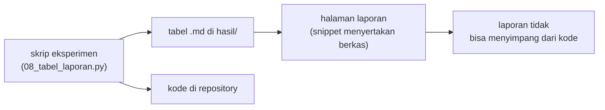

# Tabel Perbandingan Eksperimen dan Penulisan Laporan Eksperimen

!!! abstract "Info materi"
    **Tingkat kesulitan:** Menengah–lanjut. **Estimasi waktu:** 150 menit.
    **Jenis kode:** **eksperimen** (`examples/level-5-evaluation/08_tabel_laporan.py`). Tabel pada halaman ini **disertakan langsung dari berkas hasil** (`examples/level-5-evaluation/hasil/*.md`) yang ditulis oleh skrip, sehingga selalu sama dengan keluaran eksekusi. Ini adalah tabel Tahap F proyek utama.

## Tujuan pembelajaran

- [ ] Menyusun tabel perbandingan eksperimen yang dihasilkan dari kode, bukan diketik tangan.
- [ ] Memilih kolom tabel: metrik per kelas, hitungan kesalahan, selang ketidakpastian, waktu pelatihan.
- [ ] Menulis laporan eksperimen dengan struktur ilmiah: tujuan, data, metode, hasil, analisis, keterbatasan, kesimpulan, jejak reproducibility.
- [ ] Menulis kesimpulan yang sesuai dengan bukti dan memisahkan fakta dari dugaan.

## Prasyarat

Seluruh halaman Level 5 sebelumnya.

## Pengantar dan motivasi

Hasil eksperimen yang tidak dikomunikasikan dengan baik tidak berguna. Dua kegagalan paling umum:
(1) angka disalin tangan dan lama-kelamaan tidak cocok dengan kode; (2) kesimpulan melampaui bukti.
Halaman ini memecahkan keduanya: tabel dihasilkan skrip dan disertakan otomatis, dan laporan contoh di
bawah menulis kesimpulan hanya sejauh yang didukung data.

## Konsep dasar

### Kolom yang wajib ada (spesifikasi Tahap F)

| Kolom | Alasan |
|---|---|
| Akurasi | Ringkasan umum (dengan baseline) |
| Presisi, recall, F1 kelas Emergency | Fokus tugas |
| F1 makro | Ringkasan yang tidak berpihak pada kelas besar |
| Waktu training (bila diukur) | Biaya komputasi |
| Catatan kesalahan penting | FN dan FP, bukan hanya skor |

Tambahan yang kami anjurkan: **selang ketidakpastian** (bootstrap) dan **baseline**.

### Struktur laporan eksperimen

1. **Ringkasan** (apa temuan utama, dengan batasannya).
2. **Tujuan dan pertanyaan.**
3. **Data:** sumber, pembuatan label, ukuran, proporsi kelas, keterbatasan, privasi.
4. **Metode:** preprocessing, representasi, model, pembagian data, metrik, seed.
5. **Hasil:** tabel dan, bila perlu, gambar.
6. **Analisis kesalahan.**
7. **Ketidakpastian dan batas kesimpulan.**
8. **Keterbatasan.**
9. **Kesimpulan dan langkah berikut.**
10. **Reproducibility:** versi, seed, checksum, cara menjalankan ulang.

## Penjelasan mendalam

### Aturan menulis kesimpulan

- Setiap klaim harus menunjuk ke angka atau tabel.
- Pisahkan **fakta** ("recall NB 0,833") dari **dugaan** ("mungkin karena ...").
- Sebut ukuran data dan ketidakpastian ("48 teks; selang 95% [0,67; 0,96]").
- Jangan menyimpulkan lebih luas dari data ("pada data sintetis ini", bukan "pada pesan darurat").
- Laporkan hasil yang tidak mendukung hipotesis Anda.
- Jangan menyebut sistem "siap operasional" tanpa validasi yang sesuai.

### Dua tabel, dua pertanyaan

Pada proyek ini ada dua jenis evaluasi dengan makna berbeda:

- **Uji sintetis** (112 teks): *apakah kode bekerja dan model mengenali pola data bertemplat?*
- **Tulis-tangan** (48 teks): *seberapa terpengaruh model oleh gaya penulisan yang tidak ada di templat?*

Keduanya sintetis; tidak ada yang menjawab "seberapa baik pada pesan nyata".

## Cara kerja atau alur proses



## Contoh sederhana

Satu baris tabel: "Multinomial NB | akurasi 0,917 | presisi 1,000 | recall 0,833 | F1 0,909 | FN 4 | FP 0".
Baris itu menjawab: *dari 24 pesan darurat, empat terlewat; tidak ada alarm palsu.*

## Contoh dalam konteks Twitter/X kebencanaan

Pembaca laporan adalah pengelola sistem tanggap darurat. Yang mereka butuhkan: seberapa banyak pesan darurat yang
mungkin terlewat (FN), seberapa banyak alarm palsu (FP), seberapa pasti angka itu, dan apa batas data yang dipakai.

## Praktik Python

Berkas: `examples/level-5-evaluation/08_tabel_laporan.py`.

### Bagian 1 — Tabel validasi silang

```python title="Bagian 1"
--8<-- "level-5-evaluation/08_tabel_laporan.py:cv"
```

Validasi silang 5 lipatan per kejadian pada 452 teks pengembangan; `md(...)` (fungsi kecil di skrip) mengubah `DataFrame` menjadi tabel Markdown. Hasilnya ditulis ke `hasil/tabel_cv.md`.

### Bagian 2 — Tabel uji akhir dengan selang bootstrap

```python title="Bagian 2"
--8<-- "level-5-evaluation/08_tabel_laporan.py:uji"
```

Tiap model dilatih pada 452 teks dan diuji **sekali** pada uji sintetis dan tulis-tangan. `FN` dan `FP` dihitung langsung dari prediksi; selang 95% recall memakai bootstrap 2.000 resampel (halaman sebelumnya). Hasilnya ditulis ke `hasil/tabel_uji_sintetis.md` dan `hasil/tabel_tulis_tangan.md`.

### Bagian 3 — Waktu pelatihan

```python title="Bagian 3"
--8<-- "level-5-evaluation/08_tabel_laporan.py:waktu"
```

Median dari lima pelatihan agar tidak dipengaruhi satu pelatihan yang kebetulan lambat. Waktu **berubah-ubah** antar-eksekusi dan mesin, sehingga tidak ikut disertakan otomatis.

```text title="Output nyata, waktu berubah-ubah"
WAKTU LATIH median 5 kali (detik): {'Baseline: selalu Non-Emergency': '0.000', 'Multinomial NB': '0.009', 'Logistic Regression': '0.012', 'Linear SVM': '0.009'}
```

Interpretasi: ketiga model dilatih dalam sekitar 0,01 detik pada 452 teks; waktu pelatihan tidak membedakan
pilihan pada data sekecil ini. Pada data jutaan teks, perbedaan itu bisa menentukan.

## Hasil (disertakan langsung dari berkas hasil)

### Tabel 1 — Validasi silang (452 teks pengembangan, 5 lipatan per kejadian; rata-rata ± simpangan baku)

--8<-- "level-5-evaluation/hasil/tabel_cv.md"

### Tabel 2 — Uji sintetis (112 teks; 38 Emergency; model dilatih pada 452 teks)

--8<-- "level-5-evaluation/hasil/tabel_uji_sintetis.md"

### Tabel 3 — Uji tulis-tangan (48 teks; 24 Emergency)

--8<-- "level-5-evaluation/hasil/tabel_tulis_tangan.md"

Catatan membaca: `FN` = pesan Emergency yang terlewat; `FP` = Non-Emergency yang salah ditandai; selang 95%
adalah selang persentil bootstrap untuk recall Emergency.

## Laporan eksperimen contoh

Berikut laporan singkat yang memakai tabel di atas. Strukturnya dapat dipakai sebagai templat.

### 1. Ringkasan

Tiga baseline klasik (TF-IDF + Multinomial NB, Logistic Regression, Linear SVM) dibandingkan untuk klasifikasi
Emergency / Non-Emergency pada **dataset sintetis**. Pada validasi silang dan uji sintetis, ketiganya
mencapai F1 makro 0,970–0,995 dan jauh di atas baseline. Pada 48 teks tulis-tangan bergaya berbeda, recall
Emergency turun menjadi 0,833 (NB), 0,625 (SVM), dan 0,417 (LR), dengan 4, 9, dan 14 pesan darurat terlewat dan tanpa
alarm palsu. Hasil ini **tidak** mendukung klaim kelayakan operasional.

### 2. Tujuan dan pertanyaan

(1) Apakah ketiga baseline mengenali pola pada data bertemplat? (2) Seberapa besar performa turun pada
teks bergaya berbeda? (3) Apakah ada algoritma yang lebih baik secara konsisten?

### 3. Data

564 teks sintetis hasil templat (duplikat persis dibuang; 191 Emergency, 373 Non-Emergency) dan 48 teks tulis-tangan
(24/24). Label ditentukan dari jenis templat (data templat) atau oleh satu penulis (tulis-tangan); tidak ada anotator manusia
independen dan tidak ada ukuran kesepakatan. Detail dan keterbatasan: `DATA_CARD.md`. Tidak ada data pribadi.

### 4. Metode

Preprocessing dasar (huruf kecil, token URL/mention, hashtag dipecah, emoji menjadi token, normalisasi
informal), TF-IDF unigram, parameter model bawaan (belum di-tuning). Pembagian per `event_id`; model
dilatih pada 452 teks (latih + validasi) dan diuji sekali. Metrik: akurasi, presisi/recall/F1 Emergency, F1 makro.
Seed 42.

### 5. Hasil

Lihat Tabel 1–3.

### 6. Analisis kesalahan

Pada tulis-tangan, seluruh kesalahan adalah FN. Untuk SVM, tujuh dari sembilan FN berskor mendekati batas
keputusan (−0,03 sampai −0,17). Cakupan kosakata latih tidak membedakan FN dari TP (0,57 vs 0,59). Dua FP pada
uji sintetis dipicu kata kunci "butuh bantuan" pada topik non-darurat.

### 7. Ketidakpastian

Recall tulis-tangan SVM 0,625 dengan selang bootstrap 95% [0,43; 0,81]. Selisih recall NB − LR jelas ([+0,22; +0,63]),
tetapi NB − SVM tidak ([+0,00; +0,45]). Selang hanya mencakup variasi pengambilan sampel teks uji.

### 8. Keterbatasan

Data sintetis dan bertemplat (59 dari 61 templat uji ada di latih); label tulis-tangan oleh satu orang yang juga
penulis data; satu seed untuk model akhir; parameter belum di-tuning; tidak ada data nyata dan tidak ada validasi anotator.

### 9. Kesimpulan

- Ketiga baseline mengenali pola data bertemplat dengan sangat baik (F1 makro 0,970–0,995), jauh di atas baseline.
- Pada teks bergaya berbeda, recall Emergency turun tajam dan peringkat model berubah; tidak ada model yang dapat disebut terbaik.
- Skor pada dataset ini tidak boleh dipakai untuk menyatakan model layak untuk tanggap darurat.
- Langkah berikut: data nyata dengan label dari beberapa anotator, evaluasi per kelompok, tuning dengan validasi yang representatif,
  dan evaluasi ambang berdasarkan biaya FN dan FP.

### 10. Reproducibility

Versi pustaka dan checksum data dicetak oleh `07_leakage_reproducibility.py` (scikit-learn 1.9.1, Python 3.14.7, seed 42).
Jalankan `python examples/level-5-evaluation/08_tabel_laporan.py` untuk membuat ulang tabel.

## Kesalahan umum dan debugging

| Gejala | Penyebab | Perbaikan |
|---|---|---|
| Tabel di laporan tidak cocok dengan kode | Angka disalin tangan | Hasilkan tabel dari skrip dan sertakan otomatis |
| Hanya satu metrik dilaporkan | Memilih yang paling bagus | Laporkan seluruh kolom wajib dan hitungan FN/FP |
| Kesimpulan lebih luas dari data | Overgeneralisasi | Batasi ("pada data sintetis ini") |
| Waktu pelatihan dilaporkan tanpa konteks | Waktu bergantung mesin | Sebut mesin, ukuran data, dan jumlah pengulangan |
| Tidak menyebut baseline | Tidak ada pembanding | Sertakan baseline di tabel |
| Hasil negatif disembunyikan | Bias publikasi | Laporkan, termasuk hipotesis yang tidak didukung |

## Kelebihan dan keterbatasan

**Kelebihan:** tabel otomatis menjaga laporan sinkron dengan kode; struktur laporan mendorong kejujuran
tentang ketidakpastian dan batasan.
**Keterbatasan:** tabel hanya sebaik data dan protokolnya; selang bootstrap tidak mencakup semua sumber
variasi; laporan contoh ini ringkas dan belum memuat gambar, uji signifikansi, atau analisis biaya.

## Latihan bertahap

1. **Konseptual.** Mengapa tabel disertakan dari berkas hasil dan tidak diketik tangan?
2. **Membaca tabel.** Dari Tabel 3, berapa pesan darurat yang terlewat oleh Linear SVM, dan berapa alarm palsu?
3. **Menulis.** Tulis satu kalimat kesimpulan untuk Tabel 2 yang tidak melampaui bukti.
4. **Debugging.** Laporan menyatakan "NB adalah model terbaik". Sebutkan dua data pada halaman ini yang membatasi klaim itu.
5. **Mini-proyek.** Tambahkan kolom `F2 E` ke tabel uji (gunakan `fbeta_score(beta=2)`), jalankan ulang, dan tulis satu paragraf analisis.

## Kunci jawaban dan pembahasan

??? success "Jawaban 1"
    Agar angka di laporan selalu sama dengan keluaran kode. Salinan tangan bisa salah ketik atau tertinggal ketika kode berubah.

??? success "Jawaban 2"
    9 pesan terlewat (FN = 9) dan 0 alarm palsu (FP = 0), dengan recall 0,625.

??? success "Jawaban 3"
    Contoh: "Pada uji sintetis (112 teks), ketiga model berbeda satu atau dua teks (FN 0–2, FP 0–2), sehingga tidak ada yang dapat dikatakan lebih baik." Kalimat ini menyebut ukuran data, angka, dan batas.

??? success "Jawaban 4"
    (1) Selisih NB − SVM pada tulis-tangan memiliki selang [+0,00; +0,45] yang menyentuh 0. (2) Pada validasi silang, SVM justru terbaik (0,995 vs 0,983); peringkat berubah antar-evaluasi. Tambahan: set tulis-tangan hanya 48 teks dan dilabeli satu orang.

??? success "Jawaban 5"
    Tidak ada angka yang diberikan di sini; jalankan sendiri. Bingkai analisis: $F_2$ membobot recall lebih berat; model dengan recall tinggi dan presisi lebih rendah (SVM pada uji sintetis: recall 1,000, presisi 0,950) akan naik peringkatnya dibanding F1. Jelaskan bahwa pilihan $\beta$ adalah keputusan tentang biaya FN, bukan trik.

## Kuis singkat

**1.** Kolom apa yang wajib ada pada tabel perbandingan menurut spesifikasi proyek?

??? success "Jawaban"
    Akurasi, presisi, recall, F1, F1 makro, waktu training bila diukur, dan catatan kesalahan penting.

**2.** Mengapa laporan harus menyebut keterbatasan?

??? success "Jawaban"
    Agar pembaca tidak menganggap hasil pada data sintetis atau kecil berlaku umum, dan agar keputusan berdasar laporan tidak berlebihan.

**3.** Apa beda fakta dan dugaan dalam laporan?

??? success "Jawaban"
    Fakta menunjuk ke angka yang diukur; dugaan adalah penjelasan yang belum diuji dan harus ditandai sebagai dugaan.

## Ringkasan

- Tabel dihasilkan skrip dan disertakan otomatis dari `hasil/*.md`; kolom wajib: akurasi, presisi/recall/F1, F1 makro, waktu, catatan kesalahan.
- Laporan: ringkasan, tujuan, data, metode, hasil, analisis kesalahan, ketidakpastian, keterbatasan, kesimpulan, reproducibility.
- Hasil utama: F1 makro 0,970–0,995 pada data bertemplat; pada tulis-tangan recall 0,833 / 0,625 / 0,417 dengan 4 / 9 / 14 FN dan 0 FP.
- Tidak ada model yang dapat disebut terbaik, dan tidak ada klaim kelayakan operasional.

## Glosarium istilah baru

Laporan eksperimen
:   Dokumen yang memaparkan tujuan, data, metode, hasil, dan batasan sebuah eksperimen.

Fakta vs dugaan
:   Pernyataan yang didukung angka vs penjelasan yang belum diuji.

Jejak reproducibility
:   Catatan versi, seed, data, dan langkah untuk mengulang eksperimen.

## Referensi

- Mitchell, M., Wu, S., Zaldivar, A., Barnes, P., Vasserman, L., Hutchinson, B., Spitzer, E., Raji, I. D., & Gebru, T. (2019). Model cards for model reporting. *Proceedings of FAT\* '19*, 220–229. DOI: 10.1145/3287560.3287596 (makalah akademik tentang dokumentasi model; detail diperiksa lewat pencarian daring; dibahas di Level 7).
- Gebru, T., dkk. (2021). Datasheets for datasets. *Communications of the ACM*, 64(12), 86–92. DOI: 10.1145/3458723 (rujukan untuk Kartu Data).
- Dokumentasi scikit-learn, *Metrics and scoring*: <https://scikit-learn.org/stable/modules/model_evaluation.html> (dokumentasi resmi).

## Materi berikutnya

Level 5 selesai. Lanjut ke [Level 6: Deep Learning](../level-6-deep-learning/index.md).
