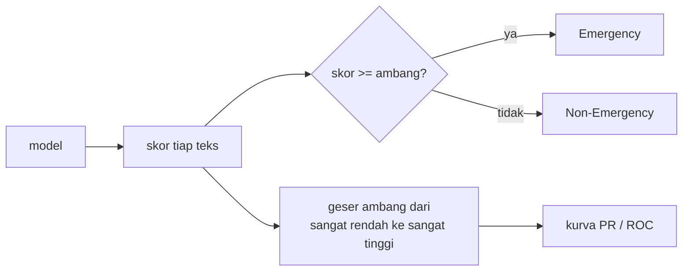

# Threshold, Kurva Precision-Recall, dan ROC/AUC

!!! abstract "Info materi"
    **Tingkat kesulitan:** Menengah–lanjut. **Estimasi waktu:** 150 menit.
    **Jenis kode:** **eksperimen** (`examples/level-5-evaluation/04_threshold_pr_roc.py`) dan pembuat gambar (`gambar_level5.py`). Model rujukan: Linear SVM; angka dari eksekusi nyata pada dataset **sintetis**.

## Tujuan pembelajaran

- [ ] Menjelaskan bahwa label prediksi dihasilkan dari skor dan **ambang**, dan bahwa ambang menukar presisi dan recall.
- [ ] Membaca kurva presisi-recall dan kurva ROC, serta AUC dan *average precision*.
- [ ] Menjelaskan kapan ROC/AUC relevan dan keterbatasannya pada data tidak seimbang.
- [ ] Membedakan **menjelajahi** trade-off dari **menetapkan** ambang, dan mengapa yang kedua memerlukan data validasi yang representatif.
- [ ] Menjelaskan mengapa ambang yang dipilih pada satu distribusi data bisa gagal pada distribusi lain.

## Prasyarat

- [Metrik Klasifikasi](metrik-klasifikasi.md) dan [Class Imbalance](class-imbalance-baseline.md).
- [Linear SVM](../level-4-machine-learning/linear-svm.md): skor keputusan.

## Pengantar dan motivasi

Model memberi **skor** untuk setiap teks; label dihasilkan dengan aturan sederhana: "jika skor ≥ ambang,
Emergency". Ambang bawaan (0 untuk SVM, 0,5 untuk probabilitas) tidak sakral. Menurunkan ambang membuat lebih banyak teks
ditandai Emergency: recall naik, tetapi FP juga naik. Menaikkannya melakukan sebaliknya. Spesifikasi proyek
menegaskan: **jangan menetapkan ambang produksi tanpa evaluasi dan validasi yang sesuai.** Halaman ini
menunjukkan mengapa pesan itu serius.

## Konsep dasar

| Istilah | Rumus / arti |
|---|---|
| **Ambang** $\tau$ | Prediksi Emergency bila skor $\ge \tau$ |
| **TPR** (*true positive rate*) = recall | $TP/(TP+FN)$ |
| **FPR** (*false positive rate*) | $FP/(FP+TN)$: dari Non-Emergency, berapa bagian yang salah ditandai |
| **Kurva ROC** | TPR terhadap FPR untuk semua ambang |
| **Kurva presisi-recall (PR)** | Presisi terhadap recall untuk semua ambang |
| **AUC** (*area under ROC curve*) | Luas di bawah kurva ROC; 1,0 sempurna, 0,5 acak |
| **Average precision (AP)** | Ringkasan luas kurva PR (rata-rata presisi tertimbang recall) |

**Arti AUC.** AUC adalah peluang bahwa sebuah contoh **positif** yang dipilih acak mendapat skor
lebih tinggi daripada contoh **negatif** yang dipilih acak. Ia mengukur **kualitas urutan skor**,
bukan label pada satu ambang.

## Penjelasan mendalam

### Trade-off presisi dan recall

Menurunkan ambang: lebih banyak teks lolos sebagai Emergency. Recall tidak pernah turun (TP naik atau tetap);
presisi biasanya turun karena FP bertambah. Kurva PR menggambarkan seluruh trade-off.

### Kapan ROC/AUC relevan

- Cocok untuk menilai **kualitas pengurutan** dan membandingkan model tanpa memilih ambang.
- Pada **data tidak seimbang**, FPR memakai jumlah Non-Emergency yang besar di penyebut, sehingga FPR kecil
  walaupun jumlah FP besar. ROC dapat tampak sangat baik padahal presisi buruk. Saito dan Rehmsmeier (2015)
  mengajukan argumen ini untuk memilih kurva PR pada data tidak seimbang.
- AUC tidak memberi tahu **ambang mana** yang harus dipakai, juga tidak biaya FN vs FP.

### AUC tinggi tidak menjamin recall tinggi pada satu ambang

Bagian 3 menunjukkan contoh nyata: pada tulis-tangan, AUC = 0,976, tetapi recall pada ambang bawaan 0,625.
Urutan skor baik, tetapi ambang tidak pas untuk distribusi data tersebut.

### Menjelajahi versus menetapkan ambang

- **Menjelajahi** trade-off pada satu set (kurva, tabel ambang) adalah analisis yang sah untuk memahami model.
- **Menetapkan** ambang dengan memilih nilai terbaik di set uji yang sama adalah *data snooping*:
  ambang disesuaikan dengan set yang kemudian dipakai melaporkan performa (kebocoran seleksi).
- Ambang untuk penggunaan nyata harus dipilih pada **data validasi yang mewakili penggunaan sebenarnya**,
  dengan mempertimbangkan biaya FN vs FP dan kapasitas peninjau, lalu diuji pada data terpisah.
  Pada dataset sintetis ini, **tidak ada** data yang memenuhi syarat itu.

## Cara kerja atau alur proses



## Contoh sederhana

Lima teks dengan skor: 0,9 (Emergency), 0,7 (bukan), 0,6 (Emergency), 0,3 (Emergency), 0,1 (bukan).

- Ambang 0,5: ditebak Emergency untuk 0,9; 0,7; 0,6 → TP = 2, FP = 1, FN = 1. Presisi 2/3 = 0,67; recall 2/3 = 0,67.
- Ambang 0,25: ditebak Emergency untuk 0,9; 0,7; 0,6; 0,3 → TP = 3, FP = 1, FN = 0. Presisi 3/4 = 0,75; recall 3/3 = 1,0.
- Ambang 0,05: semua ditebak Emergency → TP = 3, FP = 2, FN = 0. Presisi 3/5 = 0,6; recall 1,0.

Menurunkan ambang dari 0,5 ke 0,05 menaikkan recall dari 0,67 menjadi 1,0, sedangkan presisi di ujung akhirnya
turun menjadi 0,6 (pada ambang 0,25 presisi kebetulan naik, karena teks Emergency 0,3 ikut tertangkap).

## Contoh dalam konteks Twitter/X kebencanaan

Pesan "Astaga dapur tetangga meledak, apinya udah ngejalar ke atap" mendapat skor −0,067
(sedikit di bawah 0) dari model, sehingga lolos sebagai Non-Emergency pada ambang bawaan. Menurunkan ambang sedikit akan
menangkapnya, tetapi juga menangkap pesan lain. Berapa banyak "alarm palsu" yang masih dapat ditoleransi
adalah keputusan tentang sumber daya, bukan keputusan statistik.

## Praktik Python

Berkas: `examples/level-5-evaluation/04_threshold_pr_roc.py`. Model: Linear SVM pada 452 teks pengembangan;
ambang dibicarakan pada skala skor keputusan (bukan probabilitas).

### Bagian 1 — Skor keputusan

```python title="Bagian 1"
--8<-- "level-5-evaluation/04_threshold_pr_roc.py:skor"
```

```text title="Output nyata"
skor keputusan SVM, rentang uji sintetis   : -1.17 sampai 1.18
skor keputusan SVM, rentang tulis-tangan   : -1.09 sampai 0.94
tulis-tangan, rata-rata skor Emergency     : 0.207
tulis-tangan, rata-rata skor Non-Emergency : -0.664
```

Interpretasi: skor berkisar sekitar −1 sampai 1. Pada tulis-tangan, rata-rata skor Emergency (0,207) jauh di atas rata-rata
Non-Emergency (−0,664), jadi **urutannya baik**. Tetapi rata-rata Emergency hanya sedikit di atas 0:
sebagian besar skor Emergency berada dekat batas keputusan, sehingga banyak yang jatuh di bawah ambang 0.

### Bagian 2 — Menjelajahi ambang pada tulis-tangan

```python title="Bagian 2"
--8<-- "level-5-evaluation/04_threshold_pr_roc.py:ambang"
```

Untuk tiap ambang, label diturunkan dari `skor >= ambang`; TP, FP, FN, dan metrik dihitung (24 Emergency di tulis-tangan, jadi FN = 24 − TP).

```text title="Output nyata"
 ambang  TP  FP  FN  presisi E  recall E  F1 E
   -0.8  24  18   0      0.571     1.000 0.727
   -0.6  24   9   0      0.727     1.000 0.842
   -0.4  22   3   2      0.880     0.917 0.898
   -0.2  22   0   2      1.000     0.917 0.957
    0.0  15   0   9      1.000     0.625 0.769
    0.2  11   0  13      1.000     0.458 0.629
```

Interpretasi: baris `0.0` adalah ambang bawaan (TP = 15, FN = 9). **Menurunkan ambang ke −0,2** menaikkan TP ke 22
(recall 0,917) tanpa FP; ke −0,6 menemukan semua 24 Emergency tetapi dengan 9 FP (presisi 0,727); ke −0,8
FP menjadi 18. Itulah trade-off: tidak ada ambang yang memberi recall 1,0 tanpa FP pada data ini.

!!! warning "Tabel ini adalah eksplorasi, bukan pemilihan"
    Tabel ini memakai set tulis-tangan untuk **memahami** model. Memilih "ambang −0,2 karena terbaik di
    tulis-tangan" lalu melaporkan skor tulis-tangan adalah *data snooping*: skornya tidak lagi independen.
    Bagian 4 menunjukkan bahkan jika ambang dipilih dengan cara yang benar, hasilnya tidak
    otomatis berlaku pada data bergaya lain.

### Bagian 3 — AUC dan average precision

```python title="Bagian 3"
--8<-- "level-5-evaluation/04_threshold_pr_roc.py:auc"
```

```text title="Output nyata"
uji sintetis  ROC-AUC=0.999  AP (PR-AUC)=0.998
tulis-tangan  ROC-AUC=0.976  AP (PR-AUC)=0.981
```


Interpretasi: AUC 0,999 (uji sintetis) dan 0,976 (tulis-tangan); AP 0,998 dan 0,981. Pada **kedua** set,
urutan skor hampir sempurna. Padahal recall tulis-tangan pada ambang bawaan hanya 0,625
dan akurasi 0,812. Ini contoh bagaimana AUC/AP tinggi **menyembunyikan** masalah ambang: model
"tahu" mana yang lebih mungkin darurat, tetapi ambang bawaan memotong di tempat yang salah untuk distribusi ini.
Dua set di grafik memiliki kurva berdekatan walau hasil pada ambang bawaan berbeda jauh.

Catatan: AP yang dicetak adalah `average_precision_score` (rata-rata presisi pada tiap ambang tertimbang
kenaikan recall), bukan integral trapesium PR; keduanya mirip tetapi tidak identik.

### Bagian 4 — Ambang dari validasi silang: apakah berlaku pada data lain?

```python title="Bagian 4"
--8<-- "level-5-evaluation/04_threshold_pr_roc.py:pilih"
```

Langkah:

1. `cross_val_predict(..., method="decision_function", groups=...)` menghitung skor setiap teks pengembangan dari model yang **tidak pernah melihat kejadian teks itu** (validasi silang berkelompok).
2. Dari kurva PR pada skor itu, dicari **ambang tertinggi** yang masih mencapai recall validasi silang ≥ 0,95.
3. Ambang tersebut diterapkan pada uji sintetis dan tulis-tangan dan dibandingkan dengan ambang 0.

```text title="Output nyata"
ambang terpilih dari validasi silang (recall CV >= 0.95): 0.495
data pengembangan (CV) ambang 0 (bawaan): presisi=0.993 recall=0.993 F1=0.993
data pengembangan (CV) ambang terpilih : presisi=1.000 recall=0.954 F1=0.977
uji sintetis           ambang 0 (bawaan): presisi=0.950 recall=1.000 F1=0.974
uji sintetis           ambang terpilih : presisi=1.000 recall=0.947 F1=0.973
tulis-tangan           ambang 0 (bawaan): presisi=1.000 recall=0.625 F1=0.769
tulis-tangan           ambang terpilih : presisi=1.000 recall=0.250 F1=0.400
```

Interpretasi:

- Pada data pengembangan, skor validasi silang sangat terpisah: ambang tertinggi yang masih menghasilkan recall 0,95
  adalah **0,495**, jauh di atas 0. Pada data bertemplat, ambang setinggi itu "aman".
- Pada uji sintetis (distribusi yang sama), ambang itu bekerja: recall 0,947, presisi 1,000.
- Pada **tulis-tangan, ambang yang sama membuat recall jatuh dari 0,625 menjadi 0,250** (6 dari 24 pesan
  darurat ditemukan). Ambang yang "terbukti" pada validasi silang justru lebih buruk pada gaya bahasa baru.
- Pelajaran: ambang tidak melekat pada model; ia bergantung pada **distribusi skor**, dan distribusi skor berubah
  ketika gaya bahasa berubah. Ambang yang dipilih dari data yang tidak representatif tidak dapat dipercaya.
  Dengan data sintetis bertemplat, kita tidak dapat menetapkan ambang operasional apa pun.

### Skrip terpadu

`04_threshold_pr_roc.py` berisi seluruh bagian dan berjalan beberapa detik. Gambar PR dan ROC dibuat oleh
`gambar_level5.py` (warna oranye dan biru yang sama dengan Level 3, lolos pemeriksaan pembeda warna).

## Kesalahan umum dan debugging

| Gejala | Penyebab | Perbaikan |
|---|---|---|
| Ambang dipilih dari skor uji | Data snooping | Pilih pada validasi; uji sekali |
| Skor keputusan SVM disebut probabilitas | Salah tafsir | Ambang 0 pada skor, bukan 0,5 |
| AUC tinggi dianggap sistem siap | AUC tidak menyebut ambang | Periksa presisi/recall pada ambang yang dipakai |
| Ambang dari data bertemplat dipakai pada data lain | Distribusi skor berubah | Pilih pada validasi yang representatif |
| ROC dipakai pada data sangat timpang | FPR menyembunyikan FP | Lihat kurva PR dan jumlah FP |
| `precision_recall_curve` memberi satu elemen presisi/recall lebih banyak daripada ambang | Titik terakhir (recall 0) tanpa ambang | Pakai `presisi[:-1]` dan `recall[:-1]` dengan `ambang` |

## Kelebihan dan keterbatasan

**Kurva PR/ROC:** meringkas performa pada semua ambang; AP/AUC tidak bergantung ambang.
**Keterbatasan:** ringkasan bukan keputusan; tidak memuat biaya FN vs FP; peka terhadap distribusi data evaluasi;
ROC menyesatkan pada data sangat tidak seimbang; kurva dari 48 teks tulis-tangan (24 Emergency) bertangga dan kasar.

## Latihan bertahap

1. **Konseptual.** Mengapa menurunkan ambang tidak pernah menurunkan recall?
2. **Membaca tabel.** Pada Bagian 2, ambang berapa yang menghasilkan recall 0,917 dengan FP = 0?
3. **Membaca output.** Mengapa AUC 0,976 tetapi recall 0,625 pada tulis-tangan tidak kontradiktif?
4. **Debugging.** Seseorang melaporkan "ambang −0,2 menghasilkan F1 0,957 pada tulis-tangan" sebagai performa akhir. Apa kesalahannya?
5. **Analisis.** Mengapa ambang terpilih 0,495 gagal pada tulis-tangan?

## Kunci jawaban dan pembahasan

??? success "Jawaban 1"
    Menurunkan ambang hanya menambah teks yang ditandai Emergency. TP tidak berkurang (paling tidak tetap), FN tidak bertambah; jadi recall naik atau tetap.

??? success "Jawaban 2"
    $-0{,}2$ (TP = 22, FP = 0, FN = 2, presisi 1,000, recall 0,917).

??? success "Jawaban 3"
    AUC mengukur urutan skor, bukan label pada satu ambang. Urutan bisa hampir sempurna sementara ambang bawaan 0 memotong di tempat yang salah untuk distribusi tulis-tangan, sehingga banyak Emergency berada di bawah 0.

??? success "Jawaban 4"
    Ambang dan skor dihitung pada set yang sama (data snooping); skor itu tidak independen dan terlalu optimistis. Ambang harus dipilih pada data validasi, lalu diuji pada data terpisah. Di sini pun, tulis-tangan bukan data validasi yang representatif.

??? success "Jawaban 5"
    Ambang dicari pada skor validasi silang data bertemplat, yang sangat terpisah, sehingga ambang tinggi (0,495) masih memberi recall 0,95. Pada tulis-tangan skor Emergency lebih rendah (rata-rata 0,207, banyak di bawah 0,495), sehingga kebanyakan jatuh di bawah ambang. Distribusi skor berubah, sehingga ambang tidak berpindah.

## Kuis singkat

**1.** Apa arti AUC 0,5?

??? success "Jawaban"
    Urutan skor tidak lebih baik daripada acak.

**2.** Mengapa ROC bisa menyesatkan pada data sangat tidak seimbang?

??? success "Jawaban"
    FPR membagi FP dengan jumlah Non-Emergency yang sangat besar, sehingga tampak kecil meski FP absolut dan presisi buruk.

**3.** Apakah boleh menetapkan ambang produksi dari tabel di halaman ini?

??? success "Jawaban"
    Tidak. Data sintetis dan tulis-tangan tidak mewakili penggunaan nyata, dan memilih ambang dari set evaluasi adalah data snooping.

## Ringkasan

- Prediksi = skor dibandingkan ambang; menurunkan ambang menaikkan recall dan biasanya menurunkan presisi.
- Tulis-tangan: ambang 0 memberi recall 0,625; ambang −0,2 memberi recall 0,917 tanpa FP, tetapi itu eksplorasi, bukan pemilihan.
- AUC 0,976 dan AP 0,981 (tulis-tangan) menunjukkan urutan baik walau recall pada ambang bawaan rendah.
- Ambang 0,495 dari validasi silang memberi recall 0,947 pada uji sintetis tetapi hanya 0,250 pada tulis-tangan.
- Tidak ada ambang produksi yang dapat ditetapkan dari data sintetis.

## Glosarium istilah baru

Ambang (*threshold*)
:   Nilai skor yang memisahkan prediksi positif dan negatif.

ROC / AUC
:   Kurva TPR terhadap FPR dan luas di bawahnya; mengukur kualitas urutan skor.

Kurva presisi-recall / AP
:   Presisi terhadap recall untuk semua ambang, dan ringkasannya.

FPR
:   FP/(FP+TN).

Data snooping
:   Memakai data evaluasi untuk memilih sesuatu lalu melaporkan skor dari data yang sama.

## Referensi

- Fawcett, T. (2006). An introduction to ROC analysis. *Pattern Recognition Letters*, 27(8), 861–874. DOI: 10.1016/j.patrec.2005.10.010 (makalah akademik; detail bibliografi diperiksa lewat pencarian daring).
- Saito, T., & Rehmsmeier, M. (2015). The precision-recall plot is more informative than the ROC plot when evaluating binary classifiers on imbalanced datasets. *PLoS ONE*, 10(3), e0118432. DOI: 10.1371/journal.pone.0118432 (makalah akademik).
- Dokumentasi scikit-learn, `precision_recall_curve` dan `roc_curve`: <https://scikit-learn.org/stable/modules/model_evaluation.html#precision-recall-f-measure-metrics> (dokumentasi resmi).

## Materi berikutnya

[Error Analysis: False Negative dan False Positive](error-analysis.md)
