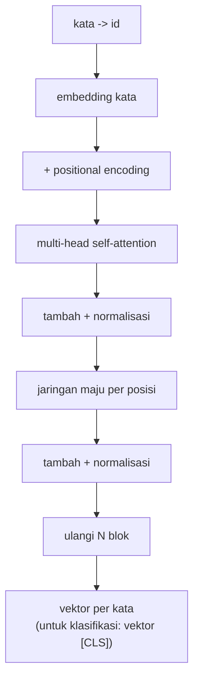

# Attention, Self-Attention, dan Transformer

!!! abstract "Info materi"
    **Tingkat kesulitan:** Lanjut. **Estimasi waktu:** 240 menit.
    **Jenis kode:** **eksperimen ringan** (`04_attention_transformer.py`, NumPy saja; bobot acak, tanpa pelatihan).

## Tujuan pembelajaran

- [ ] Menjelaskan ide *attention*: setiap kata memilih kata lain yang relevan lalu mengambil campuran informasinya.
- [ ] Menghitung *scaled dot-product attention* dengan tangan: $Q,K,V$, skor, softmax, keluaran.
- [ ] Menjelaskan *self-attention*, *multi-head*, dan *mask* (pad dan kausal).
- [ ] Menjelaskan mengapa Transformer membutuhkan *positional encoding*, dan membuktikannya dengan kode.
- [ ] Membedakan encoder, decoder, dan encoder–decoder, serta menyebut contoh modelnya.
- [ ] Menjelaskan biaya kuadratik attention terhadap panjang teks.

## Prasyarat

- [Neural Network Dasar](neural-network-dasar.md) dan [RNN, LSTM, GRU](rnn-lstm-gru.md).
- Perkalian matriks dan softmax (dijelaskan di bawah).

## Pengantar dan motivasi

RNN harus membawa seluruh informasi lewat satu vektor $h_t$ dan membacanya berurutan. *Attention* (Bahdanau dkk., 2015) mengizinkan model **langsung melihat** semua kata dan memilih yang penting. *Transformer* (Vaswani dkk., 2017) membuang rekurensi sepenuhnya dan hanya memakai attention, sehingga semua posisi dapat dihitung **paralel**. Hampir semua model bahasa modern, termasuk BERT dan IndoBERT, berbasis Transformer.

## Konsep dasar

| Istilah | Arti |
|---|---|
| **Query ($Q$)** | "Apa yang sedang saya cari?" (dari kata yang bertanya) |
| **Key ($K$)** | "Apa yang saya tawarkan?" (dari kata yang dilihat) |
| **Value ($V$)** | "Informasi yang saya berikan jika dipilih" |
| **Bobot attention** | Hasil softmax skor $Q\cdot K$; tiap baris berjumlah 1 |
| **Self-attention** | $Q,K,V$ berasal dari barisan kata yang sama |
| **Multi-head** | Beberapa attention paralel dengan proyeksi berbeda, lalu digabung |
| **Mask** | Aturan siapa boleh melihat siapa |
| **Positional encoding** | Informasi urutan yang ditambahkan ke embedding |

## Penjelasan mendalam

### Attention sebagai pencarian lunak

Bayangkan basis data: *query* dicocokkan dengan *key*, lalu *value* dikembalikan. Pada attention pencocokan bersifat **lunak**: semua value dikembalikan, tertimbang menurut kecocokan.

$$
\mathrm{Attention}(Q,K,V)=\mathrm{softmax}\!\left(\frac{QK^\top}{\sqrt{d_k}}\right)V
$$

- $Q\in\mathbb{R}^{T_q\times d_k}$, $K\in\mathbb{R}^{T_k\times d_k}$, $V\in\mathbb{R}^{T_k\times d_v}$; $T$ jumlah kata.
- $QK^\top$: matriks skor $T_q\times T_k$; elemen $(i,j)$ = kecocokan kata $i$ dengan kata $j$.
- Pembagian $\sqrt{d_k}$: jika $d_k$ besar, hasil kali titik membesar dan softmax menjadi terlalu "tajam" (hampir satu-hot) sehingga gradien mengecil; pembagian menjaga skala.
- **Softmax** mengubah skor $s$ menjadi bobot $e^{s_i}/\sum_j e^{s_j}$ yang positif dan berjumlah 1. Contoh: skor $(2;1;0{,}1)\to(0{,}659;0{,}242;0{,}099)$.

### Self-attention dan proyeksi

Pada *self-attention* satu kepala, masukan $X\in\mathbb{R}^{T\times d_{model}}$ diproyeksikan oleh tiga matriks yang dipelajari: $Q=XW_Q,\ K=XW_K,\ V=XW_V$. Dengan begitu tiap kata memiliki peran berbeda sebagai penanya, penawar, dan pemberi informasi.

### Multi-head

Alih-alih satu attention besar, bagi $d_{model}$ menjadi $h$ kepala berukuran $d_k=d_{model}/h$. Tiap kepala dapat memperhatikan hubungan yang berbeda (mis. kata benda–kata kerja, negasi–kata yang dinegasi). Hasilnya digabung (*concatenate*) dan dikalikan $W_O$. Syarat: $d_{model}$ habis dibagi $h$.

### Positional encoding

Self-attention memperlakukan masukan sebagai **himpunan**: mengacak urutan kata hanya mengacak keluaran dengan cara yang sama. "Air masuk rumah" dan "rumah masuk air" akan tak terbedakan. Karena itu informasi posisi ditambahkan ke embedding. Versi sinusoidal Vaswani dkk.:

$$
PE_{(t,2i)}=\sin\!\big(t/10000^{2i/d}\big),\qquad PE_{(t,2i+1)}=\cos\!\big(t/10000^{2i/d}\big)
$$

($t$: posisi; $i$: indeks pasangan dimensi; $d=d_{model}$.) Dimensi awal berubah cepat dengan posisi, dimensi akhir lambat, sehingga tiap posisi punya "sidik jari" unik. BERT memakai embedding posisi yang **dipelajari**, bukan sinusoidal; ide dasarnya sama.

### Mask

- **Mask padding:** token padding tidak boleh dilihat.
- **Mask kausal (segitiga bawah):** posisi $t$ hanya boleh melihat posisi $\le t$. Dipakai pada *decoder* yang menghasilkan teks kata demi kata (tidak boleh mengintip jawaban).

### Encoder, decoder, encoder–decoder

| Jenis | Cara melihat | Contoh | Cocok untuk |
|---|---|---|---|
| **Encoder** | Dua arah (semua kata melihat semua) | BERT, IndoBERT | Klasifikasi, pelabelan, ekstraksi |
| **Decoder** | Satu arah (mask kausal) | Keluarga GPT | Menghasilkan teks |
| **Encoder–decoder** | Encoder membaca, decoder menulis sambil melihat encoder | Transformer asli, T5 | Terjemahan, ringkasan |

Untuk klasifikasi Emergency/Non-Emergency, jenis **encoder** yang relevan.

### Satu blok Transformer encoder

Blok = multi-head self-attention → tambah (*residual*) + normalisasi lapisan → jaringan maju per posisi (dua lapisan linear + aktivasi) → tambah + normalisasi. Blok ditumpuk (BERT-base: 12 blok, $d_{model}=768$, 12 kepala).

## Cara kerja atau alur proses



## Contoh sederhana

Tiga kata dengan vektor 2 dimensi $X=\{(1,0),(0{,}8,0{,}6),(0,1)\}$ untuk `tolong`, `air`, `masuk`; $Q=K=V=X$, $d_k=2$.

Skor `air` terhadap ketiganya: $q\cdot k = (0{,}8;\ 1;\ 0{,}6)$; dibagi $\sqrt2$: $(0{,}566;\ 0{,}707;\ 0{,}424)$. Softmax: kira-kira $(0{,}33;\ 0{,}38;\ 0{,}29)$. Keluaran `air` $=0{,}33(1,0)+0{,}38(0{,}8,0{,}6)+0{,}29(0,1)\approx(0{,}64;\ 0{,}52)$. Bagian praktik mereproduksinya persis.

## Contoh dalam konteks Twitter/X kebencanaan

Pada "Tolong, air banjir sudah masuk ke rumah kami", kata `tolong` dapat memperhatikan `masuk` dan `rumah` untuk memahami **apa** yang dimintai tolong. Pada "tidak ada korban", `korban` dapat memperhatikan `tidak`. Untuk klasifikasi, representasi akhir sebuah token khusus `[CLS]` (di awal teks) dipakai sebagai ringkasan teks. Yang dilihat attention setelah pelatihan **tidak otomatis penjelasan**: bobot attention bukan bukti alasan keputusan (lihat [Interpretabilitas](../level-7-advanced-nlp/interpretabilitas.md)).

## Praktik Python

Berkas: `examples/level-6-deep-learning/04_attention_transformer.py`. Fungsi di `nlp_hub/atensi.py`. Seluruh bobot (`Wq`, `Wk`, `Wv`) acak: kita mempelajari **mekanisme**, bukan model terlatih.

### Bagian 1: softmax

```python title="Bagian 1"
--8<-- "level-6-deep-learning/04_attention_transformer.py:softmax"
```

```text title="Output nyata"
skor mentah     : [2.  1.  0.1]
softmax         : [0.659 0.242 0.099] | jumlah = 1.0
softmax(skor*5) : [0.993 0.007 0.   ] (skor diperbesar -> perhatian makin tajam)
```

Interpretasi: skor `[2, 1, 0.1]` menjadi bobot yang berjumlah 1. Skor dikali 5 membuat bobot hampir satu-hot (0,993): inilah alasan pembagian $\sqrt{d_k}$. Implementasi `softmax` mengurangi nilai terbesar sebelum eksponen agar tidak overflow (`np.exp(1000)` = `inf`).

### Bagian 2: attention dengan tangan

```python title="Bagian 2"
--8<-- "level-6-deep-learning/04_attention_transformer.py:tangan"
```

```text title="Output nyata"
bobot perhatian (baris = kata yang bertanya, kolom = kata yang dilihat):
  tolong  [0.424 0.368 0.209] | jumlah baris = 1.0
  air     [0.331 0.381 0.287] | jumlah baris = 1.0
  masuk   [0.219 0.335 0.445] | jumlah baris = 1.0
keluaran 'air' = campuran vektor tertimbang: [0.636 0.516]
cek manual     : [0.636 0.516]
```

Interpretasi: baris `air` adalah bobot ke `tolong`, `air`, `masuk` = (0,331; 0,381; 0,287), sama dengan hitungan di Contoh Sederhana; keluarannya (0,636; 0,516) cocok dengan `bobot[1] @ X`. Kata `air` memperhatikan dirinya sendiri paling banyak, wajar karena vektornya paling mirip dengan dirinya.

### Bagian 3: proyeksi Q, K, V

```python title="Bagian 3"
--8<-- "level-6-deep-learning/04_attention_transformer.py:proyeksi"
```

```text title="Output nyata"
masukan  X: (4, 8) -> keluaran: (4, 8) | bobot: (4, 4)
jumlah tiap baris bobot: [1. 1. 1. 1.]
```

Interpretasi: bentuk masukan (4, 8) dan keluaran (4, 8): attention tidak mengubah jumlah kata atau lebar vektor; ia mencampur informasi antar kata. Matriks bobot berbentuk (4, 4): setiap kata × setiap kata.

### Bagian 4: mask kausal

```python title="Bagian 4"
--8<-- "level-6-deep-learning/04_attention_transformer.py:mask"
```

- `np.where(mask, skor, -1e9)`: posisi terlarang diberi skor sangat negatif sehingga bobot softmax-nya ≈ 0.

```text title="Output nyata"
bobot dengan mask kausal (posisi t tidak boleh melihat masa depan):
[[1.    0.    0.    0.   ]
 [0.552 0.448 0.    0.   ]
 [0.135 0.781 0.084 0.   ]
 [0.32  0.08  0.288 0.312]]
semua bobot di atas diagonal = 0: True
```

Interpretasi: baris pertama hanya melihat dirinya (1,0); baris ke-4 boleh melihat semua; semua elemen di atas diagonal 0.

### Bagian 5: positional encoding dan urutan

```python title="Bagian 5"
--8<-- "level-6-deep-learning/04_attention_transformer.py:posisi"
```

```text title="Output nyata"
bentuk PE: (6, 8)
PE posisi 0: [0. 1. 0. 1. 0. 1. 0. 1.]
PE posisi 1: [0.841 0.54  0.1   0.995 0.01  1.    0.001 1.   ]
tanpa posisi: keluaran kata yang diacak = keluaran asli yang diacak: True
dengan posisi: sifat itu hilang (urutan kini berpengaruh): True
```

Interpretasi: posisi 0 selalu $(0,1,0,1,\dots)$ ($\sin0=0$, $\cos0=1$). Eksperimen: tanpa posisi, mengacak kata hanya mengacak keluaran (`True`); dengan posisi, sifat itu hilang sehingga urutan kini berpengaruh. Inilah yang membuat "air masuk rumah" berbeda dari "rumah masuk air".

### Bagian 6: multi-head dan biaya

```python title="Bagian 6"
--8<-- "level-6-deep-learning/04_attention_transformer.py:multihead"
```

```text title="Output nyata"
keluaran multi-head: (4, 8) | bobot per kepala: (2, 4, 4) (kepala, T, T)
kepala 0 vs kepala 1 berbeda pola: True
galat yang diharapkan: d_model=8 tidak habis dibagi n_kepala=3
```

```python title="Bagian 7"
--8<-- "level-6-deep-learning/04_attention_transformer.py:biaya"
```

```text title="Output nyata"
panjang urutan T= 64: matriks perhatian 64x64 =   4096 bobot per kepala per lapis
panjang urutan T=128: matriks perhatian 128x128 =  16384 bobot per kepala per lapis
panjang urutan T=256: matriks perhatian 256x256 =  65536 bobot per kepala per lapis
```

Interpretasi: dua kepala menghasilkan dua pola perhatian berbeda; `d_model=8` tidak dapat dibagi 3 kepala, sehingga fungsi melempar `ValueError`. Menggandakan panjang teks (64→128→256) mengalikan ukuran matriks perhatian **empat kali** (4.096→16.384→65.536): biaya kuadratik, alasan model Transformer membatasi panjang masukan (BERT: 512 token).

### Skrip terpadu

Tes unit (`examples/tests/test_atensi.py`) memeriksa: baris bobot berjumlah 1, mask kausal, ekuivarian permutasi tanpa posisi, dan galat pembagian kepala.

## Kesalahan umum dan debugging

| Gejala | Penyebab | Perbaikan |
|---|---|---|
| `ValueError: d_model ... tidak habis dibagi n_kepala` | Jumlah kepala tak membagi lebar model | Pilih $h$ pembagi $d_{model}$ |
| Bobot attention `nan` | Satu baris seluruhnya di-mask (-inf) | Pastikan tiap baris punya minimal satu posisi yang boleh dilihat |
| Model tidak peka urutan | Lupa positional encoding | Tambahkan ke embedding |
| Memori habis pada teks panjang | Matriks $T\times T$ | Potong teks (`truncation`), batasi panjang |
| Salah menafsirkan bobot attention sebagai alasan keputusan | Attention bukan penjelasan kausal | Gunakan metode penjelasan lain dan uji kontrafaktual |
| Padding ikut diperhatikan | Mask padding tidak dipasang | Kirim `attention_mask` ke model |

## Kelebihan dan keterbatasan

**Kelebihan:** dapat dihitung paralel; ketergantungan jarak jauh mudah (satu langkah); fondasi model pra-latih sangat kuat.
**Keterbatasan:** biaya kuadratik terhadap panjang; butuh data/pra-latih besar; bobot attention sulit ditafsirkan; batas panjang masukan tetap.

## Latihan bertahap

1. **Konseptual.** Mengapa $QK^\top$ dibagi $\sqrt{d_k}$?
2. **Hitungan.** Hitung softmax dari skor $(0,\ \ln 2,\ \ln 3)$.
3. **Membaca output.** Pada matriks mask kausal, mengapa baris ke-2 `[0.552 0.448 0 0]` berjumlah 1?
4. **Debugging.** Anda mengganti `-1e9` dengan `0` pada mask. Apa yang terjadi?
5. **Analisis.** Jika panjang teks 512 dan ada 12 kepala × 12 lapis, berapa banyak bobot attention per teks?

## Kunci jawaban dan pembahasan

??? success "Jawaban 1"
    Hasil kali titik $d_k$-dimensi punya varians yang tumbuh dengan $d_k$; tanpa pembagian, softmax menjadi terlalu tajam dan gradiennya sangat kecil. Pembagian $\sqrt{d_k}$ menjaga skala.

??? success "Jawaban 2"
    $e^0=1$, $e^{\ln2}=2$, $e^{\ln3}=3$; jumlah 6; bobot $(1/6;\ 2/6;\ 3/6)=(0{,}167;\ 0{,}333;\ 0{,}5)$.

??? success "Jawaban 3"
    Softmax diterapkan hanya pada posisi yang diizinkan (dua posisi pertama); posisi terlarang bernilai ≈ 0. Softmax selalu menormalkan jumlah menjadi 1.

??? success "Jawaban 4"
    Skor 0 bukan "tak terlihat"; $e^0=1$ tetap mendapat bobot positif, sehingga posisi masa depan bocor dan mask tidak berfungsi.

??? success "Jawaban 5"
    $512\times512=262{,}144$ per kepala per lapis; $\times12\times12=144$ → **37.748.736** bobot (≈ 37,7 juta) per teks. Ini menjelaskan mengapa panjang masukan dibatasi.

## Kuis singkat

**1.** Apa peran $V$?

??? success "Jawaban"
    Informasi yang dikembalikan; keluaran adalah campuran $V$ tertimbang bobot attention.

**2.** Jenis Transformer apa yang cocok untuk klasifikasi?

??? success "Jawaban"
    Encoder (mis. BERT, IndoBERT).

**3.** Apa akibat tanpa positional encoding?

??? success "Jawaban"
    Model tidak membedakan urutan kata; keluaran hanya terpermutasi mengikuti masukan.

## Ringkasan

- Attention = campuran value tertimbang oleh kecocokan query–key, dengan skala $1/\sqrt{d_k}$.
- Self-attention + multi-head + mask + positional encoding adalah inti Transformer.
- Tanpa posisi, urutan tak berpengaruh (terbukti dengan kode).
- Biaya $O(T^2)$: panjang 64→256 menaikkan bobot 16 kali.
- Bobot acak di sini hanya menunjukkan mekanisme, bukan model terlatih.

## Glosarium istilah baru

Query, Key, Value
:   Tiga proyeksi masukan yang dipakai attention untuk bertanya, ditawarkan, dan diberikan.

Self-attention
:   Attention di mana $Q,K,V$ berasal dari barisan yang sama.

Multi-head attention
:   Beberapa attention paralel yang hasilnya digabung.

Mask kausal
:   Pembatas agar posisi tidak melihat posisi sesudahnya.

Positional encoding
:   Informasi posisi yang ditambahkan ke embedding.

Encoder / Decoder
:   Tumpukan blok Transformer dua arah / satu arah.

## Referensi

- Bahdanau, D., Cho, K., & Bengio, Y. (2015). Neural machine translation by jointly learning to align and translate. *ICLR 2015* (makalah akademik; judul, penulis, dan tahun diperiksa via arXiv/Crossref/ACL Anthology; venue tidak diverifikasi terpisah).
- Vaswani, A., dkk. (2017). Attention is all you need. *NeurIPS 2017* (makalah akademik; judul, penulis, dan tahun diperiksa via arXiv/Crossref/ACL Anthology; venue tidak diverifikasi terpisah).
- Alammar, J. *The Illustrated Transformer*: <https://jalammar.github.io/illustrated-transformer/> (tutorial informal, bukan makalah).

## Materi berikutnya

[Tokenizer Modern, BERT, dan IndoBERT](tokenizer-bert-indobert.md)
