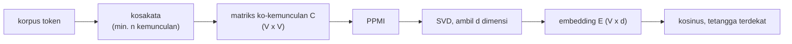

# Embedding Kata: Word2Vec, GloVe, FastText, OOV, dan Subword

!!! abstract "Info materi"
    **Tingkat kesulitan:** Menengah. **Estimasi waktu:** 150 menit.
    **Jenis kode:** **eksperimen ringan** (`examples/level-6-deep-learning/01_embedding.py`, NumPy saja). Ini **bukan** Word2Vec/GloVe/FastText asli; lihat penjelasan di bawah.

## Tujuan pembelajaran

- [ ] Menjelaskan mengapa one-hot dan TF-IDF tidak menangkap kemiripan makna.
- [ ] Menjelaskan ide distribusional: "kata dikenali dari kata-kata di sekitarnya".
- [ ] Membangun matriks ko-kemunculan, PPMI, dan embedding SVD, serta menghitung kemiripan kosinus.
- [ ] Membedakan Word2Vec, GloVe, dan FastText pada tingkat konsep.
- [ ] Menjelaskan masalah *out-of-vocabulary* (OOV) dan bagaimana potongan subword membantu.
- [ ] Membaca hasil embedding pada korpus kecil dengan sikap kritis.

## Prasyarat

- [TF-IDF](../level-3-representasi-teks/tfidf.md) dan [Sparse Matrix dan One-hot](../level-3-representasi-teks/sparse-matrix-one-hot.md).
- [NumPy](../level-1-python/numpy-dasar.md): array, `@`, bentuk (*shape*).
- [Perbandingan Klasik vs Deep Learning](ml-klasik-vs-dl-komputasi.md).

## Pengantar dan motivasi

Pada one-hot, kata `banjir` adalah vektor dengan satu angka 1 dan sisanya 0 di antara ribuan kolom. Jarak `banjir`–`air` sama persis dengan jarak `banjir`–`gempa`: model tidak tahu bahwa yang pertama lebih berkaitan. **Embedding** memberi tiap kata vektor pendek (puluhan sampai ratusan angka) yang letaknya mencerminkan penggunaan kata. Kata yang dipakai dalam konteks serupa akan berdekatan.

## Konsep dasar

| Istilah | Arti |
|---|---|
| **Hipotesis distribusional** | "Kata ditentukan oleh teman-temannya" (Firth, 1957): kata dengan konteks serupa bermakna serupa |
| **Konteks / jendela** | Kata-kata dalam jarak $w$ posisi dari kata target |
| **Matriks ko-kemunculan** $C$ | $C_{ij}$ = berapa kali kata $j$ muncul di konteks kata $i$ |
| **PMI / PPMI** | Ukuran seberapa sering dua kata muncul bersama dibanding kebetulan; PPMI memotong nilai negatif ke 0 |
| **SVD** | Penguraian matriks yang dipakai untuk memampatkan $C$ ke beberapa dimensi |
| **Kemiripan kosinus** | Sudut antara dua vektor: 1 searah, 0 tegak lurus, −1 berlawanan |
| **OOV** | Kata yang tidak ada di kosakata saat model dilatih |
| **Subword** | Potongan kata (huruf, awalan, akhiran) yang dipakai sebagai satuan |

## Penjelasan mendalam

### Dari hitungan ke vektor

Untuk kalimat "air sungai naik banjir merendam rumah" dan jendela $w=2$, kata `banjir` berdampingan dengan `sungai`, `naik`, `merendam`, `rumah`. Kita mencatat semua pasangan di seluruh korpus dalam matriks $C$.

**PMI** membandingkan peluang bersama dengan peluang jika kedua kata saling bebas:

$$
\mathrm{PMI}(i,j) = \log \frac{P(i,j)}{P(i)\,P(j)}, \qquad \mathrm{PPMI}(i,j)=\max(0,\ \mathrm{PMI}(i,j))
$$

- $P(i,j)$: proporsi pasangan $(i,j)$ dari seluruh pasangan; $P(i)$ dan $P(j)$: proporsi marginal.
- Contoh angka: jika $P(i,j)=0{,}02$, $P(i)=0{,}1$, $P(j)=0{,}05$, maka $\frac{0{,}02}{0{,}1\times0{,}05}=4$ dan $\log 4 \approx 1{,}39>0$: kedua kata muncul bersama **4 kali lebih sering** dari kebetulan. Kata sangat umum (`di`, `dan`) bernilai PMI mendekati 0 karena mereka muncul dengan siapa saja.

**SVD** menguraikan $P=U\Sigma V^\top$. Memotong ke $d$ dimensi pertama dan memakai $U_{:,1:d}\sqrt{\Sigma_{1:d}}$ memberi $d$ angka per kata yang mempertahankan pola terpenting. Hasilnya: tiap baris matriks $E \in \mathbb{R}^{V\times d}$ adalah embedding satu kata.

### Word2Vec, GloVe, FastText

| Metode | Ide | Kaitan dengan kode kita |
|---|---|---|
| **Word2Vec** (Mikolov dkk., 2013) | Jaringan kecil dilatih agar vektor sebuah kata memprediksi kata di sekitarnya (*skip-gram*) atau sebaliknya (*CBOW*) | Levy & Goldberg (2014) menunjukkan skip-gram dengan *negative sampling* secara implisit memfaktorkan matriks PMI yang digeser, sehingga PPMI+SVD adalah kerabat dekatnya |
| **GloVe** (Pennington dkk., 2014) | Memfaktorkan log ko-kemunculan global dengan fungsi bobot | Sama-sama berbasis hitungan ko-kemunculan |
| **FastText** (Bojanowski dkk., 2017) | Vektor kata = jumlah vektor potongan karakter ($n$-gram karakter) | Bagian "OOV dan subword" di bawah meniru *ide*-nya |

!!! note "Yang dilakukan dan tidak dilakukan kode halaman ini"
    Kode kita memakai **PPMI + SVD**, bukan melatih Word2Vec, GloVe, atau FastText. Alasannya: tanpa dependensi tambahan, deterministik, dan setiap langkah bisa dibaca. Fungsi `vektor_subword` hanya **mengilustrasikan mekanisme** FastText (kata dibentuk dari potongan karakter); ia tidak melatih vektor potongan. Untuk pemakaian nyata gunakan pustaka seperti gensim atau vektor pra-latih.

### OOV dan subword

Kosakata dibuat dari data latih. Pada media sosial, kata baru muncul terus: `banjirnya`, `kebanjiran`, `bnjir`, `toloooong`. Tanpa strategi, semuanya menjadi token tak dikenal. Strategi subword memecah kata menjadi potongan yang sudah dikenal. Pada FastText, kata `banjir` direpresentasikan oleh potongan `<ba`, `ban`, `anj`, `nji`, `jir`, `ir>` (dengan `<` `>` sebagai penanda batas kata) ditambah kata utuhnya; kata asing `banjirnya` berbagi banyak potongan dengan `banjir`, sehingga mendapat vektor yang mirip.

## Cara kerja atau alur proses



## Contoh sederhana

Dua kata dengan vektor 2 dimensi $a=(1,0)$ dan $b=(0{,}8,0{,}6)$. Kosinus:

$$
\cos(a,b) = \frac{a\cdot b}{\lVert a\rVert\,\lVert b\rVert} = \frac{1\times0{,}8 + 0\times0{,}6}{1\times 1} = 0{,}8
$$

(norma $b$: $\sqrt{0{,}64+0{,}36}=1$). Sudutnya sekitar 37°. Nilai 0,8 berarti cukup searah.

## Contoh dalam konteks Twitter/X kebencanaan

Delapan kalimat mini di bawah ini ditulis tangan agar pola konteks terlihat jelas: `banjir` selalu bersama `air`/`naik`/`merendam`, `gempa` bersama `guncang`/`retak`/`tembok`. Ini **ilustrasi mekanisme**, bukan korpus nyata. Setelah itu kita mencoba hal yang sama pada dataset sintetis kita untuk melihat kenyataan.

## Praktik Python

Berkas: `examples/level-6-deep-learning/01_embedding.py`. Pustaka: **NumPy** (matriks dan SVD) serta fungsi di `nlp_hub/embedding.py`. Jalankan dari folder `examples/`: `python level-6-deep-learning/01_embedding.py`.

### Bagian 1: korpus mini dan kosakata

```python title="Bagian 1"
--8<-- "level-6-deep-learning/01_embedding.py:korpus"
```

- `kalimat.split()` memecah kalimat menjadi daftar kata; `token_mini` adalah *daftar dari daftar kata* (satu daftar per kalimat).
- `bangun_kosakata(..., min_hitung=2)` hanya menyimpan kata yang muncul minimal dua kali. Kata yang muncul sekali tidak punya cukup konteks untuk dipelajari.

```text title="Output nyata"
ukuran kosakata: 15
kosakata: ['air', 'gempa', 'guncang', 'naik', 'retak', 'rumah', 'banjir', 'merendam', 'tembok', 'deras', 'hujan', 'jalan', 'kuat', 'sungai', 'warga']
```

Interpretasi: 15 kata unik, diurutkan dari yang paling sering. Pemeriksaan: kata `banjir` muncul 3 kali di korpus, jadi lolos ambang 2.

### Bagian 2: matriks ko-kemunculan

```python title="Bagian 2"
--8<-- "level-6-deep-learning/01_embedding.py:koterjadian"
```

- Baris `C[i]` menghitung tetangga kata `i` dalam jendela 2 kata ke kiri dan kanan.
- Generator `(kosakata.index(k) for k in (...))` di dalam tanda kurung dibuka-kemas langsung ke tiga variabel (*tuple unpacking*).

```text title="Output nyata"
bentuk matriks C: (15, 15)
C[banjir, air]  = 1.0
C[banjir, gempa] = 0.0
C simetris: True
```

Interpretasi: `banjir` dan `air` berdampingan sekali dalam jendela; `banjir` dan `gempa` tidak pernah. Matriks simetris karena hubungan "berada dalam jendela" bersifat timbal-balik.

### Bagian 3: PPMI dan SVD

```python title="Bagian 3"
--8<-- "level-6-deep-learning/01_embedding.py:ppmi_svd"
```

```text title="Output nyata"
bentuk embedding E: (15, 4) (satu baris 4 angka per kata)
vektor 'banjir': [-0.46 -0.24  0.21  0.11]
```

Interpretasi: tiap kata kini hanya 4 angka (bukan 15 kolom one-hot). Angka-angkanya sendiri tidak punya arti individual; yang bermakna adalah **jarak dan sudut antar vektor**.

### Bagian 4: kemiripan dan tetangga

```python title="Bagian 4"
--8<-- "level-6-deep-learning/01_embedding.py:kemiripan"
```

```text title="Output nyata"
kosinus(banjir, air) = +0.62
kosinus(banjir, gempa) = +0.15
kosinus(gempa, retak) = +0.94
kosinus(gempa, guncang) = +0.37
kosinus(air, retak) = -0.04
tetangga 'banjir': [('warga', 0.926), ('merendam', 0.839), ('guncang', 0.747)]
tetangga 'gempa' : [('jalan', 0.994), ('rumah', 0.946), ('retak', 0.936)]
```

Interpretasi yang jujur:

- `gempa`–`retak` (0,94) dan `banjir`–`air` (0,62) lebih dekat daripada `banjir`–`gempa` (0,15) dan `air`–`retak` (−0,04). Pola yang kita tanam terbaca.
- Namun tetangga terdekat `banjir` mencakup `warga` dan `guncang`, dan tetangga `gempa` yang teratas adalah `jalan` (0,994), bukan `guncang`. Dengan **8 kalimat** dan **4 dimensi** tidak cukup data untuk tetangga yang stabil. Jangan menafsirkan tetangga terdekat dari korpus sekecil ini sebagai pengetahuan.

### Bagian 5: pada dataset sintetis kita

```python title="Bagian 5"
--8<-- "level-6-deep-learning/01_embedding.py:dataset"
```

```text title="Output nyata"
jumlah teks: 564 | kosakata (>=3 kali): 518
tetangga 'banjir': ['berkurang', 'agar', 'lingkungan', 'risiko']
tetangga 'tolong': ['akun', 'follow', 'bantu', 'vote']
tetangga 'air': ['sejak', 'lutut', 'terus', 'naik']
```

Interpretasi: ada pola yang masuk akal (`tolong` dekat `bantu`, `air` dekat `naik` dan `lutut`), tetapi banyak tetangga kurang bermakna (`banjir` ↔ `berkurang`, `agar`; `tolong` ↔ `akun`, `follow`, `vote`, yang berasal dari templat pos tidak terkait). Penyebabnya: 564 teks bertemplat, bukan jutaan kalimat bervariasi. Word2Vec dan GloVe nyata dilatih pada korpus **ratusan juta hingga miliaran** token. Tetangga kata di dataset ini mencerminkan **templat generator**, bukan bahasa Indonesia.

### Bagian 6: kata di luar kosakata

```python title="Bagian 6"
--8<-- "level-6-deep-learning/01_embedding.py:oov"
```

```text title="Output nyata"
'banjir': di kosakata mini? True
'banjirnya': di kosakata mini? False
'bnjir': di kosakata mini? False
potongan 'banjir': ['<ba', 'ban', 'anj', 'nji', 'jir', 'ir>', '<ban', 'banj', 'anji', 'njir', 'jir>']
'banjirnya': dibentuk dari ['banjir']; kosinus ke 'banjir' = +1.00
'bnjir': dibentuk dari ['banjir', 'air']; kosinus ke 'banjir' = +0.84
'xyz': dibentuk dari []; kosinus ke 'banjir' = +0.00
```

Interpretasi:

- `banjirnya` dan `bnjir` tidak ada di kosakata (OOV), tetapi berbagi potongan karakter dengan `banjir`. `banjirnya` mendapat vektor persis `banjir` (kosinus 1,00) karena potongan terbaiknya hanya `banjir`; `bnjir` mendapat rata-rata `banjir` dan `air` (0,84).
- `xyz` tidak berbagi potongan apa pun: vektor nol, kosinus 0. Subword tidak ajaib; kata yang benar-benar asing tetap tidak diketahui.
- **Penyederhanaan:** FastText sungguhan melatih vektor tiap potongan; di sini kita mengambil rata-rata vektor kata yang paling banyak berbagi potongan.

### Skrip terpadu

`01_embedding.py` berisi seluruh bagian dan selesai kurang dari beberapa detik di CPU. Tes unit ada di `examples/tests/test_embedding.py`.

## Kesalahan umum dan debugging

| Gejala | Penyebab | Perbaikan |
|---|---|---|
| `ValueError: 'tsunami' is not in list` | Kata di luar kosakata (OOV) diminta tetangganya | Periksa `kata in kosakata`; pakai `vektor_subword` |
| Semua kosinus mendekati 1 | Dimensi terlalu kecil atau korpus terlalu sedikit | Tambah data; periksa `min_hitung` |
| Tetangga terdekat didominasi kata sangat umum | Tanpa PPMI (memakai hitungan mentah) | Pakai PPMI atau buang stopword |
| Mengira dimensi ke-3 "berarti banjir" | Dimensi SVD tidak punya makna individual | Tafsirkan hanya jarak/sudut |
| Embedding dilatih pada seluruh data, termasuk uji | **Kebocoran data**: kosakata/statistik dipelajari dari data uji | Bangun kosakata dan embedding hanya dari data latih |
| Menyimpulkan makna dari korpus bertemplat | Pola templat, bukan bahasa | Gunakan vektor pra-latih dari korpus besar |

## Kelebihan dan keterbatasan

**Kelebihan:** menangkap kemiripan makna; vektor padat dan pendek; subword menangani kata baru dan ejaan variatif.
**Keterbatasan:** butuh korpus besar; satu vektor per kata tanpa mempedulikan konteks (`bunga` bank vs `bunga` taman sama); membawa bias dari korpus; tidak menangani negasi ("tidak ada korban"); vektor statis tidak membedakan "banjir kemarin" dari "banjir sekarang".

## Latihan bertahap

1. **Konseptual.** Mengapa kosinus lebih cocok daripada jarak Euclid untuk membandingkan embedding?
2. **Hitungan.** Hitung kosinus $a=(1,1)$ dan $b=(2,0)$.
3. **Membaca output.** Pada Bagian 4, mengapa `gempa`–`guncang` (0,37) lebih rendah dari `gempa`–`retak` (0,94) padahal keduanya sering bersama `gempa`?
4. **Debugging.** `tetangga_terdekat("tsunami", ...)` gagal. Tulis kode yang menangkap kegagalan dan memakai `vektor_subword` sebagai cadangan.
5. **Mini-proyek.** Ubah `min_hitung` pada Bagian 5 menjadi 1 dan 10. Bagaimana ukuran kosakata dan tetangga `air` berubah? Jelaskan.

## Kunci jawaban dan pembahasan

??? success "Jawaban 1"
    Panjang vektor sering dipengaruhi frekuensi kata, sedangkan arah mencerminkan pola konteks. Kosinus hanya melihat arah.

??? success "Jawaban 2"
    $a\cdot b = 2$; $\lVert a\rVert=\sqrt2$; $\lVert b\rVert=2$; $\cos = 2/(2\sqrt2)=0{,}707$ (45°).

??? success "Jawaban 3"
    Pada 8 kalimat, `guncang` dan `retak` menempati posisi yang sedikit berbeda dan dimensi hanya 4; hasil dipengaruhi detail kecil. Jangan menafsirkan selisih itu sebagai fakta linguistik. Yang bisa disimpulkan hanyalah bahwa keduanya sama-sama jauh lebih dekat ke `gempa` daripada `air` ke `retak`.

??? success "Jawaban 4"
    ```python
    try:
        hasil = tetangga_terdekat("tsunami", kosakata, E)
    except ValueError:
        v, dipakai = vektor_subword("tsunami", kosakata, E)
        hasil = f"OOV; dibentuk dari {dipakai}"
    ```
    `list.index` menimbulkan `ValueError` untuk elemen yang tidak ada.

??? success "Jawaban 5"
    `min_hitung` kecil memperbesar kosakata dengan banyak kata langka yang vektornya tidak stabil (konteks sedikit); `min_hitung` besar membuang kata langka dan menyisakan kata umum. Tidak ada nilai "benar"; pilih lewat evaluasi tugas akhir pada data validasi, bukan lewat tampilan tetangga.

## Kuis singkat

**1.** Apa yang diukur PMI?

??? success "Jawaban"
    Seberapa sering dua kata muncul bersama dibanding yang diharapkan jika saling bebas.

**2.** Apakah kode halaman ini melatih FastText?

??? success "Jawaban"
    Tidak. Ia memakai PPMI+SVD dan hanya mengilustrasikan ide subword.

**3.** Mengapa `xyz` tidak mendapat vektor bermakna?

??? success "Jawaban"
    Tidak ada potongan karakternya yang dimiliki kata dalam kosakata.

## Ringkasan

- Embedding menaruh kata di ruang vektor sehingga kata sekonteks berdekatan.
- Ko-kemunculan → PPMI → SVD adalah cara hitungan yang kerabat dekat Word2Vec dan GloVe.
- Pada 8 kalimat terkontrol polanya terbaca; pada 564 teks bertemplat tetangga sering tidak bermakna.
- Subword membantu OOV, tetapi kata yang benar-benar asing tetap tak diketahui.

## Glosarium istilah baru

Embedding
:   Vektor padat yang mewakili kata (atau kalimat) dan dipelajari dari data.

Ko-kemunculan
:   Hitungan berapa kali dua kata muncul berdekatan.

PPMI
:   PMI yang nilai negatifnya dijadikan 0.

Kemiripan kosinus
:   Kosinus sudut antara dua vektor.

OOV (*out-of-vocabulary*)
:   Kata yang tidak ada di kosakata model.

Subword
:   Potongan kata yang dipakai sebagai satuan, mis. $n$-gram karakter.

## Referensi

- Mikolov, T., Chen, K., Corrado, G., & Dean, J. (2013). Efficient estimation of word representations in vector space. arXiv:1301.3781 (makalah akademik; detail bibliografi judul, penulis, dan tahun diperiksa via arXiv/Crossref/ACL Anthology; venue tidak diverifikasi terpisah).
- Pennington, J., Socher, R., & Manning, C. D. (2014). GloVe: Global vectors for word representation. *EMNLP 2014* (makalah akademik; judul, penulis, dan tahun diperiksa via arXiv/Crossref/ACL Anthology; venue tidak diverifikasi terpisah).
- Bojanowski, P., Grave, E., Joulin, A., & Mikolov, T. (2017). Enriching word vectors with subword information. *TACL*, 5, 135–146 (makalah akademik; judul, penulis, dan tahun diperiksa via arXiv/Crossref/ACL Anthology; venue tidak diverifikasi terpisah).
- Levy, O., & Goldberg, Y. (2014). Neural word embedding as implicit matrix factorization. *NeurIPS 2014* (makalah akademik; belum diperiksa daring).
- Jurafsky, D., & Martin, J. H. *Speech and Language Processing* (draf edisi ke-3), bab tentang vektor semantik: <https://web.stanford.edu/~jurafsky/slp3/> (buku teks).

## Materi berikutnya

[Neural Network Dasar](neural-network-dasar.md)
