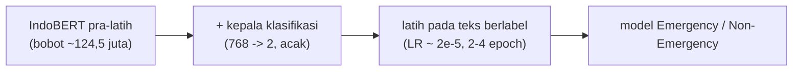
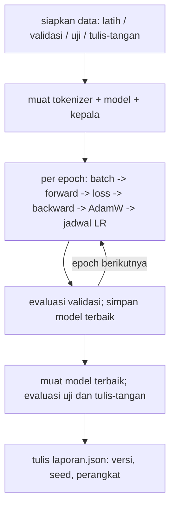

# Fine-tuning dan Transfer Learning untuk Klasifikasi Teks

!!! abstract "Info materi"
    **Tingkat kesulitan:** Lanjut. **Estimasi waktu:** 180 menit.
    **Jenis kode:** **eksperimen berat** (`examples/level-6-deep-learning/berat/12_finetune_indobert.py` dan `13_ulang_seed.py`; butuh `torch`, `transformers`, dan unduhan bobot sekitar 0,5 GB).
    **Status eksekusi: dijalankan penulis pada 2026-10-23 di CPU** (torch 2.14.1, transformers 5.20.2, Python 3.14.7, Windows) untuk dua model IndoBERT × 5 seed. Hasil disertakan dari `berat/hasil/`, **tidak diperiksa otomatis**, dan hanya berlaku untuk dataset sintetis kecil ini; tidak ada klaim IndoBERT lebih baik secara umum.

## Tujuan pembelajaran

- [ ] Menjelaskan transfer learning: pra-latih pada korpus besar, lalu menyesuaikan pada tugas kecil.
- [ ] Menjelaskan fine-tuning penuh, pembekuan lapisan, dan mengapa learning rate fine-tuning kecil.
- [ ] Membaca skrip fine-tuning PyTorch bagian demi bagian.
- [ ] Menyusun protokol evaluasi fine-tuning yang jujur (seed, validasi, uji, laporan versi).
- [ ] Memperkirakan kebutuhan komputasi dan menjalankan uji asap pada CPU.
- [ ] Menjelaskan mengapa hasil harus dilaporkan sebagai rentang antar seed.

## Prasyarat

- [Tokenizer, BERT, IndoBERT](tokenizer-bert-indobert.md).
- [Neural Network Dasar](neural-network-dasar.md): loss, optimizer.
- [Komputasi dan Dependensi](ml-klasik-vs-dl-komputasi.md); lingkungan sudah diperiksa.
- Protokol data dari [Level 5](../level-5-evaluasi/leakage-reproducibility.md).

## Pengantar dan motivasi

Melatih BERT dari nol memerlukan korpus miliaran kata dan banyak GPU. Kita tidak perlu itu. **Transfer learning**: ambil model yang sudah memahami bahasa Indonesia, tambahkan lapisan klasifikasi kecil, lalu latih sebentar pada contoh berlabel kita. Karena pengetahuan bahasa sudah ada, beberapa ratus contoh bisa cukup untuk hasil yang masuk akal, **meski tidak dijamin**.

## Konsep dasar

| Istilah | Arti |
|---|---|
| **Pra-pelatihan** | Melatih model bahasa umum (MLM) pada korpus besar tanpa label |
| **Fine-tuning** | Melanjutkan pelatihan pada tugas khusus dengan data berlabel |
| **Kepala klasifikasi** | Lapisan linear di atas vektor `[CLS]`; diinisialisasi acak |
| **Pembekuan (*freezing*)** | Tidak memperbarui sebagian lapisan |
| **Learning rate warmup** | Mulai dari kecil lalu naik selama awal pelatihan |
| **AdamW** | Adam dengan peluruhan bobot (*weight decay*) yang dipisahkan dari gradien |
| **Catastrophic forgetting** | Pengetahuan pra-latih rusak karena langkah belajar terlalu besar |

## Penjelasan mendalam

### Apa yang berubah saat fine-tuning



Pada fine-tuning penuh, **semua** bobot diperbarui, tetapi dengan learning rate sangat kecil (mis. $2\times10^{-5}$) agar pengetahuan pra-latih tidak rusak. Alternatifnya membekukan sebagian besar lapisan dan hanya melatih lapisan atas dan kepala klasifikasi: lebih murah, kadang lebih stabil pada data sangat kecil, biasanya sedikit kurang akurat.

### Hyperparameter yang lazim

Untuk BERT, makalah asli menyarankan rentang kira-kira learning rate $\{2,3,5\}\times10^{-5}$, batch 16–32, 2–4 epoch (Devlin dkk., 2019). Rentang itu **titik awal**, bukan jaminan; tentukan nilai akhir pada data validasi, jangan pada data uji.

### Mengapa hasil bervariasi antar seed

Kepala klasifikasi diinisialisasi acak dan urutan batch diacak. Pada data kecil, dua jalankan dengan seed berbeda dapat berbeda beberapa poin recall. Melaporkan satu angka dari satu seed menyesatkan; laporkan beberapa seed (mis. lima) atau rentangnya.

### Kebutuhan komputasi

| Skenario | Perkiraan (kasar, ukur sendiri) |
|---|---|
| Memuat model + inferensi satu teks, CPU | Beberapa detik muat; di bawah ~1 detik per teks |
| Fine-tuning 335 teks × 3 epoch, panjang 64, batch 16, CPU | Mungkin puluhan menit sampai satu jam lebih, bergantung CPU |
| Fine-tuning yang sama, GPU kelas konsumen | Kira-kira beberapa menit |
| Memori | Bobot ~0,5 GB; saat latihan beberapa kali lipat (lihat [Komputasi](ml-klasik-vs-dl-komputasi.md)) |

Tiga baris pertama adalah **perkiraan orde besaran** sebelum eksperimen. Pengukuran nyata penulis (CPU, 335 teks latih, 3 epoch, panjang 64, batch 16, satu proses): uji asap `--subset 64 --epochs 1` memerlukan sekitar 21 detik pelatihan; satu seed penuh memerlukan **111–217 detik** termasuk pemuatan model (seed pertama paling lambat karena proses lain berjalan bersamaan dan cache dingin). GPU tidak tersedia sehingga baris GPU tetap perkiraan.

## Cara kerja atau alur proses



## Contoh sederhana

Jika kepala klasifikasi memberi logit $(z_0,z_1)=(-0{,}4;\ 1{,}2)$, softmax memberi $P(\text{Emergency})=\dfrac{e^{1{,}2}}{e^{-0{,}4}+e^{1{,}2}}=\dfrac{3{,}320}{0{,}670+3{,}320}=0{,}832$. Loss *cross-entropy* untuk label Emergency adalah $-\ln0{,}832=0{,}184$. Fine-tuning menggeser seluruh bobot supaya angka ini turun untuk contoh latih.

## Contoh dalam konteks Twitter/X kebencanaan

Kita ingin model membedakan "Tolong, air banjir sudah masuk ke rumah kami" (Emergency) dari "Saya sedang membaca berita tentang gempa tahun lalu" (Non-Emergency). IndoBERT sudah punya pengetahuan bahwa "banjir" dan "genangan" berkaitan, yang tidak dimiliki TF-IDF. Tetapi kita tidak tahu **tanpa mengukur** apakah ini membantu pada data kita, apalagi pada data nyata yang kosakatanya lebih liar. Dengan dataset sintetis bertemplat, baseline TF-IDF sudah mencapai F1 makro ~0,98 pada uji sintetis (Level 5); ruang untuk "menang" di sana hampir tidak ada, dan satu-satunya sinyal berarti ada di set tulis-tangan yang kecil (48 teks).

## Praktik Python

Berkas: `examples/level-6-deep-learning/berat/12_finetune_indobert.py`. Semua cuplikan di bawah dijalankan penulis tanpa perubahan setelah ditulis; skrip tidak memerlukan perbaikan untuk transformers 5.20.2.

### Bagian 1: persiapan

```python title="Persiapan"
--8<-- "level-6-deep-learning/berat/12_finetune_indobert.py:siapkan"
```

- `torch.manual_seed` dan `np.random.seed` mengunci inisialisasi kepala dan urutan batch; hasil tetap dapat berbeda antar perangkat keras.
- `siapkan()` (dari `nlp_hub.proyek`) memberi pembagian latih/validasi/uji **berdasarkan kejadian** yang sama dengan Level 5, sehingga hasil sebanding.
- `AutoModelForSequenceClassification.from_pretrained(nama, num_labels=2)` memuat IndoBERT dan menambah kepala klasifikasi 2 kelas; peringatan "some weights ... newly initialized" **normal** (kepala acak).
- `id2label` menyimpan nama kelas di konfigurasi sehingga model yang disimpan dapat dipahami kemudian.

### Bagian 2: fungsi bantu

```python title="enkode dan prediksi"
--8<-- "level-6-deep-learning/berat/12_finetune_indobert.py:fungsi"
```

- `enkode` memanggil tokenizer dengan padding dan truncation. `prediksi` bekerja dalam mode `model.eval()` dan `torch.no_grad()` (tanpa dropout dan tanpa gradien), per 32 teks agar memori terkendali, dan mengembalikan $P(\text{Emergency})$ dari softmax.

### Bagian 3: perulangan latih

```python title="Perulangan latih"
--8<-- "level-6-deep-learning/berat/12_finetune_indobert.py:latih"
```

- `get_linear_schedule_with_warmup`: 10% langkah pertama LR naik dari 0, lalu turun linear ke 0.
- Memberikan `labels=` ke model membuatnya menghitung loss *cross-entropy* sendiri (`keluaran.loss`).
- `clip_grad_norm_(…, 1.0)` membatasi norma gradien; `jadwal.step()` memperbarui LR tiap langkah.
- Setelah tiap epoch dihitung loss validasi dari $P(\text{Emergency})$. Hanya epoch dengan loss validasi terendah yang disimpan: ini *model selection* pada data validasi, bukan uji.

### Bagian 4: evaluasi dan laporan

```python title="Evaluasi dan laporan"
--8<-- "level-6-deep-learning/berat/12_finetune_indobert.py:evaluasi"
```

- Model **terbaik** dimuat ulang dari disk, lalu dievaluasi pada uji sintetis dan tulis-tangan dengan fungsi metrik yang sama seperti Level 5 (`metrik_emergency`).
- `laporan.json` mencatat model, seed, versi `torch`/`transformers`, perangkat, dan peringatan data sintetis, memenuhi aturan pelaporan Level 5.
- Ambang 0,5 adalah **bawaan**, bukan ambang operasional.

### Menjalankan

```bash
# dari folder examples/
python level-6-deep-learning/cek_lingkungan_dl.py                                   # periksa lingkungan
python level-6-deep-learning/berat/12_finetune_indobert.py --subset 64 --epochs 1   # uji asap
python level-6-deep-learning/berat/12_finetune_indobert.py                          # penuh (3 epoch), satu seed
python level-6-deep-learning/berat/13_ulang_seed.py --seeds 1 2 3 4 5               # lima seed + tabel ringkasan
python level-6-deep-learning/berat/13_ulang_seed.py --model indolem/indobert-base-uncased
```

Hasil model disimpan di `berat/artefak/indobert_emergency/` (diabaikan git; folder `artefak` ada di `.gitignore`).

### Hasil nyata penulis (lima seed, CPU)

IndoBERT `indobenchmark/indobert-base-p1`, tiga epoch, LR 2e-5, batch 16, panjang 64; pembanding Linear SVM dilatih pada **data latih yang sama** (335 teks). Tabel disertakan langsung dari `berat/hasil/`:

--8<-- "level-6-deep-learning/berat/hasil/indobenchmark_indobert_base_p1.md"

Model `indolem/indobert-base-uncased` dengan prosedur identik:

--8<-- "level-6-deep-learning/berat/hasil/indolem_indobert_base_uncased.md"

Interpretasi yang jujur:

- **p1:** recall Emergency tulis-tangan 0,825 (0,708–0,917) dengan presisi 1,000 pada kelima seed, dibanding SVM 0,583; seed terburuk (17 dari 24 pesan) masih di atas SVM (14 dari 24). Pada uji sintetis tidak ada beda bermakna (F1 makro 0,986 vs 0,980).
- **indolem:** recall tulis-tangan 0,442 (0,375–0,542) dan F1 makro uji 0,915: **lebih rendah** daripada SVM. Dua model yang sama-sama bernama IndoBERT dapat berbeda sangat jauh; penyebabnya tidak diselidiki.
- **Batas:** 24 pesan Emergency, satu pelabel yang juga menulis data latih, data sintetis bertemplat, lima seed, hiperparameter tidak disetel, satu pembagian data. Hasil ini adalah petunjuk, bukan bukti keunggulan; pembahasan lengkap dan perbandingan dengan LSTM ada di [Tahap G proyek](../proyek-klasifikasi-bencana/tahap-g-advanced-modeling.md).

### Cara melaporkan hasil Anda sendiri

1. Jalankan minimal lima seed (`--seed 1` … `--seed 5`). Simpan `laporan.json` masing-masing.
2. Laporkan rata-rata dan rentang (minimum–maksimum) recall Emergency, presisi, dan F1 makro, untuk uji sintetis **dan** tulis-tangan.
3. Bandingkan dengan Linear SVM Level 5 pada pembagian yang sama.
4. Catat bahwa tulis-tangan hanya 48 teks (24 Emergency) dan dilabeli oleh penulis dataset; selisih satu-dua pesan bukan bukti.
5. Jangan memilih epoch, seed, atau ambang berdasarkan skor tulis-tangan.

## Kesalahan umum dan debugging

| Gejala | Penyebab | Perbaikan |
|---|---|---|
| `Some weights ... are newly initialized` | Kepala klasifikasi baru, normal | Abaikan; ia akan dilatih |
| `CUDA out of memory` | Batch/`max-len` terlalu besar | Kurangi `--batch`, `--max-len` |
| Loss tidak turun | LR terlalu besar/kecil, label terbalik | Periksa `label2id`; coba LR $2\times10^{-5}$; uji `--subset` kecil lalu overfit 10 contoh |
| Semua prediksi satu kelas | Model belum belajar atau data sangat timpang | Periksa distribusi kelas; tambah epoch; periksa `labels` |
| Skor uji jauh lebih rendah dari validasi | Overfitting atau perbedaan distribusi | Early stopping; bandingkan distribusi |
| Hasil berubah tiap jalan | Seed berbeda, perangkat berbeda | Catat seed; laporkan beberapa seed |
| Evaluasi memakai dropout | Lupa `model.eval()` | `prediksi` sudah memanggilnya |
| Memilih model terbaik di data uji | Kebocoran seleksi | Pilih pada validasi, evaluasi uji sekali |

## Kelebihan dan keterbatasan

**Kelebihan:** memanfaatkan pengetahuan bahasa pra-latih; sering kuat pada data berlabel sedikit; menangani kata baru lewat subword.
**Keterbatasan:** berat secara komputasi; hasil bervariasi antar seed; model dapat membawa bias korpus pra-latih; sulit dijelaskan; tidak ada jaminan lebih baik dari TF-IDF pada data yang kecil dan bertemplat; keputusan tetap memerlukan verifikasi manusia.

## Latihan bertahap

1. **Konseptual.** Mengapa learning rate fine-tuning jauh lebih kecil daripada saat melatih dari nol?
2. **Hitungan.** Dengan logit $(0;\ 0)$, berapa $P(\text{Emergency})$ dan loss untuk label Emergency?
3. **Membaca kode.** Mengapa `model.save_pretrained` dipanggil hanya jika `lv < terbaik`?
4. **Debugging.** Skor tulis-tangan Anda 0,95 recall dari satu seed, tetapi seed lain 0,70. Apa kesimpulannya?
5. **Rancangan.** Rancang eksperimen yang menjawab "apakah IndoBERT lebih baik daripada SVM pada data ini?" dengan jujur.

## Kunci jawaban dan pembahasan

??? success "Jawaban 1"
    Bobot pra-latih sudah menyimpan pengetahuan bahasa. Langkah besar akan merusaknya (*catastrophic forgetting*); langkah kecil hanya menyesuaikan.

??? success "Jawaban 2"
    $P=e^0/(e^0+e^0)=0{,}5$; loss $=-\ln0{,}5=0{,}693$.

??? success "Jawaban 3"
    Agar yang tersimpan adalah bobot epoch dengan loss validasi terendah (menghindari model yang sudah overfit di epoch akhir). Ini early stopping manual.

??? success "Jawaban 4"
    Selisih sebesar itu antar seed menunjukkan **ketidakstabilan** pada data sekecil ini; satu angka tidak dapat dipercaya. Laporkan rentang dari banyak seed, dan jangan memilih seed terbaik berdasarkan set yang sama dengan set pelaporan.

??? success "Jawaban 5"
    Gunakan pembagian per kejadian yang sama; latih SVM dan IndoBERT pada data latih yang sama; pilih hyperparameter hanya pada validasi; ulangi IndoBERT dengan ≥5 seed; laporkan recall/presisi Emergency dengan rentang dan selang bootstrap (Level 5); lakukan uji perbedaan berpasangan (`selisih_recall_bootstrap`); akui bahwa tulis-tangan hanya 48 teks dan perlu data nyata yang diannotasi independen sebelum menyimpulkan apa pun.

## Kuis singkat

**1.** Apa yang baru dan diinisialisasi acak saat memuat `AutoModelForSequenceClassification`?

??? success "Jawaban"
    Kepala klasifikasi (lapisan linear di atas `[CLS]`).

**2.** Apakah halaman ini menunjukkan IndoBERT lebih baik dari SVM?

??? success "Jawaban"
    Tidak secara umum. Pada percobaan ini IndoBERT p1 lebih tinggi pada recall tulis-tangan, tetapi IndoLEM lebih rendah daripada SVM, dan set uji kecil (24 Emergency) dengan satu pelabel.

**3.** Pada data mana model terbaik dipilih?

??? success "Jawaban"
    Data validasi, bukan uji.

## Ringkasan

- Transfer learning: model pra-latih + kepala baru + pelatihan singkat dengan LR kecil.
- Skrip `12_finetune_indobert.py` (seed, jadwal LR, early stopping, laporan) dijalankan 5 seed × 2 model: p1 recall E tulis-tangan 0,825 (0,708–0,917) vs SVM 0,583; indolem 0,442 (0,375–0,542).
- Laporkan beberapa seed, bandingkan dengan SVM pada protokol yang sama, dan jangan memilih apa pun dari data uji.
- Tidak ada klaim kelayakan operasional; hasil terbatas pada dataset sintetis kecil.

## Glosarium istilah baru

Fine-tuning
:   Melanjutkan pelatihan model pra-latih pada tugas dan data berlabel khusus.

Transfer learning
:   Memakai pengetahuan dari satu tugas atau korpus untuk tugas lain.

Kepala klasifikasi
:   Lapisan akhir yang memetakan representasi ke kelas.

Warmup
:   Menaikkan learning rate bertahap di awal pelatihan.

AdamW
:   Adam dengan peluruhan bobot yang dipisahkan.

## Referensi

- Devlin, J., Chang, M.-W., Lee, K., & Toutanova, K. (2019). BERT: Pre-training of deep bidirectional transformers for language understanding. *NAACL-HLT 2019* (makalah akademik; judul, penulis, dan tahun diperiksa via arXiv/Crossref/ACL Anthology; venue tidak diverifikasi terpisah).
- Loshchilov, I., & Hutter, F. (2019). Decoupled weight decay regularization. *ICLR 2019* (makalah akademik; judul, penulis, dan tahun diperiksa via arXiv/Crossref/ACL Anthology; venue tidak diverifikasi terpisah).
- Wolf, T., dkk. (2020). Transformers: State-of-the-art natural language processing. *EMNLP 2020: System Demonstrations* (makalah akademik).
- Dokumentasi Hugging Face, fine-tuning: <https://huggingface.co/docs/transformers/training> (dokumentasi resmi; perilaku API dapat berubah antar versi).
- Halaman model: <https://huggingface.co/indobenchmark/indobert-base-p1> dan <https://huggingface.co/indolem/indobert-base-uncased> (diperiksa saat penulisan).

## Materi berikutnya

[Overfitting, Regularisasi, dan Evaluasi Model Deep Learning](overfitting-evaluasi-dl.md)
