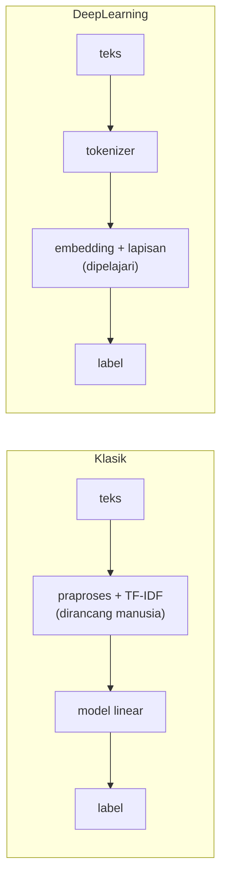
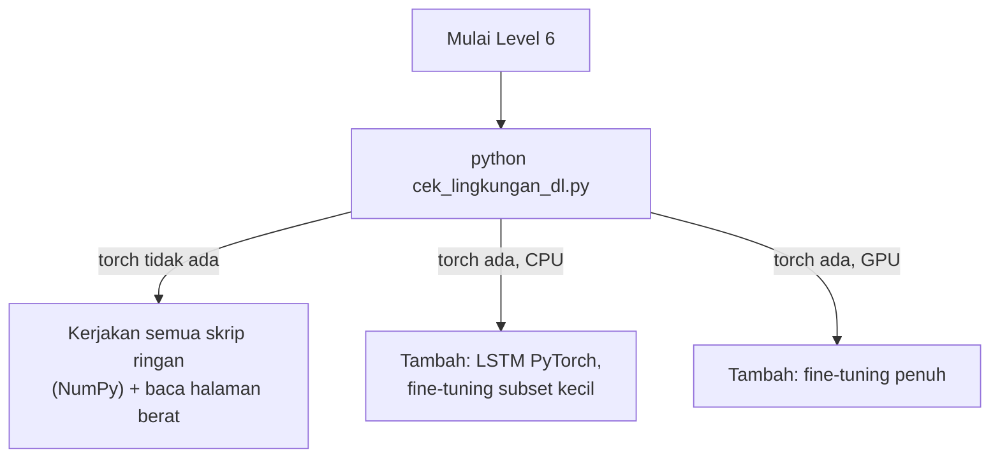

# ML Klasik vs Deep Learning, Komputasi, dan Dependensi

!!! abstract "Info materi"
    **Tingkat kesulitan:** Pemula–menengah. **Estimasi waktu:** 90 menit.
    **Jenis kode:** utilitas ringan (`examples/level-6-deep-learning/cek_lingkungan_dl.py`). Halaman ini **tidak** menjalankan model berat.

## Tujuan pembelajaran

- [ ] Menjelaskan perbedaan machine learning klasik (fitur dirancang) dan deep learning (representasi dipelajari).
- [ ] Menyebut kapan deep learning layak dicoba dan kapan model klasik sudah cukup.
- [ ] Menjelaskan peran CPU dan GPU serta perkiraan kebutuhan memori untuk model Transformer.
- [ ] Memeriksa lingkungan Anda dan memutuskan eksperimen Level 6 mana yang dapat dijalankan.
- [ ] Menjelaskan bagaimana repository ini memisahkan kode ringan dari eksperimen berat.

## Prasyarat

- [Level 4](../level-4-machine-learning/index.md) (pipeline TF-IDF + model) dan [Level 5](../level-5-evaluasi/index.md) (evaluasi).
- Membaca output skrip Python sederhana ([Level 1](../level-1-python/index.md)).

## Pengantar dan motivasi

Sampai Level 5 kita mengubah teks menjadi angka dengan **aturan yang kita pilih sendiri**: hitung kata (Bag of Words), beri bobot (TF-IDF), lalu serahkan ke model linear. Pendekatan ini cepat, murah, dan mudah dijelaskan. Kelemahannya muncul di Level 5: model tidak mengenali kata yang tidak pernah dilihatnya, dan tidak tahu bahwa "meluap" dan "banjir" berhubungan. Deep learning mencoba menjawab keduanya dengan **mempelajari representasi** dari data. Harganya: lebih banyak komputasi, lebih banyak dependensi, hasil yang lebih sulit direproduksi, dan penjelasan yang lebih sulit.

!!! warning "Jangan berasumsi model yang lebih kompleks pasti lebih baik"
    Seluruh Level 6 memakai dataset sintetis kecil (574 baris). Pada data sekecil dan sebertemplat ini, perbandingan model **tidak dapat** menyimpulkan bahwa deep learning lebih unggul secara umum. Halaman [Overfitting dan Evaluasi](overfitting-evaluasi-dl.md) menunjukkan angka nyata dan batasnya.

## Konsep dasar

| Istilah | Arti sederhana |
|---|---|
| **Machine learning klasik** | Model (NB, regresi logistik, SVM) yang belajar dari fitur yang **kita rancang** (mis. TF-IDF) |
| **Deep learning** | Model berlapis-lapis (*neural network*) yang belajar fitur sendiri dari data mentah atau hampir mentah |
| **Representasi** | Cara teks ditulis sebagai angka agar bisa dihitung |
| **Embedding** | Representasi padat: tiap kata (atau kalimat) menjadi vektor pendek yang dipelajari |
| **Pra-latih (*pre-trained*)** | Model yang sebelumnya dilatih pada korpus sangat besar, lalu dipakai ulang |
| **CPU / GPU** | Prosesor umum / prosesor paralel yang sangat cepat untuk perkalian matriks |

## Penjelasan mendalam

### Dua cara membangun fitur



- **Klasik.** Kita memutuskan fitur. Keuntungan: murah, stabil, mudah dijelaskan (Level 7 menunjukkan koefisien tiap kata). Kerugian: "banjir" dan "meluap" adalah dua kolom yang tidak berhubungan.
- **Deep learning.** Fitur muncul dari pelatihan. Keuntungan: menangkap kemiripan makna dan urutan kata. Kerugian: butuh data atau model pra-latih, butuh lebih banyak komputasi, dan lebih sulit diaudit.

### Kapan deep learning layak dicoba

| Situasi | Kecenderungan |
|---|---|
| Data berlabel sangat sedikit, tetapi ada model pra-latih berbahasa Indonesia | Fine-tuning model pra-latih layak dicoba |
| Data kecil dan sangat bertemplat (seperti dataset sintetis kita) | Model klasik sering sudah cukup; selisih sulit dibuktikan |
| Kata kunci dan frasa sudah memisahkan kelas | TF-IDF + model linear sulit dikalahkan secara biaya |
| Perlu memahami urutan, negasi jarak jauh, atau konteks | Model berurutan atau Transformer lebih menjanjikan |
| Perlu penjelasan yang dapat diaudit sederhana | Model linear lebih mudah |

Ini adalah **kecenderungan**, bukan hukum. Satu-satunya cara memutuskan adalah mengukur dengan protokol yang sama (Level 5).

### CPU, GPU, dan memori

Pelatihan neural network didominasi perkalian matriks. GPU mengerjakan ribuan perkalian sekaligus, sehingga pelatihan model besar bisa puluhan kali lebih cepat daripada CPU. Tetapi:

- **CPU cukup** untuk: seluruh kode NumPy di Level 6, LSTM kecil, dan *inferensi* (memakai model yang sudah dilatih) satu per satu.
- **GPU sangat membantu** untuk: fine-tuning model berukuran BERT-base pada ribuan teks atau lebih, dan inferensi batch besar.

**Memori.** Satu parameter bertipe `float32` memakai 4 byte. Model dengan $P$ parameter memerlukan sekitar $4P$ byte hanya untuk bobot. Contoh: IndoBERT-base punya sekitar 124,5 juta parameter (angka dari halaman model, lihat [Tokenizer, BERT, IndoBERT](tokenizer-bert-indobert.md)), sehingga $4 \times 124{,}5 \times 10^6 \approx 498$ MB hanya untuk bobot. Saat *fine-tuning*, optimizer AdamW menyimpan dua nilai tambahan per parameter dan gradien menyimpan satu lagi, sehingga kebutuhan memori latihan kira-kira **tiga sampai empat kali lipat** bobot, ditambah aktivasi yang tumbuh dengan ukuran batch dan panjang teks. Ini perkiraan kasar; ukur di mesin Anda.

### Pemisahan eksperimen berat dari build dokumentasi

| Hal | Aturan di repository ini |
|---|---|
| `mkdocs build` | Tidak menjalankan kode apa pun. Halaman hanya **menyalin teks** skrip lewat `pymdownx.snippets`. Build tidak membutuhkan PyTorch |
| `requirements.txt` | Hanya MkDocs dan ekstensinya |
| `requirements-ml.txt` | NumPy, pandas, scikit-learn, FastAPI, pytest. Cukup untuk semua kode **ringan** Level 6 dan seluruh Level 7 |
| `requirements-dl.txt` | PyTorch, Transformers, datasets, accelerate. **Opsional dan berat**; hanya untuk `berat/` |
| Folder `examples/level-6-deep-learning/` | Skrip `01`–`06`: NumPy, deterministik, dijalankan oleh pytest dan pemeriksa keluaran |
| Folder `examples/level-6-deep-learning/berat/` | Skrip PyTorch/Transformers. **Tidak** dikumpulkan pytest, **tidak** diperiksa pemeriksa keluaran, **tidak** dijalankan build |
| Angka dari skrip berat | Hanya yang benar-benar dieksekusi, disalin dari hasil nyata beserta versi, seed, dan perangkat, dan ditandai sebagai **tidak diperiksa otomatis** (bergantung unduhan dan mesin). Skrip yang tidak dieksekusi diberi label itu |

## Cara kerja atau alur proses



## Contoh sederhana

Dua kalimat: "banjir meluap" dan "air sungai naik". Pada TF-IDF, kolom `banjir`, `meluap`, `air`, `sungai`, `naik` semuanya terpisah; kedua kalimat tidak berbagi kata, sehingga kemiripannya 0. Pada embedding, tiap kata adalah vektor; jika `banjir` dan `air` berdekatan dalam ruang vektor, kedua kalimat dapat dinilai mirip. Halaman berikutnya mengerjakan ini dengan angka.

## Contoh dalam konteks Twitter/X kebencanaan

"Tolong, air banjir sudah masuk ke rumah kami" dan "Tolong, genangan sudah setinggi lutut di rumah" melaporkan kejadian yang sama. Jika "genangan" jarang atau tak pernah muncul pada data latih, model TF-IDF tidak mendapat petunjuk apa pun darinya. Model dengan embedding atau model bahasa pra-latih sudah "mengenal" kata itu. Inilah alasan utama mencoba deep learning pada teks media sosial yang kosakatanya beragam, dan juga alasan Level 5 menemukan recall yang turun pada tulis-tangan.

## Praktik Python

### Memeriksa lingkungan

Berkas: `examples/level-6-deep-learning/cek_lingkungan_dl.py`. Skrip ini aman dijalankan tanpa PyTorch.

```python title="Pemeriksaan lingkungan"
--8<-- "level-6-deep-learning/cek_lingkungan_dl.py:cek"
```

**Penjelasan per bagian.**

- `importlib.util.find_spec(nama)` bertanya "apakah paket ini dapat diimpor?" **tanpa** mengimpornya. Mengimpor `torch` memakan waktu dan memori, dan gagal bila tidak terpasang; `find_spec` aman.
- Nama untuk `pip` bisa berbeda dari nama untuk `import`: paket `scikit-learn` diimpor sebagai `sklearn`. Karena itu fungsi menerima dua nama. Versi pertama skrip ini mencampur keduanya dan gagal dengan `PackageNotFoundError: No package metadata was found for sklearn`; ini kesalahan nyata yang terjadi saat menulis halaman ini.
- `importlib.metadata.version("scikit-learn")` membaca versi dari metadata pemasangan.
- `torch.cuda.is_available()` hanya benar bila PyTorch versi CUDA terpasang **dan** driver GPU sesuai.

```text title="Output nyata: bergantung komputer dan versi"
Python: 3.14.7 | Windows
numpy        : 2.5.4
scikit-learn : 1.9.1
torch        : 2.14.1
transformers : 5.20.2
fastapi      : 0.159.1
CUDA tersedia: False
```

Interpretasi: pada mesin penulis (setelah `requirements-dl.txt` dipasang), `torch` 2.14.1 (versi CPU) dan `transformers` 5.20.2 terpasang, tetapi **CUDA tidak tersedia**: semua eksperimen berat dijalankan di CPU. Sebelum dipasang, skrip yang sama melaporkan `torch : TIDAK terpasang` dan menyarankan `pip install -r requirements-dl.txt`; itu kondisi awal yang dialami penulis di Tahap 6. Versi `transformers` 5.x adalah rilis mayor baru; skrip `berat/` ditulis dengan perulangan latih PyTorch biasa (bukan `Trainer`) sehingga tidak bergantung pada argumen API yang berubah antar versi.

### Memasang dependensi berat (opsional)

```bash
pip install -r requirements-dl.txt
```

Untuk PyTorch, ikuti perintah resmi pada <https://pytorch.org/get-started/locally/> agar sesuai CPU atau versi CUDA Anda; unduhan bisa beberapa gigabita. Setelah itu jalankan lagi `cek_lingkungan_dl.py`.

## Kesalahan umum dan debugging

| Gejala | Penyebab | Perbaikan |
|---|---|---|
| `ModuleNotFoundError: No module named 'torch'` | `requirements-dl.txt` belum dipasang, atau memakai Python/venv yang berbeda | Pasang di venv yang sama; cek `python -c "import sys; print(sys.executable)"` |
| `torch.cuda.is_available()` bernilai `False` padahal ada GPU | PyTorch versi CPU, atau driver tidak cocok | Pasang ulang dengan perintah resmi untuk CUDA |
| `CUDA out of memory` | Batch atau panjang teks terlalu besar | Kecilkan `--batch` atau `--max-len`; coba `--subset` |
| Unduhan model gagal | Tidak ada jaringan atau akses ke Hugging Face Hub dibatasi | Unduh lebih dulu di tempat yang berjaringan dan arahkan ke folder lokal |
| Hasil berbeda tiap dijalankan | Seed, versi library, atau perangkat berbeda | Catat semuanya; ulangi dengan beberapa seed |

## Kelebihan dan keterbatasan

**Deep learning:** representasi dipelajari; menangani kata baru lewat subword; model pra-latih mengurangi kebutuhan data berlabel.
**Keterbatasan:** komputasi dan memori besar; hasil lebih bervariasi antar seed; lebih sulit dijelaskan; mudah tampak unggul pada data kecil yang tidak representatif; model pra-latih membawa bias dari korpusnya.

## Latihan bertahap

1. **Konseptual.** Sebutkan satu hal yang dilakukan manusia pada pipeline TF-IDF dan yang dipelajari model pada pipeline deep learning.
2. **Hitungan.** Sebuah model punya 66 juta parameter `float32`. Berapa MB untuk bobotnya? Berapa kisaran memori saat latihan dengan AdamW?
3. **Membaca output.** Pada output di atas, apakah ada eksperimen Level 6 yang tidak dapat dijalankan? Apa yang berubah jika `CUDA tersedia` bernilai `True`?
4. **Debugging.** `versi_paket("scikit-learn")` memunculkan `PackageNotFoundError`. Apa penyebabnya jika kodenya `find_spec("scikit-learn")`?
5. **Keputusan.** Anda hanya punya laptop CPU dan 300 teks berlabel. Bagaimana Anda merencanakan eksperimen Level 6?

## Kunci jawaban dan pembahasan

??? success "Jawaban 1"
    Manusia merancang fitur: pembersihan, tokenisasi, pembobotan TF-IDF. Pada deep learning, **embedding dan lapisan tersembunyi** dipelajari dari data selama pelatihan.

??? success "Jawaban 2"
    $66 \times 10^6 \times 4 = 264$ juta byte ≈ **264 MB** untuk bobot. Dengan gradien dan dua keadaan AdamW, kira-kira tiga sampai empat kali lipat: sekitar **0,8–1,1 GB**, belum termasuk aktivasi. Ini perkiraan kasar.

??? success "Jawaban 3"
    Tidak ada: `torch` dan `transformers` terpasang, sehingga semua skrip `berat/` dapat dijalankan, tetapi di CPU karena CUDA tidak tersedia. Bila CUDA tersedia, `12_finetune_indobert.py` memilih GPU otomatis (`torch.device("cuda" ...)`) dan waktu fine-tuning turun; angka hasil tidak seharusnya berubah selain oleh perbedaan numerik kecil antar perangkat.

??? success "Jawaban 4"
    Nama impor (`sklearn`) dan nama distribusi (`scikit-learn`) berbeda. `find_spec` butuh nama impor, `importlib.metadata.version` butuh nama distribusi. Satu nama dipakai untuk keduanya, sehingga salah satu pencarian gagal.

??? success "Jawaban 5"
    Kerjakan seluruh skrip NumPy dahulu. Bandingkan dengan baseline Level 5 di protokol yang sama. Untuk model bahasa pra-latih, mulai dengan `--subset` kecil dan `--epochs 1` untuk menguji alur; lalu putuskan apakah layak sewa GPU. Dengan 300 teks, laporkan selang ketidakpastian dan jangan menyimpulkan keunggulan dari selisih kecil.

## Kuis singkat

**1.** Apa fungsi `find_spec`?

??? success "Jawaban"
    Memeriksa apakah suatu modul dapat diimpor tanpa mengimpornya.

**2.** Apakah `mkdocs build` memerlukan PyTorch?

??? success "Jawaban"
    Tidak. Build hanya menyalin teks skrip dan tidak menjalankannya.

**3.** Apakah GPU wajib untuk Level 6?

??? success "Jawaban"
    Tidak. Semua kode ringan berjalan di CPU. GPU hanya mempercepat fine-tuning model besar.

## Ringkasan

- ML klasik: fitur dirancang manusia. Deep learning: fitur (embedding, lapisan) dipelajari.
- Deep learning bukan otomatis lebih baik; ukur dengan protokol yang sama.
- Bobot `float32` memakai 4 byte per parameter; latihan membutuhkan kira-kira 3–4 kali lipat.
- Kode ringan (NumPy) terpisah dari kode berat (`berat/`), dan keduanya terpisah dari build dokumentasi.

## Glosarium istilah baru

Deep learning
:   Pembelajaran dengan neural network berlapis banyak yang mempelajari representasi dari data.

Pra-latih (*pre-trained*)
:   Model yang sudah dilatih pada korpus besar dan dipakai ulang untuk tugas lain.

GPU
:   Prosesor paralel yang mempercepat perkalian matriks.

Inferensi
:   Memakai model yang sudah dilatih untuk memprediksi data baru.

## Referensi

- Dokumentasi PyTorch, instalasi: <https://pytorch.org/get-started/locally/> (dokumentasi resmi).
- Dokumentasi Hugging Face Transformers: <https://huggingface.co/docs/transformers> (dokumentasi resmi).
- Python `importlib.metadata`: <https://docs.python.org/3/library/importlib.metadata.html> (dokumentasi resmi).

## Materi berikutnya

[Embedding Kata](embedding-kata.md)
