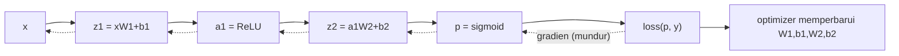

# Neural Network Dasar: Forward, Backpropagation, Loss, dan Optimizer

!!! abstract "Info materi"
    **Tingkat kesulitan:** Menengah–lanjut. **Estimasi waktu:** 210 menit.
    **Jenis kode:** **eksperimen ringan** (`examples/level-6-deep-learning/02_neural_network.py`, NumPy saja) dengan kelas `MLPBiner` di `nlp_hub/jaringan.py`. PyTorch memakai konsep yang sama; hanya turunan dihitung otomatis.

## Tujuan pembelajaran

- [ ] Menjelaskan satu neuron, satu lapisan, fungsi aktivasi (ReLU, sigmoid), dan mengapa aktivasi non-linear diperlukan.
- [ ] Menghitung propagasi maju (*forward*) satu contoh dengan tangan.
- [ ] Menjelaskan *loss* (binary cross-entropy) dan menghitung nilainya.
- [ ] Menurunkan dan menghitung propagasi mundur (*backpropagation*) lewat aturan rantai pada jaringan kecil.
- [ ] Memeriksa gradien dengan beda hingga (*gradient check*).
- [ ] Membandingkan SGD dan Adam, serta menjelaskan *learning rate*.

## Prasyarat

- [NumPy](../level-1-python/numpy-dasar.md): perkalian matriks `@`, broadcasting.
- [Logistic Regression](../level-4-machine-learning/logistic-regression.md): sigmoid dan probabilitas.
- [Embedding Kata](embedding-kata.md).

## Pengantar dan motivasi

Regresi logistik menarik **satu garis lurus** untuk memisahkan dua kelas. Jika kelas tidak dapat dipisah garis lurus, model gagal; contoh klasik adalah XOR. Neural network menambah satu atau lebih **lapisan tersembunyi** dengan aktivasi non-linear sehingga dapat membentuk batas yang melengkung. Pelatihannya memakai **backpropagation**: cara efisien menghitung seberapa besar tiap bobot harus diubah untuk mengecilkan kesalahan.

## Konsep dasar

| Istilah | Arti |
|---|---|
| **Neuron** | Menghitung $z = w\cdot x + b$ lalu menerapkan aktivasi |
| **Lapisan (*layer*)** | Kumpulan neuron yang menerima masukan yang sama |
| **Bobot $W$, bias $b$** | Parameter yang dipelajari |
| **Aktivasi** | Fungsi non-linear: ReLU $\max(0,z)$, sigmoid $\sigma(z)=\frac1{1+e^{-z}}$ |
| **Forward** | Menghitung keluaran dari masukan |
| **Loss** | Angka yang mengukur seberapa salah prediksi; makin kecil makin baik |
| **Gradien** | Turunan loss terhadap parameter; arah yang menaikkan loss paling cepat |
| **Optimizer** | Aturan memperbarui parameter memakai gradien (SGD, Adam) |
| **Epoch / batch** | Satu putaran seluruh data / sebagian data yang diproses sekali pembaruan |

## Penjelasan mendalam

### Mengapa harus non-linear

Dua lapisan linear berturut-turut $W_2(W_1x)$ sama dengan satu lapisan linear $(W_2W_1)x$. Tanpa aktivasi non-linear, menumpuk lapisan tidak menambah kemampuan. ReLU (potong nilai negatif ke 0) adalah pilihan non-linear yang sederhana dan umum.

### Jaringan yang kita pakai

Satu lapisan tersembunyi dengan $H$ neuron dan keluaran sigmoid untuk $P(\text{Emergency})$:

$$
z_1 = xW_1 + b_1,\quad a_1=\mathrm{ReLU}(z_1),\quad z_2=a_1W_2+b_2,\quad p=\sigma(z_2)
$$

- $x$: vektor fitur satu teks (mis. TF-IDF); $W_1$ berukuran (jumlah fitur $\times H$); $a_1$: keluaran lapisan tersembunyi; $p$: peluang kelas Emergency.

### Loss: binary cross-entropy

Untuk label $y\in\{0,1\}$ dan prediksi $p$:

$$
\mathcal{L} = -\big[\,y\log p + (1-y)\log(1-p)\,\big]
$$

Jika $y=1$ hanya suku $-\log p$ yang aktif: $p=0{,}9$ memberi 0,105 (kecil); $p=0{,}1$ memberi 2,303 (besar). Prediksi yakin tetapi salah dihukum sangat berat. Untuk banyak contoh, ambil rata-ratanya.

### Backpropagation dengan aturan rantai

Kita ingin $\partial\mathcal{L}/\partial W$ untuk setiap parameter. Aturan rantai: turunan gabungan = hasil kali turunan tiap tahap, dihitung dari belakang ke depan.

1. Kombinasi sigmoid + BCE menyederhana: $\dfrac{\partial\mathcal{L}}{\partial z_2}=p-y$.
2. $\dfrac{\partial\mathcal{L}}{\partial W_2}=a_1^\top(p-y)$, $\ \dfrac{\partial\mathcal{L}}{\partial b_2}=p-y$.
3. Kirim mundur ke lapisan tersembunyi: $\dfrac{\partial\mathcal{L}}{\partial a_1}=(p-y)\,W_2^\top$.
4. ReLU memblokir neuron mati: $\dfrac{\partial\mathcal{L}}{\partial z_1}=\dfrac{\partial\mathcal{L}}{\partial a_1}\odot \mathbb{1}[z_1>0]$ ($\odot$ = perkalian elemen demi elemen).
5. $\dfrac{\partial\mathcal{L}}{\partial W_1}=x^\top\dfrac{\partial\mathcal{L}}{\partial z_1}$.

### Optimizer

- **SGD:** $\theta \leftarrow \theta - \eta\,g$, dengan $\eta$ = *learning rate*. Terlalu kecil → lambat; terlalu besar → loncat dan tidak konvergen.
- **Adam** (Kingma & Ba, 2015): menyimpan rata-rata bergerak gradien ($m$) dan kuadrat gradien ($v$), lalu memperbarui $\theta \leftarrow \theta - \eta\,\hat m/(\sqrt{\hat v}+\epsilon)$. Ukuran langkah tiap parameter disesuaikan sendiri, sehingga sering lebih mudah disetel.

## Cara kerja atau alur proses



## Contoh sederhana

Dua fitur: $x_1$ = kata "tolong" ada, $x_2$ = kata "bantuan" ada. Teks hanya memuat "tolong": $x=(1,0)$, label $y=1$ (Emergency). Dengan bobot di skrip: $z_1=(0{,}6,\,-0{,}6)$, $a_1=(0{,}6,\,0)$ (neuron kedua "mati" untuk contoh ini), $z_2=0{,}6$, $p=\sigma(0{,}6)=0{,}6457$, loss $=-\log 0{,}6457=0{,}4375$. Gradien $\partial\mathcal{L}/\partial z_2 = p - y = -0{,}3543$: negatif berarti menaikkan $z_2$ akan menurunkan loss.

## Contoh dalam konteks Twitter/X kebencanaan

Pada fitur TF-IDF sungguhan, $W_1$ berukuran sekitar $491\times 32$ (491 kata × 32 neuron tersembunyi). Tiap neuron tersembunyi dapat "mendengarkan" kombinasi kata, mis. kombinasi `tolong` + `air` + `masuk`, dan itu dapat menjadi fitur yang tidak dimiliki model linear. Pada [halaman Overfitting dan Evaluasi](overfitting-evaluasi-dl.md) jaringan ini dilatih pada data bencana kita.

## Praktik Python

Berkas: `examples/level-6-deep-learning/02_neural_network.py`. Jalankan dari `examples/`.

### Bagian 1: forward dengan tangan

```python title="Bagian 1"
--8<-- "level-6-deep-learning/02_neural_network.py:tangan"
```

- `x @ W1` adalah perkalian matriks: vektor (2,) dengan matriks (2,2) menghasilkan vektor (2,).
- `relu(z1)` memotong nilai negatif; `sigmoid(z2)[0]` mengambil angka tunggal dari larik berukuran 1.

```text title="Output nyata"
z1 = [ 0.6 -0.6] -> a1 = [0.6 0. ]
z2 = [0.6] -> p(Emergency) = 0.6457
loss BCE = 0.4375
```

Interpretasi: cocok dengan hitungan tangan di atas (0,6457 dan 0,4375).

### Bagian 2: backward dengan tangan

```python title="Bagian 2"
--8<-- "level-6-deep-learning/02_neural_network.py:mundur_tangan"
```

- `dz1 = da1 * (z1 > 0)`: `z1 > 0` menghasilkan `[True, False]`, diperlakukan sebagai `[1, 0]`; neuron kedua tidak menerima gradien.
- `np.outer(x, dz1)` membentuk matriks (2×2) dari dua vektor: gradien $W_1$.

```text title="Output nyata"
dz2 = -0.3543
dW2 = [-0.213 -0.   ]
dz1 = [-0.354  0.   ]
dW1 =
 [[-0.354  0.   ]
 [-0.     0.   ]]
```

Interpretasi: hanya satu entri $W_1$ (`x1` → neuron 1) berubah (−0,354). Neuron 2 mati (ReLU) dan `x2 = 0`, sehingga semua gradien lain 0. Tanda `-0.` adalah nol negatif hasil perkalian dengan angka negatif; nilainya tetap nol.

### Bagian 3: memeriksa gradien (*gradient check*)

Bagaimana kita yakin turunan di atas benar? Hitung turunan secara numerik: $\dfrac{\mathcal{L}(\theta+\epsilon)-\mathcal{L}(\theta-\epsilon)}{2\epsilon}$ untuk setiap parameter dan bandingkan.

```python title="Bagian 3"
--8<-- "level-6-deep-learning/02_neural_network.py:periksa"
```

```text title="Output nyata"
selisih relatif terbesar gradien analitik vs numerik: 5.42e-11
lolos (< 1e-6): True
```

Interpretasi: selisih relatif per tensor sekitar $5\times10^{-11}$, jauh di bawah $10^{-6}$. Turunan di `MLPBiner.mundur` dapat dipercaya. Perhatikan catatan teknis: versi awal pemeriksaan memakai rasio per elemen dan menghasilkan $1{,}1\times10^{-5}$ pada beberapa entri bergradien hampir nol (neuron ReLU mati), padahal selisih absolutnya hanya $10^{-11}$. Ukuran per tensor (berbasis norma) lebih tepat.

### Bagian 4: XOR, bukti perlunya lapisan tersembunyi

```python title="Bagian 4"
--8<-- "level-6-deep-learning/02_neural_network.py:xor"
```

```text title="Output nyata"
regresi logistik, akurasi XOR: 0.5
MLP, prediksi XOR: [0 1 1 0] | benar: [0 1 1 0]
MLP, akurasi XOR: 1.0
loss awal 0.705 -> loss akhir 0.0012
```

Interpretasi: regresi logistik hanya mencapai 0,5 (tebakan) pada XOR karena tidak ada garis lurus yang memisahkannya. MLP dengan 8 neuron tersembunyi mencapai 1,0 dan loss turun dari 0,705 ke 0,0012. XOR bukan masalah NLP, tetapi perilaku yang sama muncul saat makna bergantung pada **kombinasi** fitur.

### Bagian 5: optimizer dan learning rate

```python title="Bagian 5"
--8<-- "level-6-deep-learning/02_neural_network.py:optimizer"
```

```text title="Output nyata"
sgd  lr=0.05 loss epoch 1: 0.724 | epoch 50: 0.587 | epoch 200: 0.322
sgd  lr=0.5  loss epoch 1: 0.674 | epoch 50: 0.110 | epoch 200: 0.019
adam lr=0.05 loss epoch 1: 0.705 | epoch 50: 0.056 | epoch 200: 0.005
```

Interpretasi: SGD dengan `lr=0,05` lambat (loss 0,322 setelah 200 epoch); SGD `lr=0,5` jauh lebih cepat (0,019); Adam `lr=0,05` tercepat (0,005). Tidak ada `lr` terbaik untuk semua masalah; ini hasil pada **satu** masalah kecil dan satu seed.

### Skrip terpadu dan kelas

Kelas `MLPBiner` (`nlp_hub/jaringan.py`) menggabungkan `maju`, `loss`, `mundur`, dan `latih` (mini-batch, SGD/Adam, L2, *early stopping*). Tesnya ada di `examples/tests/test_jaringan.py` (termasuk gradient check dan XOR).

!!! note "PyTorch"
    Di PyTorch, `loss.backward()` menghitung `mundur` secara otomatis (*autograd*) dan `optimizer.step()` melakukan pembaruan. Konsepnya identik; yang berbeda hanya Anda tidak menulis turunan sendiri. Lihat [RNN, LSTM, GRU](rnn-lstm-gru.md) untuk contoh PyTorch.

## Kesalahan umum dan debugging

| Gejala | Penyebab | Perbaikan |
|---|---|---|
| Loss menjadi `nan` | Learning rate terlalu besar, `log(0)`, atau overflow `exp` | Kecilkan `lr`; potong probabilitas (`clip`); pakai sigmoid stabil |
| Loss tidak turun | `lr` terlalu kecil, label salah, fitur tak diskalakan, bug gradien | Jalankan gradient check; coba overfit 10 contoh dulu |
| Shape mismatch (`matmul`) | Dimensi $W$ tak cocok dengan $x$ | Cetak `.shape` tiap langkah |
| Akurasi 100% pada latih, buruk pada uji | Overfitting | Early stopping, regularisasi, data lebih banyak |
| Neuron ReLU tak pernah aktif | "Dying ReLU" | Inisialisasi lebih baik (He), `lr` lebih kecil |
| Hasil berbeda tiap jalan | Inisialisasi dan urutan batch acak | Tetapkan `seed`; laporkan beberapa seed |

## Kelebihan dan keterbatasan

**Kelebihan:** menangkap interaksi fitur; fleksibel; fondasi seluruh deep learning.
**Keterbatasan:** banyak hyperparameter (ukuran lapisan, `lr`, epoch); sensitif terhadap inisialisasi; lebih mudah overfit pada data kecil; kurang dapat dijelaskan dibanding model linear.

## Latihan bertahap

1. **Konseptual.** Mengapa menumpuk dua lapisan linear tanpa aktivasi tidak menambah kemampuan?
2. **Hitungan.** Hitung loss BCE untuk $y=1$, $p=0{,}9$ dan untuk $y=1$, $p=0{,}1$.
3. **Membaca kode.** Pada `dz1 = da1 * (z1 > 0)`, apa yang terjadi jika semua `z1` negatif?
4. **Debugging.** Loss Anda `nan` pada epoch ke-3. Sebutkan tiga penyebab dan cara memeriksanya.
5. **Eksperimen.** Ubah `n_tersembunyi` pada XOR menjadi 1, 2, 8. Apakah selalu mencapai akurasi 1,0? Jelaskan hasilnya.

## Kunci jawaban dan pembahasan

??? success "Jawaban 1"
    $W_2(W_1x)=(W_2W_1)x$: komposisi transformasi linear tetap linear. Kemampuan model tidak bertambah tanpa non-linearitas di antara lapisan.

??? success "Jawaban 2"
    $-\log 0{,}9=0{,}105$; $-\log 0{,}1=2{,}303$. Prediksi yakin yang salah dihukum jauh lebih berat.

??? success "Jawaban 3"
    Seluruh gradien yang mengalir ke $W_1$ dan $b_1$ menjadi 0: tidak ada neuron tersembunyi yang belajar dari contoh itu. Jika terjadi pada semua contoh, lapisan pertama berhenti belajar (*dying ReLU*).

??? success "Jawaban 4"
    (a) `lr` terlalu besar sehingga bobot meledak: kecilkan `lr`, cetak norma bobot. (b) `log(0)`: potong $p$ dengan `np.clip`. (c) Overflow `exp`: gunakan sigmoid stabil. Periksa dengan mencetak loss dan norma gradien tiap beberapa langkah.

??? success "Jawaban 5"
    Pada pengukuran penulis (10 seed, 500 epoch, Adam `lr=0,05`, batch 4, dijalankan sekali untuk halaman ini): 1 neuron berhasil **0 dari 10** seed, 2 neuron **1 dari 10**, 8 neuron **10 dari 10**. Dua neuron secara teori cukup untuk XOR, tetapi pelatihan sering terjebak; lebih banyak neuron membuat pelatihan lebih andal. Pelajaran: "cukup secara teori" tidak sama dengan "mudah dilatih", dan satu seed bisa menyesatkan.

## Kuis singkat

**1.** Apa tugas backpropagation?

??? success "Jawaban"
    Menghitung turunan loss terhadap semua parameter memakai aturan rantai dari keluaran ke masukan.

**2.** Apa risiko learning rate terlalu besar?

??? success "Jawaban"
    Langkah melompati minimum, loss naik-turun atau menjadi `nan`.

**3.** Apakah gradient check dipakai saat pelatihan produksi?

??? success "Jawaban"
    Tidak; ia lambat. Ia dipakai sekali untuk memverifikasi implementasi turunan, atau sebagai tes.

## Ringkasan

- Jaringan = lapisan linear + aktivasi non-linear; forward menghitung $p$, backward menghitung gradien.
- BCE menghukum prediksi yakin yang salah; sigmoid+BCE memberi gradien $p-y$.
- Gradient check (selisih relatif $5\times10^{-11}$) memverifikasi turunan.
- XOR: regresi logistik 0,5, MLP 1,0. Adam lebih cepat dari SGD pada contoh kecil ini.

## Glosarium istilah baru

Neuron / lapisan
:   Unit hitung $\sigma(wx+b)$ dan kumpulannya.

ReLU
:   Aktivasi $\max(0,z)$.

Backpropagation
:   Penerapan aturan rantai untuk menghitung gradien semua parameter.

Learning rate
:   Ukuran langkah pembaruan parameter.

Adam
:   Optimizer dengan langkah adaptif per parameter.

*Gradient check*
:   Memeriksa gradien analitik dengan beda hingga.

## Referensi

- Kingma, D. P., & Ba, J. (2015). Adam: A method for stochastic optimization. *ICLR 2015* (makalah akademik; judul, penulis, dan tahun diperiksa via arXiv/Crossref/ACL Anthology; venue tidak diverifikasi terpisah).
- Rumelhart, D. E., Hinton, G. E., & Williams, R. J. (1986). Learning representations by back-propagating errors. *Nature*, 323, 533–536 (makalah akademik; judul, penulis, dan tahun diperiksa via arXiv/Crossref/ACL Anthology; venue tidak diverifikasi terpisah).
- PyTorch Autograd: <https://pytorch.org/docs/stable/notes/autograd.html> (dokumentasi resmi).
- Goodfellow, I., Bengio, Y., & Courville, A. (2016). *Deep Learning*. MIT Press, <https://www.deeplearningbook.org/> (buku teks).

## Materi berikutnya

[RNN, LSTM, dan GRU](rnn-lstm-gru.md)
