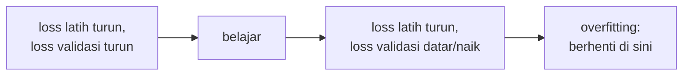
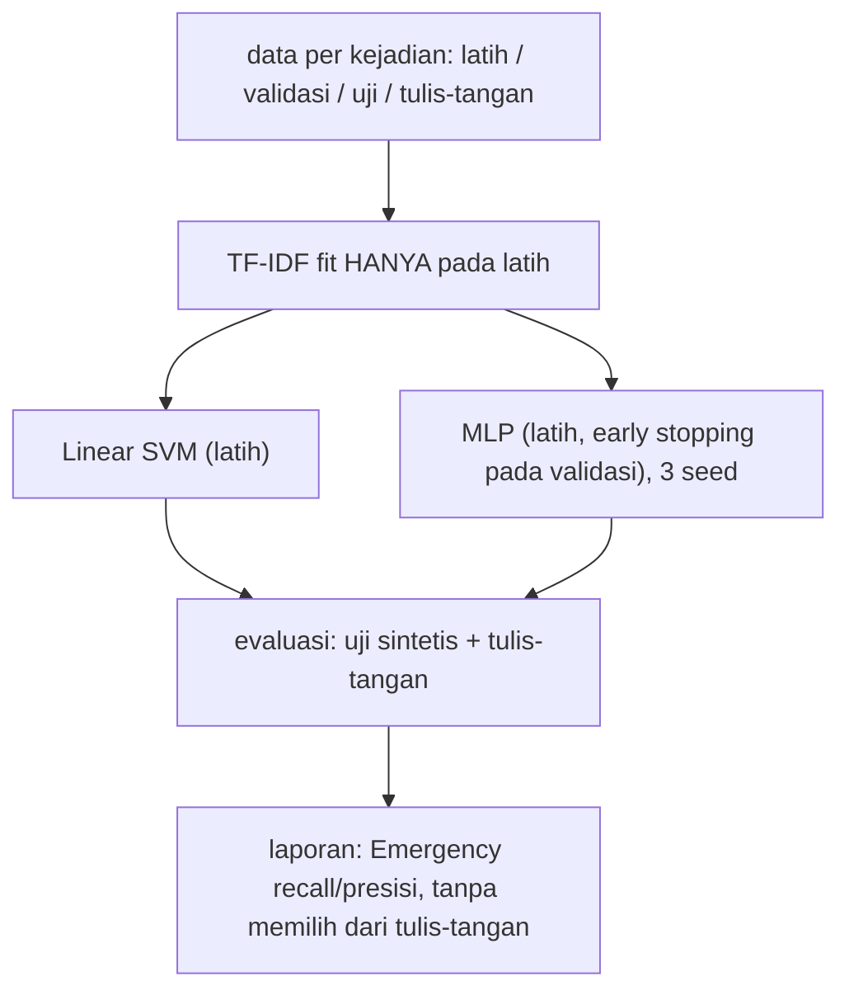

# Overfitting, Regularisasi, dan Evaluasi Model Deep Learning

!!! abstract "Info materi"
    **Tingkat kesulitan:** Menengah–lanjut. **Estimasi waktu:** 180 menit.
    **Jenis kode:** **eksperimen ringan** (`examples/level-6-deep-learning/06_mlp_vs_klasik.py`): jaringan NumPy `MLPBiner` pada fitur TF-IDF dibandingkan dengan Linear SVM, memakai protokol data Level 5. Berjalan di CPU dalam hitungan detik. Angka di halaman adalah keluaran nyata.

## Tujuan pembelajaran

- [ ] Mengenali overfitting dari kurva loss latih dan validasi.
- [ ] Menerapkan early stopping dan regularisasi L2, serta menjelaskan dropout dan *weight decay*.
- [ ] Mengevaluasi model deep learning dengan protokol yang sama seperti model klasik.
- [ ] Menafsirkan variasi antar seed dan tidak menyimpulkan keunggulan dari selisih kecil.
- [ ] Menjelaskan alasan membandingkan pada set yang gaya bahasanya berbeda (tulis-tangan).
- [ ] Menuliskan kesimpulan yang jujur dari hasil di atas.

## Prasyarat

- [Neural Network Dasar](neural-network-dasar.md) (kelas `MLPBiner`).
- [Metrik Klasifikasi](../level-5-evaluasi/metrik-klasifikasi.md) dan [Leakage dan Ketidakpastian](../level-5-evaluasi/leakage-reproducibility.md).

## Pengantar dan motivasi

Model dengan banyak parameter dapat **menghafal** data latih: loss latih menuju nol, tetapi performa pada data baru tidak ikut membaik, bahkan bisa memburuk. Itu *overfitting*. Pada deep learning masalah ini lebih mudah muncul karena jumlah parameter besar dibanding jumlah contoh. Halaman ini melatih jaringan kecil pada data bencana kita, melihat kurvanya, lalu membandingkannya dengan Linear SVM Level 5 secara adil.

## Konsep dasar

| Istilah | Arti |
|---|---|
| **Overfitting** | Bagus pada data latih, jelek pada data baru |
| **Underfitting** | Jelek di keduanya (model terlalu sederhana/dilatih kurang) |
| **Kurva belajar** | Grafik/tabel loss latih dan validasi terhadap epoch |
| **Early stopping** | Berhenti ketika loss validasi tidak membaik selama `sabar` epoch, lalu pulihkan bobot terbaik |
| **Regularisasi L2 / weight decay** | Menambah penalti $\frac{\lambda}{2}\sum W^2$ agar bobot kecil |
| **Dropout** | Mematikan sebagian neuron secara acak saat latihan |
| **Variasi antar seed** | Hasil berubah karena inisialisasi dan urutan batch acak |

## Penjelasan mendalam

### Membaca kurva belajar



Titik loss validasi terendah adalah kandidat untuk berhenti. Pada data kecil kurva validasi berisik (117 contoh), jadi gunakan kesabaran beberapa epoch.

### Regularisasi

- **L2:** fungsi tujuan menjadi $\mathcal{L}+\frac{\lambda}{2}\sum W^2$; gradien tambahan $\lambda W$ menarik bobot ke nol. $\lambda$ besar → model sederhana (risiko underfitting); $\lambda=0$ → tanpa regularisasi.
- **Dropout:** saat latihan, tiap neuron dimatikan dengan peluang $p$; model tidak bisa bergantung pada satu neuron. Saat evaluasi, dropout dimatikan.
- **Early stopping:** regularisasi lewat waktu pelatihan.
- **Lainnya:** menambah data, augmentasi, model lebih kecil.

### Evaluasi yang adil

Untuk membandingkan dua model, **semuanya harus sama** kecuali model: data latih, validasi untuk pemilihan, dan uji untuk pelaporan; ukuran yang sama (recall dan presisi Emergency, F1 makro); beberapa seed untuk model acak. Selisih kecil pada set kecil bukan bukti.

## Cara kerja atau alur proses



## Contoh sederhana

Loss latih 0,0001 dan loss validasi 0,0125: selisihnya 0,0124. Selisih ("celah generalisasi") yang besar menandakan model lebih yakin pada data yang dilihatnya daripada pada data baru. Dengan regularisasi kuat, loss latih naik tetapi celah dapat tetap ada; yang kita cari adalah loss **validasi** yang rendah, bukan celah yang kecil.

## Contoh dalam konteks Twitter/X kebencanaan

Ketika model deep learning dilatih pada pos bertemplat, ia dapat menghafal frasa templat (mis. alamat "Kelurahan X RT nn") dan tampak sangat baik pada uji sintetis karena templatnya sama. Pada pesan tulis-tangan yang bergaya lain, performa jatuh. Karena itu kita selalu melaporkan dua set: uji sintetis (distribusi sama) dan tulis-tangan (gaya berbeda).

## Praktik Python

Berkas: `examples/level-6-deep-learning/06_mlp_vs_klasik.py`. Pustaka: pandas dan scikit-learn (TF-IDF, SVM) dari kode sebelumnya, serta `MLPBiner` NumPy. Jalankan dari `examples/`.

### Bagian 1: data dan fitur

```python title="Bagian 1"
--8<-- "level-6-deep-learning/06_mlp_vs_klasik.py:data"
```

- `tfidf.fit_transform(...)` dipanggil **hanya** pada data latih; `ubah` memakai `transform` untuk validasi/uji/tulis-tangan. Itulah yang mencegah kebocoran dari data non-latih.
- `.toarray()` mengubah matriks jarang menjadi padat karena `MLPBiner` memakai NumPy padat. Pada 335 × 491 ini murah; untuk korpus besar bukan pilihan yang baik.

```text title="Output nyata"
bentuk X_latih: (335, 491) | X_val: (117, 491) | X_uji: (112, 491) | X_tangan: (48, 491)
proporsi Emergency pada latih: 0.337
```

Interpretasi: 335 teks latih dengan 491 fitur; proporsi Emergency pada latih 0,337. Pemeriksaan: jumlah kolom sama pada semua set (491), tanda bahwa `transform` memakai kosakata latih yang sama.

### Bagian 2: kurva belajar

```python title="Bagian 2"
--8<-- "level-6-deep-learning/06_mlp_vs_klasik.py:kurva"
```

```text title="Output nyata"
epoch  1: loss latih 0.4930 | loss validasi 0.5080
epoch  5: loss latih 0.0203 | loss validasi 0.0417
epoch 10: loss latih 0.0022 | loss validasi 0.0149
epoch 20: loss latih 0.0006 | loss validasi 0.0125
epoch 40: loss latih 0.0002 | loss validasi 0.0123
epoch 60: loss latih 0.0001 | loss validasi 0.0125
epoch dengan loss validasi terendah: 27
```

Interpretasi:

- Loss latih turun hampir ke nol (0,0001 pada epoch 60), sedangkan loss validasi berhenti membaik di sekitar 0,012: minimum tercapai pada epoch ke-27, lalu **naik tipis** dari 0,0123 (epoch 40) ke 0,0125 (epoch 60).
- Overfitting di sini **ringan**, bukan dramatis. Dataset bertemplat sangat mudah dipisahkan sehingga validasi pun hampir sempurna. Kita tidak boleh menyimpulkan bahwa deep learning "tidak mengalami overfitting" secara umum; pada data nyata yang lebih berisik celahnya biasanya lebih besar.

### Bagian 3: perbandingan dengan Linear SVM

```python title="Bagian 3"
--8<-- "level-6-deep-learning/06_mlp_vs_klasik.py:bandingkan"
```

- `sabar=5`: berhenti jika loss validasi tidak membaik 5 epoch berturut-turut, dan bobot dari epoch terbaik dipulihkan.
- Tiga seed (0, 1, 2) mengubah inisialisasi dan urutan batch MLP.

```text title="Output nyata"
Linear SVM (latih)                 F1 makro uji 0.980 | recall E uji 1.000 | recall E tulis-tangan 0.583 | presisi E tulis-tangan 1.000
MLP early stopping, seed 0         F1 makro uji 0.980 | recall E uji 1.000 | recall E tulis-tangan 0.792 | presisi E tulis-tangan 0.950
MLP early stopping, seed 1         F1 makro uji 0.980 | recall E uji 1.000 | recall E tulis-tangan 0.833 | presisi E tulis-tangan 0.952
MLP early stopping, seed 2         F1 makro uji 0.980 | recall E uji 1.000 | recall E tulis-tangan 0.833 | presisi E tulis-tangan 0.952
```

Interpretasi yang jujur:

| Model | F1 makro uji | Recall E uji | Recall E tulis-tangan | Presisi E tulis-tangan |
|---|---|---|---|---|
| Linear SVM | 0,980 | 1,000 | 0,583 | 1,000 |
| MLP seed 0 | 0,980 | 1,000 | 0,792 | 0,950 |
| MLP seed 1 | 0,980 | 1,000 | 0,833 | 0,952 |
| MLP seed 2 | 0,980 | 1,000 | 0,833 | 0,952 |

- Pada **uji sintetis** semuanya identik (0,980): data bertemplat tidak membedakan model.
- Pada **tulis-tangan**, MLP menemukan 19–20 dari 24 pesan Emergency, dibanding 14 oleh SVM (recall 0,792–0,833 vs 0,583), dengan sedikit alarm palsu (presisi 0,95 vs 1,00).
- Tetapi: **48 teks, 24 Emergency**. Selisih 5–6 pesan. Hanya tiga seed. Label tulis-tangan dibuat oleh penulis yang sama dengan penulis data latih. Model SVM dilatih pada data latih saja di sini (335 teks), bukan 452 seperti di Level 5, sehingga angka SVM (0,583) sedikit berbeda dari Level 5 (0,625). **Kami tidak mengklaim bahwa MLP lebih baik secara umum.** Pernyataan yang dapat dipertahankan: *pada pengujian kecil ini, MLP menunjukkan recall tulis-tangan yang lebih tinggi pada tiga seed; perlu data lebih besar dan independen, lebih banyak seed, dan uji perbedaan berpasangan sebelum menyimpulkan.* Anda dapat menjalankan `selisih_recall_bootstrap` (Level 5) pada prediksi keduanya untuk memperoleh selang.
- Jaringan ini memakai fitur TF-IDF yang sama; ia **tidak** memakai embedding atau konteks urutan, jadi keunggulan (jika nyata) berasal dari interaksi fitur, bukan dari "kecerdasan bahasa".

### Bagian 4: pengaruh regularisasi L2

```python title="Bagian 4"
--8<-- "level-6-deep-learning/06_mlp_vs_klasik.py:regularisasi"
```

```text title="Output nyata"
l2=0.0  : loss latih akhir 0.0001 | loss validasi akhir 0.0125 | selisih +0.0124
l2=0.001: loss latih akhir 0.0431 | loss validasi akhir 0.0575 | selisih +0.0144
l2=0.01 : loss latih akhir 0.2532 | loss validasi akhir 0.2722 | selisih +0.0189
```

Interpretasi: makin besar $\lambda$, loss latih makin besar (0,0001 → 0,0431 → 0,2532) karena model dibatasi. Loss validasi akhir pun naik (0,0125 → 0,0575 → 0,2722): pada data ini regularisasi kuat **menyebabkan underfitting**, bukan menolong. Perhatikan bahwa loss validasi di sini termasuk suku penalti L2 (fungsi `loss` menambahkannya), jadi angka tidak langsung sebanding antar $\lambda$. Early stopping dan model yang memadai sudah cukup; pilih $\lambda$ lewat evaluasi tanpa penalti pada validasi.

!!! note "Catatan teknis tentang membandingkan loss"
    Loss validasi dari `MLPBiner.loss` memasukkan suku $\frac{\lambda}{2}\sum W^2$. Untuk membandingkan model dengan $\lambda$ berbeda secara adil, hitung `loss_bce(p, y)` saja (tanpa penalti). Ini kesalahan umum yang mudah terjadi.

### Evaluasi model deep learning: daftar periksa

1. Pembagian per kejadian (tidak ada kejadian yang sama di latih dan uji).
2. Transformasi (kosakata, TF-IDF, embedding) dipelajari hanya dari latih.
3. Pemilihan epoch/hyperparameter di validasi; uji dipakai sekali.
4. Beberapa seed; laporkan rentang.
5. Metrik kelas Emergency (recall, presisi) dan F1 makro, bukan hanya akurasi.
6. Set bergaya berbeda; set kecil diperlakukan sebagai petunjuk, bukan bukti.
7. Catat versi library, seed, perangkat, waktu latih.
8. Tanpa klaim kelayakan operasional.

## Kesalahan umum dan debugging

| Gejala | Penyebab | Perbaikan |
|---|---|---|
| Akurasi latih 100%, uji turun | Overfitting | Early stopping, regularisasi, data lebih banyak |
| TF-IDF di-`fit` pada semua data | Kebocoran | `fit` hanya pada latih |
| Loss validasi tidak sebanding antar $\lambda$ | Penalti L2 ikut dihitung | Bandingkan BCE murni |
| Kesimpulan dari satu seed | Variasi acak | Banyak seed, rentang |
| Memilih seed/epoch terbaik di tulis-tangan | Kebocoran seleksi | Pilih di validasi |
| `MemoryError` pada `.toarray()` | Kosakata besar × banyak dokumen | Tetap sparse atau pakai embedding/PyTorch |
| Mengira "MLP lebih baik" dari selisih 5 pesan | Set terlalu kecil | Selang kepercayaan, data lebih banyak |

## Kelebihan dan keterbatasan

**Early stopping dan L2:** sederhana, murah, efektif mencegah overfitting.
**Keterbatasan perbandingan di halaman ini:** satu dataset sintetis bertemplat; tulis-tangan 48 teks dan satu pelabel; tiga seed; tidak ada uji statistik; fitur TF-IDF saja.

## Latihan bertahap

1. **Konseptual.** Sebutkan tanda overfitting pada kurva belajar.
2. **Membaca output.** Pada Bagian 2, pada epoch berapa loss validasi terendah? Apa artinya bagi pemilihan jumlah epoch?
3. **Hitungan.** Recall 0,792 dari 24 Emergency: berapa pesan yang ditemukan?
4. **Debugging.** Seseorang memanggil `tfidf.fit_transform` pada gabungan latih+uji. Apa masalahnya?
5. **Eksperimen.** Ubah `n_tersembunyi` dari 32 ke 4 dan 128. Bagaimana celah latih–validasi berubah?
6. **Analisis.** Tulis satu paragraf kesimpulan Bagian 3 yang jujur.

## Kunci jawaban dan pembahasan

??? success "Jawaban 1"
    Loss latih terus turun sementara loss validasi berhenti turun lalu naik; celah antar keduanya melebar.

??? success "Jawaban 2"
    Epoch ke-27 (indeks 26 + 1). Berhenti di sekitar epoch itu (dengan kesabaran beberapa epoch) cukup; melatih sampai 60 epoch tidak memberi manfaat pada validasi.

??? success "Jawaban 3"
    $0{,}792\times24\approx19$ pesan.

??? success "Jawaban 4"
    IDF dan kosakata dihitung dengan data uji ikut serta; informasi dari uji bocor ke fitur latih, sehingga skor uji terlalu optimistis. `fit` hanya pada latih.

??? success "Jawaban 5"
    Hasil bergantung pada data; umumnya jaringan lebih besar memperlebar celah latih–validasi pada data kecil. Jalankan dan catat nilai Anda; jangan menyimpulkan dari satu seed.

??? success "Jawaban 6"
    Contoh: "Pada tiga seed, MLP berbasis TF-IDF menemukan 19–20 dari 24 pesan Emergency tulis-tangan, dibanding 14 oleh Linear SVM, dengan presisi 0,95 vs 1,00. Karena set hanya 48 teks, dilabeli penulis yang sama dengan data latih, dan hanya tiga seed yang dicoba, hasil ini hanya petunjuk. Tidak ada klaim bahwa MLP lebih baik atau layak untuk penggunaan operasional."

## Kuis singkat

**1.** Apakah loss latih yang mendekati nol selalu baik?

??? success "Jawaban"
    Tidak; bisa menandakan penghafalan. Lihat loss validasi.

**2.** Mengapa early stopping memulihkan bobot terbaik?

??? success "Jawaban"
    Bobot pada epoch terakhir sudah melewati titik loss validasi terendah; kita ingin bobot di titik terbaik.

**3.** Apakah hasil MLP vs SVM di halaman ini membuktikan deep learning lebih baik?

??? success "Jawaban"
    Tidak; hanya petunjuk dari set kecil dan tiga seed.

## Ringkasan

- Loss latih ≈ 0,0001 vs loss validasi minimum ≈ 0,0123 pada epoch 27; overfitting ringan pada data bertemplat.
- Uji sintetis tidak membedakan model (F1 makro 0,980 untuk semua); tulis-tangan: recall Emergency SVM 0,583, MLP 0,792–0,833.
- Selisih berasal dari set kecil (24 Emergency) dan tiga seed; tidak ada klaim keunggulan umum.
- L2 kuat pada data ini menyebabkan underfitting; bandingkan BCE tanpa penalti.

## Glosarium istilah baru

Overfitting
:   Model menghafal data latih sehingga buruk pada data baru.

Early stopping
:   Menghentikan pelatihan ketika loss validasi tidak membaik.

Regularisasi L2
:   Penalti pada kuadrat bobot agar bobot kecil.

Dropout
:   Mematikan neuron acak saat latihan.

Celah generalisasi
:   Selisih performa latih dan validasi.

## Referensi

- Srivastava, N., dkk. (2014). Dropout: A simple way to prevent neural networks from overfitting. *JMLR*, 15, 1929–1958 (makalah akademik; judul, penulis, dan tahun diperiksa via arXiv/Crossref/ACL Anthology; venue tidak diverifikasi terpisah).
- Goodfellow, I., Bengio, Y., & Courville, A. (2016). *Deep Learning*, bab 7 (regularisasi): <https://www.deeplearningbook.org/> (buku teks).
- Dokumentasi scikit-learn, kesalahan umum (kebocoran data): <https://scikit-learn.org/stable/common_pitfalls.html> (dokumentasi resmi).

## Materi berikutnya

Selesai Level 6? Kerjakan checkpoint di [indeks Level 6](index.md), lalu lanjut ke [Level 7: Advanced NLP dan Deployment](../level-7-advanced-nlp/index.md).
