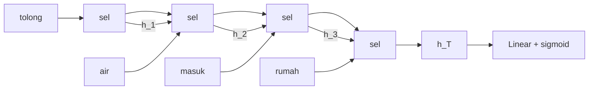

# RNN, LSTM, dan GRU

!!! abstract "Info materi"
    **Tingkat kesulitan:** Menengah–lanjut. **Estimasi waktu:** 210 menit.
    **Jenis kode:** **eksperimen ringan** (`03_rnn_lstm_gru.py`, NumPy saja, hanya propagasi maju dengan bobot acak) dan **eksperimen berat** (`berat/10_lstm_pytorch.py`, butuh PyTorch; **dieksekusi penulis** pada 2026-10-23 dengan 5 seed, hasil tidak diperiksa otomatis).

## Tujuan pembelajaran

- [ ] Menjelaskan mengapa teks adalah data berurutan dan mengapa model "kantong kata" mengabaikan urutan.
- [ ] Menghitung satu langkah RNN dan menjelaskan keadaan tersembunyi (*hidden state*).
- [ ] Menjelaskan masalah gradien menghilang dan melihatnya pada angka.
- [ ] Menjelaskan gerbang LSTM (lupa, masuk, keluaran) dan sel memori; membedakannya dari GRU.
- [ ] Menghitung jumlah parameter RNN, GRU, dan LSTM.
- [ ] Membaca kode klasifikasi LSTM di PyTorch dan menjelaskan *padding* serta `pack_padded_sequence`.

## Prasyarat

- [Neural Network Dasar](neural-network-dasar.md) (forward, backward).
- [Embedding Kata](embedding-kata.md).

## Pengantar dan motivasi

"Tidak ada korban" dan "ada korban, tidak ada yang menolong" memakai kata yang hampir sama, tetapi maknanya sangat berbeda. TF-IDF unigram tidak peduli urutan. **Jaringan rekuren** membaca teks kata demi kata sambil membawa "ingatan" ringkas tentang apa yang sudah dibaca.

## Konsep dasar

| Istilah | Arti |
|---|---|
| **RNN** (*recurrent neural network*) | Jaringan yang memakai keluaran langkah sebelumnya sebagai masukan langkah berikutnya |
| **Keadaan tersembunyi** $h_t$ | Vektor ringkasan bacaan sampai kata ke-$t$ |
| **Gradien menghilang** | Gradien mengecil secara eksponensial ketika dirambatkan melalui banyak langkah |
| **LSTM** | RNN dengan sel memori $c_t$ dan tiga gerbang |
| **GRU** | Versi lebih ringkas dengan dua gerbang |
| **Padding** | Menambah token kosong agar semua teks dalam batch sama panjang |

## Penjelasan mendalam

### RNN sederhana

$$
h_t = \tanh(x_t W_x + h_{t-1} W_h + b)
$$

- $x_t$: embedding kata ke-$t$; $h_{t-1}$: keadaan sebelumnya ($h_0$ = nol); $W_x, W_h, b$: parameter yang **dipakai bersama di semua langkah**; $\tanh$ membatasi nilai ke $(-1,1)$.
- Setelah kata terakhir, $h_T$ dipakai sebagai ringkasan seluruh teks untuk klasifikasi.

### Gradien menghilang

Saat pelatihan, gradien dari kata terakhir dirambatkan ke kata awal:

$$
\frac{\partial h_T}{\partial h_0}=\prod_{t=1}^{T}\mathrm{diag}(1-h_t^2)\,W_h^\top
$$

Jika setiap faktor menyusutkan vektor (mis. skala 0,9 dikali turunan $\tanh<1$), hasil kali $T$ faktor mengecil seperti $0{,}9^T$. Bagian praktik menunjukkan angkanya. Akibatnya RNN sederhana sulit mengaitkan kata awal dan akhir kalimat panjang.

### LSTM

LSTM menambah **sel memori** $c_t$ yang diperbarui secara hampir aditif, dengan tiga gerbang (nilai 0–1 hasil sigmoid) yang mengatur aliran:

$$
\begin{aligned}
f_t &= \sigma(\cdot)\ \text{(lupa)}, \quad i_t=\sigma(\cdot)\ \text{(masuk)}, \quad o_t=\sigma(\cdot)\ \text{(keluaran)}, \quad g_t=\tanh(\cdot)\ \text{(kandidat)}\\
c_t &= f_t\odot c_{t-1} + i_t\odot g_t, \qquad h_t = o_t\odot\tanh(c_t)
\end{aligned}
$$

($\odot$: perkalian elemen). Jika $f_t\approx1$ dan $i_t\approx0$, memori diteruskan nyaris utuh; jalur aditif ini membuat gradien tidak mengecil secepat RNN (Hochreiter & Schmidhuber, 1997).

### GRU

GRU (Cho dkk., 2014) menggabungkan sel memori dan keadaan tersembunyi, dengan gerbang pembaruan $z_t$ dan gerbang reset $r_t$:

$$
h_t = (1-z_t)\odot h_{t-1} + z_t \odot \tilde h_t
$$

Parameternya lebih sedikit daripada LSTM (tiga blok vs. empat), dan performa keduanya sering mirip; pilihannya empiris.

## Cara kerja atau alur proses



## Contoh sederhana

Tiga langkah RNN dengan $h$ satu dimensi, $W_x=1$, $W_h=0{,}5$, $b=0$, $h_0=0$ dan masukan $x=(1,1,0)$:

- $h_1=\tanh(1\cdot1+0)=0{,}762$
- $h_2=\tanh(1+0{,}5\cdot0{,}762)=\tanh(1{,}381)=0{,}881$
- $h_3=\tanh(0+0{,}5\cdot0{,}881)=\tanh(0{,}441)=0{,}414$

Pengaruh $x_1$ pada $h_3$ lewat $W_h$ sudah dikali $0{,}5$ dua kali (dan turunan $\tanh$); semakin panjang, semakin kecil.

## Contoh dalam konteks Twitter/X kebencanaan

"Tolong air masuk rumah" dibaca empat langkah: setelah `tolong`, $h$ condong ke permintaan bantuan; `air` dan `masuk` menambah informasi kejadian; `rumah` menyempurnakan konteks. Teks dengan negasi seperti "tidak ada korban" memerlukan model mengingat `tidak` saat membaca `korban`; di sinilah gerbang LSTM diharapkan berguna.

## Praktik Python

### A. NumPy: apa yang terjadi di dalam sel (ringan)

Berkas: `examples/level-6-deep-learning/03_rnn_lstm_gru.py`. Bobot **acak dan belum dilatih**, jadi angka tidak bermakna linguistik; tujuannya melihat bentuk dan rentang nilai.

**Bagian 1: masukan.** Empat kata, masing-masing embedding acak 3 dimensi.

```python title="Bagian 1"
--8<-- "level-6-deep-learning/03_rnn_lstm_gru.py:masukan"
```

**Bagian 2: RNN.**

```python title="Bagian 2"
--8<-- "level-6-deep-learning/03_rnn_lstm_gru.py:rnn"
```

- `lambda x, h: langkah_rnn(...)` adalah fungsi tanpa nama yang "mengunci" bobot; `jalankan_urutan` memanggilnya untuk tiap kata dan mengumpulkan semua $h_t$.

```text title="Output nyata"
bentuk deret_x (T, dim_x): (4, 3)
bentuk keadaan (T, dim_h): (4, 4)
setelah tolong : h = [ 0.052 -0.037 -0.11  -0.225]
setelah air    : h = [ 0.844  0.517  0.78  -0.099]
setelah masuk  : h = [-0.647 -0.595 -0.962 -0.917]
setelah rumah  : h = [-0.237  0.144  0.331  0.267]
rentang nilai h (tanh membatasi ke (-1, 1)): -0.9624585095179152 sampai 0.8437835171604628
```

Interpretasi: `keadaan` berbentuk (4, 4): satu vektor 4 dimensi per kata. Semua nilai dalam (−1, 1), sesuai $\tanh$. Setelah `air`, nilai besar (0,84); setelah `masuk`, hampir seluruhnya negatif; keadaan berubah tajam antar kata karena bobot acak.

**Bagian 3: LSTM.**

```python title="Bagian 3"
--8<-- "level-6-deep-learning/03_rnn_lstm_gru.py:lstm"
```

- Bias gerbang lupa diisi 1,0 (praktik umum) agar $f_t$ awalnya cenderung besar, yaitu "ingat".

```text title="Output nyata"
tolong : gerbang lupa f = [0.741 0.753 0.739 0.691] | masuk i = [0.519 0.495 0.513 0.405]
air    : gerbang lupa f = [0.767 0.701 0.644 0.676] | masuk i = [0.381 0.725 0.423 0.367]
masuk  : gerbang lupa f = [0.775 0.833 0.83  0.602] | masuk i = [0.593 0.443 0.549 0.217]
rumah  : gerbang lupa f = [0.721 0.762 0.873 0.694] | masuk i = [0.398 0.579 0.403 0.475]
sel memori c akhir: [ 0.034 -0.663  0.093  0.461]
keadaan tersembunyi h akhir: [ 0.014 -0.214  0.05   0.137]
```

Interpretasi: semua gerbang berada di antara 0 dan 1. Gerbang lupa $f$ sekitar 0,6–0,87 (memori sebagian besar dipertahankan); gerbang masuk $i$ sekitar 0,2–0,7. Setelah pelatihan nilai ini akan berbeda, dan memeriksanya merupakan salah satu cara mengintip perilaku model.

**Bagian 4: GRU dan jumlah parameter.**

```python title="Bagian 4"
--8<-- "level-6-deep-learning/03_rnn_lstm_gru.py:gru"
```

```text title="Output nyata"
tolong : gerbang pembaruan z = [0.485 0.458 0.513 0.525] | reset r = [0.481 0.52  0.59  0.493]
air    : gerbang pembaruan z = [0.76  0.501 0.312 0.708] | reset r = [0.497 0.636 0.525 0.332]
masuk  : gerbang pembaruan z = [0.362 0.328 0.625 0.466] | reset r = [0.518 0.634 0.731 0.58 ]
rumah  : gerbang pembaruan z = [0.437 0.462 0.706 0.344] | reset r = [0.507 0.587 0.437 0.55 ]
keadaan tersembunyi h akhir: [-0.41  -0.141  0.23  -0.046]
```

```python title="Bagian 5"
--8<-- "level-6-deep-learning/03_rnn_lstm_gru.py:parameter"
```

```text title="Output nyata"
dim_x=  3, dim_h=  4 -> RNN     32 | GRU     96 | LSTM    128 parameter
dim_x=100, dim_h=128 -> RNN  29312 | GRU  87936 | LSTM 117248 parameter
```

Interpretasi: untuk ukuran kecil (3→4) hanya 32/96/128 parameter; untuk ukuran lebih realistis (100→128) 29.312 / 87.936 / 117.248. LSTM sekitar 4 kali RNN dan GRU sekitar 3 kali, sebab jumlah blok bobot masing-masing 4 dan 3 (versus 1).

**Bagian 6: gradien menghilang.**

```python title="Bagian 6"
--8<-- "level-6-deep-learning/03_rnn_lstm_gru.py:hilang"
```

- Matriks $W_h$ diskalakan sehingga jari-jari spektralnya 0,9 (nilai eigen terbesar), lalu Jacobian satu langkah $\mathrm{diag}(1-h^2)W_h^\top$ dikalikan sepanjang waktu.

```text title="Output nyata"
T= 5: norma dh_T/dh_0 = 6.26e-02
T=20: norma dh_T/dh_0 = 1.26e-05
T=50: norma dh_T/dh_0 = 2.29e-15
```

Interpretasi: pengaruh keadaan awal pada keadaan akhir menyusut dari $6\times10^{-2}$ (5 langkah) ke $10^{-5}$ (20 langkah) dan $10^{-15}$ (50 langkah). Ini satu percobaan dengan satu matriks acak dan data masukan acak, bukan bukti umum; tetapi menunjukkan mekanismenya.

### B. PyTorch: klasifikasi LSTM (berat, dieksekusi penulis)

Berkas: `examples/level-6-deep-learning/berat/10_lstm_pytorch.py`. Dependensi: `torch` (`requirements-dl.txt`). **Status: dijalankan penulis (torch 2.14.1 CPU) lima kali dengan seed 1–5 lewat `13_ulang_seed.py --jenis lstm`; hasil di bagian "Hasil nyata" di bawah.**

**Model.**

```python title="Model LSTM"
--8<-- "level-6-deep-learning/berat/10_lstm_pytorch.py:model"
```

- `nn.Embedding(n_kosakata, dim, padding_idx=PAD)`: tabel embedding yang **dipelajari**; indeks `PAD` tidak diperbarui.
- `pack_padded_sequence` memberi tahu LSTM panjang asli tiap teks supaya padding tidak ikut dibaca; tanpa itu keadaan akhir bercampur token kosong.
- `h[-1]` adalah keadaan tersembunyi terakhir tiap teks. Keluarannya **logit** (belum sigmoid); `BCEWithLogitsLoss` memasang sigmoid di dalamnya dengan cara yang stabil secara numerik.
- `nn.Dropout` mematikan sebagian aktivasi secara acak saat latihan sebagai regularisasi.

**Mengubah token menjadi id.**

```python title="Token ke id"
--8<-- "level-6-deep-learning/berat/10_lstm_pytorch.py:ke_id"
```

- `kosakata.get(t, UNK)` memberi id `UNK` untuk kata yang tidak ada di kosakata **latih**; kosakata dibangun hanya dari data latih untuk mencegah kebocoran.
- Hasilnya papan id berbentuk (jumlah teks, panjang maksimum) dan daftar panjang asli.

**Perulangan latih.**

```python title="Perulangan latih"
--8<-- "level-6-deep-learning/berat/10_lstm_pytorch.py:latih"
```

- `optimizer.zero_grad()` → `loss.backward()` → `optimizer.step()` adalah tiga langkah wajib di PyTorch. Lupa `zero_grad` membuat gradien menumpuk antar batch.
- `clip_grad_norm_` membatasi norma gradien agar tidak meledak.
- Bobot dengan loss validasi terendah disalin dan dipulihkan setelah loop (early stopping manual).

Menjalankan: `python level-6-deep-learning/berat/10_lstm_pytorch.py` (satu seed, bawaan 42) atau `python level-6-deep-learning/berat/13_ulang_seed.py --jenis lstm` (lima seed).

**Hasil nyata (lima seed, CPU, 335 teks latih, 15 epoch; pembanding Linear SVM dilatih pada data latih yang sama):**

--8<-- "level-6-deep-learning/berat/hasil/lstm_pytorch.md"

Interpretasi yang jujur:

- Pada **uji sintetis** LSTM sebanding dengan SVM (F1 makro 0,974 vs 0,980): data bertemplat mudah.
- Pada **tulis-tangan** LSTM jauh lebih buruk: recall Emergency rata-rata 0,192 (0,000–0,333) dibanding 0,583 untuk SVM; pada satu seed ia tidak menandai satu pun pesan sebagai Emergency (recall 0 dan presisi 0).
- Dugaan (tidak diuji): embedding yang dilatih dari 335 teks bertemplat hanya mengenali kosakata templat; kata-kata di tulis-tangan menjadi `<unk>`. Embedding pra-latih atau model bahasa pra-latih ([Fine-tuning](fine-tuning-transfer-learning.md)) menjadi jalan keluar yang wajar, dan IndoBERT p1 memang jauh lebih baik pada set yang sama.
- Satu pelajaran praktis: **model neural tidak otomatis lebih baik** daripada TF-IDF. Tanpa pra-latih dan dengan data sekecil ini ia lebih buruk, dan hasilnya bervariasi besar antar seed (recall 0,000–0,333).
- Satu eksekusi awal (seed 42) menunjukkan loss validasi turun sampai 0,045 pada epoch 6 lalu bergerak naik-turun 0,05–0,10; skrip menyimpan bobot epoch terbaik. Tabel di atas memakai seed 1–5, bukan seed 42.

## Kesalahan umum dan debugging

| Gejala | Penyebab | Perbaikan |
|---|---|---|
| `RuntimeError: ... lengths ... on CPU` pada `pack_padded_sequence` | Panjang berada di GPU | `panjang.cpu()` (sudah dilakukan pada kode) |
| Prediksi sama untuk semua teks | Embedding/`h` tidak belajar, atau padding ikut terbaca | Periksa padding, `lr`, jumlah epoch |
| Loss `nan` | Gradien meledak | `clip_grad_norm_`, kecilkan `lr` |
| Lupa `model.eval()` saat evaluasi | Dropout tetap aktif, hasil acak | Panggil `model.eval()` dan `torch.no_grad()` |
| Kosakata dibangun dari seluruh data | Kebocoran data | Bangun hanya dari data latih |
| Panjang urutan beragam menyebabkan boros memori | Padding ke panjang maksimum global | Batasi `maks` dan kelompokkan menurut panjang |

## Kelebihan dan keterbatasan

**Kelebihan:** membaca urutan; parameter sedikit dibanding Transformer; LSTM/GRU menangani ketergantungan menengah.
**Keterbatasan:** harus dihitung berurutan (sulit diparalelkan); masih kesulitan pada urutan sangat panjang; pada data kecil sering tidak lebih baik daripada TF-IDF + model linear; digeser oleh Transformer untuk hampir semua tugas bahasa modern.

## Latihan bertahap

1. **Konseptual.** Mengapa parameter $W_x$, $W_h$ dipakai bersama di semua langkah?
2. **Hitungan.** Hitung jumlah parameter LSTM dengan `dim_x=50`, `dim_h=64`.
3. **Membaca output.** Pada Bagian 6, jika $T$ dinaikkan menjadi 100, perkirakan arah norma dan jelaskan.
4. **Debugging.** Seseorang tidak memakai `pack_padded_sequence` dan mengambil `output[:, -1]`. Apa masalahnya?
5. **Analisis.** Mengapa bias gerbang lupa diinisialisasi positif?

## Kunci jawaban dan pembahasan

??? success "Jawaban 1"
    Agar model dapat memproses teks dengan panjang berapa pun dan mengenali pola yang sama di posisi berbeda; jumlah parameter tidak bergantung panjang teks.

??? success "Jawaban 2"
    $4\times((50+64)\times64+64)=4\times(7296+64)=4\times7360=29{,}440$.

??? success "Jawaban 3"
    Norma akan semakin kecil (turun lagi secara eksponensial, jauh di bawah $10^{-15}$), karena setiap langkah menambah satu faktor penyusut.

??? success "Jawaban 4"
    Pada teks yang lebih pendek dari panjang maksimum, posisi terakhir adalah token padding, bukan kata terakhir sesungguhnya; keadaan terakhir tercampur token kosong sehingga representasi teks pendek rusak.

??? success "Jawaban 5"
    Agar di awal pelatihan memori cenderung dipertahankan ($f\approx\sigma(1)\approx0{,}73$), sehingga gradien lebih mudah mengalir melintasi waktu. Ini praktik umum, bukan aturan mutlak.

## Kuis singkat

**1.** Apa yang dibawa $h_t$?

??? success "Jawaban"
    Ringkasan vektor dari kata-kata yang sudah dibaca sampai langkah $t$.

**2.** Mana yang punya lebih banyak parameter, GRU atau LSTM?

??? success "Jawaban"
    LSTM (4 blok vs 3 blok).

**3.** Apakah angka gerbang di halaman ini menunjukkan model yang sudah belajar?

??? success "Jawaban"
    Tidak. Bobotnya acak dan belum dilatih.

## Ringkasan

- RNN membaca berurutan dengan keadaan tersembunyi; gradiennya menyusut melalui langkah panjang (contoh: $6\times10^{-2}\to10^{-15}$ dari T=5 ke T=50).
- LSTM menambah sel memori dan tiga gerbang; GRU lebih ringkas.
- Parameter: RNN 29.312, GRU 87.936, LSTM 117.248 pada 100→128.
- Kode PyTorch dijalankan lima seed: LSTM dari nol mendapat F1 makro uji 0,974 tetapi recall E tulis-tangan hanya 0,192 (0,000–0,333) vs SVM 0,583.

## Glosarium istilah baru

Keadaan tersembunyi (*hidden state*)
:   Vektor ringkasan bacaan hingga langkah tertentu.

Gradien menghilang
:   Gradien yang mengecil eksponensial saat dirambatkan melintasi banyak langkah.

Gerbang (*gate*)
:   Nilai 0–1 yang mengatur seberapa banyak informasi lewat.

Padding
:   Token kosong untuk menyamakan panjang teks dalam satu batch.

## Referensi

- Hochreiter, S., & Schmidhuber, J. (1997). Long short-term memory. *Neural Computation*, 9(8), 1735–1780 (makalah akademik; judul, penulis pertama, jurnal, tahun diperiksa via Crossref).
- Cho, K., dkk. (2014). Learning phrase representations using RNN encoder–decoder for statistical machine translation. *EMNLP 2014* (makalah akademik; judul, penulis, dan tahun diperiksa via arXiv/Crossref/ACL Anthology; venue tidak diverifikasi terpisah).
- Dokumentasi PyTorch, `torch.nn.LSTM`: <https://pytorch.org/docs/stable/generated/torch.nn.LSTM.html> (dokumentasi resmi).

## Materi berikutnya

[Attention, Self-Attention, dan Transformer](attention-transformer.md)
