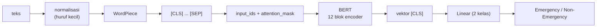

# Tokenizer Modern, BERT, dan IndoBERT

!!! abstract "Info materi"
    **Tingkat kesulitan:** Lanjut. **Estimasi waktu:** 180 menit.
    **Jenis kode:** **ringan** (`05_tokenizer_subword.py`: BPE dan WordPiece mini, tanpa dependensi tambahan) dan **berat** (`berat/11_tokenizer_indobert.py`: tokenizer IndoBERT nyata, butuh `transformers` dan unduhan kecil; **dieksekusi penulis pada 2026-10-23**, keluarannya ditampilkan tetapi tidak diperiksa otomatis).

## Tujuan pembelajaran

- [ ] Menjelaskan mengapa tokenizer modern memakai potongan subword, bukan kata utuh.
- [ ] Mempelajari aturan BPE dari korpus kecil dan menerapkannya ke kata baru.
- [ ] Menjelaskan pemecahan WordPiece (longest-match-first, awalan `##`).
- [ ] Menjelaskan arsitektur BERT: encoder, token `[CLS]`/`[SEP]`, *masked language modeling*, dan batas 512 token.
- [ ] Membedakan dua model berlabel IndoBERT yang umum: `indobenchmark/indobert-base-p1` dan `indolem/indobert-base-uncased`.
- [ ] Menyiapkan `input_ids`, `attention_mask`, *padding*, dan *truncation*.

## Prasyarat

- [Embedding Kata](embedding-kata.md) (OOV dan subword).
- [Attention dan Transformer](attention-transformer.md).

## Pengantar dan motivasi

Kosakata berbasis kata utuh selalu terlalu kecil (kata baru terus muncul) atau terlalu besar (jutaan entri). Tokenizer subword mengambil jalan tengah: kosakata puluhan ribu potongan yang cukup untuk menyusun kata apa pun. Model seperti **BERT** menerima potongan itu sebagai masukan. **IndoBERT** adalah BERT yang dilatih pada teks berbahasa Indonesia, sehingga kosakata dan pengetahuan bahasanya lebih sesuai untuk proyek kita daripada BERT berbahasa Inggris.

## Konsep dasar

| Istilah | Arti |
|---|---|
| **Tokenizer** | Mengubah teks menjadi urutan token (potongan) lalu id bilangan bulat |
| **BPE** (*byte-pair encoding*) | Mulai dari huruf; berulang kali gabungkan pasangan simbol yang paling sering |
| **WordPiece** | Kosakata potongan; saat memecah, ambil potongan terpanjang yang ada, potongan lanjutan berawalan `##` |
| **`[CLS]`, `[SEP]`, `[PAD]`, `[UNK]`, `[MASK]`** | Token khusus: awal teks (ringkasan), pemisah, padding, tak dikenal, tutup |
| **MLM** (*masked language modeling*) | Latihan awal BERT: tutup sebagian kata, tebak dari konteks dua arah |
| **`input_ids` / `attention_mask`** | Id token / penanda 1 = token asli, 0 = padding |
| **Truncation** | Memotong teks yang melebihi panjang maksimum |

## Penjelasan mendalam

### Algoritma BPE

1. Pecah semua kata menjadi huruf, tambahkan penanda akhir kata `</w>`. Contoh `banjir` → `b a n j i r </w>`.
2. Hitung semua pasangan simbol bersebelahan (diboboti frekuensi kata) dan gabungkan pasangan paling sering menjadi satu simbol baru.
3. Ulangi sebanyak jumlah gabungan yang diinginkan. Urutan gabungan = "aturan".
4. Untuk kata baru: mulai dari huruf, terapkan aturan sesuai urutan belajarnya.

Semakin banyak aturan, semakin panjang potongan dan semakin sedikit potongan per kata, tetapi kosakata semakin besar.

### WordPiece dan BERT

BERT memakai WordPiece (Wu dkk., 2016; dipakai oleh Devlin dkk., 2019). Perbedaannya dengan BPE terutama pada cara kosakata dipilih, dan pada penerapan: pemecahan greedy longest-match. Contoh: `banjirnya` → `banjir` + `##nya`. Bila ada bagian yang tak bisa dicocokkan, seluruh kata menjadi `[UNK]` (bagian praktik menunjukkannya).

### BERT

BERT (*Bidirectional Encoder Representations from Transformers*, Devlin dkk., 2019) adalah tumpukan encoder Transformer. Pra-latih dengan dua tugas: **MLM** (menebak kata yang ditutup) dan *next sentence prediction* pada makalah asli. Hasilnya adalah model yang memahami konteks dua arah. Untuk klasifikasi: masukan `[CLS] teks [SEP]`, ambil keluaran pada posisi `[CLS]`, tambahkan lapisan linear untuk kelas. Batas panjang standar 512 token. BERT-base: 12 lapis, 768 dimensi, 12 kepala.

### IndoBERT: dua model berbeda

Nama "IndoBERT" dipakai untuk beberapa model. Dua yang umum (informasi dari halaman model masing-masing di Hugging Face Hub, diperiksa saat menulis halaman ini):

| ID model | Makalah | Catatan dari halaman model |
|---|---|---|
| `indobenchmark/indobert-base-p1` | Wilie dkk. (2020), *IndoNLU*, AACL-IJCNLP 2020 | Lisensi MIT; 124,5 juta parameter; arsitektur BERT-base; "p1" = fase 1 |
| `indolem/indobert-base-uncased` | Koto dkk. (2020), *IndoLEM and IndoBERT*, COLING 2020 | Lisensi MIT; huruf kecil (*uncased*); halaman menyatakan diuji dengan `transformers==3.5.1` |

Dua model ini dilatih dengan korpus dan tokenizer yang berbeda; hasilnya pada tugas kita dapat berbeda dan **tidak boleh diasumsikan sama**. Pilihan model, versi, dan lisensi harus dicatat di laporan. Periksa selalu halaman model terbaru sebelum memakainya.

## Cara kerja atau alur proses



## Contoh sederhana

Kosakata WordPiece kecil `{banjir, ##nya, air, ke, ##an, ##banjir, gempa, tolong}`:

- `banjirnya` → cocok terpanjang `banjir`, sisa `nya` → `##nya`. Hasil: `banjir`, `##nya`.
- `kebanjiran` → `ke`, lalu `banjir` sebagai `##banjir`, lalu `##an`. Hasil: `ke`, `##banjir`, `##an`.
- `meluap` → tidak ada potongan yang cocok → `[UNK]`.

## Contoh dalam konteks Twitter/X kebencanaan

Pesan seperti "Banjirnya tinggi bgt, toloooong!" mengandung singkatan dan huruf berulang. Tokenizer subword memecahnya menjadi potongan yang mungkin mirip dengan kata baku, sehingga model masih mendapat sebagian informasi, tidak seperti model kata utuh yang melihat dua token `[UNK]`. Namun pemecahan bisa mengalami fragmentasi (`to ##lo ##oo ##ong`), dan model mungkin tetap kesulitan. Apakah normalisasi informal masih membantu **harus diuji**, bukan diasumsikan.

## Praktik Python

### A. BPE dan WordPiece mini (ringan, berjalan di CPU)

Berkas: `examples/level-6-deep-learning/05_tokenizer_subword.py`; fungsi di `nlp_hub/subword.py`. Ini versi pengajaran, **bukan** tokenizer IndoBERT.

**Bagian 1: menghitung kata.**

```python title="Bagian 1"
--8<-- "level-6-deep-learning/05_tokenizer_subword.py:hitung"
```

- `t.isalpha()` menyaring token khusus (`tok_url`, angka); `Counter` menghitung frekuensi.

```text title="Output nyata"
jumlah token kata: 6623 | jenis kata unik: 557
lima kata tersering: [('di', 268), ('jalan', 152), ('kelurahan', 148), ('dan', 134), ('rt', 128)]
```

Interpretasi: 6.623 token kata dan 557 jenis kata unik. Kata tersering `di`, `jalan`, `kelurahan` berasal dari templat alamat dataset sintetis.

**Bagian 2: belajar BPE dan menerapkannya.**

```python title="Bagian 2"
--8<-- "level-6-deep-learning/05_tokenizer_subword.py:bpe"
```

```text title="Output nyata"
10 aturan gabung pertama: [('a', 'n'), ('an', '</w>'), ('a', '</w>'), ('i', '</w>'), ('a', 'h'), ('a', 'r'), ('g', '</w>'), ('e', 'r'), ('e', 'n'), ('i', 'n')]
banjir      -> ['banjir</w>']
banjirnya   -> ['banj', 'i', 'r', 'nya</w>']
kebanjiran  -> ['keb', 'an', 'j', 'i', 'r', 'an</w>']
gempa       -> ['gempa</w>']
tolooong    -> ['to', 'l', 'o', 'o', 'ong</w>']
xyz         -> ['x', 'y', 'z', '</w>']
```

Interpretasi:

- Aturan awal menggabungkan huruf-huruf sering: `a`+`n`, lalu `an`+`</w>`: akhiran `-an` ditemukan otomatis.
- Setelah 300 aturan, `banjir` dan `gempa` menjadi satu potongan karena sering muncul di data.
- `banjirnya` **tidak** muncul di data, sehingga pecah menjadi `banj`, `i`, `r`, `nya</w>`; `kebanjiran` pecah menjadi enam potongan; `tolooong` jadi `to l o o ong</w>`. BPE kita dilatih pada korpus kecil bertemplat; kata asing terfragmentasi. Tokenizer BERT dilatih pada korpus ribuan kali lebih besar sehingga fragmentasi lebih jarang.
- `xyz` tak punya aturan: huruf tunggal, tidak pernah `[UNK]` karena BPE selalu bisa kembali ke huruf (kelebihan dibanding WordPiece di bawah).

**Bagian 3: efek jumlah aturan.**

```python title="Bagian 3"
--8<-- "level-6-deep-learning/05_tokenizer_subword.py:ukuran"
```

```text title="Output nyata"
  0 aturan gabung -> rata-rata 6.60 potongan per kata
 20 aturan gabung -> rata-rata 4.77 potongan per kata
100 aturan gabung -> rata-rata 3.25 potongan per kata
300 aturan gabung -> rata-rata 2.19 potongan per kata
```

Interpretasi: rata-rata potongan per kata turun dari 6,60 (huruf) ke 2,19 (300 aturan). Kosakata yang lebih besar membuat urutan lebih pendek (lebih cepat), tetapi tabel embedding lebih besar.

**Bagian 4: WordPiece.**

```python title="Bagian 4"
--8<-- "level-6-deep-learning/05_tokenizer_subword.py:wordpiece"
```

```text title="Output nyata"
banjirnya   -> ['banjir', '##nya']
kebanjiran  -> ['ke', '##banjir', '##an']
airnya      -> ['air', '##nya']
gempa       -> ['gempa']
meluap      -> ['[UNK]']
```

Interpretasi: cocok dengan contoh tangan. `meluap` menjadi `[UNK]` karena tidak ada potongan; berbeda dengan BPE yang jatuh ke huruf.

### B. Tokenizer IndoBERT nyata (berat, dieksekusi penulis)

Berkas: `examples/level-6-deep-learning/berat/11_tokenizer_indobert.py`. Dependensi: `transformers` (`requirements-dl.txt`). Mengunduh berkas tokenizer kecil dari Hugging Face Hub saat pertama kali. **Status: dijalankan penulis (torch 2.14.1 CPU, transformers 5.20.2, Windows); keluaran di bawah disalin dari eksekusi itu dan dapat berbeda pada versi lain.** Skrip menerima argumen ID model: `python level-6-deep-learning/berat/11_tokenizer_indobert.py indolem/indobert-base-uncased`.

```python title="Memuat tokenizer"
--8<-- "level-6-deep-learning/berat/11_tokenizer_indobert.py:muat"
```

- `AutoTokenizer.from_pretrained(nama)` memilih kelas tokenizer yang tepat dari konfigurasi model dan mengunduh kosakatanya. Tokenizer **harus** berasal dari model yang sama dengan model yang dilatih; tokenizer berbeda menghasilkan id berbeda.

```python title="Memecah teks"
--8<-- "level-6-deep-learning/berat/11_tokenizer_indobert.py:pecah"
```

- `tokenizer(teks)` mengembalikan `input_ids` dan `attention_mask`; `convert_ids_to_tokens` menampilkan potongannya. Anda akan melihat `[CLS]` di awal dan `[SEP]` di akhir.

```python title="Batch dengan padding"
--8<-- "level-6-deep-learning/berat/11_tokenizer_indobert.py:batch"
```

- `padding=True` menyamakan panjang; `truncation=True, max_length=32` memotong; `return_tensors="pt"` menghasilkan tensor PyTorch. `attention_mask` bernilai 0 pada padding.

```text title="Output nyata: dieksekusi penulis, bergantung versi dan unduhan (tidak diperiksa otomatis)"
model: indobenchmark/indobert-base-p1 | ukuran kosakata: 30521

teks      : Tolong, air banjir sudah masuk ke rumah kami.
token     : ['[CLS]', 'tolong', ',', 'air', 'banjir', 'sudah', 'masuk', 'ke', 'rumah', 'kami', '.', '[SEP]']
jumlah id : 12

teks      : Banjirnya tinggi bgt, toloooong!
token     : ['[CLS]', 'banjir', '##nya', 'tinggi', 'bgt', ',', 'tol', '##oooo', '##ng', '!', '[SEP]']
jumlah id : 11

teks      : Saya sedang membaca berita tentang gempa tahun lalu.
token     : ['[CLS]', 'saya', 'sedang', 'membaca', 'berita', 'tentang', 'gempa', 'tahun', 'lalu', '.', '[SEP]']
jumlah id : 11

bentuk input_ids : (3, 12)
attention_mask[0]: [1, 1, 1, 1, 1, 1, 1, 1, 1, 1, 1, 1]
```

Interpretasi hasil nyata:

- **Kosakata 30.521** potongan; tokenizer `indobert-base-p1` mengubah semua huruf menjadi kecil (`Tolong` → `tolong`), jadi model ini *uncased* dalam praktik.
- Kalimat baku ("Tolong, air banjir sudah masuk ke rumah kami.") menjadi 10 token (8 kata, koma, dan titik) + `[CLS]` + `[SEP]` = 12 id; setiap kata utuh satu token.
- `Banjirnya` → `banjir` + `##nya`: sufiks `-nya` dipisah, cocok dengan contoh WordPiece mini kita.
- `bgt` (singkatan) tetap satu token: ada di kosakata, berbeda dari tokenizer kita yang harus belajar dari data.
- `toloooong` pecah menjadi `tol` + `##oooo` + `##ng`: huruf berulang memecah kata menjadi potongan yang kurang bermakna. Tidak ada `[UNK]`, tetapi representasinya jauh dari `tolong`. Ini alasan untuk **menguji** apakah normalisasi huruf berulang (Level 2) masih membantu sebelum IndoBERT, bukan mengasumsikannya.
- Batch 3 teks: `input_ids` berbentuk `(3, 12)` (panjang terpanjang 12); baris pertama (teks terpanjang) tidak berisi padding, sehingga `attention_mask` seluruhnya 1. Dua teks lain 11 token dan mendapat satu padding (mask 0); angka itu tidak dicetak skrip.
- Peringatan Hugging Face tentang token HF, symlink Windows, dan unduhan tanpa autentikasi adalah informasi lingkungan, bukan kesalahan.

## Kesalahan umum dan debugging

| Gejala | Penyebab | Perbaikan |
|---|---|---|
| `OSError: Can't load tokenizer ...` | Nama model salah atau tidak ada jaringan | Periksa ID di Hub; unduh lebih dulu |
| Hasil buruk setelah mengganti model | Memakai tokenizer model lain | Muat tokenizer dan model dengan ID yang sama |
| Teks terpotong diam-diam | `truncation=True` dengan `max_length` pendek | Periksa panjang token; naikkan `max_length` |
| Panjang batch berbeda-beda menyebabkan galat | Lupa `padding=True` | Aktifkan padding |
| Kata kunci penting menjadi `[UNK]` | Tokenizer WordPiece tak mengenal karakter (mis. emoji) | Ubah emoji ke kata (Level 2) atau pakai tokenizer yang mendukung |
| Mengira model `uncased` membedakan huruf besar | Tokenizer huruf-kecil mengabaikan perbedaan itu | Baca konfigurasi model |

## Kelebihan dan keterbatasan

**Kelebihan:** kosakata terbatas tetapi dapat menyusun kata apa pun; mengurangi OOV; model pra-latih membawa pengetahuan bahasa.
**Keterbatasan:** pemecahan yang tidak intuitif; singkatan dan slang bisa terfragmentasi; panjang maksimum 512 token; model pra-latih membawa bias korpus dan memerlukan komputasi.

## Latihan bertahap

1. **Konseptual.** Mengapa BPE tidak pernah menghasilkan token tak dikenal, sedangkan WordPiece bisa?
2. **Hitungan.** Dengan korpus `{"aab": 3, "ab": 1}`, pasangan apa yang digabung pertama?
3. **Membaca output.** Mengapa `banjirnya` terpecah menjadi 4 potongan pada Bagian 2, padahal `banjir` satu potongan?
4. **Debugging.** Anda memuat tokenizer `indolem/indobert-base-uncased` tetapi model `indobenchmark/indobert-base-p1`. Apa risikonya?
5. **Analisis.** Mengapa panjang masukan maksimum 512 relevan untuk pos Twitter/X, dan kapan ia bisa menjadi masalah?

## Kunci jawaban dan pembahasan

??? success "Jawaban 1"
    BPE selalu dapat jatuh kembali ke huruf (atau byte), sehingga setiap string dapat direpresentasikan. WordPiece gagal bila ada bagian kata yang tak ada di kosakata dan mengganti seluruh kata dengan `[UNK]`.

??? success "Jawaban 2"
    Hitung pasangan (dengan penanda `</w>`): `a a` = 3 (dari `aab`), `a b` = 3 + 1 = 4, `b </w>` = 3 + 1 = 4. Ada **seri** antara `a b` dan `b </w>` (masing-masing 4). Implementasi kita memutus seri secara abjad sehingga **`a`+`b`** digabung dahulu (hasil dikonfirmasi dengan menjalankan `latih_bpe`). Implementasi lain bisa memilih berbeda; aturan pemutus seri adalah bagian dari definisi algoritma yang perlu dicatat agar hasil dapat direproduksi.

??? success "Jawaban 3"
    Korpus latih tidak pernah memuat `banjirnya`; aturan yang menggabungkan `-nya` hanya sebagian, sehingga sisanya jatuh ke huruf. Fragmentasi menandakan kata itu langka bagi tokenizer.

??? success "Jawaban 4"
    Id token tokenizer tidak cocok dengan tabel embedding model: token yang sama bisa menunjuk ke vektor yang salah (atau melewati batas kosakata), sehingga hasil menjadi tak bermakna meski kode berjalan tanpa galat.

??? success "Jawaban 5"
    Pos Twitter/X pendek (puluhan token), jadi 512 jarang tercapai. Masalah muncul pada rangkaian percakapan atau teks berita panjang yang digabung; bagian akhir terpotong dan informasi penting bisa hilang.

## Kuis singkat

**1.** Apa arti awalan `##`?

??? success "Jawaban"
    Potongan itu melanjutkan kata sebelumnya (bukan awal kata).

**2.** Apa isi `attention_mask`?

??? success "Jawaban"
    1 untuk token asli, 0 untuk padding.

**3.** Apakah kedua model IndoBERT sama?

??? success "Jawaban"
    Tidak; berbeda penulis, korpus, dan tokenizer.

## Ringkasan

- Tokenizer subword memecah kata menjadi potongan; BPE menggabungkan pasangan tersering, WordPiece memecah greedy dengan awalan `##`.
- Pada korpus kecil kita, `banjir` menjadi satu potongan setelah 300 aturan, tetapi `banjirnya` terfragmentasi.
- BERT = tumpukan encoder dua arah, dilatih dengan MLM; untuk klasifikasi dipakai vektor `[CLS]`.
- Ada dua model "IndoBERT" yang berbeda; catat ID persis. Tokenizer nyata dijalankan: kosakata 30.521, `banjirnya` → `banjir ##nya`, `toloooong` → `tol ##oooo ##ng`.

## Glosarium istilah baru

BPE
:   Algoritma pembentuk kosakata subword dengan menggabungkan pasangan simbol tersering.

WordPiece
:   Kosakata subword dengan pemecahan greedy longest-match dan awalan `##`.

`[CLS]` / `[SEP]`
:   Token awal (ringkasan) / pemisah pada BERT.

MLM
:   Tugas pra-latih menebak kata yang ditutup dari konteks.

IndoBERT
:   Nama untuk model BERT berbahasa Indonesia; ada lebih dari satu.

## Referensi

- Sennrich, R., Haddow, B., & Birch, A. (2016). Neural machine translation of rare words with subword units. *ACL 2016* (makalah akademik; judul, penulis, dan tahun diperiksa via arXiv/Crossref/ACL Anthology; venue tidak diverifikasi terpisah).
- Devlin, J., Chang, M.-W., Lee, K., & Toutanova, K. (2019). BERT: Pre-training of deep bidirectional transformers for language understanding. *NAACL-HLT 2019* (makalah akademik; judul, penulis, dan tahun diperiksa via arXiv/Crossref/ACL Anthology; venue tidak diverifikasi terpisah).
- Wilie, B., dkk. (2020). IndoNLU: Benchmark and resources for evaluating Indonesian natural language understanding. *AACL-IJCNLP 2020*, arXiv:2009.05387. Halaman model: <https://huggingface.co/indobenchmark/indobert-base-p1> **(diperiksa: ID, lisensi MIT, 124,5 juta parameter, makalah)**.
- Koto, F., Rahimi, A., Lau, J. H., & Baldwin, T. (2020). IndoLEM and IndoBERT: A benchmark dataset and pre-trained language model for Indonesian NLP. *COLING 2020*, arXiv:2011.00677. Halaman model: <https://huggingface.co/indolem/indobert-base-uncased> **(diperiksa: ID, lisensi MIT, makalah)**.
- Dokumentasi Hugging Face Tokenizers/Transformers: <https://huggingface.co/docs/transformers/main_classes/tokenizer> (dokumentasi resmi).

## Materi berikutnya

[Fine-tuning dan Transfer Learning](fine-tuning-transfer-learning.md)
