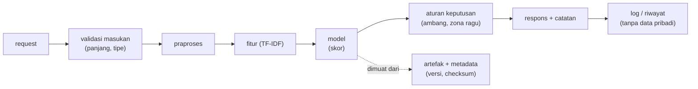
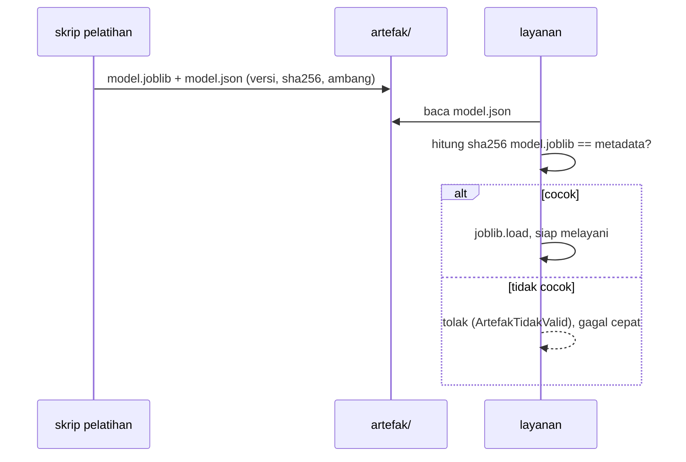

# Arsitektur Pipeline NLP, Optimasi Inferensi, Versioning, dan Penyimpanan Model

!!! abstract "Info materi"
    **Tingkat kesulitan:** Menengah. **Estimasi waktu:** 180 menit.
    **Jenis kode:** ringan (`examples/level-7-deployment/01_arsitektur_pipeline.py`; scikit-learn, tanpa PyTorch). Model: Linear SVM Level 5 pada dataset **sintetis**. Ini demonstrasi pendidikan, bukan sistem penentuan keadaan darurat.

## Tujuan pembelajaran

- [ ] Menggambar pipeline NLP aplikasi nyata sebagai lapisan dengan tanggung jawab terpisah.
- [ ] Menelusuri satu teks melalui praproses, TF-IDF, dan model, dengan nilai antara.
- [ ] Menyimpan model bersama metadata (versi, library, checksum, ambang) dan memuatnya kembali dengan aman.
- [ ] Menjelaskan mengapa checksum membantu tetapi tidak membuat `joblib.load` aman untuk berkas tak tepercaya.
- [ ] Mengukur manfaat inferensi batch dan menyebut cara optimasi yang tidak merusak kebenaran.
- [ ] Menjelaskan versioning model dan pencatatan eksperimen secara sederhana.

## Prasyarat

- [Simpan Model dan Prediksi](../level-4-machine-learning/serialisasi-prediksi.md) (joblib, metadata).
- [Pipeline scikit-learn](../level-4-machine-learning/pipeline-sklearn.md).
- [Level 5](../level-5-evaluasi/index.md): model rujukan dan protokol.

## Pengantar dan motivasi

Di notebook, "model" sering berupa satu sel yang berjalan. Di aplikasi, model hanyalah satu bagian: ada validasi masukan, praproses, inferensi, aturan keputusan, pencatatan, dan antarmuka. Memisahkan lapisan-lapisan itu membuat setiap bagian dapat diuji, diganti, dan diaudit. Halaman ini membangun fondasi tersebut sebelum menaruhnya di belakang API.

## Konsep dasar

| Istilah | Arti |
|---|---|
| **Pipeline inferensi** | Rangkaian langkah dari teks mentah sampai keluaran |
| **Artefak** | Berkas hasil pelatihan yang dipakai saat inferensi (model, tokenizer, metadata) |
| **Metadata** | Informasi tentang artefak: versi, library, data, ambang, checksum |
| **Checksum (SHA-256)** | Sidik jari berkas; berubah jika satu byte berubah |
| **Batch inference** | Memproses banyak teks sekaligus |
| **Versioning model** | Memberi nama versi unik ke setiap model yang dipakai |
| **Eksperimen terlacak** | Mencatat seed, data, parameter, dan metrik tiap percobaan |

## Penjelasan mendalam

### Lapisan sistem



| Lapisan | Tanggung jawab | Diuji dengan |
|---|---|---|
| Validasi | Menolak masukan buruk lebih awal | tes batas (kosong, terlalu panjang) |
| Praproses + fitur + model | Mengubah teks menjadi skor | tes nilai yang diketahui |
| Keputusan | Skor → label (ambang), tanda ragu | tes ambang |
| Penyimpanan | Menyimpan/memuat artefak, memeriksa checksum | tes simpan–muat–rusak |
| Antarmuka (API) | Protokol HTTP | tes endpoint ([FastAPI](fastapi-dasar.md)) |
| Pencatatan | Log dan riwayat | tes isi log (tanpa teks mentah) |

Prinsip penting: **skor model dan keputusan dipisahkan**. Model menghasilkan skor; ambang dan perilaku pada zona ragu adalah kebijakan yang dapat diubah tanpa melatih ulang, dan harus divalidasi ([Kalibrasi dan Threshold](kalibrasi-threshold.md)).

### Optimasi inferensi (tanpa mengorbankan kebenaran)

1. **Batch.** Satu panggilan `decision_function` untuk banyak teks jauh lebih murah daripada satu per satu, karena overhead Python dan operasi matriks diamortisasi. Hasilnya harus sama persis (diuji).
2. **Muat sekali.** Muat model saat server mulai, bukan per permintaan.
3. **Cache hasil praproses yang mahal.** Mis. stemming Sastrawi dilindungi `lru_cache` (Level 2). Tetapi cache harus memakai kunci yang lengkap dan tidak tumbuh tanpa batas.
4. **Ukur sebelum mengoptimalkan.** Profil waktu praproses, TF-IDF, dan model; optimalkan bagian yang dominan.
5. **Model lebih kecil / kuantisasi / ONNX.** Relevan bagi model Transformer; di luar cakupan kode halaman ini (tidak diuji di sini).

### Versioning dan pelacakan eksperimen

Versi model harus ditulis di artefak dan di **setiap respons** supaya prediksi dapat ditelusuri ke model yang menghasilkannya. Catatan eksperimen minimal: versi library, seed, versi data (hash/tanggal), parameter, metrik pada validasi dan uji, serta tanggal. Tabel hasil Level 5 (`examples/level-5-evaluation/hasil/*.md`) adalah contoh pencatatan yang dihasilkan kode.

### Menyimpan model dan tokenizer

- **scikit-learn:** `joblib.dump(pipeline)` menyimpan praproses, TF-IDF (termasuk kosakata), dan model dalam satu berkas. Kosakata TF-IDF adalah "tokenizer" kita.
- **Hugging Face:** `model.save_pretrained(folder)` dan `tokenizer.save_pretrained(folder)` menyimpan bobot, konfigurasi, dan kosakata; muat dengan `from_pretrained(folder)` ([Fine-tuning](../level-6-deep-learning/fine-tuning-transfer-learning.md)). Model dan tokenizer **harus** dipasangkan.
- **Keamanan:** `joblib`/`pickle` dapat menjalankan kode saat dimuat. Hanya muat berkas yang Anda buat sendiri atau dari sumber tepercaya. Checksum membuktikan berkas **tidak berubah sejak metadata dibuat**, bukan bahwa berkas itu **aman**. Format seperti `safetensors` (bobot saja) mengurangi risiko untuk model neural; untuk scikit-learn lihat dokumentasi persistensi.

## Cara kerja atau alur proses



## Contoh sederhana

Sebuah teks "air masuk" diproses: praproses mengubah huruf besar, menghapus URL; TF-IDF menghasilkan vektor jarang dengan beberapa nilai tidak nol; SVM menghitung $s=w\cdot x+b$. Jika $s\ge$ ambang (0), label Emergency. Seluruh rantai ini adalah satu objek `Pipeline`, tetapi tiap tahap dapat diperiksa sendiri.

## Contoh dalam konteks Twitter/X kebencanaan

"Tolong, air banjir sudah masuk ke rumah kami." dilewatkan ke pipeline; kita ingin tahu teks apa yang dilihat model (setelah praproses), berapa banyak fitur yang aktif, dan skor akhirnya, supaya ketika model keliru kita tahu di lapisan mana mencari penyebabnya.

## Praktik Python

Berkas: `examples/level-7-deployment/01_arsitektur_pipeline.py`. Pustaka: scikit-learn, joblib, dan modul `nlp_hub/layanan.py`. Jalankan dari `examples/`. Skrip ini **membuat** folder `artefak/` yang dipakai skrip Level 7 lainnya.

### Bagian 1: menelusuri tiap lapisan

```python title="Bagian 1"
--8<-- "level-7-deployment/01_arsitektur_pipeline.py:lapisan"
```

- `model.steps` adalah daftar pasangan (nama, objek). `model.named_steps["tfidf"]` mengambil satu tahap berdasarkan nama.
- Kita memanggil `transform` tiap tahap secara manual untuk melihat nilai antara; `X.nnz` = jumlah elemen tidak nol pada matriks jarang.

```text title="Output nyata"
langkah pipeline: ['praproses', 'tfidf', 'model']
1. teks mentah   : Tolong, air banjir sudah masuk ke rumah kami.
2. setelah praproses: tolong air banjir sudah masuk ke rumah kami
3. matriks TF-IDF   : (1, 582) dengan 8 nilai tidak nol
4. skor keputusan   : 0.3028 (sama dengan model.decision_function: True )
```

Interpretasi: teks diubah huruf kecil dan tanda baca dibuang; vektor TF-IDF berbentuk (1, 582) (582 fitur) dengan hanya 8 nilai tidak nol; skor 0,3028 (> 0, maka Emergency). Pemeriksaan: skor yang dihitung manual **sama persis** dengan `model.decision_function([teks])` (`True`), bukti bahwa kita memahami pipeline.

### Bagian 2: menyimpan artefak dengan metadata

```python title="Bagian 2"
--8<-- "level-7-deployment/01_arsitektur_pipeline.py:simpan"
```

- `simpan_artefak` (di `nlp_hub/layanan.py`) menulis `model.joblib` dan `model.json`. Metadata mencatat `jenis_keluaran: skor_keputusan_svm` (**bukan probabilitas**), `ambang_tervalidasi: False`, versi scikit-learn, versi Python, dan SHA-256.

```text title="Output nyata"
{'model_version': 'svm-tfidf-sintetis-0.1', 'jenis_keluaran': 'skor_keputusan_svm', 'ambang': 0.0, 'ambang_tervalidasi': False}
panjang sha256: 64
```

Interpretasi: `ambang_tervalidasi` bernilai `False` karena 0 hanyalah batas bawaan model; tidak ada data yang cukup untuk memvalidasinya ([Kalibrasi dan Threshold](kalibrasi-threshold.md)). SHA-256 berpanjang 64 karakter heksadesimal.

### Bagian 3: memuat dan memakai

```python title="Bagian 3"
--8<-- "level-7-deployment/01_arsitektur_pipeline.py:muat"
```

```text title="Output nyata"
[{'skor': 0.3028, 'label': 'Emergency', 'ambang': 0.0, 'zona_ragu': False}]
skor sama dengan model asli: True
```

Interpretasi: `Penilai.nilai` mengembalikan skor, label, ambang, dan `zona_ragu` (apakah skor berada dalam margin 0,3 dari ambang). Skor setelah simpan–muat identik dengan skor model asli.

### Bagian 4: berkas yang berubah ditolak

```python title="Bagian 4"
--8<-- "level-7-deployment/01_arsitektur_pipeline.py:rusak"
```

- `try/except/finally`: bagian `finally` mengembalikan berkas asli apa pun yang terjadi, sehingga skrip lain tetap bekerja.

```text title="Output nyata"
ditolak: checksum model.joblib tidak cocok dengan model.json (berkas berubah?)
setelah dipulihkan, dapat dimuat lagi: svm-tfidf-sintetis-0.1
```

Interpretasi: menambah satu byte ke `model.joblib` membuat checksum tidak cocok, dan `muat_artefak` menolak sebelum `joblib.load` dipanggil. Ini melindungi dari berkas rusak atau tertukar, **bukan** dari berkas yang sejak awal berbahaya.

### Bagian 5: batch vs satu per satu

```python title="Bagian 5"
--8<-- "level-7-deployment/01_arsitektur_pipeline.py:batch"
```

```text title="Output nyata: waktu berubah-ubah"
448 teks: satu per satu 150 ms | satu batch 8 ms | batch lebih cepat: True
```

Interpretasi: pada mesin penulis, satu panggilan batch sekitar 19 kali lebih cepat daripada 448 panggilan terpisah (150 ms vs 8 ms). Angka waktu **berbeda tiap komputer dan tiap jalan**; hanya urutannya (batch lebih cepat) yang dapat diandalkan. Kecepatan lebih besar tidak berarti hasil berbeda: tes `test_batch_sama_dengan_prediksi_satuan` memverifikasi skor identik.

### Skrip terpadu

`01_arsitektur_pipeline.py` menjalankan kelima bagian. Tes: `examples/tests/test_layanan.py` (simpan–muat, checksum, metadata hilang/rusak, `pastikan_artefak`).

## Kesalahan umum dan debugging

| Gejala | Penyebab | Perbaikan |
|---|---|---|
| `ArtefakTidakValid: checksum ... tidak cocok` | Berkas berubah atau metadata dari versi lain | Latih/simpan ulang bersama; jangan edit manual |
| `InconsistentVersionWarning` saat `joblib.load` | scikit-learn saat memuat berbeda dari saat menyimpan | Pakai versi sama (catat di metadata) atau latih ulang |
| `ModuleNotFoundError: nlp_hub` saat memuat model | Model menyimpan referensi ke kelas kita | Jalankan dengan `examples/` di `sys.path` |
| Model dimuat di setiap request | Pemuatan di dalam handler | Muat sekali saat start |
| Prediksi batch berbeda dari satuan | Fitur yang bergantung pada batch (mis. transformer dilatih ulang tak sengaja) | Pastikan hanya `transform` di inferensi |
| Metadata tidak menyebut data/versi | Pencatatan malas | Wajibkan lewat fungsi `simpan_artefak` |
| Menganggap checksum = aman | Salah paham | Muat hanya berkas tepercaya |

## Kelebihan dan keterbatasan

**Kelebihan:** lapisan terpisah mudah diuji dan diaudit; metadata memungkinkan penelusuran; batch menghemat waktu.
**Keterbatasan:** kode ini tidak melacak data pelatihan secara otomatis (hash dataset tidak dicatat); tidak ada registri model; checksum tidak melindungi dari berkas berbahaya; optimasi lanjut (kuantisasi, ONNX) tidak dicakup dan tidak diuji di sini.

## Latihan bertahap

1. **Konseptual.** Mengapa skor dan keputusan (ambang) dipisahkan?
2. **Membaca output.** Pada Bagian 1, berapa persen fitur TF-IDF yang aktif untuk teks itu?
3. **Membaca kode.** Mengapa bagian `finally` pada Bagian 4 penting?
4. **Debugging.** Seorang rekan mengedit `ambang` di `model.json` dari 0 menjadi −0,3 "agar recall naik". `muat_artefak` tidak menolaknya. Mengapa tidak, dan mengapa ini tetap masalah?
5. **Rancangan.** Metadata apa yang akan Anda tambahkan agar audit enam bulan kemudian memungkinkan?

## Kunci jawaban dan pembahasan

??? success "Jawaban 1"
    Model menghasilkan angka; ambang adalah kebijakan yang bergantung pada biaya kesalahan dan kapasitas peninjau. Dipisah, kebijakan dapat diubah dan divalidasi tanpa melatih ulang, dan perubahan dapat diaudit.

??? success "Jawaban 2"
    8 dari 582 ≈ **1,4%**. Vektor TF-IDF sangat jarang, sebab itu disimpan sebagai matriks jarang.

??? success "Jawaban 3"
    Tes mensimulasikan kerusakan dengan menulis ke `model.joblib`. Tanpa `finally`, jika `muat_artefak` melempar galat (seperti yang diharapkan) berkas tetap rusak dan skrip Level 7 lain gagal. `finally` selalu mengembalikan berkas.

??? success "Jawaban 4"
    Checksum hanya mencakup `model.joblib`, bukan `model.json`; mengedit metadata tidak terdeteksi. Masalahnya: ambang berubah **tanpa jejak, tanpa validasi**, dan `ambang_tervalidasi` masih `False`. Ubah ambang lewat jalur yang tercatat (`NLP_HUB_AMBANG` atau `simpan_artefak(..., ambang=...)`), tentukan nilainya pada data validasi ([Kalibrasi dan Threshold](kalibrasi-threshold.md)), dan catat alasannya. Penguatan lanjutan (di luar kode ini): menandatangani metadata juga.

??? success "Jawaban 5"
    Hash/tanggal dataset, daftar label dan definisi operasionalnya, metrik validasi dan uji dengan selang, seed, perintah pelatihan, pemilik model, serta tautan model card.

## Kuis singkat

**1.** Apa yang dibuktikan checksum?

??? success "Jawaban"
    Bahwa berkas tidak berubah sejak checksum dibuat; bukan bahwa berkas aman.

**2.** Mengapa model dimuat saat server mulai?

??? success "Jawaban"
    Memuat mahal; melakukannya per request memperlambat dan memboroskan memori.

**3.** Mengapa respons menyertakan versi model?

??? success "Jawaban"
    Agar setiap prediksi dapat ditelusuri ke model yang menghasilkannya.

## Ringkasan

- Pipeline dipisah menjadi lapisan yang dapat diuji; skor dan keputusan dipisahkan.
- Artefak disimpan bersama metadata (versi, library, SHA-256, ambang, status validasi).
- Checksum menolak berkas yang berubah, tetapi `joblib.load` tetap hanya untuk berkas tepercaya.
- Batch jauh lebih cepat dan menghasilkan skor yang sama.

## Glosarium istilah baru

Artefak
:   Berkas hasil pelatihan yang dipakai saat inferensi.

Checksum / SHA-256
:   Sidik jari berkas.

Metadata model
:   Catatan versi, library, data, ambang, dan checksum.

Inferensi batch
:   Memprediksi banyak teks dalam satu panggilan.

## Referensi

- scikit-learn, persistensi model dan keamanan: <https://scikit-learn.org/stable/model_persistence.html> (dokumentasi resmi).
- Python `hashlib`: <https://docs.python.org/3/library/hashlib.html> (dokumentasi resmi).
- Hugging Face, `safetensors`: <https://huggingface.co/docs/safetensors> (dokumentasi resmi).

## Materi berikutnya

[Kalibrasi Probabilitas dan Pemilihan Threshold](kalibrasi-threshold.md)
