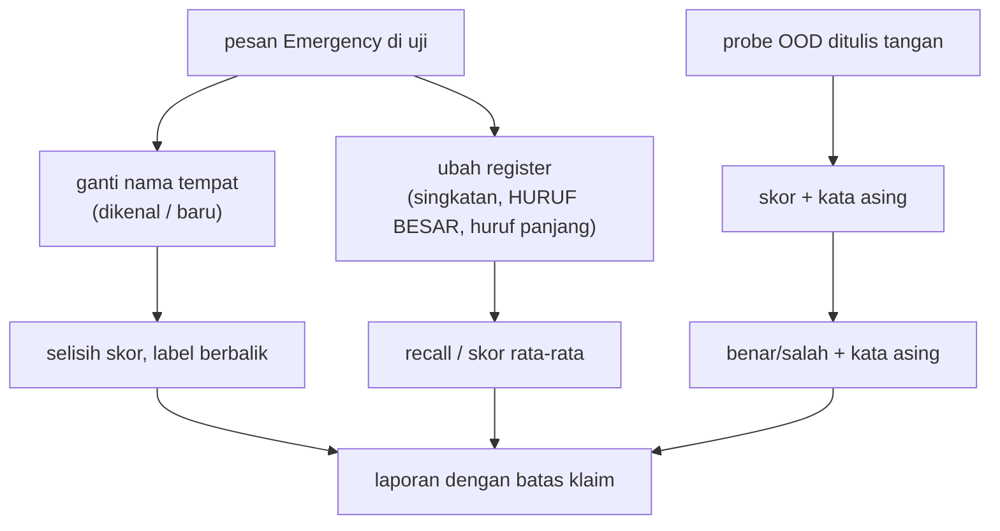

# Bias, Fairness, Robustness, dan Data di Luar Distribusi (OOD)

!!! abstract "Info materi"
    **Tingkat kesulitan:** Lanjut. **Estimasi waktu:** 210 menit.
    **Jenis kode:** ringan (`examples/level-7-deployment/04_bias_robustness_ood.py`). Model: Linear SVM + TF-IDF (Level 5), dataset **sintetis**. Uji ini adalah **demonstrasi metode**, bukan audit fairness; dataset tidak memuat atribut demografis nyata.

## Tujuan pembelajaran

- [ ] Menjelaskan sumber bias pada klasifikasi pesan kebencanaan (geografis, bahasa/register, platform, pelabelan).
- [ ] Menjalankan uji kontrafaktual: mengganti satu atribut (nama tempat) dan mengukur perubahan skor dan label.
- [ ] Membedakan robustness terhadap variasi bahasa dari generalisasi ke data di luar distribusi (OOD).
- [ ] Mengukur dan menafsirkan dampak perturbasi register tanpa menyimpulkan lebih dari data.
- [ ] Menyusun *probe* OOD kecil dan menafsirkannya dengan jujur.
- [ ] Menyatakan batas analisis bias pada dataset sintetis.

## Prasyarat

- [Ablation dan Robustness](../level-5-evaluasi/ablation-robustness.md) (perturbasi deterministik).
- [Interpretabilitas](interpretabilitas.md).
- [Error Analysis](../level-5-evaluasi/error-analysis.md).

## Pengantar dan motivasi

Sistem peringatan yang bekerja baik untuk satu kelompok pengguna tetapi buruk untuk kelompok lain berarti sebagian orang lebih sering tidak terdengar. Dalam konteks kebencanaan: pesan dari wilayah tertentu, ditulis dengan dialek atau singkatan tertentu, atau dari akun dengan gaya menulis tertentu bisa lebih sering terlewat. Selain itu, bencana tidak mengikuti data latih: kejadian jenis baru, kosakata baru, atau format baru akan muncul. Model harus diuji untuk itu sebelum dipercaya.

## Konsep dasar

| Istilah | Arti |
|---|---|
| **Bias** | Perbedaan sistematis performa atau keluaran antar kelompok atau atribut yang tidak semestinya relevan |
| **Fairness** | Upaya agar kualitas layanan tidak bergantung pada atribut yang tidak relevan; ada beberapa definisi yang dapat saling bertentangan |
| **Uji kontrafaktual** | Ubah hanya satu atribut pada teks yang sama dan lihat apakah keluaran berubah |
| **Analisis irisan (*slice*)** | Hitung metrik terpisah per subkelompok |
| **Robustness** | Keluaran tetap benar bila masukan berubah sedikit (typo, singkatan) |
| **OOD** (*out-of-distribution*) | Data yang berbeda jenisnya dari data latih |
| **Probe** | Kumpulan kecil contoh buatan untuk menyelidiki satu perilaku |

## Penjelasan mendalam

### Sumber bias pada data bencana

| Sumber | Contoh |
|---|---|
| **Data** | Pos dari daerah berinternet baik lebih banyak; bahasa daerah dan kode-campur kurang terwakili |
| **Pelabelan** | Anotator dari satu latar belakang menilai gaya tertentu sebagai "tidak serius" |
| **Representasi** | Embedding atau model bahasa pra-latih membawa bias korpusnya |
| **Pengukuran** | Metrik rata-rata menyembunyikan kelompok kecil |
| **Penggunaan** | Pesan dari kelompok tertentu lebih jarang ditinjau manusia |

### Dua uji sederhana yang bisa dikerjakan

1. **Kontrafaktual atribut.** Ambil pesan Emergency yang menyebut nama tempat $T_1$. Ganti dengan $T_2, T_3, \dots$ tanpa mengubah hal lain. Pesan yang sama seharusnya menghasilkan skor mirip. Ukur $\Delta s$ dan berapa kali label berbalik. Ini mendeteksi apakah model "mendiskriminasi" nama tempat.
2. **Irisan.** Hitung recall Emergency per irisan (mis. bergaya formal vs. informal, ada emoji vs. tidak). Selisih besar adalah sinyal untuk ditelusuri. Pada irisan kecil, selisih dapat murni acak: sertakan $n$ per irisan dan selang.

### Fairness tidak punya satu definisi

Misalnya *kesetaraan peluang* (recall sama antar kelompok) dan *kesetaraan prediksi positif* (presisi sama) umumnya tidak bisa dipenuhi serentak bila laju dasar berbeda. Pilihan metrik adalah keputusan nilai yang harus dibicarakan dengan pemangku kepentingan, bukan keputusan teknis.

### Robustness vs OOD

- **Robustness terhadap variasi bahasa**: konten sama, bentuk berbeda (typo, singkatan, huruf besar). Kita menguji dengan perturbasi deterministik ([Level 5](../level-5-evaluasi/ablation-robustness.md)).
- **OOD**: konten berbeda (jenis bencana baru, topik baru). Model tidak punya dasar untuk membuat keputusan benar; kita ingin ia **mengenali** ketidakpastiannya. Metode sederhana: periksa kata asing (di luar kosakata), skor di zona ragu, dan perubahan distribusi ([Pemantauan Drift](pemantauan-drift.md)).

## Cara kerja atau alur proses



## Contoh sederhana

Angka berikut **ilustrasi** (bukan keluaran model). Pesan: "Banjir di Kelurahan Sukamaju, tolong." Skor 0,50. Ganti `Sukamaju` dengan `Cibening`: skor 0,52. Ganti dengan `Rawa Kuning`: skor 0,31. Selisih terbesar 0,19 menunjukkan model sedikit peka terhadap nama tempat; jika ambang 0,4, label berbalik. Satu contoh tidak membuktikan apa-apa; ulangi pada banyak pesan dan banyak nama, lalu laporkan rata-rata dan jumlah pembalikan.

## Contoh dalam konteks Twitter/X kebencanaan

Dua pesan identik, kecuali nama kelurahan: "Air sudah setinggi lutut di Kelurahan X, tolong evakuasi." Jika model memberi skor lebih rendah untuk kelurahan yang tidak ada di data latih, warga di sana lebih berisiko tidak terdeteksi, walau kejadiannya sama. Itulah yang diuji di bawah (dengan nama tempat **fiktif**, bukan wilayah nyata).

## Praktik Python

Berkas: `examples/level-7-deployment/04_bias_robustness_ood.py`. Modul: `nlp_hub/perturbasi.py` (Level 5), daftar nama tempat contoh di `nlp_hub/kamus.py`. Jalankan dari `examples/`.

### Bagian 1: uji kontrafaktual nama tempat

```python title="Bagian 1"
--8<-- "level-7-deployment/04_bias_robustness_ood.py:lokasi"
```

- `re.compile("|".join(...), re.IGNORECASE)` membentuk satu pola yang cocok dengan salah satu nama (tanda `|` berarti "atau").
- `d.uji["text"].str.contains(POLA)` menyaring teks yang menyebut nama tempat; `ganti_tempat` menggantinya dengan nama lain berhuruf judul (`.title()`).
- `selisih_skor` mengulang untuk setiap pasangan (teks, nama baru) dan mencatat selisih skor serta label yang berbalik.

```text title="Output nyata"
teks Emergency di uji yang menyebut salah satu dari 10 nama tempat: 14
tempat DIKENAL model : rata-rata |selisih skor| 0.045, terbesar 0.172, label berbalik 5 dari 140
tempat BARU (fiktif) : rata-rata |selisih skor| 0.065, terbesar 0.222, label berbalik 4 dari 70
```

Interpretasi: hanya **14** teks Emergency di uji yang menyebut salah satu dari 10 nama. Mengganti dengan nama yang **dikenal** model mengubah skor rata-rata 0,045 (terbesar 0,172) dan membalik label pada 5 dari 140 percobaan (3,6%). Mengganti dengan nama **baru** (fiktif, tidak ada di data latih) mengubah skor rata-rata lebih besar, 0,065 (terbesar 0,222), dan membalik 4 dari 70 (5,7%). Perbedaan antara 3,6% dan 5,7% **tidak dapat dinilai signifikan**: sampel hanya 14 pesan dan percobaan tidak independen (14 teks dipakai berulang). Yang bisa dikatakan: model **tidak sepenuhnya invarian** terhadap nama tempat, dan nama baru cenderung sedikit lebih mengubah skor. Pembalikan label terjadi pada pesan yang skornya sudah dekat ambang.

### Bagian 2: perturbasi register

```python title="Bagian 2"
--8<-- "level-7-deployment/04_bias_robustness_ood.py:register"
```

```text title="Output nyata"
singkatan informal : rata-rata skor +0.817 -> +0.817 | recall E 1.000 -> 1.000
HURUF BESAR        : rata-rata skor +0.817 -> +0.840 | recall E 1.000 -> 1.000
huruf diperpanjang : rata-rata skor +0.817 -> +0.817 | recall E 1.000 -> 1.000
```

Interpretasi: tidak ada penurunan sama sekali pada uji sintetis (recall 1,000 → 1,000). `singkat` dan `perpanjang_huruf` bahkan tidak mengubah skor rata-rata karena praproses (Level 2) mengembalikan singkatan dan huruf berulang ke bentuk baku. HURUF BESAR menaikkan skor tipis (+0,817 → +0,840) karena `case folding`. **Ini bukan bukti bahwa model robust**: uji sintetis bertemplat sudah sangat mudah (recall 1,0), sehingga perturbasi sederhana tidak punya "ruang" untuk merusak. Pada Level 5, perturbasi gabungan (emoji + hashtag + URL) menurunkan recall pada tulis-tangan dari 0,625 menjadi 0,458; ujilah juga irisan itu.

### Bagian 3: probe data di luar distribusi

```python title="Bagian 3"
--8<-- "level-7-deployment/04_bias_robustness_ood.py:ood"
```

- Enam teks ditulis oleh penulis halaman ini tentang bahaya atau situasi yang tidak ada di data latih (tsunami, sinkhole, terjebak di lift saat badai). Label mengikuti definisi operasional proyek. Ini **bukan** dataset tervalidasi.
- Kata asing = token (setelah praproses) yang tidak ada di kosakata TF-IDF.

```text title="Output nyata"
E | skor +0.371 -> Emergency     | benar | kata asing: ['pantai', 'bukit']
E | skor +0.413 -> Emergency     | benar | kata asing: ['sinkhole', 'muncul', 'amblas']
E | skor +0.393 -> Emergency     | benar | kata asing: ['lift', 'mati', 'badai', 'hamil']
N | skor -1.107 -> Non-Emergency | benar | kata asing: ['kesiapsiagaan', 'daftar']
N | skor -0.466 -> Non-Emergency | benar | kata asing: ['sinkhole', 'ditutup']
N | skor -1.175 -> Non-Emergency | benar | kata asing: ['baca', 'artikel', 'badai', 'tropis', 'melanda']
```

Interpretasi: keenam probe diklasifikasikan benar. Tapi enam contoh sangat sedikit, ditulis oleh orang yang sama dengan penulis data, dan banyak memuat kata kunci (`tolong`, `mohon`, `bantuan`) yang menandai Emergency, sedangkan probe Non-Emergency memuat penanda seperti `webinar`, `dulu`, dan `lalu` yang ada di kosakata dan lazim pada pos Non-Emergency (diperiksa terpisah). Skor probe Emergency hanya +0,37 hingga +0,41, jauh lebih dekat ke ambang daripada skor Non-Emergency yang −0,47 hingga −1,18 (kecuali probe 5, −0,466, yang juga kurang pasti). Kesimpulan yang sah: *pada enam probe ini tidak ditemukan kegagalan*, bukan *model robust terhadap bahaya baru*. Pada data nyata dengan kata kunci yang tidak ada dan tanpa kata permintaan, hasilnya bisa berbeda; probe tanpa kata permintaan (mis. hanya laporan kejadian) belum dicoba di sini. Itu perluasan yang disarankan.

### Skrip terpadu

Tidak ada tes khusus karena bagian ini eksperimen eksploratif; tes pendukung ada di `test_perturbasi.py` (Level 5) dan `test_layanan.py` (`cakupan_kosakata`).

## Kesalahan umum dan debugging

| Gejala | Penyebab | Perbaikan |
|---|---|---|
| Menyimpulkan "tidak bias" dari satu uji kontrafaktual | Satu atribut, sampel kecil | Uji banyak atribut dan irisan; laporkan $n$ dan selang |
| Menyimpulkan "robust" dari perturbasi pada data yang terlalu mudah | Data bertemplat | Uji juga pada data bergaya lain |
| Percobaan yang bergantung dihitung independen | 14 teks × 10 nama | Hitung per teks, bukan per percobaan |
| Probe OOD ditulis oleh penulis model | Bias penulis | Libatkan penulis lain dan data nyata |
| Selisih skor diabaikan karena label tak berubah | Perubahan skor mendekatkan ke ambang | Laporkan selisih skor dan jumlah pembalikan |
| Atribut sensitif tidak tersedia | Tidak ada anotasi demografis | Jangan menebak atribut individu; gunakan proksi hanya bila etis dan sah |
| Metrik fairness dipilih tanpa diskusi | Dikira teknis | Putuskan bersama pemangku kepentingan |

## Kelebihan dan keterbatasan

**Kelebihan:** uji kontrafaktual dan probe murah, cepat, dan tidak membutuhkan data sensitif; menemukan sensitivitas yang tak terlihat pada metrik rata-rata.
**Keterbatasan:** dataset sintetis tanpa atribut demografis nyata; nama tempat fiktif; perturbasi sederhana; probe sangat kecil; tidak ada bahasa daerah atau kode-campur; **tidak ada klaim bahwa model adil, robust, atau aman**.

## Latihan bertahap

1. **Konseptual.** Beda robustness bahasa dan OOD?
2. **Hitungan.** 5 label berbalik dari 140 percobaan: berapa persen? Jika 14 teks yang menghasilkan 140 percobaan, mengapa 140 bukan ukuran sampel efektif?
3. **Membaca output.** Mengapa `singkat` tidak mengubah skor sama sekali?
4. **Debugging.** Pada Bagian 1 Anda mengganti `.title()` dengan `.lower()` atau `.upper()` untuk nama pengganti. Apa yang Anda harapkan pada skor, dan mengapa?
5. **Rancangan.** Rancang uji kontrafaktual untuk dialek (mis. "banjir" vs padanan lokal) dan sebutkan tiga batasannya.
6. **Analisis.** Mengapa laporan bias pada dataset sintetis tidak dapat dipakai untuk menyatakan sistem adil?

## Kunci jawaban dan pembahasan

??? success "Jawaban 1"
    Robustness: konten sama, bentuk berbeda. OOD: konten/jenis berbeda dari yang pernah dilihat model.

??? success "Jawaban 2"
    $5/140=3{,}6\%$. Hanya 14 pesan yang unik; percobaan berbagi pesan yang sama sehingga tidak independen. Ukuran sampel efektif lebih dekat ke 14.

??? success "Jawaban 3"
    Praproses Level 2 sudah menormalkan singkatan informal (`yg`→`yang`, dst.), jadi setelah praproses, teks perturbasi sama dengan teks asli.

??? success "Jawaban 4"
    Skor seharusnya **identik**, karena praproses melakukan *case folding* sebelum TF-IDF. Pada satu pesan percobaan (`Banjir di Kelurahan Rawa Kuning, tolong kirim bantuan`) ketiga bentuk (huruf kecil, judul, kapital) memberi skor yang sama persis, 0,3274. Jika hasil Anda berbeda, ada langkah lain yang memperlakukan huruf besar sebagai petunjuk (mis. pemisahan CamelCase pada hashtag); periksa teks setelah praproses.

??? success "Jawaban 5"
    Buat pasangan pesan dengan konten sama dalam bentuk baku dan dialek, skor keduanya, bandingkan. Batasan: (1) padanan harus ditulis penutur asli; (2) satu padanan tidak mewakili variasi dialek; (3) kosakata TF-IDF latih mungkin tak memuat bentuk dialek sama sekali sehingga selisihnya mencerminkan OOV, bukan "bias".

??? success "Jawaban 6"
    Data sintetis dibuat oleh penulis, tidak mewakili populasi nyata, tidak punya atribut demografis nyata, dan label dibuat satu orang. Audit fairness memerlukan data nyata, atribut yang sah dan etis, pelabel beragam, dan keterlibatan pemangku kepentingan.

## Kuis singkat

**1.** Apa yang diubah pada uji kontrafaktual?

??? success "Jawaban"
    Satu atribut saja (mis. nama tempat), sementara hal lain tetap.

**2.** Apakah 6 probe benar membuktikan model robust terhadap bahaya baru?

??? success "Jawaban"
    Tidak; sampel kecil, ditulis oleh penulis yang sama, dan banyak memuat kata kunci yang membantu.

**3.** Apakah label yang tidak berubah berarti skor tidak berubah?

??? success "Jawaban"
    Tidak; skor bisa bergeser mendekati ambang tanpa membalik label.

## Ringkasan

- Bias dan robustness diuji dengan kontrafaktual, irisan, perturbasi, dan probe; semuanya memerlukan $n$, selang, dan kerendahan hati.
- Nama tempat dikenal: skor bergeser 0,045 rata-rata dan 5/140 label berbalik; nama baru: 0,065 dan 4/70.
- Perturbasi register tidak menurunkan recall pada uji sintetis karena data terlalu mudah, bukan bukti robust.
- Enam probe OOD semua benar, tetapi tidak cukup untuk kesimpulan.

## Glosarium istilah baru

Uji kontrafaktual
:   Mengubah satu atribut dan mengamati perubahan keluaran.

Analisis irisan
:   Menghitung metrik per subkelompok.

OOD
:   Data yang berbeda jenis dari data latih.

Probe
:   Kumpulan kecil contoh untuk menyelidiki satu perilaku.

Kesetaraan peluang
:   Recall sama antar kelompok.

## Referensi

- Mitchell, M., dkk. (2019). Model cards for model reporting. *FAT\* '19*, 220–229, DOI: 10.1145/3287560.3287596 (makalah akademik; **diperiksa**, lihat [Referensi](../referensi.md)).
- Hardt, M., Price, E., & Srebro, N. (2016). Equality of opportunity in supervised learning. *NeurIPS 2016* (makalah akademik; judul, penulis, dan tahun diperiksa via arXiv/Crossref/ACL Anthology; venue tidak diverifikasi terpisah).
- Ribeiro, M. T., Wu, T., Guestrin, C., & Singh, S. (2020). Beyond accuracy: Behavioral testing of NLP models with CheckList. *ACL 2020* (makalah akademik; judul, penulis, dan tahun diperiksa via arXiv/Crossref/ACL Anthology; venue tidak diverifikasi terpisah).
- Blodgett, S. L., Barocas, S., Daumé III, H., & Wallach, H. (2020). Language (technology) is power: A critical survey of "bias" in NLP. *ACL 2020* (makalah akademik; judul, penulis, dan tahun diperiksa via arXiv/Crossref/ACL Anthology; venue tidak diverifikasi terpisah).

## Materi berikutnya

[Pemantauan Performa dan Data Drift](pemantauan-drift.md)
