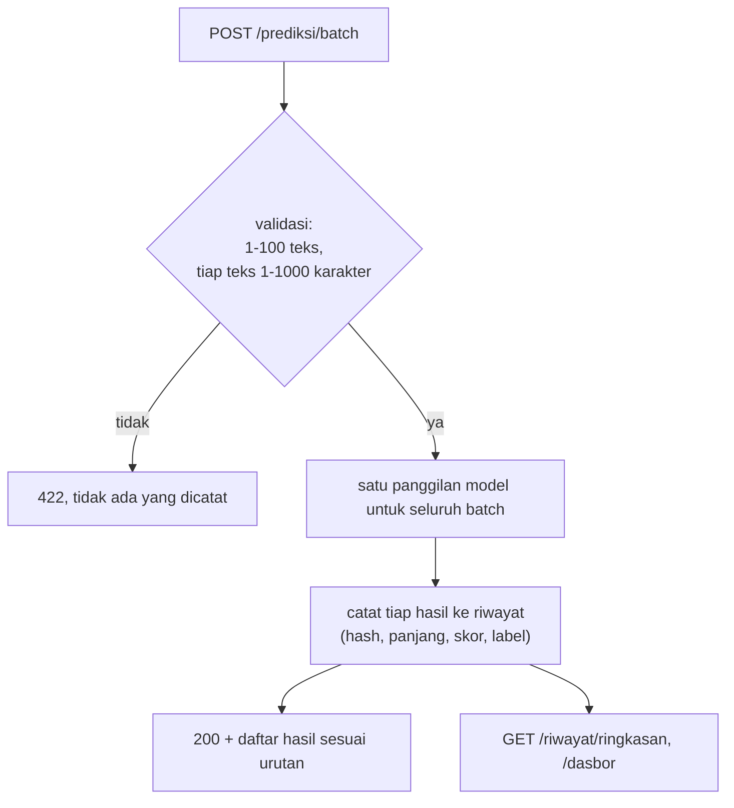

# Batch Inference, Riwayat Prediksi, Dasbor, dan Pengujian Otomatis

!!! abstract "Info materi"
    **Tingkat kesulitan:** Menengah–lanjut. **Estimasi waktu:** 210 menit.
    **Jenis kode:** ringan (`examples/nlp_hub/api.py`, `riwayat.py`, `examples/tests/test_api.py`, `test_layanan.py`). Dataset **sintetis**; layanan adalah demonstrasi pendidikan.

## Tujuan pembelajaran

- [ ] Menjelaskan endpoint batch, batasnya, dan sifat "semua atau tidak sama sekali".
- [ ] Menjelaskan skema riwayat prediksi dan prinsip minimisasi data (tidak menyimpan teks bawaan).
- [ ] Membaca ringkasan riwayat dan dasbor HTML sederhana serta mengamankan keluaran HTML.
- [ ] Menulis tes API dengan `TestClient`, fixture pytest, dan `parametrize`.
- [ ] Menyebut kelas tes yang perlu ada (unit, integrasi, kontrak, kegagalan) dan apa yang belum tercakup.
- [ ] Menjalankan seluruh rangkaian tes dan membaca hasilnya dengan benar.

## Prasyarat

- [FastAPI: Layanan Prediksi](fastapi-dasar.md).
- [Debugging dan Pengujian](../level-1-python/debugging-pengujian.md) (pytest dasar) dan [Pipeline yang Dapat Diuji](../level-2-fondasi-teks/pipeline-teruji.md).

## Pengantar dan motivasi

Layanan nyata menerima banyak teks sekaligus, perlu jejak apa yang terjadi, dan harus dapat diuji tanpa menjalankan server secara manual. Tiga hal ini, **batch**, **riwayat**, dan **tes otomatis**, mengubah skrip prediksi menjadi layanan yang dapat dirawat.

## Konsep dasar

| Istilah | Arti |
|---|---|
| **Batch endpoint** | Satu permintaan memuat banyak teks; satu panggilan model |
| **Atomik** | Semua atau tidak sama sekali: satu teks buruk menolak seluruh batch |
| **Riwayat prediksi** | Catatan tiap prediksi: waktu, sidik jari teks, skor, label, versi model |
| **Minimisasi data** | Menyimpan hanya data yang diperlukan |
| **Dasbor** | Halaman ringkasan; di sini HTML statis tanpa JavaScript |
| **Fixture pytest** | Fungsi yang menyiapkan sumber daya tes |
| **`parametrize`** | Menjalankan satu tes dengan banyak masukan |
| **Tes kontrak** | Memeriksa bentuk antarmuka (kolom respons, kode status) |

## Penjelasan mendalam

### Batch: aturan dan alasan

- **Batas 100 teks** per permintaan, 1.000 karakter per teks. Tanpa batas, satu permintaan besar dapat menghabiskan memori atau menahan layanan (risiko penolakan layanan).
- **Atomik:** bila satu teks tidak valid (mis. string kosong), seluruh batch ditolak dengan 422 dan **tidak ada** yang dicatat. Pilihan lain (menerima sebagian dan melaporkan kegagalan per butir) lebih rumit bagi klien; pilihan atomik lebih sederhana dan lebih mudah diuji. Ini keputusan desain yang sebaiknya dicatat.
- **Urutan terjaga:** hasil ke-$i$ untuk teks ke-$i$.
- **Konsistensi:** skor batch harus sama persis dengan skor satuan (dijaga tes).
- **Kinerja:** batch lebih cepat karena satu panggilan model (lihat [Arsitektur Pipeline](arsitektur-pipeline.md): 448 teks, 150 ms vs 8 ms pada mesin penulis).

### Riwayat prediksi

Tabel `prediksi` menyimpan: `waktu` (UTC), `teks_hash` (12 karakter SHA-256), `panjang`, `skor`, `label`, `zona_ragu`, `versi_model`, dan `teks` (kosong secara bawaan).

- **Mengapa hash, bukan teks?** Pesan bencana bisa memuat nama, alamat, nomor telepon. Hash memungkinkan mendeteksi pengiriman berulang tanpa menyimpan isi. Hash 12 karakter adalah sidik jari, bukan anonimisasi sempurna: teks pendek yang umum dapat ditebak dengan mencoba kandidat.
- **`NLP_HUB_SIMPAN_TEKS=1`** menyimpan teks asli; hanya aktifkan dengan dasar hukum, retensi, dan kontrol akses yang jelas.
- **Parameter SQL (`?`)** dipakai pada semua kueri agar masukan tidak dapat menyisipkan perintah SQL (*SQL injection*).
- Kueri agregat (`COUNT`, `SUM`, `AVG`, `GROUP BY`) dilakukan di SQL, bukan dengan memuat semua baris ke Python.

### Dasbor HTML sederhana

`GET /dasbor` menampilkan total, jumlah per label, jumlah zona ragu, dan 20 prediksi terbaru. Setiap nilai yang berasal dari data disaring dengan `html.escape` sebelum disisipkan ke HTML supaya karakter seperti `<` tidak ditafsirkan sebagai markup (*XSS*). Sekarang dasbor hanya memuat hash, bukan teks, sehingga risikonya kecil, tetapi kebiasaan meloloskan keluaran harus ada sebelum ada yang menampilkan teks. Dasbor ini **tidak memiliki autentikasi**: jangan dibuka ke jaringan tak tepercaya.

### Pengujian otomatis

| Kelas tes | Contoh di repository | Apa yang dijaga |
|---|---|---|
| **Unit** | `test_atensi.py`, `test_jaringan.py`, `test_layanan.py::test_psi_*` | Fungsi murni: bentuk, nilai yang diketahui, galat |
| **Integrasi** | `test_api.py` | Endpoint + model + riwayat bekerja bersama |
| **Kontrak** | `test_prediksi_bentuk_respons_dan_tanpa_klaim_probabilitas` | Kolom respons; tidak ada klaim probabilitas |
| **Kegagalan** | `test_galat_internal_tidak_membocorkan_detail`, `test_start_gagal_cepat_...` | Sistem gagal dengan aman |
| **Keamanan sederhana** | `test_riwayat_mencatat_tanpa_teks_asli`, checksum | Data pribadi tidak tersimpan; berkas rusak ditolak |
| **Regresi** | `test_batch_sama_dengan_prediksi_satuan` | Batch ≡ satuan |

Yang **tidak** dicakup tes ini: beban/konkurensi, server sungguhan lewat jaringan, autentikasi, serangan lanjutan, kinerja pada data nyata, dan kualitas model.

## Cara kerja atau alur proses



## Contoh sederhana

Permintaan batch dengan tiga teks `["a", "b", ""]`: elemen ketiga kosong → seluruh permintaan ditolak (422), riwayat tetap kosong. Dengan `["a", "b"]`: dua hasil dan dua baris riwayat.

## Contoh dalam konteks Twitter/X kebencanaan

Relawan memasukkan 80 pos sekaligus untuk dipriorisasi. Layanan memberi skor ke seluruhnya dalam satu panggilan, menandai yang berada di zona ragu, dan mencatat ringkasan. Dasbor menunjukkan berapa pos Emergency dan zona ragu dalam sesi ini, sehingga koordinator tahu berapa yang perlu ditinjau manusia.

## Praktik Python

Berkas: `examples/level-7-deployment/06_api_demo.py` (lanjutan) dan `examples/tests/test_api.py`. Jalankan dari `examples/`.

### Bagian 1: batch

```python title="Bagian 1"
--8<-- "level-7-deployment/06_api_demo.py:batch"
```

- `zip(teks_batch, r.json()["hasil"])` memasangkan teks ke-$i$ dengan hasil ke-$i$ (urutan terjaga).
- `{str(h['zona_ragu']):5}` memformat boolean menjadi teks selebar 5 karakter.

```text title="Output nyata"
skor +0.303 | Emergency     | ragu: False | Tolong, air banjir sudah masuk ke rumah kami.
skor -1.104 | Non-Emergency | ragu: False | Pemerintah mengumumkan pembangunan tanggul untuk mengur
skor -0.229 | Non-Emergency | ragu: True  | Gempa terasa kuat, warga diminta menjauhi bangunan yang
skor -1.016 | Non-Emergency | ragu: False | Saya sedang membaca berita tentang gempa tahun lalu.
batch 101 teks -> 422
```

Interpretasi: empat teks, empat hasil. Contoh dari `CLAUDE.md`: laporan banjir (skor +0,303 → Emergency); pengumuman pembangunan tanggul (−1,104); berita lama tentang gempa (−1,016) jelas Non-Emergency. Kalimat **"Gempa terasa kuat, warga diminta menjauhi bangunan yang rusak."** mendapat skor −0,229 → **Non-Emergency, tetapi `zona_ragu` `True`**. Ini kasus ambigu menurut definisi operasional (ada kejadian dan peringatan, tetapi tidak ada laporan korban atau permintaan bantuan eksplisit): sistem yang bertanggung jawab tidak boleh memperlakukannya sebagai "aman". Batch 101 teks ditolak dengan 422.

### Bagian 2: riwayat dan dasbor

```python title="Bagian 2"
--8<-- "level-7-deployment/06_api_demo.py:riwayat"
```

```text title="Output nyata"
{'total': 5, 'per_label': {'Emergency': 2, 'Non-Emergency': 3}, 'zona_ragu': 1, 'skor_rata_rata': -0.3487}
kolom riwayat: ['waktu', 'teks_hash', 'panjang', 'skor', 'label', 'zona_ragu', 'versi_model']
teks asli tersimpan di riwayat? False
dasbor HTML: 200 | memuat catatan wajib: True
```

Interpretasi: lima prediksi tercatat (satu dari bagian prediksi tunggal sebelumnya dan empat dari batch; permintaan yang ditolak tidak tercatat), dua Emergency, tiga Non-Emergency, satu di zona ragu; skor rata-rata −0,3487. Kolom riwayat tidak memuat `teks`, dan dasbor memuat catatan wajib.

### Bagian 3: kode endpoint riwayat dan dasbor

```python title="Endpoint riwayat"
--8<-- "nlp_hub/api.py:riwayat"
```

- `min(max(n, 1), 200)` membatasi `n` pada rentang 1–200 (*clamp*); parameter kueri `n: int` ditolak 422 bila bukan bilangan bulat.

```python title="Dasbor HTML"
--8<-- "nlp_hub/api.py:dasbor"
```

- `html.escape(...)` pada setiap nilai berasal dari data; f-string menyusun baris tabel.

### Bagian 4: tes dengan fixture dan parametrize

```python title="Fixture tes API"
--8<-- "tests/test_api.py:11:15"
```

- `@pytest.fixture()` mendaftarkan fungsi yang menyiapkan klien; pytest memanggilnya otomatis untuk setiap tes yang punya parameter bernama `klien`. `tmp_path` adalah folder sementara bawaan pytest; artefak dibuat di sana sehingga tes tidak menyentuh berkas Anda dan setiap tes mulai dari riwayat kosong.
- `raise_server_exceptions=False` agar galat server muncul sebagai respons 500, bukan dilempar ke tes.

```python title="Tes batch"
--8<-- "tests/test_api.py:36:49"
```

- Tes pertama memeriksa urutan hasil dan tiga jenis penolakan; tes kedua memeriksa bahwa **skor batch sama dengan skor satuan**.

```python title="Tes terparametrisasi"
--8<-- "tests/test_api.py:31:33"
```

- `@pytest.mark.parametrize` menjalankan tes yang sama enam kali dengan badan berbeda: `{}`, string kosong, hanya spasi, angka, 1.001 karakter, `None`. Pytest melaporkan tiap kasus terpisah.

### Menjalankan seluruh rangkaian tes

```bash
cd examples
python -m pytest -q                    # semua tes
python -m pytest tests/test_api.py -q  # hanya API
```

```text title="Output nyata: dijalankan penulis, jumlah berubah bila tes bertambah"
$ python -m pytest tests/test_api.py -q
20 passed
$ python -m pytest -q
198 passed
```

Interpretasi: 20 tes API dan 198 tes seluruhnya lolos pada Python 3.14.7, FastAPI 0.159.1, scikit-learn 1.9.1 (versi dari mesin penulis; 198 mencakup tes Level 2-7, proyek, dan latihan). Tes tidak membuka port dan tidak butuh jaringan. Jumlah tes akan berubah seiring penambahan; angka yang relevan adalah **0 gagal**.

!!! note "Cara menambah tes"
    Setiap kali menemukan bug, tulis tes yang gagal lebih dulu, perbaiki, lalu biarkan tes itu tinggal sebagai penjaga. Dua bug nyata ditemukan saat menulis Level 6–7: ukuran relatif per elemen pada *gradient check* yang berisik pada gradien nol (kini dijaga tes), dan `PackageNotFoundError` karena nama paket berbeda dari nama impor ([Komputasi dan Dependensi](../level-6-deep-learning/ml-klasik-vs-dl-komputasi.md)).

## Kesalahan umum dan debugging

| Gejala | Penyebab | Perbaikan |
|---|---|---|
| Tes lulus di komputer Anda, gagal di orang lain | Tes bergantung pada berkas lokal (`artefak/`) | Gunakan `tmp_path` dan `pastikan_artefak` |
| Tes saling memengaruhi | Riwayat/DB bersama antar tes | Fixture membuat aplikasi baru per tes |
| 500 pada tes yang seharusnya 422 | Validasi domain tidak dipetakan | Tangkap `ValueError` → `HTTPException(422)` |
| Dasbor menampilkan `<script>` mentah | Lupa `html.escape` | Escape semua nilai dari data |
| Riwayat penuh teks pribadi | `SIMPAN_TEKS` aktif tanpa kebijakan | Matikan; terapkan retensi |
| Batch lambat dan memori besar | Tanpa batas ukuran | Batasi jumlah dan panjang |
| `TestClient` memberi peringatan deprecation | Versi Starlette baru dengan httpx | Peringatan dari library; disaring di `pytest.ini` |
| Hanya menguji jalur sukses | Lupa kasus gagal | Tambah tes masukan buruk dan galat internal |

## Kelebihan dan keterbatasan

**Kelebihan:** tes cepat (beberapa detik), deterministik, tanpa jaringan; batch hemat waktu; riwayat tanpa teks mengurangi risiko data pribadi.
**Keterbatasan:** SQLite tunggal tanpa retensi atau enkripsi; dasbor tanpa autentikasi; tidak ada tes beban/keamanan lanjutan; batch atomik tidak melaporkan kegagalan per butir; tidak ada antrean untuk pekerjaan panjang.

## Latihan bertahap

1. **Konseptual.** Mengapa batch dibuat atomik, dan apa kelemahannya?
2. **Membaca kode.** Mengapa kueri riwayat memakai `?` dan bukan f-string?
3. **Membaca output.** Pada output Bagian 1, kalimat mana yang `zona_ragu` `True`, dan mengapa itu informatif?
4. **Menulis tes.** Tulis tes yang memastikan permintaan yang ditolak (`{"teks": ""}`) tidak menambah riwayat.
5. **Debugging.** Dasbor menampilkan `&lt;b&gt;` alih-alih tebal. Apakah itu bug?
6. **Mini-proyek.** Tambahkan endpoint `GET /riwayat/zona-ragu` yang mengembalikan prediksi zona ragu terbaru, lengkap dengan tesnya.

## Kunci jawaban dan pembahasan

??? success "Jawaban 1"
    Atomik sederhana dan mudah diuji: tidak ada status setengah jadi. Kelemahan: satu butir buruk menggagalkan seluruh batch, sehingga klien harus memvalidasi sebelum mengirim atau mengulang tanpa butir bermasalah.

??? success "Jawaban 2"
    Parameter `?` dikirim terpisah dari perintah SQL, sehingga masukan tidak dapat mengubah struktur kueri (pencegahan SQL injection).

??? success "Jawaban 3"
    "Gempa terasa kuat, warga diminta menjauhi bangunan yang rusak." (skor −0,229). Ia ambigu menurut definisi operasional; penanda zona ragu mengingatkan agar manusia meninjaunya, bukan menganggap Non-Emergency final.

??? success "Jawaban 4"
    Sudah ada: `test_input_ditolak_tidak_tercatat`:
    ```python
    def test_input_ditolak_tidak_tercatat(klien):
        klien.post("/prediksi", json={"teks": ""})
        assert klien.get("/riwayat/ringkasan").json()["total"] == 0
    ```

??? success "Jawaban 5"
    Bukan bug. `html.escape` mengubah `<b>` menjadi teks `&lt;b&gt;` agar tidak ditafsirkan sebagai markup; itu perilaku yang diinginkan.

??? success "Jawaban 6"
    Tambahkan kueri `SELECT ... WHERE zona_ragu = 1 ORDER BY id DESC LIMIT ?` di `Riwayat`, endpoint di `buat_app`, dan tes: kirim satu teks zona ragu (mis. "Gempa terasa kuat, warga diminta menjauhi bangunan yang rusak.") dan satu jelas Emergency; pastikan hanya yang pertama muncul. Sertakan tes untuk riwayat kosong.

## Kuis singkat

**1.** Apa isi riwayat bawaan pengganti teks?

??? success "Jawaban"
    Sidik jari SHA-256 12 karakter dan panjang teks.

**2.** Apa fungsi `tmp_path`?

??? success "Jawaban"
    Folder sementara per tes sehingga tes terisolasi.

**3.** Apakah dasbor ini aman dibuka ke internet?

??? success "Jawaban"
    Tidak; tidak ada autentikasi.

## Ringkasan

- Batch: maksimal 100 teks, atomik, urutan terjaga, skor identik dengan satuan.
- Riwayat menyimpan hash, bukan teks; kueri berparameter; dasbor meloloskan HTML.
- 20 tes API dan 198 tes seluruhnya lolos pada mesin penulis; belum ada tes beban/keamanan lanjutan.
- Kalimat ambigu ditandai `zona_ragu`, bukan dianggap pasti.

## Glosarium istilah baru

Atomik
:   Semua atau tidak sama sekali.

Fixture
:   Fungsi pytest yang menyiapkan sumber daya tes.

`parametrize`
:   Menjalankan satu tes dengan banyak masukan.

Minimisasi data
:   Menyimpan hanya data yang diperlukan.

SQL injection / XSS
:   Penyisipan perintah SQL / skrip melalui masukan.

## Referensi

- pytest, fixtures dan parametrize: <https://docs.pytest.org/en/stable/> (dokumentasi resmi).
- FastAPI, pengujian: <https://fastapi.tiangolo.com/tutorial/testing/> (dokumentasi resmi).
- Python `sqlite3` (parameter kueri): <https://docs.python.org/3/library/sqlite3.html> (dokumentasi resmi).
- OWASP, SQL Injection dan XSS: <https://owasp.org/www-community/> (acuan keamanan; belum diperiksa daring).

## Materi berikutnya

[Keamanan, Model Card, Keterbatasan, dan Roadmap](keamanan-model-card-roadmap.md)
