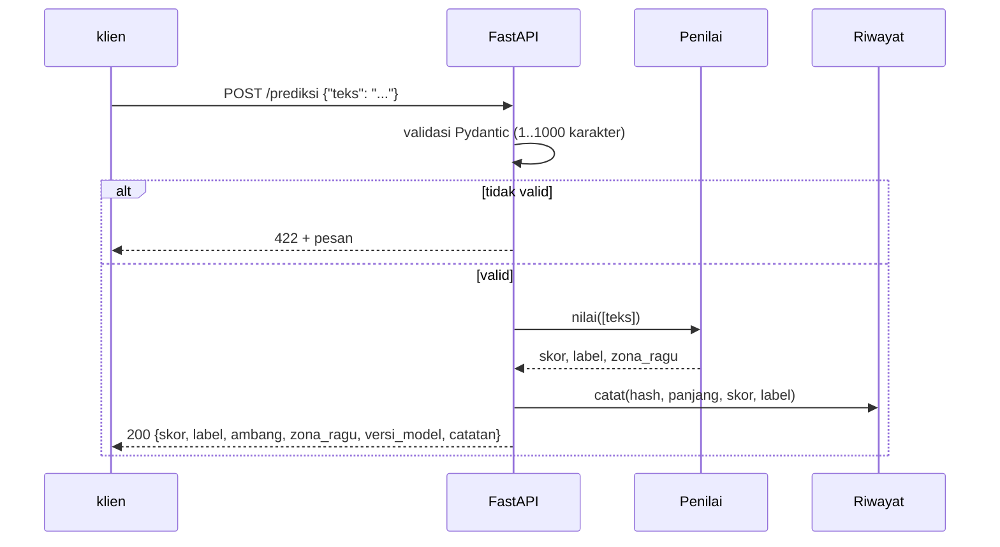

# FastAPI: Layanan Prediksi, Validasi, Logging, dan Penanganan Error

!!! abstract "Info materi"
    **Tingkat kesulitan:** Menengah–lanjut. **Estimasi waktu:** 240 menit.
    **Jenis kode:** ringan (`examples/nlp_hub/api.py`, `examples/level-7-deployment/06_api_demo.py`; FastAPI, uvicorn, httpx dari `requirements-ml.txt`). Model: Linear SVM (Level 5), dataset **sintetis**. **Demonstrasi pendidikan, bukan sistem penentuan keadaan darurat dan bukan layanan siap produksi.**

## Tujuan pembelajaran

- [ ] Menjelaskan REST API, request/response, kode status HTTP, dan JSON.
- [ ] Membangun endpoint prediksi dengan FastAPI dan model Pydantic untuk validasi request dan response.
- [ ] Menjelaskan mengapa respons memuat skor (bukan probabilitas), versi model, dan catatan wajib.
- [ ] Menangani error dengan benar: 422 untuk masukan buruk, 500 tanpa membocorkan detail internal.
- [ ] Mencatat log tanpa menyimpan teks mentah.
- [ ] Menjalankan layanan secara lokal dan menjelaskan langkah menuju deployment server.

## Prasyarat

- [Arsitektur Pipeline](arsitektur-pipeline.md): artefak dan `Penilai`.
- [Kalibrasi dan Threshold](kalibrasi-threshold.md): mengapa SVM mengeluarkan skor.
- [Exception Handling](../level-1-python/exception-handling.md), [CSV dan JSON](../level-1-python/csv-json.md).

## Pengantar dan motivasi

Model yang hanya hidup di notebook tidak bisa dipakai aplikasi lain. API menaruh model di belakang antarmuka standar: program lain mengirim teks lewat HTTP dan menerima hasil dalam JSON. Pada sistem yang menyentuh keputusan penting, API juga tempat yang tepat untuk menegakkan aturan: validasi masukan, catatan keterbatasan pada setiap respons, dan pencatatan yang tidak membocorkan data pribadi.

## Konsep dasar

| Istilah | Arti |
|---|---|
| **API** | Antarmuka bagi program untuk berkomunikasi dengan program lain |
| **REST / HTTP** | Gaya API yang memakai metode HTTP (`GET`, `POST`) pada alamat (*endpoint*) |
| **JSON** | Format teks untuk data terstruktur: `{"teks": "halo"}` |
| **Kode status** | 200 sukses, 422 masukan tidak valid, 500 galat server |
| **FastAPI** | Kerangka kerja Python untuk API; memakai anotasi tipe |
| **Pydantic** | Pustaka validasi data berbasis tipe; dipakai FastAPI |
| **uvicorn** | Server yang menjalankan aplikasi FastAPI |
| **OpenAPI** | Spesifikasi dokumentasi API; FastAPI membuat halaman `/docs` otomatis |
| **Factory** | Fungsi yang membuat aplikasi (`buat_app`), memudahkan pengujian |

## Penjelasan mendalam

### Desain endpoint

| Metode & alamat | Fungsi | Masukan | Keluaran |
|---|---|---|---|
| `GET /kesehatan` | Apakah layanan hidup | - | `{status, versi_model}` |
| `GET /model/info` | Metadata model | - | versi, checksum, ambang, status validasi |
| `POST /prediksi` | Satu teks | `{teks}` | skor, label, ambang, zona ragu, versi model, waktu (ms), catatan |
| `POST /prediksi/batch` | 1–100 teks | `{teks: [...]}` | daftar hasil sesuai urutan |

### Prinsip desain respons

1. **Skor, bukan probabilitas.** Field bernama `skor`, dengan deskripsi "BUKAN probabilitas". Tidak ada field `probabilitas` (tes `test_prediksi_bentuk_respons_dan_tanpa_klaim_probabilitas` menjaga ini).
2. **`ambang` dan `zona_ragu`.** Klien melihat ambang yang dipakai dan apakah skor dekat ambang. `zona_ragu` bukan kepastian; ia hanya saran untuk memprioritaskan tinjauan manusia. Nilai margin 0,3 adalah **parameter tak tervalidasi**.
3. **`versi_model` dan `catatan`.** Setiap respons memuat versi (keterlacakan) dan catatan: "bukan penentuan keadaan darurat; verifikasi manusia diperlukan".
4. **Tidak ada klaim otomatisasi.** API tidak mengirim peringatan, tidak memicu tindakan, dan tidak menyebut dirinya sistem darurat.

### Validasi dengan Pydantic

Anotasi `Field(min_length=1, max_length=1000)` pada `teks` membuat FastAPI menolak masukan di luar batas dengan **422** dan pesan yang jelas, sebelum kode kita dijalankan. Lapisan kedua (`Penilai.nilai`) menolak teks yang hanya spasi (lolos `min_length` karena panjangnya 3) dan memetakan `ValueError` menjadi 422 juga. Dua lapis dipakai karena Pydantic memeriksa bentuk, sedangkan aturan "tidak kosong setelah dipangkas" adalah aturan domain.

### Penanganan error

| Situasi | Kode | Detail ke klien |
|---|---|---|
| Masukan tidak sesuai skema | 422 | Pesan validasi (aman) |
| Teks hanya spasi / batch berisi teks kosong | 422 | `setiap teks harus string tidak kosong` |
| Galat tak terduga (bug, model rusak) | 500 | **Hanya** `Terjadi kesalahan internal.` + `id_galat` pendek |
| Artefak tidak valid saat start | Server tidak mulai | Gagal cepat dengan pesan di konsol |

`id_galat` menghubungkan keluhan pengguna ke jejak tumpukan lengkap yang hanya ada di log server. Jejak tumpukan di respons dapat membocorkan jalur berkas dan versi, jadi tidak dikirim.

### Logging

Log mencatat sidik jari teks (12 karakter SHA-256), panjang, skor, dan label, **bukan teks**. Alasan: pesan bencana dapat memuat nama, alamat, dan nomor telepon. Menyimpan teks mentah di log atau riwayat harus keputusan sadar (variabel `NLP_HUB_SIMPAN_TEKS=1`) dengan dasar hukum dan kebijakan retensi.

### Deployment lokal dan pengantar server

| Tahap | Cara | Status verifikasi di halaman ini |
|---|---|---|
| Lokal | `python -m uvicorn nlp_hub.api:buat_app --factory --port 8000` dari `examples/` | **Dijalankan** oleh penulis: `/kesehatan`, `/prediksi`, `/docs`, `/riwayat/ringkasan` merespons 200 (versi: lihat log verifikasi) |
| Dokumentasi interaktif | `http://127.0.0.1:8000/docs` | Dibuka lewat HTTP (status 200) |
| Beberapa proses | `uvicorn ... --workers N` atau manajer proses | **Tidak dicoba**. Setiap proses memuat model sendiri; riwayat `:memory:` tidak dibagi antar proses (pakai berkas SQLite atau basis data) |
| Di belakang reverse proxy + HTTPS | nginx/Caddy, sertifikat TLS | **Tidak dicoba**. Wajib sebelum akses publik |
| Kontainer | Dockerfile | **Tidak disediakan dan tidak diuji** |
| Autentikasi, pembatasan laju | Kunci API/OAuth, rate limit | **Tidak ada di kode ini**. Layanan ini tidak boleh dibuka ke internet tanpa itu |

## Cara kerja atau alur proses



## Contoh sederhana

Permintaan:

```json
{"teks": "Tolong, air banjir sudah masuk ke rumah kami."}
```

Dengan `curl` (server berjalan di port 8000):

```bash
curl -X POST http://127.0.0.1:8000/prediksi -H "Content-Type: application/json" \
     -d '{"teks": "Tolong, air banjir sudah masuk ke rumah kami."}'
```

Respons memuat `skor` 0,3028, `label` `Emergency`, `ambang` 0,0, `zona_ragu` `false`, `versi_model`, `waktu_ms`, dan `catatan`.

## Contoh dalam konteks Twitter/X kebencanaan

Suatu aplikasi relawan mengirim pos yang dikumpulkan secara sah ke layanan ini untuk **memprioritaskan antrean tinjauan manusia**. Pos dengan skor tinggi atau di zona ragu naik ke atas daftar; manusia tetap memutuskan. Layanan tidak mengirim peringatan sendiri, dan responsnya mengulang catatan keterbatasan agar tidak terlepas dari konteks.

## Praktik Python

Berkas: `examples/nlp_hub/api.py` (aplikasi) dan `examples/level-7-deployment/06_api_demo.py` (demo). Pustaka: **FastAPI** (kerangka API), **Pydantic** (validasi, ikut terpasang dengan FastAPI), **httpx** (dipakai `TestClient`), **uvicorn** (server). Prasyarat: artefak sudah dibuat oleh `01_arsitektur_pipeline.py` atau akan dibuat otomatis oleh `pastikan_artefak`.

### Bagian 1: skema request dan response

```python title="Skema Pydantic"
--8<-- "nlp_hub/api.py:skema"
```

- `class PermintaanTeks(BaseModel)`: kelas data yang diperiksa otomatis. `teks: str` menyatakan tipe; `Field(min_length=1, max_length=...)` menyatakan batas.
- `list[str]` dengan `min_length`/`max_length` pada `PermintaanBatch` membatasi jumlah elemen 1–100.
- `HasilPrediksi` adalah **skema respons**: FastAPI menyaring keluaran agar sesuai bentuk ini dan menuliskannya di dokumentasi. `catatan: str = CATATAN_WAJIB` memberi nilai bawaan sehingga selalu hadir.

### Bagian 2: membuat aplikasi (factory)

```python title="buat_app: mulai"
--8<-- "nlp_hub/api.py:mulai"
```

- `buat_app` adalah *factory*: fungsi yang mengembalikan aplikasi. Ini membuat pengujian mudah (tiap tes membuat aplikasi baru dengan folder berbeda) dan menghindari efek samping saat modul diimpor.
- `muat_artefak` dipanggil di awal: jika berkas hilang atau checksum salah, `buat_app` melempar `ArtefakTidakValid` dan server **tidak mulai** (gagal cepat), alih-alih melayani dengan model rusak.
- `Riwayat(":memory:")` memakai SQLite di memori (hilang saat berhenti); `NLP_HUB_DB` menunjuk berkas agar tersimpan.

### Bagian 3: penanganan error dan fungsi bantu

```python title="buat_app: galat"
--8<-- "nlp_hub/api.py:galat"
```

- `@app.exception_handler(Exception)` adalah *dekorator*: ia mendaftarkan fungsi di bawahnya sebagai penangan semua galat tak terduga. `async def` membuatnya fungsi asinkron seperti yang diminta FastAPI untuk handler.
- `log.exception(...)` menulis pesan **dan** jejak tumpukan ke log server; klien hanya menerima `id_galat`.
- `_jalankan` mengubah `ValueError` dari `Penilai` menjadi `HTTPException(422)`.

```python title="buat_app: membentuk respons"
--8<-- "nlp_hub/api.py:bentuk"
```

- `_bentuk` mencatat ke riwayat dan log (hash, bukan teks), lalu membuat `HasilPrediksi`. `**h` membuka kamus menjadi argumen bernama.

### Bagian 4: endpoint

```python title="buat_app: endpoint"
--8<-- "nlp_hub/api.py:endpoint"
```

- `@app.post("/prediksi", response_model=HasilPrediksi)`: dekorator yang menghubungkan alamat dan metode HTTP dengan fungsi. Parameter `p: PermintaanTeks` membuat FastAPI membaca JSON dan memvalidasinya sebelum fungsi dipanggil.
- `/prediksi/batch` memanggil model **sekali** untuk seluruh batch, lalu membentuk respons per teks.

### Bagian 5: memanggil API dari kode (tanpa membuka port)

Berkas: `06_api_demo.py`. `TestClient` menjalankan aplikasi di dalam proses yang sama; ini cara tes dan demo ini bekerja tanpa server.

```python title="Bagian 5a"
--8<-- "level-7-deployment/06_api_demo.py:mulai"
```

```text title="Output nyata"
200 {'status': 'ok', 'versi_model': 'svm-tfidf-sintetis-0.1'}
```

```python title="Bagian 5b"
--8<-- "level-7-deployment/06_api_demo.py:prediksi"
```

```text title="Output nyata"
200
{
  "skor": 0.3028,
  "label": "Emergency",
  "ambang": 0.0,
  "zona_ragu": false,
  "versi_model": "svm-tfidf-sintetis-0.1",
  "catatan": "Keluaran ini adalah skor model pada data sintetis, bukan penentuan keadaan darurat. Verifikasi manusia diperlukan sebelum tindakan apa pun."
}
waktu_ms ada dan bukan negatif: True
```

`waktu_ms` (waktu pemanggilan model dalam milidetik; pada batch, rata-rata per teks) berubah-ubah tiap jalan, sehingga skrip mencabutnya dengan `badan.pop("waktu_ms")` sebelum mencetak JSON dan hanya memeriksa bahwa nilainya bilangan non-negatif. Ini menjaga keluaran tetap deterministik untuk pemeriksa otomatis.

Interpretasi: status 200; `skor` 0,3028 sama dengan skor di halaman [Arsitektur Pipeline](arsitektur-pipeline.md); `zona_ragu` `false` karena 0,3028 berjarak 0,30 dari ambang 0, tepat di luar margin 0,3 (0,3028 > 0,3), yaitu sangat dekat batas. `catatan` ada pada respons.

```python title="Bagian 5c: masukan tidak valid"
--8<-- "level-7-deployment/06_api_demo.py:validasi"
```

```text title="Output nyata"
{'teks': ''}                     -> 422 | String should have at least 1 character
{'teks': '   '}                  -> 422 | setiap teks harus string tidak kosong
{'kolom_salah': 'x'}             -> 422 | Field required
{'teks': 'aaaaaaaaaaaaaaaaaaaa   -> 422 | String should have at most 1000 characters
```

Interpretasi: empat jenis masukan buruk semuanya menghasilkan **422** dengan pesan jelas: string kosong, hanya spasi (ditangkap `Penilai`), kolom salah nama (`Field required`), dan 1.001 karakter. Pemeriksaan: tidak ada yang menghasilkan 500.

### Bagian 6: galat internal tidak bocor

```python title="Bagian 6"
--8<-- "level-7-deployment/06_api_demo.py:galat"
```

- `app.state.penilai.model = None` mensimulasikan kerusakan: pemanggilan berikutnya menimbulkan `AttributeError` di dalam model.
- `TestClient(app, raise_server_exceptions=False)` membuat galat server dikembalikan sebagai respons 500, seperti server asli; tanpa argumen itu, galat dilempar ulang ke tes.

```text title="Output nyata"
500 Terjadi kesalahan internal. | ada id_galat: True | jejak tumpukan bocor ke klien: False
```

Interpretasi: klien menerima 500 dan `id_galat`, **tanpa** jejak tumpukan. Jejak lengkap (`AttributeError: 'NoneType' object has no attribute 'decision_function'`) tertulis di log server (stderr) dan tidak dicetak di blok ini karena bukan keluaran standar.

### Menjalankan sebagai server (dijalankan penulis)

```bash
# dari folder examples/
python -m uvicorn nlp_hub.api:buat_app --factory --port 8000
curl http://127.0.0.1:8000/kesehatan
```

Pada pengujian penulis untuk halaman ini, server dijalankan di port 8765: `/kesehatan` → 200; `POST /prediksi` → skor 0,3028 `Emergency`; `/docs` → 200; `/riwayat/ringkasan` → `total` 1. Server kemudian dihentikan. Pengujian ini manual dan sekali; tes otomatis yang tidak membutuhkan port ada di `tests/test_api.py`.

## Kesalahan umum dan debugging

| Gejala | Penyebab | Perbaikan |
|---|---|---|
| `422` padahal JSON terlihat benar | Nama kolom salah (`text` vs `teks`) atau tipe salah | Baca `detail[0].loc` pada respons |
| `ModuleNotFoundError: nlp_hub` saat uvicorn | Dijalankan dari folder lain | Jalankan dari `examples/` |
| Server tidak mulai: `ArtefakTidakValid` | Artefak belum dibuat/rusak | Jalankan `01_arsitektur_pipeline.py` |
| Klien menerima jejak tumpukan | Handler 500 tidak dipasang | Pakai `exception_handler(Exception)` |
| Log berisi teks pesan | Mencatat `p.teks` | Catat hash dan panjang |
| Model dimuat tiap request | Memuat di dalam endpoint | Muat saat `buat_app` |
| Tes API membuka port nyata | Memakai `requests` ke server | `TestClient` |
| Probabilitas ditampilkan dari SVM | Salah menamai `skor` | Tampilkan sebagai skor; kalibrasi dulu |
| Riwayat hilang setelah restart | `:memory:` | Set `NLP_HUB_DB` ke berkas |
| Endpoint `async def` yang memanggil model berat memblokir | Pekerjaan CPU di event loop | Pakai `def` biasa (FastAPI memakai thread pool) seperti di kode ini |

## Kelebihan dan keterbatasan

**Kelebihan:** validasi dan dokumentasi otomatis; kode pendek; mudah diuji dengan `TestClient`; respons yang menegakkan catatan keterbatasan.
**Keterbatasan:** tidak ada autentikasi, pembatasan laju, HTTPS, atau pemantauan lalu lintas; riwayat SQLite tunggal; satu model; tidak diuji pada beban; ambang 0 dan margin 0,3 tidak tervalidasi; tidak siap untuk akses publik atau penggunaan operasional.

## Latihan bertahap

1. **Konseptual.** Apa beda kode status 422 dan 500?
2. **Membaca kode.** Mengapa `teks` yang hanya berisi spasi lolos Pydantic tetapi tetap ditolak?
3. **Membaca output.** Pada Bagian 5b, mengapa `zona_ragu` bernilai `false` meski skor 0,3028 dekat 0,3?
4. **Debugging.** Anda memanggil `POST /prediksi` dengan `{"text": "halo"}` dan menerima 422. Mengapa dan bagaimana memperbaikinya?
5. **Menulis tes.** Tulis tes yang memastikan teks 1.000 karakter diterima dan 1.001 ditolak.
6. **Analisis.** Mengapa respons API tidak boleh hanya `{"label": "Emergency"}`?

## Kunci jawaban dan pembahasan

??? success "Jawaban 1"
    422: masukan klien tidak valid (kesalahan klien, bisa diperbaiki klien). 500: galat tak terduga di server (kesalahan server).

??? success "Jawaban 2"
    `min_length=1` hanya memeriksa panjang string; `"   "` panjangnya 3. Aturan domain "teks bermakna setelah dipangkas" ditegakkan di `Penilai.nilai`, yang melempar `ValueError`, dipetakan menjadi 422.

??? success "Jawaban 3"
    Selisih dari ambang 0 adalah 0,3028 > margin 0,3; syaratnya `abs(skor - ambang) <= margin`. Hanya terlewat 0,0028. Ini mengingatkan bahwa batas margin bersifat sembarang; pesan di sekitar batas tidak berbeda secara bermakna.

??? success "Jawaban 4"
    Kolom diminta bernama `teks`, bukan `text`. Pydantic menandai `teks` sebagai `Field required`. Perbaiki JSON menjadi `{"teks": "halo"}`.

??? success "Jawaban 5"
    ```python
    def test_batas_panjang(klien):
        assert klien.post("/prediksi", json={"teks": "a" * 1000}).status_code == 200
        assert klien.post("/prediksi", json={"teks": "a" * 1001}).status_code == 422
    ```
    (Teks 1.000 karakter `a` sah karena tidak kosong dan tidak melebihi batas.)

??? success "Jawaban 6"
    Label saja menghilangkan konteks yang diperlukan: skor, ambang, apakah di zona ragu, versi model, dan catatan keterbatasan. Tanpanya, klien dapat memperlakukan keluaran sebagai keputusan final dan tidak dapat menelusuri model yang menghasilkannya.

## Kuis singkat

**1.** Mengapa `buat_app` memuat model di awal?

??? success "Jawaban"
    Gagal cepat bila artefak tidak valid, dan model dimuat sekali, bukan per request.

**2.** Apa yang dikirim ke klien saat terjadi galat tak terduga?

??? success "Jawaban"
    Pesan umum dan `id_galat`; jejak tumpukan hanya di log server.

**3.** Apakah layanan ini siap dibuka ke internet?

??? success "Jawaban"
    Tidak: tanpa autentikasi, pembatasan laju, HTTPS, dan validasi lain.

## Ringkasan

- API: endpoint kesehatan, info, prediksi tunggal, dan batch; validasi Pydantic menghasilkan 422.
- Respons memuat skor (bukan probabilitas), ambang, zona ragu, versi, dan catatan keterbatasan.
- Galat tak terduga → 500 + `id_galat`; log berisi hash, bukan teks.
- Dijalankan lokal dan lewat `TestClient`; deployment publik tidak dicoba dan memerlukan langkah keamanan tambahan.

## Glosarium istilah baru

REST / endpoint
:   Gaya API berbasis HTTP; alamat tempat operasi ditawarkan.

Pydantic
:   Pustaka validasi data berbasis tipe.

Kode status HTTP
:   Angka yang menyatakan hasil permintaan (200, 422, 500).

Factory
:   Fungsi yang membuat aplikasi.

`TestClient`
:   Klien yang memanggil aplikasi di dalam proses yang sama untuk pengujian.

## Referensi

- FastAPI, dokumentasi resmi: <https://fastapi.tiangolo.com/> (dokumentasi resmi).
- Pydantic: <https://docs.pydantic.dev/> (dokumentasi resmi).
- Uvicorn: <https://uvicorn.dev/> (dokumentasi resmi).
- Python `logging`: <https://docs.python.org/3/library/logging.html> (dokumentasi resmi).
- OWASP API Security Top 10: <https://owasp.org/API-Security/> (acuan keamanan; belum diperiksa daring).

## Materi berikutnya

[Batch Inference, Riwayat Prediksi, dan Pengujian Otomatis](fastapi-batch-riwayat-tes.md)
