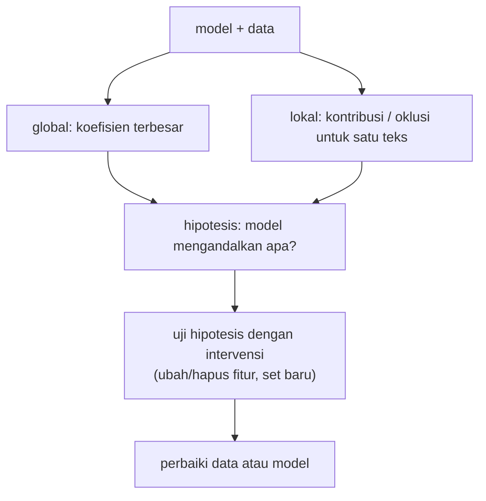

# Explainable NLP: Interpretabilitas Model

!!! abstract "Info materi"
    **Tingkat kesulitan:** Menengah–lanjut. **Estimasi waktu:** 180 menit.
    **Jenis kode:** ringan (`examples/level-7-deployment/03_interpretabilitas.py`; modul `nlp_hub/interpretasi.py`). Model: Linear SVM + TF-IDF (Level 5) pada dataset **sintetis**.

## Tujuan pembelajaran

- [ ] Membedakan penjelasan global (model secara keseluruhan) dari lokal (satu prediksi).
- [ ] Membaca koefisien model linear dan menghitung kontribusi tiap kata ke satu skor.
- [ ] Menjalankan penjelasan oklusi (hapus satu kata) yang berlaku untuk model apa pun.
- [ ] Mengenali jalan pintas (*shortcut*) yang dipelajari model dari artefak data.
- [ ] Menjelaskan mengapa penjelasan adalah hipotesis, bukan bukti sebab-akibat.
- [ ] Menggunakan penjelasan dalam error analysis tanpa memberi rasa aman yang palsu.

## Prasyarat

- [Linear SVM](../level-4-machine-learning/linear-svm.md) dan [TF-IDF](../level-3-representasi-teks/tfidf.md).
- [Error Analysis](../level-5-evaluasi/error-analysis.md).
- [Arsitektur Pipeline](arsitektur-pipeline.md).

## Pengantar dan motivasi

Jika model menandai pesan sebagai Emergency, peninjau manusia ingin tahu **mengapa**. Jika model melewatkan pesan darurat, tim ingin tahu penyebabnya agar dapat memperbaiki data. Interpretabilitas membantu keduanya, tetapi ada jebakan: penjelasan yang tampak masuk akal bisa menyesatkan, dan model dapat benar karena alasan yang salah.

## Konsep dasar

| Istilah | Arti |
|---|---|
| **Interpretabilitas** | Sejauh mana manusia dapat memahami cara model memutuskan |
| **Penjelasan global** | Pola umum model (mis. koefisien per kata) |
| **Penjelasan lokal** | Alasan untuk satu prediksi |
| **Kontribusi fitur** | Pada model linear: nilai fitur × koefisien |
| **Oklusi** | Hapus bagian masukan dan lihat perubahan keluaran |
| **Shortcut learning** | Model memakai petunjuk kebetulan di data, bukan sinyal yang dimaksud |
| **Faithfulness** | Seberapa setia penjelasan terhadap perilaku model sebenarnya |

## Penjelasan mendalam

### Model linear: skor adalah jumlah kontribusi

Untuk SVM linear, skor satu teks:

$$
s = \sum_{j} x_j\,w_j + b
$$

- $x_j$: nilai TF-IDF kata $j$ dalam teks (0 bila kata tidak ada); $w_j$: koefisien; $b$: intersep.
- Contoh angka: dua kata aktif, $x_1=0{,}5,\ w_1=1{,}6$ dan $x_2=0{,}4,\ w_2=-0{,}8$, dengan $b=-0{,}6$: $s=0{,}8-0{,}32-0{,}6=-0{,}12$. Kontribusi kata 1 = +0,8, kata 2 = −0,32. Penjelasan ini **tepat**, bukan perkiraan, untuk model linear (tetapi hanya menjelaskan model, bukan dunia).

### Penjelasan oklusi

Hapus satu kata, hitung ulang skor, ambil selisihnya. Perubahan positif berarti kata itu menaikkan skor. Metode ini hanya perlu `decision_function`, jadi berlaku untuk model non-linear termasuk jaringan saraf, dengan biaya satu prediksi per kata. Kelemahan: efek kata yang saling bergantung (mis. "tidak" dan "ada") tidak tertangkap bila dihapus satu-satu; praproses seperti pengubahan huruf dan normalisasi mengubah apa yang sebenarnya dihapus.

### Penjelasan model rumit

LIME dan SHAP (Ribeiro dkk., 2016; Lundberg & Lee, 2017) memberi penjelasan lokal untuk model apa pun dengan memperkirakan model di sekitar satu contoh. Keduanya tidak dipakai di kode ini (tambahan dependensi, tidak diuji di sini). Untuk Transformer, bobot attention **bukan** penjelasan otomatis (Jain & Wallace, 2019; Wiegreffe & Pinter, 2019 memperdebatkannya); gunakan metode berbasis gradien atau oklusi, dan uji dengan intervensi.

### Shortcut learning

Model memanfaatkan apa pun yang berkorelasi dengan label pada data latih. Pada data sintetis bertemplat, alamat ("Jl. … RT 04") hanya muncul pada templat laporan Emergency, sehingga kata `rt`, `jalan`, `rumah` menjadi penanda kuat. Pada data nyata, kata-kata itu ada di banyak pesan non-darurat. Model tampak pintar, padahal mengandalkan artefak pembangkit data.

## Cara kerja atau alur proses



## Contoh sederhana

Teks "air masuk rumah" dengan kontribusi `air` +0,22, `masuk` +0,14, `rumah` +0,40 dan intersep −0,62: skor $=0{,}22+0{,}14+0{,}40-0{,}62=+0{,}14$ → Emergency (ambang 0). Jika `rumah` dihapus, skor menjadi $-0{,}26$ → Non-Emergency; satu kata yang berstatus "umum" menentukan keputusan.

## Contoh dalam konteks Twitter/X kebencanaan

"Tolong, air banjir sudah masuk ke rumah kami." Kita ingin kata seperti `tolong`, `air`, `masuk` yang berperan. Kenyataan di bawah memperlihatkan bahwa peran terbesar justru dipegang kata `rumah` dan `ke`: peringatan bahwa penjelasan perlu dibaca kritis.

## Praktik Python

Berkas: `examples/level-7-deployment/03_interpretabilitas.py`. Fungsi di `nlp_hub/interpretasi.py`. Model: `model_rujukan(siapkan())`, Linear SVM pada 452 teks pengembangan. Jalankan dari `examples/`.

### Bagian 1: penjelasan global

```python title="Bagian 1"
--8<-- "level-7-deployment/03_interpretabilitas.py:global"
```

- `model.named_steps["model"].coef_[0]` adalah vektor koefisien; `np.argsort` mengurutkan indeks dari koefisien terkecil.
- `get_feature_names_out()` menghubungkan indeks kolom dengan kata.

```text title="Output nyata"
fitur dengan koefisien paling NEGATIF (condong Non-Emergency): [('kemarin', -0.91), ('sudah', -0.79), ('kembali', -0.66), ('lalu', -0.64), ('lancar', -0.59), ('membersihkan', -0.56)]
fitur dengan koefisien paling POSITIF (condong Emergency)    : [('rt', 1.59), ('rumah', 1.43), ('jalan', 1.3), ('barusan', 1.12), ('butuh', 1.09), ('di', 1.0)]
```

Interpretasi: kata yang menarik ke Non-Emergency (`kemarin`, `sudah`, `kembali`, `lalu`, `lancar`, `membersihkan`) masuk akal: itu kata kejadian lampau atau pemulihan. Kata yang menarik ke Emergency (`butuh`, `barusan`) masuk akal. Tetapi `rt`, `jalan`, `rumah`, `di` yang teratas adalah **kata alamat dan kata fungsi**. Itu petunjuk shortcut. Pengukuran terpisah pada 564 teks dataset (dihitung satu kali untuk halaman ini, bukan dari skrip di atas): kata `rt` muncul di sekitar 63% teks Emergency tetapi hanya sekitar 2% teks Non-Emergency; `rumah` sekitar 29% vs 2%. Templat laporan memuat alamat, jadi kata alamat menjadi penanda murah. Model yang mengandalkan `rt` atau `di` belum tentu memahami "darurat".

### Bagian 2: kontribusi untuk satu teks

```python title="Bagian 2"
--8<-- "level-7-deployment/03_interpretabilitas.py:lokal"
```

```text title="Output nyata"
  rumah      +0.398
  ke         +0.339
  sudah      -0.240
  air        +0.222
  masuk      +0.135
  kami       +0.114
jumlah semua kontribusi + intersep (-0.623) = 0.3028
skor dari model.decision_function              = 0.3028
```

Interpretasi: kontribusi terbesar `rumah` (+0,398) dan `ke` (+0,339), diikuti `air` (+0,222). `sudah` menarik ke bawah (−0,240). **Kata `tolong` tidak muncul di enam teratas** padahal intuitif penting; kontribusinya lebih kecil daripada `ke`. Pemeriksaan: jumlah seluruh kontribusi ditambah intersep (−0,623) sama dengan skor model (0,3028), jadi penjelasan ini **setia** pada model linear.

### Bagian 3: oklusi

```python title="Bagian 3"
--8<-- "level-7-deployment/03_interpretabilitas.py:oklusi"
```

```text title="Output nyata"
skor dasar +0.303; perubahan bila satu kata dihapus (positif = kata itu menaikkan skor):
  rumah      +0.377
  sudah      -0.298
  ke         +0.295
  air        +0.170
  banjir     -0.126
```

Interpretasi: menghapus `rumah` menurunkan skor 0,377 (dari +0,303 menjadi kira-kira −0,074): satu kata cukup membalik keputusan. Menghapus `banjir` justru **menaikkan** skor 0,126 (nilai −0,126): kata `banjir` ada juga di pos edukasi dan berita, sehingga bagi model ia berasosiasi dengan Non-Emergency. Pendekatan oklusi (selisih −0,298 untuk `sudah`) mendekati kontribusi linear, tetapi tidak identik, sebab menghapus kata mengubah normalisasi TF-IDF kata lain.

### Bagian 4: menyelidiki kesalahan (false negative)

```python title="Bagian 4"
--8<-- "level-7-deployment/03_interpretabilitas.py:salah"
```

- `d.y_tangan == 1` dan `skor < 0` menyaring pesan Emergency (label 1) yang diprediksi Non-Emergency (FN).
- `fn.iterrows()` mengulang baris DataFrame; `cakupan_kosakata` mengukur proporsi token yang dikenal kosakata TF-IDF.

```text title="Output nyata"
[H001] FN, skor -0.067: Astaga dapur tetangga meledak, apinya udah ngejalar ke atap. Siapa punya AP
   kontribusi terbesar: [('ke', 0.35), ('jalan', 0.32), ('atap', 0.3), ('sudah', -0.25)]

[H004] FN, skor -0.032: Mohon info: jalur Puncak km 12 baru saja longsor, 2 mobil keseret ke jurang
   kontribusi terbesar: [('ke', 0.42), ('mohon', 0.2), ('sudah', -0.15), ('jalur', -0.09)]

cakupan kosakata teks ini: 0.57 | seluruh tulis-tangan: 0.56
```

Interpretasi: dua FN yang hampir lolos (skor −0,067 dan −0,032, tepat di bawah 0). Kata `ke` kembali menjadi kontributor positif terbesar (+0,35, +0,42) sementara kata yang secara intuitif penting ("meledak", "longsor") tidak berada di empat teratas. Kedua kata itu **ada** di kosakata (diperiksa terpisah), jadi kontribusinya memang kecil; `jurang` tidak ada di kosakata sama sekali. Cakupan kosakata untuk kedua teks hanya 0,57, mirip seluruh set tulis-tangan (0,56), yaitu **sekitar 43% token tidak dikenal model**. Pada Level 5 hipotesis "FN disebabkan kosakata asing" tidak terdukung dengan pengukuran lain; data ini hanya menunjukkan **kosakata asing umum** pada tulis-tangan, bukan bahwa itulah sebab FN. Jangan menyimpulkan sebab dari dua contoh.

### Skrip terpadu

`03_interpretabilitas.py` menjalankan keempat bagian dan selesai kurang dari beberapa detik. Tes: `examples/tests/test_layanan.py` (kontribusi menjumlah ke skor, oklusi satu kata, cakupan kosakata).

## Kesalahan umum dan debugging

| Gejala | Penyebab | Perbaikan |
|---|---|---|
| Menganggap kata berkoefisien tinggi sebagai penyebab darurat | Korelasi pada data ≠ sebab | Uji dengan intervensi dan data baru |
| Penjelasan mengira kata `di` penting | Shortcut dari templat | Periksa data, kurangi artefak, tambah variasi |
| Kontribusi tidak menjumlah ke skor | Lupa intersep, atau salah tahap | Jumlahkan juga intersep; gunakan fitur sesudah TF-IDF |
| Oklusi memberi nilai nol | Kata sudah dihapus praproses (stopword) | Tampilkan teks setelah praproses |
| Menafsirkan bobot attention sebagai alasan | Attention bukan penjelasan kausal | Pakai oklusi/gradien dan uji intervensi |
| Penjelasan dipakai sebagai alasan menolak verifikasi manusia | Rasa aman palsu | Penjelasan membantu peninjau, bukan menggantikan |

## Kelebihan dan keterbatasan

**Kelebihan model linear:** penjelasan tepat, murah, dan dapat diaudit; membantu menemukan artefak data dan bahan error analysis.
**Keterbatasan:** menjelaskan model, bukan kebenaran; oklusi satu kata mengabaikan interaksi; penjelasan tidak menjamin keadilan atau ketepatan; model yang lebih akurat (non-linear) lebih sulit dijelaskan.

## Latihan bertahap

1. **Konseptual.** Apa beda penjelasan global dan lokal?
2. **Hitungan.** Dengan kontribusi +0,5, −0,2, +0,1 dan intersep −0,3, berapa skor dan labelnya (ambang 0)?
3. **Membaca output.** Mengapa `rt` dan `di` di daftar teratas menimbulkan curiga?
4. **Debugging.** Kontribusi kata dijumlahkan tetapi tidak sama dengan `decision_function`. Sebutkan dua penyebab.
5. **Eksperimen.** Hapus kata alamat (`rt`, `jalan`, `kelurahan`) dari data latih dan latih ulang. Apa yang terjadi pada skor dan koefisien teratas?
6. **Analisis.** Mengapa penjelasan yang tampak masuk akal tetap dapat menyesatkan?

## Kunci jawaban dan pembahasan

??? success "Jawaban 1"
    Global menjelaskan perilaku umum model (mis. koefisien teratas); lokal menjelaskan alasan untuk satu prediksi (kontribusi/oklusi pada satu teks).

??? success "Jawaban 2"
    $0{,}5-0{,}2+0{,}1-0{,}3=0{,}1$ → $\ge0$, maka Emergency.

??? success "Jawaban 3"
    Keduanya bukan sinyal darurat. `rt` bagian dari alamat; `di` kata fungsi. Jika model mengandalkannya, ia memakai artefak templat, dan akan gagal pada pesan yang tidak memuat alamat atau memuat alamat tetapi tidak darurat.

??? success "Jawaban 4"
    (a) Intersep tidak dijumlahkan. (b) Mengambil kontribusi dari teks mentah, bukan dari fitur setelah praproses dan TF-IDF; atau hanya menjumlahkan `atas` fitur, bukan semuanya.

??? success "Jawaban 5"
    Tidak dapat dijawab tanpa menjalankan; hipotesis: koefisien teratas bergeser ke kata kejadian (mis. `longsor`, `tertimpa`) dan skor pada teks beralamat berubah. Jalankan, bandingkan recall tulis-tangan sebelum dan sesudah, dan laporkan dengan hati-hati (satu seed, 48 teks).

??? success "Jawaban 6"
    Manusia cenderung menerima cerita yang masuk akal (bias konfirmasi). Penjelasan menjelaskan model, yang bisa benar karena alasan salah. Penjelasan harus diuji sebagai hipotesis lewat intervensi pada data.

## Kuis singkat

**1.** Apakah kontribusi kata pada SVM linear merupakan perkiraan?

??? success "Jawaban"
    Tidak, tepat untuk model linear: skor = jumlah kontribusi + intersep.

**2.** Apa risiko menafsirkan koefisien sebagai sebab?

??? success "Jawaban"
    Koefisien mencerminkan korelasi pada data latih, termasuk artefak.

**3.** Apakah penjelasan menggantikan peninjau manusia?

??? success "Jawaban"
    Tidak; ia membantu peninjau, tidak menggantikannya.

## Ringkasan

- Skor linear = jumlah kontribusi + intersep (terbukti: 0,3028 = 0,3028).
- Kata alamat dan fungsi (`rt`, `jalan`, `rumah`, `di`) berkoefisien teratas: tanda shortcut dari data bertemplat.
- Oklusi menunjukkan satu kata (`rumah`) cukup membalik keputusan; `banjir` malah menurunkan skor.
- Pada dua FN, sekitar 43% token tidak dikenal (cakupan 0,57); penjelasan = hipotesis, bukan bukti sebab.

## Glosarium istilah baru

Penjelasan lokal / global
:   Alasan satu prediksi / perilaku model secara keseluruhan.

Kontribusi fitur
:   Nilai fitur dikali koefisien.

Oklusi
:   Menghapus bagian masukan untuk melihat perubahan keluaran.

*Shortcut learning*
:   Model memakai petunjuk kebetulan dari data.

Faithfulness
:   Kesetiaan penjelasan terhadap perilaku model.

## Referensi

- Ribeiro, M. T., Singh, S., & Guestrin, C. (2016). "Why should I trust you?": Explaining the predictions of any classifier. *KDD 2016* (makalah akademik; judul, penulis, dan tahun diperiksa via arXiv/Crossref/ACL Anthology; venue tidak diverifikasi terpisah).
- Lundberg, S. M., & Lee, S.-I. (2017). A unified approach to interpreting model predictions. *NeurIPS 2017* (makalah akademik; judul, penulis, dan tahun diperiksa via arXiv/Crossref/ACL Anthology; venue tidak diverifikasi terpisah).
- Jain, S., & Wallace, B. C. (2019). Attention is not explanation. *NAACL-HLT 2019*; Wiegreffe, S., & Pinter, Y. (2019). Attention is not not explanation. *EMNLP-IJCNLP 2019* (makalah akademik; judul, penulis, dan tahun diperiksa via arXiv/Crossref/ACL Anthology; venue tidak diverifikasi terpisah).
- Molnar, C. *Interpretable Machine Learning*: <https://christophm.github.io/interpretable-ml-book/> (buku daring).
- Geirhos, R., dkk. (2020). Shortcut learning in deep neural networks. *Nature Machine Intelligence*, 2, 665–673 (makalah akademik; judul, penulis, dan tahun diperiksa via arXiv/Crossref/ACL Anthology; venue tidak diverifikasi terpisah).

## Materi berikutnya

[Bias, Fairness, Robustness, dan Data di Luar Distribusi](bias-robustness-ood.md)
