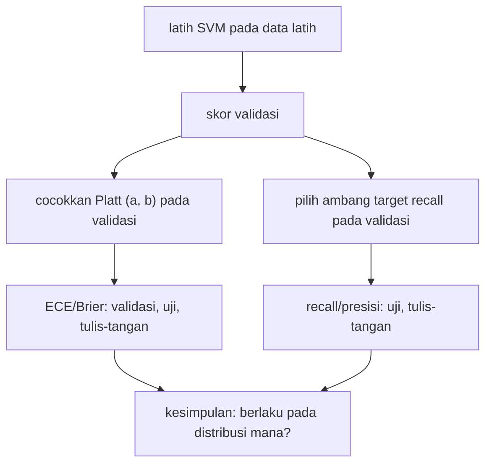

# Kalibrasi Probabilitas dan Pemilihan Threshold

!!! abstract "Info materi"
    **Tingkat kesulitan:** Menengah–lanjut. **Estimasi waktu:** 180 menit.
    **Jenis kode:** ringan (`examples/level-7-deployment/02_kalibrasi_threshold.py`; modul `nlp_hub/kalibrasi.py`). Model: Linear SVM pada TF-IDF, dilatih hanya pada data latih; semua angka dari eksekusi nyata pada dataset **sintetis**.

## Tujuan pembelajaran

- [ ] Membedakan skor, probabilitas, dan label.
- [ ] Menjelaskan apa itu kalibrasi dan mengukurnya dengan ECE, skor Brier, dan tabel reliabilitas.
- [ ] Mengkalibrasi skor SVM dengan skala Platt (sigmoid) pada data validasi.
- [ ] Memilih ambang berdasarkan target recall **pada data validasi** dan mengujinya pada data lain.
- [ ] Menjelaskan mengapa ambang dan kalibrasi dari satu distribusi dapat gagal pada distribusi lain.
- [ ] Menyatakan batasan: tidak ada ambang produksi yang dapat ditetapkan dari data sintetis.

## Prasyarat

- [Threshold, Kurva PR, dan ROC](../level-5-evaluasi/threshold-pr-roc.md).
- [Logistic Regression](../level-4-machine-learning/logistic-regression.md) (sigmoid).
- [Arsitektur Pipeline](arsitektur-pipeline.md).

## Pengantar dan motivasi

SVM mengeluarkan **skor** seperti $-0{,}6$ atau $1{,}2$. Aplikasi sering ingin menampilkan "peluang darurat 87%". Skor SVM **bukan** probabilitas; menampilkannya sebagai persen adalah klaim yang tidak didukung. Kalibrasi memetakan skor ke angka yang benar-benar berperilaku seperti probabilitas: dari seratus pesan yang diberi "0,8", sekitar delapan puluh memang Emergency. Dan setelah kita punya skor yang bermakna, kita perlu memutuskan **ambang** untuk menandai pesan. Kedua hal itu mudah salah jika dikerjakan pada data yang tidak mewakili.

## Konsep dasar

| Istilah | Arti |
|---|---|
| **Skor** | Angka apa pun yang makin besar makin condong ke Emergency (skor keputusan SVM) |
| **Probabilitas terkalibrasi** | Angka 0–1 yang frekuensi kejadian nyatanya cocok dengan nilainya |
| **Kalibrasi Platt** | $p=\sigma(a\,s+b)$; $a,b$ dipelajari dari data berlabel yang tidak dipakai melatih model |
| **ECE** (*expected calibration error*) | Rata-rata tertimbang selisih antara prediksi dan frekuensi nyata per bin |
| **Skor Brier** | Rata-rata $(p-y)^2$; makin kecil makin baik |
| **Diagram reliabilitas** | Tabel/plot prediksi rata-rata vs frekuensi nyata per bin |
| **Ambang berbasis target recall** | Ambang tertinggi yang masih mencapai recall yang ditargetkan pada data validasi |

## Penjelasan mendalam

### Skala Platt

$$
p(\text{Emergency}\mid s)=\sigma(a\,s+b)=\frac{1}{1+e^{-(a s+b)}}
$$

- $s$: skor SVM; $a>0$ mengatur kemiringan; $b$ menggeser titik 0,5. Keduanya dicocokkan dengan regresi logistik satu-fitur pada skor **validasi**.
- Contoh angka dari eksekusi di bawah: $a=3{,}625$, $b=-0{,}361$. Untuk $s=0{,}3$: $z=3{,}625\times0{,}3-0{,}361=0{,}727$; $p=\sigma(0{,}727)=0{,}674$. Skor yang sama dengan 0 menghasilkan $p=\sigma(-0{,}361)=0{,}411$: perhatikan bahwa **skor 0 tidak sama dengan probabilitas 0,5** setelah kalibrasi.
- Mengapa data validasi, bukan latih? Pada data latih, SVM biasanya terlalu yakin; skala yang dipelajari di sana terlalu optimistis.

### Mengukur kalibrasi

**Tabel reliabilitas:** bagi $p$ ke bin (mis. 0–0,2, 0,2–0,4, …). Untuk tiap bin, bandingkan rata-rata prediksi dengan fraksi Emergency sebenarnya. Garis ideal: keduanya sama.

$$
\mathrm{ECE}=\sum_{b}\frac{n_b}{N}\,\big|\,\overline{y}_b-\overline{p}_b\,\big|
$$

($n_b$: jumlah contoh pada bin $b$; $\overline y_b$ frekuensi Emergency nyata; $\overline p_b$ rata-rata prediksi.) Contoh: dua bin; bin A 80 contoh, $\overline y=0{,}10$, $\overline p=0{,}12$; bin B 20 contoh, $\overline y=0{,}70$, $\overline p=0{,}90$. ECE $=0{,}8\times0{,}02+0{,}2\times0{,}20=0{,}056$.

### Memilih ambang

Dua pendekatan berbeda, jangan dicampur:

1. **Eksplorasi** (Level 5): melihat trade-off presisi–recall pada set apa pun untuk memahami model.
2. **Penetapan:** memilih satu ambang untuk dipakai. Syaratnya: (a) data validasi yang **mewakili penggunaan nyata**, (b) pertimbangan biaya FN vs FP dan kapasitas peninjau, (c) pengujian pada data terpisah, (d) dokumentasi alasan dan tanggal.

Contoh aturan: "ambang tertinggi yang masih menangkap ≥95% Emergency di validasi". Fungsi `pilih_ambang_target_recall` mengerjakannya. Aturan ini hanya sekeras data validasinya.

## Cara kerja atau alur proses



## Contoh sederhana

Lima pesan validasi dengan skor dan label: $(1{,}0;\,E)$, $(0{,}6;\,E)$, $(0{,}2;\,N)$, $(-0{,}1;\,E)$, $(-0{,}8;\,N)$. Target recall 0,66 (2 dari 3 Emergency): ambang 0,6 menangkap `1,0` dan `0,6` → TP=2, FP=0, recall 0,667, presisi 1,0. Menaikkan target ke 1,0 memaksa ambang turun ke −0,1: TP=3, **FP=1** (skor 0,2), presisi 0,75. Menaikkan target menaikkan alarm palsu: trade-off yang harus diputuskan manusia.

## Contoh dalam konteks Twitter/X kebencanaan

"Gempa terasa kuat, warga diminta menjauhi bangunan yang rusak." Apakah ini laporan darurat atau pengumuman? Tergantung definisi operasional (ada kejadian, ada ancaman, ada permintaan menjauh). Skor yang jatuh dekat ambang untuk pesan semacam itu normal; itulah **zona ragu**. Kalibrasi yang baik akan memberi probabilitas sedang (~0,4–0,6) untuk kasus ambigu; kalibrasi yang buruk memberi angka yang tampak yakin tetapi salah.

## Praktik Python

Berkas: `examples/level-7-deployment/02_kalibrasi_threshold.py`. Pustaka: scikit-learn (`LogisticRegression` untuk Platt), NumPy, dan `nlp_hub/kalibrasi.py`. Jalankan dari `examples/`.

### Bagian 1: skor dari model yang dilatih hanya pada data latih

```python title="Bagian 1"
--8<-- "level-7-deployment/02_kalibrasi_threshold.py:skor"
```

```text title="Output nyata"
ambang dari VALIDASI (target recall 0,95): 0.694 -> presisi 1.000, recall 0.950
uji sintetis  ambang 0 (bawaan)    : recall E 1.000 | presisi E 0.950
```

Interpretasi: skor berkisar sekitar −1,15 sampai 1,18, yaitu jelas bukan 0–1. Menampilkannya sebagai "persen" salah.

### Bagian 2: kalibrasi Platt dan ECE

```python title="Bagian 2"
--8<-- "level-7-deployment/02_kalibrasi_threshold.py:platt"
```

- `s_val.reshape(-1, 1)` mengubah vektor menjadi matriks satu kolom, bentuk yang diminta scikit-learn.
- `ke_proba` adalah fungsi pendek (`lambda`) yang mengubah skor apa pun menjadi probabilitas dengan Platt.

```text title="Output nyata"
uji sintetis  ambang dari validasi : recall E 0.816 | presisi E 1.000
tulis-tangan  ambang 0 (bawaan)    : recall E 0.583 | presisi E 1.000
tulis-tangan  ambang dari validasi : recall E 0.083 | presisi E 1.000
galat yang diharapkan: tidak ada contoh positif; recall tidak terdefinisi
```

Interpretasi: pada validasi (tempat $a,b$ dipelajari) ECE 0,043; pada uji sintetis (distribusi sama) 0,052; pada **tulis-tangan 0,186** dan Brier 0,142 (vs 0,013 uji sintetis). Kalibrasi yang baik pada data sintetis **tidak berpindah** ke gaya bahasa lain. Catatan: validasi dipakai untuk mencocokkan $a,b$ sehingga ECE 0,043 itu agak optimistis (dihitung pada data yang sama).

### Bagian 3: tabel reliabilitas pada tulis-tangan

```python title="Bagian 3"
--8<-- "level-7-deployment/02_kalibrasi_threshold.py:reliabilitas"
```

```text title="Output nyata"
```

Interpretasi: pada bin 0,2–0,4, model memprediksi rata-rata 0,30, tetapi **78%** dari 9 pesan di bin itu sebenarnya Emergency; pada bin 0,4–0,6, prediksi 0,47 vs kenyataan 1,00 (4 dari 4). Model **terlalu pesimis** pada tulis-tangan: pesan darurat bergaya lain mendapat skor rendah. Bin kecil (4–9 contoh) berisik, jadi lihat pola, bukan angka persis.

### Bagian 4: ambang dari data validasi

```python title="Bagian 4"
--8<-- "level-7-deployment/02_kalibrasi_threshold.py:ambang"
```

```text title="Output nyata"
```

Interpretasi:

| Set | Ambang | Recall E | Presisi E |
|---|---|---|---|
| Uji sintetis | 0 (bawaan) | 1,000 | 0,950 |
| Uji sintetis | 0,694 (dari validasi) | 0,816 | 1,000 |
| Tulis-tangan | 0 (bawaan) | 0,583 | 1,000 |
| Tulis-tangan | 0,694 (dari validasi) | **0,083** | 1,000 |

Ambang 0,694 mencapai recall 0,95 di validasi, tetapi pada **uji sintetis recall turun ke 0,816**, dan pada **tulis-tangan jatuh ke 0,083** (2 dari 24 pesan darurat terdeteksi). Aturan "target recall 0,95" yang tampak aman justru berbahaya di luar distribusi validasi. (Pada Level 5 dilaporkan temuan serupa dengan ambang dari validasi silang.) Mengapa uji sintetis pun turun? Dugaan (tidak diuji di sini): dengan 117 contoh validasi, ambang tertinggi yang mencapai 95% sangat peka terhadap beberapa contoh sehingga ambang dari sampel kecil tidak stabil.

### Bagian 5: pagar pengaman

```python title="Bagian 5"
--8<-- "level-7-deployment/02_kalibrasi_threshold.py:pilih_salah"
```

```text title="Output nyata"
```

Interpretasi: tanpa contoh positif, recall tidak terdefinisi; fungsi menolak dengan pesan jelas, bukan mengembalikan angka sembarang.

### Kesimpulan yang sah

- Kalibrasi dan ambang di halaman ini adalah **demonstrasi teknik**. Tidak ada ambang yang direkomendasikan.
- Pendekatan yang benar untuk penggunaan nyata: kumpulkan data validasi representatif dengan banyak pelabel independen; pilih ambang dengan selang ketidakpastian; uji pada data terpisah dari periode berbeda; pantau drift ([Pemantauan Drift](pemantauan-drift.md)); tinjau ulang berkala; pertahankan peninjau manusia.

## Kesalahan umum dan debugging

| Gejala | Penyebab | Perbaikan |
|---|---|---|
| SVM disebut "probabilitas 0,87" | Skor tidak dikalibrasi | Kalibrasi atau tampilkan sebagai skor |
| Kalibrasi dicocokkan pada data latih | Model terlalu yakin di data latih | Pakai validasi terpisah |
| Ambang dipilih di set uji | Kebocoran seleksi | Pilih di validasi, uji sekali |
| Ambang tidak stabil antar sampel | Validasi kecil | Bootstrap; selang; lebih banyak data |
| `ValueError: ... tidak ada contoh positif` | Validasi tanpa kelas positif | Stratifikasi; periksa pembagian |
| ECE kecil dianggap bukti model baik | ECE tidak mengukur kemampuan memisahkan | Lihat juga recall/presisi dan AUC |
| Bin reliabilitas berisik | Bin berisi sedikit contoh | Kurangi jumlah bin; laporkan $n$ per bin |

## Kelebihan dan keterbatasan

**Kelebihan:** probabilitas terkalibrasi memudahkan komunikasi dan keputusan berbasis biaya; ambang eksplisit dapat diaudit.
**Keterbatasan:** kalibrasi hanya berlaku pada distribusi tempat ia dipelajari; Platt mengasumsikan bentuk sigmoid; ECE bergantung pada pilihan bin; validasi sintetis tidak mewakili dunia nyata.

## Latihan bertahap

1. **Konseptual.** Apa beda skor, probabilitas terkalibrasi, dan label?
2. **Hitungan.** Dengan $a=3{,}625$, $b=-0{,}361$, berapa $p$ untuk skor $-0{,}5$?
3. **Membaca output.** Pada tabel reliabilitas tulis-tangan, bin mana yang paling tidak terkalibrasi dan ke arah mana?
4. **Debugging.** Tim Anda memilih ambang 0,694 karena "recall 0,95 di validasi" dan melaporkan "recall 0,95". Apa kesalahannya?
5. **Rancangan.** Tulis prosedur memilih ambang dengan data validasi baru yang representatif.
6. **Analisis.** Dalam konteks respons bencana, siapa yang menanggung biaya FN dan FP, dan bagaimana itu memengaruhi pilihan ambang?

## Kunci jawaban dan pembahasan

??? success "Jawaban 1"
    Skor: angka monoton tanpa makna probabilistik. Probabilitas terkalibrasi: angka yang frekuensi nyatanya cocok. Label: keputusan diskret setelah ambang.

??? success "Jawaban 2"
    $z=3{,}625\times(-0{,}5)-0{,}361=-2{,}1735$; $p=\sigma(-2{,}1735)=1/(1+e^{2{,}1735})=1/(1+8{,}79)=0{,}102$.

??? success "Jawaban 3"
    Bin 0,4–0,6 (prediksi 0,47, nyata 1,00) dan 0,2–0,4 (0,30 vs 0,78): model terlalu pesimis (meremehkan Emergency). Bin sangat kecil (4 dan 9 contoh), jadi pola lebih penting daripada angka.

??? success "Jawaban 4"
    Recall 0,95 adalah angka pada data yang **dipakai memilih ambang** (selection bias) dan tidak berlaku pada data lain: pada uji sintetis 0,816 dan pada tulis-tangan 0,083. Laporan harus memakai data terpisah dan menyebut distribusinya.

??? success "Jawaban 5"
    (1) Kumpulkan validasi representatif dan beranotasi independen. (2) Tentukan biaya relatif FN/FP dan kapasitas peninjau bersama pemangku kepentingan. (3) Hitung kurva PR di validasi dengan selang bootstrap. (4) Pilih ambang yang memenuhi target recall dengan selang kepercayaan, bukan titik. (5) Uji pada data periode lain. (6) Dokumentasikan, tetapkan jadwal tinjau ulang dan pemantauan drift.

??? success "Jawaban 6"
    FN: korban tidak tertolong tepat waktu, dampak paling berat. FP: sumber daya terbatas terkuras oleh alarm palsu sehingga pesan nyata lambat ditangani. Karena FN berbiaya sangat tinggi, recall Emergency diprioritaskan, tetapi FP harus dibatasi oleh kapasitas peninjau. Keputusan ini adalah keputusan organisasi, bukan statistik.

## Kuis singkat

**1.** Apakah skor 0 pada SVM berarti probabilitas 0,5 setelah kalibrasi Platt?

??? success "Jawaban"
    Tidak; bergantung $b$ (di sini $p=0{,}411$).

**2.** Pada data mana $a,b$ Platt sebaiknya dicocokkan?

??? success "Jawaban"
    Data validasi yang tidak dipakai melatih model.

**3.** Apakah ambang 0,694 siap dipakai?

??? success "Jawaban"
    Tidak; recall tulis-tangan hanya 0,083 dan tidak ada validasi representatif.

## Ringkasan

- Skor SVM bukan probabilitas; Platt (a = 3,625; b = −0,361) mengubahnya, dicocokkan pada validasi.
- ECE: validasi 0,043, uji sintetis 0,052, tulis-tangan 0,186: kalibrasi tidak berpindah antar gaya.
- Ambang dari target recall 0,95 di validasi: recall uji sintetis 0,816 dan tulis-tangan 0,083.
- Tidak ada ambang yang dapat direkomendasikan dari data sintetis.

## Glosarium istilah baru

Kalibrasi
:   Menyesuaikan keluaran model agar berperilaku seperti probabilitas.

Skala Platt
:   Pemetaan sigmoid dari skor ke probabilitas.

ECE
:   Selisih tertimbang antara prediksi dan frekuensi nyata per bin.

Skor Brier
:   Rata-rata kuadrat selisih probabilitas dan label.

Zona ragu
:   Rentang skor dekat ambang yang perlu perhatian manusia.

## Referensi

- Platt, J. (1999). Probabilistic outputs for support vector machines and comparisons to regularized likelihood methods. *Advances in Large Margin Classifiers* (makalah akademik; belum diperiksa daring).
- Guo, C., Pleiss, G., Sun, Y., & Weinberger, K. Q. (2017). On calibration of modern neural networks. *ICML 2017* (makalah akademik; judul, penulis, dan tahun diperiksa via arXiv/Crossref/ACL Anthology; venue tidak diverifikasi terpisah).
- scikit-learn, kalibrasi probabilitas: <https://scikit-learn.org/stable/modules/calibration.html> (dokumentasi resmi).

## Materi berikutnya

[Interpretabilitas Model](interpretabilitas.md)
