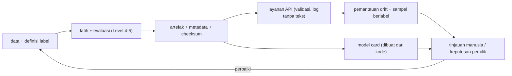

# Keamanan, Model Card, Keterbatasan Sistem Darurat, dan Roadmap

!!! abstract "Info materi"
    **Tingkat kesulitan:** Menengah–lanjut. **Estimasi waktu:** 180 menit.
    **Jenis kode:** ringan (`examples/level-7-deployment/07_model_card.py`). Model card dihasilkan dari metadata artefak dan metrik yang dihitung ulang, bukan diketik tangan.

## Tujuan pembelajaran

- [ ] Mengidentifikasi risiko keamanan dataset, kredensial, dan artefak model, serta langkah pencegahannya.
- [ ] Menyusun model card yang jujur: tujuan, penggunaan yang tidak sesuai, data, evaluasi, keterbatasan.
- [ ] Menjelaskan mengapa klasifikasi darurat tidak boleh menjadi sistem otomatis penuh.
- [ ] Menyusun daftar periksa sebelum model dipakai di luar pembelajaran.
- [ ] Menilai kematangan proyek ini secara jujur dan menyusun roadmap pengembangan.
- [ ] Menghubungkan seluruh Level 0–7 menjadi satu alur kerja.

## Prasyarat

- Seluruh [Level 5](../level-5-evaluasi/index.md) dan halaman Level 7 sebelumnya, terutama [Kalibrasi](kalibrasi-threshold.md), [Bias dan OOD](bias-robustness-ood.md), [FastAPI](fastapi-dasar.md).
- `examples/disaster-classification/DATA_CARD.md`.

## Pengantar dan motivasi

Menjalankan model adalah bagian mudah. Bagian sulitnya: memastikan data tidak bocor, kredensial tidak tercecer, orang lain memahami batas model, dan tidak ada yang mengira demonstrasi ini adalah sistem penentu keadaan darurat. Halaman ini membahas hal-hal itu dan menutup Level 7.

## Konsep dasar

| Istilah | Arti |
|---|---|
| **Model card** | Dokumen singkat yang menjelaskan model: tujuan, data, evaluasi, keterbatasan (Mitchell dkk., 2019) |
| **Data card / datasheet** | Dokumen serupa untuk dataset |
| **Kredensial** | Rahasia akses: kunci API, kata sandi, token |
| **Minimisasi data** | Mengumpulkan dan menyimpan seminimal mungkin |
| **PII** | Informasi yang dapat mengidentifikasi seseorang |
| **Human-in-the-loop** | Manusia memeriksa dan memutuskan |
| **Penggunaan di luar maksud** | Memakai model untuk tujuan yang tidak dirancang atau divalidasi |

## Penjelasan mendalam

### Keamanan dataset

| Risiko | Praktik |
|---|---|
| Data pribadi di pos (nama, alamat, nomor telepon, foto) | Minimalkan; anonimkan; jangan menaruh data nyata di repository; patuhi ketentuan platform dan hukum pelindungan data yang berlaku |
| Data nyata tersebar lewat git | Jangan commit data mentah; gunakan `.gitignore`; periksa riwayat git bila pernah terlanjur |
| Pelabel dapat melihat konten sensitif | Informasikan, batasi akses, dan sediakan dukungan |
| Penyalahgunaan hasil (profiling) | Batasi tujuan dan akses; catat penggunaan |
| Dataset ini | **Sintetis**: tidak memuat data pribadi nyata; tidak boleh dianggap mewakili data nyata (lihat `DATA_CARD.md`) |

Proyek ini **tidak mengunduh atau men-scrape** data Twitter/X. Bila Anda berencana memakai data nyata, periksa syarat layanan dan izin yang berlaku, dokumentasikan sumber dan hak penggunaannya, serta lakukan penilaian risiko privasi lebih dulu.

### Kredensial dan konfigurasi

- Jangan menaruh kunci API, token, atau kata sandi di kode atau di repository. Gunakan **variabel lingkungan** (seperti `NLP_HUB_AMBANG`) atau pengelola rahasia.
- Berkas `.env` yang berisi rahasia harus masuk `.gitignore`. Kode ini sengaja tidak memerlukan kredensial apa pun.
- Jika rahasia pernah ter-commit, anggap bocor: **cabut dan ganti**, jangan hanya menghapus dari riwayat.
- Log: jangan mencetak kredensial atau teks pengguna (sudah dipraktikkan di `nlp_hub/api.py`).

### Keamanan artefak dan layanan

| Risiko | Praktik |
|---|---|
| `joblib`/`pickle` dapat menjalankan kode saat dimuat | Muat hanya berkas buatan sendiri/tepercaya; simpan checksum; pertimbangkan format yang lebih aman untuk bobot |
| Model/tokenizer dari Hub | Pin versi/revisi; periksa lisensi; batasi `trust_remote_code` |
| Layanan tanpa autentikasi | Jangan dibuka publik; tambahkan autentikasi, pembatasan laju, HTTPS |
| Permintaan raksasa / membanjiri | Batas panjang dan batch (ada), pembatasan laju (belum ada) |
| Dependensi rentan | Pin versi dan perbarui berkala; pindai kerentanan |
| Log berisi data pribadi | Catat hash, bukan teks (ada) |

### Model card

Model card yang baik memuat: ringkasan; penggunaan yang dimaksud; **penggunaan yang tidak sesuai**; data dan pelabelan; metrik dengan konteks dan ketidakpastian; keterbatasan dan bias yang diketahui; lingkungan dan versi; kontak/pemilik; tanggal. Poin kunci: kartu yang dihasilkan dari kode mengurangi risiko angka usang atau salah ketik, tetapi **keterbatasan tetap harus ditulis oleh manusia yang memahami konteks**.

### Keterbatasan sistem klasifikasi darurat

Sistem seperti ini **tidak boleh** disebut atau diperlakukan sebagai penentu keadaan darurat otomatis atau pengganti verifikasi manusia. Alasan:

1. **Konsekuensi tidak simetris.** FN dapat berarti korban tidak tertolong; FP menghabiskan sumber daya terbatas.
2. **Definisi bergantung konteks.** Banyak pesan ambigu (peringatan, kejadian lampau, empati, sarkasme) dan pelabel bisa tidak sepakat.
3. **Data dan model terbatas.** Dataset sintetis kecil bertemplat; recall tulis-tangan 0,583–0,625 pada ambang bawaan dan jatuh ke 0,083 pada ambang dari validasi ([Kalibrasi](kalibrasi-threshold.md)).
4. **Pergeseran.** Bahaya baru, kosakata baru, dan lonjakan lalu lintas saat bencana ([Pemantauan Drift](pemantauan-drift.md)).
5. **Bias.** Wilayah, bahasa, dan gaya menulis tidak merata terwakili ([Bias](bias-robustness-ood.md)).
6. **Konteks hilang.** Teks saja tidak menunjukkan lokasi pasti, kebenaran laporan, atau apakah pertolongan sudah datang.
7. **Penyalahgunaan dan manipulasi.** Pesan palsu atau massal dapat membanjiri sistem.

Pedoman: sistem hanya untuk **membantu memprioritaskan antrean tinjauan manusia**, dengan prosedur eskalasi di luar sistem, jalur pelaporan alternatif, dan akuntabilitas organisasi.

## Cara kerja atau alur proses



## Contoh sederhana

Daftar periksa satu halaman sebelum model keluar dari lingkungan belajar. Jawaban "tidak" pada salah satu butir berarti **belum siap**:

- [ ] Data nyata, sah dipakai, dan terdokumentasi sumber serta izinnya?
- [ ] Definisi label disepakati beberapa pelabel independen (dengan ukuran kesepakatan)?
- [ ] Evaluasi pada data representatif dengan selang ketidakpastian?
- [ ] Ambang dipilih di validasi representatif dan diuji di data terpisah?
- [ ] Pengujian bias/irisan, robustness, dan OOD oleh pihak yang beragam?
- [ ] Prosedur tinjauan manusia, eskalasi, dan jalur cadangan ada?
- [ ] Pemantauan drift dan pelabelan sampel berjalan, dengan pemilik yang jelas?
- [ ] Keamanan: autentikasi, HTTPS, pembatasan laju, kebijakan data dan retensi?
- [ ] Model card dan data card terkini?
- [ ] Persetujuan pemangku kepentingan dan penilaian risiko tertulis?

## Contoh dalam konteks Twitter/X kebencanaan

Seorang relawan ingin memasang layanan ini "agar otomatis mengirim bantuan". Jawaban yang tepat: tidak. Dengan dataset sintetis dan recall tulis-tangan 0,583–0,625, sistem akan melewatkan sebagian besar pesan darurat berbahasa nyata. Pemakaian yang masuk akal paling jauh adalah *eksperimen* mengurutkan antrean tinjauan manusia pada data yang sah dan dengan evaluasi berkelanjutan, bukan pengiriman bantuan otomatis.

## Praktik Python

Berkas: `examples/level-7-deployment/07_model_card.py`. Jalankan dari `examples/` (artefak dibuat otomatis bila belum ada).

### Bagian 1: menghitung ulang metrik dari artefak

```python title="Bagian 1"
--8<-- "level-7-deployment/07_model_card.py:metrik"
```

- Model dimuat lewat `muat_artefak` (checksum diperiksa). Metrik dihitung dengan fungsi yang sama seperti Level 5 (`metrik_emergency`), bukan disalin.
- Perhatikan komentar: artefak dilatih pada latih+validasi, sehingga uji sintetis tidak dipakai melatih.
- Baris tabel Markdown disusun dengan f-string.

```text title="Output nyata"
| uji sintetis (112 teks) | 1.000 | 0.950 | 0.980 |
| tulis-tangan (48 teks) | 0.625 | 1.000 | 0.806 |
```

Interpretasi: baris pertama: recall 1,000, presisi 0,950, F1 makro 0,980 (uji sintetis); baris kedua: recall 0,625, presisi 1,000, F1 makro 0,806 (tulis-tangan). Angkanya sama dengan Level 5 (model rujukan identik), sesuai harapan.

### Bagian 2: menyusun model card

```python title="Bagian 2"
--8<-- "level-7-deployment/07_model_card.py:kartu"
```

- Kartu memakai f-string multibaris: nilai dari `meta` (versi, ambang, library) dan `baris_metrik` disisipkan. `chr(10)` adalah karakter baris-baru, dipakai karena sebelum Python 3.12 f-string tidak mengizinkan garis miring terbalik (`
`) di dalam ekspresi.
- Bagian **keterbatasan** dan **penggunaan yang tidak sesuai** adalah teks tetap yang ditulis manusia; mereka tidak otomatis.

```text title="Output nyata"
model card ditulis; jumlah baris: 33
memuat peringatan penggunaan tidak sesuai: True
```

Interpretasi: kartu ditulis ke `artefak/MODEL_CARD.md` (33 baris) dan memuat peringatan penggunaan yang tidak sesuai. File itu diabaikan git bersama folder `artefak/`; buat ulang dengan menjalankan skrip.

Contoh bagian yang dihasilkan (kutipan struktur, bukan keluaran penuh):

```markdown
## Penggunaan yang TIDAK sesuai
Penentuan keadaan darurat otomatis, pengganti verifikasi manusia, pemantauan individu, keputusan alokasi sumber daya.
```

## Roadmap pengembangan

### Yang sudah ada di proyek ini (diverifikasi)

| Komponen | Status |
|---|---|
| Dataset sintetis + data card | Ada; label dari templat atau satu penulis |
| Baseline TF-IDF + NB/LR/SVM, evaluasi, error analysis | Ada, diuji |
| Mekanisme deep learning (NumPy) | Ada, diuji |
| IndoBERT (2 model × 5 seed) dan LSTM (5 seed) PyTorch di CPU | Ada dan **dieksekusi** (hasil di [Tahap G](../proyek-klasifikasi-bencana/tahap-g-advanced-modeling.md)); tidak diperiksa otomatis |
| Artefak bermetadata + checksum | Ada, diuji |
| Kalibrasi, interpretabilitas, bias, drift (demonstrasi) | Ada |
| API FastAPI, riwayat, dasbor, tes | Ada; dijalankan lokal; tanpa autentikasi |
| Model card dari kode | Ada |

### Langkah berikutnya (urutan disarankan)

1. **Data:** kumpulkan data nyata yang sah; definisikan label dengan pedoman tertulis; libatkan ≥2 pelabel independen dan ukur kesepakatan (Cohen's kappa); catat provenance.
2. **Evaluasi:** pisahkan data per waktu dan per kejadian; selang bootstrap; analisis irisan; set uji kecil yang dibekukan.
3. **Model:** jalankan fine-tuning IndoBERT (≥5 seed) dan bandingkan dengan SVM pada protokol yang sama; coba normalisasi informal vs tanpa.
4. **Ambang dan kalibrasi:** pilih di validasi representatif dengan analisis biaya bersama pemangku kepentingan.
5. **Layanan:** autentikasi, pembatasan laju, HTTPS, basis data riwayat yang tahan lama, retensi data, pengamatan (metrik, peringatan).
6. **Pemantauan:** jadwal pelabelan sampel, ambang drift dari simulasi, tinjauan model berkala, prosedur penarikan model.
7. **Tata kelola:** pemilik model, penilaian risiko dan dampak, jalur banding, audit.

## Kesalahan umum dan debugging

| Gejala | Penyebab | Perbaikan |
|---|---|---|
| Kunci API ada di git | Hard-code | Cabut, ganti, pakai variabel lingkungan, `.gitignore` |
| Model card berisi angka lama | Diketik tangan | Hasilkan dari kode saat evaluasi |
| Model card tanpa bagian keterbatasan | Hanya memamerkan metrik | Wajibkan bagian keterbatasan dan penggunaan tidak sesuai |
| Menjalankan model dari unduhan acak | `joblib.load` tak tepercaya | Muat hanya yang tepercaya |
| Menyebut sistem "AI darurat" | Klaim berlebihan | Gunakan bahasa terbatas: "alat bantu prioritas tinjauan" |
| Menyimpan teks pengguna tanpa kebijakan | Praktis tetapi berisiko | Hash saja; retensi dan akses jelas |
| Dikira checksum sama dengan keamanan | Salah paham | Checksum hanya mendeteksi perubahan |

## Kelebihan dan keterbatasan

**Kelebihan:** praktik yang diajarkan (metadata, checksum, model card dari kode, log tanpa teks, gagal cepat) dapat ditransfer ke proyek nyata.
**Keterbatasan:** semua pada data sintetis; tidak ada tinjauan keamanan independen, uji penetrasi, atau tinjauan etika/hukum; model card ini adalah contoh pendidikan, bukan dokumen kepatuhan.

## Latihan bertahap

1. **Konseptual.** Mengapa model card memuat bagian "penggunaan yang tidak sesuai"?
2. **Membaca output.** Berapa recall Emergency pada tulis-tangan menurut kartu, dan mengapa angka itu cukup untuk menolak penggunaan otomatis?
3. **Debugging.** Anda menemukan kunci API di riwayat git. Apa yang harus dilakukan, berurutan?
4. **Daftar periksa.** Pilih tiga butir daftar periksa yang gagal dipenuhi proyek ini dan jelaskan apa yang dibutuhkan.
5. **Menulis.** Tambahkan bagian "Pemilik dan kontak" dan "Tanggal evaluasi" pada pembuat model card (ubah `07_model_card.py`).
6. **Analisis.** Tuliskan paragraf yang menolak permintaan "pasang di server dan kirim ambulans otomatis".

## Kunci jawaban dan pembahasan

??? success "Jawaban 1"
    Model sering dipakai di luar tujuan semula. Menyebutkan penggunaan yang tidak sesuai secara eksplisit mengurangi risiko penyalahgunaan dan membantu pengguna memutuskan.

??? success "Jawaban 2"
    0,625 (15 dari 24 Emergency tulis-tangan ditemukan; sembilan terlewat). Untuk sistem darurat, kehilangan hampir 4 dari 10 pesan darurat tidak dapat diterima sebagai pengganti manusia, walau angka itu sendiri berasal dari set kecil.

??? success "Jawaban 3"
    (1) **Cabut dan ganti** kunci di penyedia, segera. (2) Periksa log penggunaan untuk akses mencurigakan. (3) Hapus dari kode dan pindahkan ke variabel lingkungan. (4) Bersihkan riwayat git (mis. dengan alat khusus) bila perlu, tetapi anggap rahasia sudah bocor dan jangan mengandalkan penghapusan riwayat. (5) Tambah pemindai rahasia dan `.gitignore`.

??? success "Jawaban 4"
    Contoh: (a) data nyata dan pelabel independen: perlu izin pengumpulan, pedoman label, dan ukuran kesepakatan; (b) autentikasi dan HTTPS: perlu implementasi dan konfigurasi server; (c) pemantauan dengan pelabelan sampel: perlu proses dan pemilik tugas. Semua butir daftar periksa belum terpenuhi pada proyek pendidikan ini.

??? success "Jawaban 5"
    Tambahkan variabel `pemilik` dan `tanggal = datetime.now(timezone.utc).date()` di skrip lalu sisipkan ke f-string `kartu`. Catat bahwa tanggal membuat keluaran skrip berubah tiap hari, sehingga jangan ditaruh di blok keluaran yang diperiksa otomatis.

??? success "Jawaban 6"
    Contoh: "Permintaan ini ditolak. Model dilatih pada data sintetis; recall pada pesan tulis-tangan hanya 0,583–0,625 dan ambang dari validasi gagal pada gaya berbeda (0,083). Mengirim ambulans memerlukan verifikasi manusia, kapasitas, dan jalur eskalasi di luar sistem. Pemakaian yang sesuai maksimal sebagai alat bantu memprioritaskan antrean tinjauan, setelah evaluasi pada data nyata yang sah dan persetujuan pemangku kepentingan."

## Kuis singkat

**1.** Boleh menyimpan kunci API di repository?

??? success "Jawaban"
    Tidak; gunakan variabel lingkungan atau pengelola rahasia.

**2.** Apa yang tidak dibuktikan checksum?

??? success "Jawaban"
    Bahwa berkas aman; hanya bahwa berkas tidak berubah.

**3.** Apakah layanan ini siap menggantikan verifikasi manusia?

??? success "Jawaban"
    Tidak, sama sekali.

## Ringkasan

- Keamanan: data pribadi diminimalkan, kredensial lewat variabel lingkungan, artefak hanya dari sumber tepercaya, layanan tidak dibuka tanpa autentikasi.
- Model card dihasilkan dari kode (uji sintetis recall 1,000; tulis-tangan recall 0,625) dan menyatakan keterbatasan serta penggunaan yang tidak sesuai.
- Sistem ini hanya alat bantu prioritas tinjauan manusia, bukan penentu keadaan darurat.
- Roadmap: data nyata sah, pelabel independen, evaluasi representatif, fine-tuning ber-seed banyak, layanan aman, pemantauan, tata kelola.

## Glosarium istilah baru

Model card
:   Dokumen ringkas tentang tujuan, data, evaluasi, dan keterbatasan model.

PII
:   Informasi yang dapat mengidentifikasi seseorang.

Human-in-the-loop
:   Manusia memeriksa dan memutuskan.

Kredensial
:   Rahasia akses seperti kunci API.

Penggunaan di luar maksud
:   Memakai model untuk tujuan yang tidak divalidasi.

## Referensi

- Mitchell, M., dkk. (2019). Model cards for model reporting. *FAT\* '19*, 220–229, DOI: 10.1145/3287560.3287596 (makalah akademik; **diperiksa**, lihat [Referensi](../referensi.md)).
- Gebru, T., dkk. (2021). Datasheets for datasets. *Communications of the ACM*, 64(12) (makalah akademik; judul, penulis, dan tahun diperiksa via arXiv/Crossref/ACL Anthology; venue tidak diverifikasi terpisah).
- OWASP Top 10: <https://owasp.org/www-project-top-ten/> (acuan keamanan; belum diperiksa daring).
- scikit-learn, persistensi model dan keamanan: <https://scikit-learn.org/stable/model_persistence.html> (dokumentasi resmi).
- Pelindungan data pribadi: rujuk regulasi yang berlaku di wilayah Anda (mis. UU Pelindungan Data Pribadi di Indonesia); halaman ini bukan nasihat hukum.

## Materi berikutnya

Selesai Level 7? Kerjakan checkpoint di [indeks Level 7](index.md), lalu lanjut ke [Proyek Klasifikasi Bencana](../proyek-klasifikasi-bencana/index.md).
