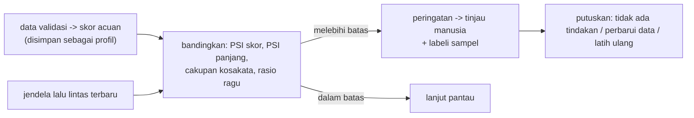

# Pemantauan Performa dan Data Drift

!!! abstract "Info materi"
    **Tingkat kesulitan:** Menengah–lanjut. **Estimasi waktu:** 150 menit.
    **Jenis kode:** ringan (`examples/level-7-deployment/05_pemantauan_drift.py`; modul `nlp_hub/pantau.py`). Model: Linear SVM dilatih pada data latih; data acuan = validasi; semua angka dari eksekusi nyata pada dataset **sintetis**.

## Tujuan pembelajaran

- [ ] Membedakan *data drift*, *concept drift*, dan pergeseran proporsi kelas (*prior shift*).
- [ ] Menghitung Population Stability Index (PSI) dengan tangan dan dengan kode.
- [ ] Memantau distribusi skor, panjang teks, dan cakupan kosakata tanpa label.
- [ ] Menjelaskan mengapa ambang PSI "baku" tidak dapat dipercaya pada sampel kecil dan mengukurnya dengan bootstrap.
- [ ] Merancang rencana pemantauan yang menyertakan pelabelan sampel oleh manusia.
- [ ] Menyatakan apa yang tidak bisa dideteksi tanpa label.

## Prasyarat

- [Kalibrasi dan Threshold](kalibrasi-threshold.md).
- [Robustness dan OOD](bias-robustness-ood.md).
- [Leakage dan Ketidakpastian](../level-5-evaluasi/leakage-reproducibility.md): bootstrap.

## Pengantar dan motivasi

Model dilatih pada data masa lalu, tetapi melayani data masa depan. Selama bencana, topik melonjak (mis. banyak pos tentang gempa bila terjadi gempa), kata baru muncul, dan gaya menulis berubah. Tanpa pemantauan, kualitas model dapat menurun diam-diam. Yang menyulitkan: pada layanan nyata **label tidak tersedia secara langsung**, jadi kita memantau indikator tidak langsung dan menjadwalkan pelabelan sampel oleh manusia.

## Konsep dasar

| Istilah | Arti |
|---|---|
| **Data drift (*covariate shift*)** | Distribusi masukan $P(x)$ berubah |
| **Concept drift** | Hubungan masukan–label $P(y\mid x)$ berubah (mis. definisi "darurat" bergeser) |
| **Prior shift** | Proporsi kelas $P(y)$ berubah |
| **PSI** | Ukuran perbedaan dua distribusi berbasis bin |
| **Jendela acuan / jendela baru** | Data pembanding dari masa validasi / data lalu lintas terbaru |
| **Cakupan kosakata** | Proporsi token masukan yang ada di kosakata model |

## Penjelasan mendalam

### PSI

Bagi nilai (mis. skor) ke $B$ bin berdasarkan kuantil data acuan. Misalkan $p_i$ proporsi acuan dan $q_i$ proporsi data baru pada bin $i$:

$$
\mathrm{PSI}=\sum_{i=1}^{B}(q_i-p_i)\,\ln\frac{q_i}{p_i}
$$

Contoh dengan tiga bin: acuan $p=(0{,}5;0{,}3;0{,}2)$, baru $q=(0{,}3;0{,}3;0{,}4)$.
Suku 1: $(0{,}3-0{,}5)\ln(0{,}3/0{,}5)=(-0{,}2)(-0{,}511)=0{,}102$. Suku 2: $0$. Suku 3: $(0{,}4-0{,}2)\ln(0{,}4/0{,}2)=0{,}2\times0{,}693=0{,}139$. PSI $=0{,}241$.
Setiap suku non-negatif, sehingga PSI ≥ 0 dan bernilai 0 bila distribusinya sama. Aturan praktis di industri (< 0,1 stabil; 0,1–0,25 sedang; > 0,25 besar) adalah **konvensi**, bukan hasil teori statistik, dan peka terhadap jumlah bin dan ukuran sampel. Bin kosong diberi proporsi sangat kecil ($\varepsilon$) agar logaritma terdefinisi.

### Apa yang dipantau tanpa label

| Indikator | Mendeteksi | Tidak mendeteksi |
|---|---|---|
| PSI skor | Perubahan distribusi keluaran model | Perubahan yang tidak menggeser skor |
| PSI panjang teks | Perubahan format (mis. banyak URL/hashtag) | Perubahan isi |
| Cakupan kosakata | Kata baru / bencana jenis baru | Kata lama dengan makna baru |
| Rasio zona ragu | Banyak pesan dekat ambang | Kesalahan yakin |
| Proporsi Emergency yang diprediksi | Prior shift kasar | Apakah prediksinya benar |

**Pelabelan sampel manusia** tetap satu-satunya cara mengukur performa sebenarnya (recall, presisi). Rencanakan sampel acak berkala **dan** sampel pada zona ragu, dan catat siapa yang melabeli serta kesepakatan antar pelabel.

### Drift ≠ penurunan performa, dan sebaliknya

Distribusi bisa bergeser tanpa memengaruhi akurasi (mis. lebih banyak URL, tetapi model tetap benar), dan performa bisa turun tanpa drift terdeteksi (concept drift). PSI adalah **alarm untuk memeriksa**, bukan pengukur kebenaran.

## Cara kerja atau alur proses



## Contoh sederhana

Acuan: 100 skor validasi, 20 di antaranya > 0,5 (20%). Jendela baru: 100 skor, 40 > 0,5 (40%). Bin dua (≤0,5 vs >0,5): $p=(0{,}8;0{,}2)$, $q=(0{,}6;0{,}4)$ → PSI $=(0{,}6-0{,}8)\ln(0{,}75)+(0{,}4-0{,}2)\ln(2)=0{,}0575+0{,}1386=0{,}196$ ("sedang"). Peningkatan proporsi skor tinggi bisa berarti memang ada lebih banyak pesan darurat (banjir sedang terjadi!) dan bukan tanda model rusak: kontekslah yang menentukan.

## Contoh dalam konteks Twitter/X kebencanaan

Selama gempa besar, pos tentang gempa membanjiri sistem: proporsi Emergency naik, pos bergaya "situasi terkini" yang tidak ada di data latih muncul, dan lebih banyak emoji/URL. PSI skor naik (bisa wajar). Cakupan kosakata turun (kata baru: nama daerah terdampak, istilah teknis). Jika recall turun diam-diam di saat paling kritis, hanya sampel berlabel yang akan mengetahuinya.

## Praktik Python

Berkas: `examples/level-7-deployment/05_pemantauan_drift.py`. Modul: `nlp_hub/pantau.py` (`psi`, `ringkas_aliran`) dan `nlp_hub/interpretasi.py` (`cakupan_kosakata`). Jalankan dari `examples/`.

### Bagian 1: profil acuan

```python title="Bagian 1"
--8<-- "level-7-deployment/05_pemantauan_drift.py:acuan"
```

- Model dilatih pada data latih; **acuan** adalah skor pada data validasi (tidak dipakai melatih), dengan panjang teks. Acuan yang diambil dari data latih akan terlalu rapi.
- `ringkas_aliran` mengembalikan kamus statistik ringkas.

```text title="Output nyata"
acuan: {'n': 117, 'skor_rata': -0.303, 'skor_std': 0.859, 'panjang_median': 87.0}
```

Interpretasi: 117 teks acuan; rata-rata skor −0,303 (kebanyakan Non-Emergency), simpangan baku 0,859, median panjang 87 karakter.

### Bagian 2: empat jendela lalu lintas

```python title="Bagian 2"
--8<-- "level-7-deployment/05_pemantauan_drift.py:jendela"
```

```text title="Output nyata"
jendela                               PSI skor  PSI panjang  cakupan kosakata
uji sintetis (distribusi sama)           0.142        0.180              0.97
uji + emoji/hashtag/URL                  1.505        4.704              0.98
hanya tulis-tangan                       5.423        0.925              0.55
hanya info edukasi (isi bergeser)        3.418        1.190              0.99
```

Interpretasi:

| Jendela | PSI skor | PSI panjang | Cakupan kosakata |
|---|---|---|---|
| Uji sintetis (distribusi sama) | 0,142 | 0,180 | 0,97 |
| Uji + emoji/hashtag/URL | 1,505 | 4,704 | 0,98 |
| Hanya tulis-tangan | 5,423 | 0,925 | 0,55 |
| Hanya info edukasi | 3,418 | 1,190 | 0,99 |

- Menambah emoji, hashtag, dan URL **tidak** menurunkan cakupan kosakata (0,98) tetapi memukul PSI panjang (4,704) dan PSI skor (1,505): drift format terlihat di panjang teks.
- Tulis-tangan: cakupan kosakata turun ke 0,55 (45% token tidak dikenal) dan PSI skor 5,423 besar: drift isi dan gaya.
- Hanya info edukasi: cakupan 0,99 (kosakata familiar) tetapi PSI skor 3,418: isi bergeser (semua Non-Emergency) walau katanya dikenal; ini *prior shift* ekstrem, bukan kerusakan model.
- **Masalah:** jendela "distribusi sama" menunjukkan PSI skor **0,142** dan PSI panjang **0,180**, keduanya melewati batas "stabil" 0,1 padahal tidak ada drift. Penyebabnya ukuran sampel kecil: acuan 117 teks dan uji 112 teks.

### Bagian 3: seberapa besar PSI "tanpa drift"?

```python title="Bagian 3"
--8<-- "level-7-deployment/05_pemantauan_drift.py:bootstrap"
```

- `rng.choice(acuan_skor, size=48, replace=True)` mengambil sampel acak dengan pengembalian dari acuan itu sendiri: distribusinya **persis sama**, sehingga PSI yang muncul murni derau pengambilan sampel.

```text title="Output nyata"
PSI antara acuan dan sampel acak 48 teks dari acuan SENDIRI: median 0.185, persentil 95 0.792
```

Interpretasi: untuk jendela 48 teks, PSI antara acuan dan sampelnya sendiri bermedian 0,185 dan persentil ke-95 0,792. Artinya, **PSI 0,3–0,7 pada jendela 48 teks tidak membuktikan drift**; ambang konvensi 0,1/0,25 jauh terlalu sensitif pada sampel kecil. Dalam praktik: gunakan jendela yang cukup besar, tentukan ambang alarm dari simulasi seperti ini pada ukuran jendela yang sama, dan lihat tren beberapa jendela, bukan satu titik. Perhatikan bahwa dibanding derau (p95 0,79), nilai tulis-tangan (5,42), edukasi (3,42), dan derau-tambahan (1,50) tetap jauh di atas: drift yang besar tetap terdeteksi.

### Skrip terpadu

`05_pemantauan_drift.py` menjalankan seluruh bagian. Tes: `test_layanan.py::test_psi_nol_untuk_data_sama_dan_besar_untuk_geser` (PSI = 0 untuk data identik, < 0,1 untuk dua sampel besar sama, > 0,25 untuk geseran rata-rata 2 simpangan baku).

## Kesalahan umum dan debugging

| Gejala | Penyebab | Perbaikan |
|---|---|---|
| PSI > 0,1 pada data yang sama | Sampel kecil | Simulasikan derau (bootstrap) dan tetapkan ambang dari situ |
| `PSI = inf` atau `nan` | Bin kosong, log(0) | Beri $\varepsilon$ (sudah dilakukan) |
| Bin acuan tidak seimbang | Kuantil dengan banyak nilai sama | `np.unique` pada batas bin (sudah dilakukan) |
| Acuan diambil dari data latih | Terlalu rapi, PSI berlebihan | Pakai validasi |
| Drift dianggap sama dengan penurunan performa | Keduanya berbeda | Label sampel untuk mengukur performa |
| Alarm terus menerus | Ambang terlalu sensitif | Naikkan ambang; jendela lebih besar |
| Tidak ada rencana tindak lanjut | Pemantauan tanpa tindakan | Tetapkan pemilik, prosedur, dan jadwal tinjau |

## Kelebihan dan keterbatasan

**Kelebihan:** murah, tanpa label, cepat, dan dapat diotomatisasi; menangkap perubahan format dan kosakata.
**Keterbatasan:** tidak mengukur performa; tidak mendeteksi concept drift; ambang bergantung ukuran sampel; hanya melihat satu variabel per PSI; contoh di sini adalah simulasi dari data sintetis, bukan lalu lintas nyata.

## Latihan bertahap

1. **Konseptual.** Beda data drift dan concept drift?
2. **Hitungan.** Hitung PSI untuk $p=(0{,}6;0{,}4)$, $q=(0{,}4;0{,}6)$.
3. **Membaca output.** Mengapa cakupan kosakata "hanya info edukasi" (0,99) tinggi tetapi PSI skor besar?
4. **Debugging.** PSI Anda `nan`. Sebutkan dua kemungkinan penyebab.
5. **Eksperimen.** Ulangi Bagian 3 dengan ukuran sampel 500. Bagaimana median dan persentil ke-95 berubah, dan apa artinya?
6. **Rancangan.** Rancang rencana pemantauan mingguan untuk layanan klasifikasi pesan bencana.

## Kunci jawaban dan pembahasan

??? success "Jawaban 1"
    Data drift: $P(x)$ berubah (kata/format baru). Concept drift: $P(y\mid x)$ berubah (pesan yang sama kini dinilai berbeda).

??? success "Jawaban 2"
    $(0{,}4-0{,}6)\ln(0{,}4/0{,}6)+(0{,}6-0{,}4)\ln(0{,}6/0{,}4)=(-0{,}2)(-0{,}405)+(0{,}2)(0{,}405)=0{,}081+0{,}081=0{,}162$.

??? success "Jawaban 3"
    Cakupan kosakata hanya mengukur apakah **kata** dikenal. Info edukasi memakai kata yang familiar, tetapi seluruhnya Non-Emergency, sehingga distribusi skor berpindah ke sisi negatif (prior shift ekstrem).

??? success "Jawaban 4"
    (a) Bin kosong tanpa $\varepsilon$ (0·log 0 atau pembagian nol). (b) Data berisi `nan` atau panjang nol (jendela kosong). Periksa `np.isnan` dan ukuran jendela.

??? success "Jawaban 5"
    Median dan persentil ke-95 PSI turun (jendela lebih besar → derau lebih kecil), sehingga ambang alarm dapat lebih ketat. Jalankan untuk melihat angkanya; PSI derau kira-kira berskala $B/n$ ($B$ bin, $n$ ukuran sampel).

??? success "Jawaban 6"
    Mingguan: (1) hitung PSI skor, PSI panjang, cakupan kosakata, proporsi Emergency dan zona ragu terhadap acuan, dengan ambang dari simulasi derau; (2) tarik sampel acak 100 pesan dan 100 pesan zona ragu untuk dilabeli dua orang; (3) hitung recall/presisi sampel dengan selang; (4) tinjau pesan dengan kosakata asing; (5) catat hasil; (6) tetapkan pemilik dan kriteria pelatihan ulang; (7) jangan mengubah ambang tanpa validasi.

## Kuis singkat

**1.** Berapa PSI untuk dua distribusi identik?

??? success "Jawaban"
    0.

**2.** Mengapa jendela kecil menyulitkan PSI?

??? success "Jawaban"
    Derau pengambilan sampel menaikkan PSI walau tanpa drift.

**3.** Apakah tanpa drift berarti performa baik?

??? success "Jawaban"
    Tidak; concept drift dan kesalahan sistematis tidak terlihat oleh PSI.

## Ringkasan

- PSI membandingkan distribusi per bin; ambang 0,1/0,25 adalah konvensi.
- Pada sampel kecil, PSI derau sudah 0,142 (uji sintetis) dan p95 0,792 (48 teks).
- Drift besar tetap terdeteksi: tulis-tangan 5,42, edukasi 3,42, derau-tambahan 1,50; cakupan kosakata tulis-tangan 0,55.
- Pemantauan tanpa label harus dilengkapi pelabelan sampel manusia.

## Glosarium istilah baru

Data drift
:   Perubahan distribusi masukan.

Concept drift
:   Perubahan hubungan masukan–label.

PSI
:   Population Stability Index.

Prior shift
:   Perubahan proporsi kelas.

Cakupan kosakata
:   Proporsi token yang dikenal kosakata model.

## Referensi

- Quiñonero-Candela, J., Sugiyama, M., Schwaighofer, A., & Lawrence, N. D. (Eds.). (2009). *Dataset Shift in Machine Learning*. MIT Press (buku; belum diperiksa daring).
- Gama, J., dkk. (2014). A survey on concept drift adaptation. *ACM Computing Surveys*, 46(4) (makalah akademik; judul, penulis, dan tahun diperiksa via arXiv/Crossref/ACL Anthology; venue tidak diverifikasi terpisah).
- Konvensi ambang PSI berasal dari praktik industri kredit; tidak ada sumber akademik tunggal yang dikutip di sini dan angkanya dijelaskan sebagai konvensi.

## Materi berikutnya

[FastAPI: Layanan Prediksi](fastapi-dasar.md)
