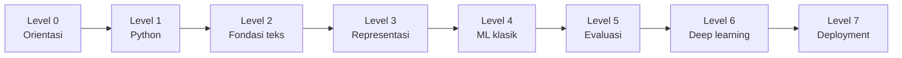

# Panduan Belajar

## Tujuan pembelajaran

- Memahami cara materi disusun dan jalur belajar yang sesuai latar belakang Anda.
- Mengetahui format setiap halaman dan cara memanfaatkannya.
- Menyiapkan kebiasaan belajar yang membuat hasil eksperimen dapat dipercaya.

## Jalur belajar

| Latar belakang Anda | Mulai dari | Catatan |
|---|---|---|
| Belum pernah memprogram | Level 0, lalu Level 1 secara penuh | Estimasi 2–3 minggu untuk dua level pertama |
| Mahir Python, baru di NLP | Level 0, lewati Level 1 bila nyaman, lanjut Level 2 | Tetap kerjakan halaman regex dan pandas |
| Paham ML, baru di NLP teks | Level 2 | Fokus pada preprocessing dan kebocoran data |
| Ingin langsung ke model modern | Level 5, lalu Level 6 | Evaluasi (Level 5) wajib sebelum deep learning |

## Format setiap halaman

Setiap halaman materi mengikuti urutan yang sama:

1. Tujuan pembelajaran dan prasyarat.
2. Pengantar dan intuisi, lalu penjelasan konsep.
3. Contoh kontekstual kebencanaan.
4. Kode Python beserta penjelasan, output, dan interpretasinya.
5. Kesalahan umum.
6. Latihan mandiri dan kuis singkat dengan pembahasan.
7. Ringkasan, referensi, dan materi selanjutnya.

## Tiga jenis contoh

Materi membedakan secara tegas:

- **Ilustratif**: potongan kecil untuk menjelaskan satu ide. Bukan hasil eksperimen.
- **Eksperimen**: kode yang dijalankan pada dataset sintetis; angka yang tampil berasal dari eksekusi nyata dan dicatat versi library serta seed-nya.
- **Siap pakai**: kode yang sudah dilengkapi pengujian dan penanganan galat.

!!! note "Tentang angka"
    Dataset sintetis kecil tidak cukup untuk menarik kesimpulan ilmiah.
    Angka dari dataset tersebut hanya menunjukkan **bahwa kodenya bekerja**.

## Kebiasaan belajar yang disarankan

- Ketik ulang kode, jangan hanya menyalin.
- Ubah satu hal pada satu waktu, lalu amati dampaknya.
- Catat seed acak dan versi library setiap kali menjalankan eksperimen.
- Jangan lanjut ke level berikutnya sebelum latihan dasarnya dapat Anda selesaikan sendiri.

## Menjalankan materi di komputer Anda

Lihat [Persiapan Python](level-0-orientasi/persiapan-python.md) di Level 0 untuk langkah lengkap, dan README repository untuk menjalankan situs ini secara lokal.

## Ringkasan

Belajar berurutan dari Level 0, bedakan contoh ilustratif dan eksperimen, dan
selalu verifikasi klaim dengan menjalankan kode.

## Materi selanjutnya

[Level 0: Orientasi NLP](level-0-orientasi/index.md)
