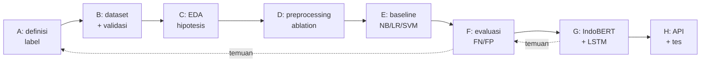

# Proyek: Klasifikasi Pesan Kebencanaan (Emergency vs Non-Emergency)

Satu proyek yang berkembang dari baseline sederhana menjadi layanan NLP yang teruji, dengan batas klaim yang dinyatakan di setiap tahap. Delapan tahap (A–H) mengikat seluruh Level 0–7.

**Estimasi waktu:** 16–22 jam, di luar latihan Level 0–7.
**Prasyarat:** minimal [Level 5](../level-5-evaluasi/index.md) untuk Tahap A–F; [Level 6](../level-6-deep-learning/index.md) untuk Tahap G; [Level 7](../level-7-advanced-nlp/index.md) untuk Tahap H.

!!! danger "Data sintetis, bukan sistem darurat"
    Seluruh data proyek ini sintetis (dari templat dan tulisan tangan satu orang). Skor tidak membuktikan kelayakan model untuk tanggap darurat nyata, tidak ada ambang produksi, dan hasil bukan penentu keadaan darurat otomatis. Verifikasi manusia, data nyata yang sah, dan pelabel independen diperlukan sebelum penggunaan apa pun di luar pembelajaran. Baca `examples/disaster-classification/DATA_CARD.md`.

## Daftar tahap

| Tahap | Halaman | Hasil utama | Kode |
|---|---|---|---|
| **A** | [Definisi Masalah](tahap-a-definisi-masalah.md) | Pedoman anotasi, aturan sebagai fungsi, kappa | `tahap_a_definisi.py`, `nlp_hub/anotasi.py` |
| **B** | [Dataset](tahap-b-dataset.md) | Pemeriksa skema/duplikat/privasi/kebocoran | `tahap_b_dataset.py`, `nlp_hub/validasi_data.py` |
| **C** | [EDA](tahap-c-eda.md) | Distribusi, panjang, hipotesis | `tahap_c_eda.py` + notebook |
| **D** | [Preprocessing](tahap-d-preprocessing.md) | Perbandingan 5 strategi | `tahap_d_praproses.py` |
| **E** | [Modeling](tahap-e-modeling.md) | NB, LR, SVM dengan protokol sama | `tahap_e_model.py` |
| **F** | [Evaluasi](tahap-f-evaluasi.md) | Tabel dari kode, FN/FP, kesimpulan sah | `tahap_f_evaluasi.py` |
| **G** | [Advanced Modeling](tahap-g-advanced-modeling.md) | IndoBERT (5 seed), LSTM, perbandingan | `berat/13_ulang_seed.py` |
| **H** | [Deployment](tahap-h-deployment.md) | API FastAPI, request-response, tes | `tahap_h_deployment.py`, `nlp_hub/api.py` |

Semua skrip proyek ada di `examples/disaster-classification/proyek/`; jalankan dari folder `examples/` (Tahap G memakai `requirements-dl.txt`).

## Alur proyek

## Temuan utama (dari eksekusi nyata, dataset sintetis)

| Temuan | Tahap |
|---|---|
| Dataset: 574 baris (10 duplikat), Emergency 35%; 59 dari 61 templat uji ada di latih | [B](tahap-b-dataset.md), [C](tahap-c-eda.md) |
| Strategi preprocessing: CV F1 makro 0,995–0,998 (tidak dibedakan); tulis-tangan recall E 0,458–0,708; stopword konservatif menurunkan 4 pesan | [D](tahap-d-preprocessing.md) |
| Baseline: CV F1 makro SVM 0,995 > NB 0,983 > LR 0,975, tetapi tulis-tangan recall E NB 0,833 > SVM 0,625 > LR 0,417 (peringkat berbalik) | [E](tahap-e-modeling.md) |
| Tulis-tangan: ketiga baseline tanpa FP; FN 4 / 9 / 14; FN SVM berskor −0,03 sampai −0,07 | [F](tahap-f-evaluasi.md) |
| IndoBERT p1 (5 seed): recall E tulis-tangan 0,825 (0,708–0,917), presisi 1,000 vs SVM 0,583 dengan data latih sama; model IndoBERT lain (`indolem`) jauh lebih rendah | [G](tahap-g-advanced-modeling.md) |
| API: respons berisi skor (bukan probabilitas), ambang, versi, `waktu_ms`, catatan | [H](tahap-h-deployment.md) |

## Yang sudah dan belum

**Sudah (dan diuji/dijalankan):** pedoman dan aturan anotasi; pemeriksa dataset; EDA (skrip dan notebook); perbandingan preprocessing; tiga baseline; tabel evaluasi dari kode; fine-tuning IndoBERT 5 seed (CPU) dan LSTM PyTorch; API dengan tes.

**Belum:** label oleh anotator independen; data nyata yang sah; ambang tervalidasi; evaluasi lintas waktu; autentikasi/HTTPS; pemantauan produksi; tinjauan etika dan hukum. Daftar rinci ada di [Keamanan, Model Card, dan Roadmap](../level-7-advanced-nlp/keamanan-model-card-roadmap.md).

## Checkpoint praktis proyek

- [ ] Saya dapat menjelaskan definisi Emergency dan menerapkannya pada kasus baru dengan alasan.
- [ ] Saya dapat menjalankan pemeriksa dataset dan menjelaskan apa yang tidak dideteksinya.
- [ ] Saya dapat menjelaskan mengapa skor uji sintetis tidak membuktikan generalisasi.
- [ ] Saya dapat menyusun tabel perbandingan dari kode dan menuliskan apa yang tidak dapat disimpulkan.
- [ ] Saya dapat menjelaskan mengapa respons API tidak memuat probabilitas.
- [ ] Saya dapat menolak klaim kelayakan operasional dengan alasan tertulis.

## Materi selanjutnya

Mulai dari [Tahap A](tahap-a-definisi-masalah.md). Setelah proyek: [Latihan dan Kuis](../latihan/index.md).
