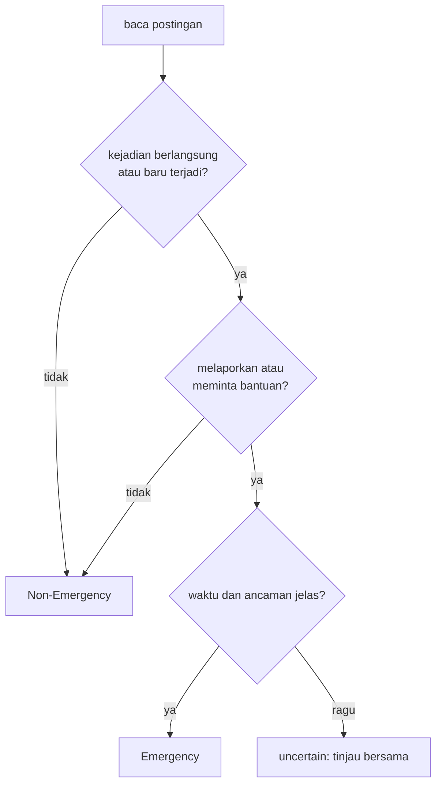

# Tahap A: Definisi Masalah dan Pedoman Anotasi

!!! abstract "Info materi"
    **Tingkat kesulitan:** Pemula–menengah. **Estimasi waktu:** 120 menit.
    **Jenis kode:** ringan (`examples/disaster-classification/proyek/tahap_a_definisi.py`, `nlp_hub/anotasi.py`). Halaman ini adalah **pedoman anotasi** proyek; teks contoh seluruhnya sintetis.

## Tujuan pembelajaran

- [ ] Menuliskan tujuan klasifikasi, unit analisis, dan kriteria inklusi/eksklusi proyek.
- [ ] Menerapkan definisi operasional `Emergency`/`Non-Emergency` pada postingan baru dengan alasan tertulis.
- [ ] Membedakan laporan kejadian, permintaan bantuan, berita, opini, informasi lama, dan peringatan umum.
- [ ] Menangani kasus ambigu dan label `uncertain` sesuai aturan.
- [ ] Menghitung dan menafsirkan kesepakatan antaranotator (persentase dan Cohen's kappa).
- [ ] Menyatakan batas pedoman ini dan siapa yang berhak mengubahnya.

## Prasyarat

- [Memahami Masalah Emergency vs Non-Emergency](../level-0-orientasi/masalah-emergency.md) (definisi dasar yang diperluas di sini).
- [Mini Proyek Manual](../level-0-orientasi/mini-proyek-manual.md) (pengalaman melabeli dan kesepakatan).

## Pengantar dan motivasi

Semua tahap berikutnya (data, model, metrik, ambang) bertumpu pada satu hal: **apa arti "Emergency"**. Model hanya meniru label; bila definisi tidak konsisten, model meniru ketidakkonsistenan itu dan metrik yang tinggi hanya mengukur seberapa baik ia menebak kebiasaan pelabelnya. Tahap A karena itu menghasilkan dokumen, bukan model: pedoman yang dapat dipakai dua orang berbeda dan menghasilkan label yang sama.

## Konsep dasar

| Istilah | Arti dalam proyek ini |
|---|---|
| **Tujuan klasifikasi** | Membantu **memprioritaskan antrean tinjauan manusia** atas postingan publik yang terkait bencana; bukan memutuskan atau mengirim bantuan |
| **Unit analisis** | Satu postingan (satu teks). Utas, gambar, profil penulis, dan lokasi terstruktur tidak dipakai |
| **Definisi operasional** | Definisi yang dapat diterapkan langkah demi langkah oleh orang berbeda |
| **Kriteria inklusi/eksklusi** | Postingan mana yang masuk dataset dan mana yang dikeluarkan |
| **Anotasi / anotator** | Proses pemberian label oleh manusia / orang yang melakukannya |
| **`uncertain`** | Label sementara untuk kasus yang tetap ragu setelah memakai aturan; ditinjau bersama, tidak dipakai melatih |
| **Kesepakatan antaranotator** | Seberapa sering dua anotator memberi label sama pada contoh yang sama |
| **Cohen's kappa** | Kesepakatan yang dikoreksi untuk kebetulan |

## Penjelasan mendalam

### Tujuan, unit analisis, inklusi dan eksklusi

- **Tujuan.** Memberi skor dan label pada postingan agar petugas peninjau dapat memeriksa yang paling mungkin darurat lebih dahulu. Sistem **tidak** menentukan keadaan darurat dan **tidak** menggantikan verifikasi manusia.
- **Unit.** Satu postingan berbahasa Indonesia (termasuk ragam informal), maksimal beberapa ratus karakter.
- **Inklusi.** Postingan publik berbahasa Indonesia yang menyebut bencana alam atau bahaya fisik (banjir, gempa, kebakaran, longsor, angin kencang, letusan gunung) atau topik tidak terkait yang sengaja dimasukkan sebagai pembanding.
- **Eksklusi.** Postingan non-Indonesia; postingan tanpa teks; teks yang tidak terbaca; konten yang memuat data pribadi sensitif yang tidak dapat dianonimkan; duplikat persis (dicatat, tidak otomatis dibuang; lihat [Tahap B](tahap-b-dataset.md)).

### Definisi operasional

Sebuah postingan diberi label **Emergency** bila memenuhi **kedua** syarat:

1. ada **kejadian yang sedang berlangsung atau baru terjadi** yang mengancam keselamatan jiwa, kesehatan, atau harta; **dan**
2. postingan **melaporkan** kejadian itu atau **meminta bantuan/penyelamatan** terkait kejadian itu.

Selain itu: **Non-Emergency**. Kasus ragu: **uncertain**.

```python title="Aturan sebagai fungsi"
--8<-- "nlp_hub/anotasi.py:aturan"
```

- Fungsi menerima **tiga jawaban ya/tidak** yang diberikan anotator, bukan teks. Keputusan memahami teks tetap dilakukan manusia; fungsi hanya memastikan tiga jawaban itu digabung dengan cara yang sama setiap kali.
- `not (a and b)` berarti: bila salah satu syarat gagal, hasilnya Non-Emergency. Perhatikan kata "dan" pada definisi: satu syarat saja tidak cukup.

### Jenis postingan

| Jenis | Ciri | Label | Contoh sintetis |
|---|---|---|---|
| Laporan kejadian | Menyatakan kejadian yang sedang berlangsung | Emergency | "Atap ruko runtuh dan ada yang tertimpa." |
| Permintaan bantuan | Meminta pertolongan terkait kejadian yang sedang terjadi | Emergency | "Tolong, ibu saya terjebak, air naik." |
| Berita | Pelaporan media; sering ada rujukan sumber | Non-Emergency\* | "BMKG: gempa M4,1 pukul 08.12." |
| Opini | Pendapat atau emosi tanpa laporan baru | Non-Emergency | "Pemerintah lambat tangani banjir." |
| Informasi lama | Kejadian sudah berlalu atau pulih | Non-Emergency | "Banjir kemarin sudah surut." |
| Peringatan umum | Imbauan tanpa kejadian spesifik | Non-Emergency | "Musim hujan, waspada banjir." |
| Edukasi | Tips, pelatihan, tas siaga | Non-Emergency | "Tips menghadapi banjir." |
| Candaan/sarkasme | Hiperbola atau lelucon | Non-Emergency | "Konser semalam getarannya kayak gempa wkwk" |
| Tidak terkait | Mengandung kata kunci tanpa kejadian | Non-Emergency | "Tolong follow akun saya, giveaway!" |

\* Berita tentang kejadian yang masih berlangsung dengan korban/ancaman nyata dapat menjadi ambigu: lihat aturan 2 di bawah.

### Aturan anotasi untuk kasus ambigu

1. Waktu kejadian tidak jelas **dan** tidak ada permintaan bantuan → **Non-Emergency**.
2. Berita media tentang kejadian yang menurut teks masih berlangsung dengan ancaman nyata → **Emergency** hanya bila teks menyiratkan ia masih berlangsung; catat sebagai kasus ambigu.
3. Sarkasme/candaan → **Non-Emergency**, kecuali ada permintaan bantuan eksplisit.
4. Tetap ragu → **uncertain**; bahas bersama; **jangan** dipaksakan sebagai data latih.
5. Nilai **isi teks**, bukan siapa penulisnya.
6. Jangan menyamakan kata kunci (`gempa`, `banjir`, `tolong`) dengan Emergency.
7. Perubahan aturan di tengah pelabelan wajib dicatat bersama tanggalnya, dan label lama ditinjau ulang.

## Cara kerja atau alur proses



## Contoh sederhana

"Banjir kemarin sudah surut, terima kasih relawan." Syarat 1: kejadian sudah berlalu → gagal. Hasil: Non-Emergency, apa pun kata yang ada.

## Contoh dalam konteks Twitter/X kebencanaan

Delapan postingan **sintetis** berikut diberi tiga jawaban oleh anotator (kejadian berlangsung? melaporkan/meminta bantuan? waktu dan ancaman jelas?), lalu fungsi di atas menggabungkannya.

## Praktik Python

Berkas: `examples/disaster-classification/proyek/tahap_a_definisi.py`. Jalankan dari `examples/`.

### Bagian 1: aturan diterapkan pada delapan kasus

```python title="Bagian 1"
--8<-- "disaster-classification/proyek/tahap_a_definisi.py:kasus"
```

- `KASUS` adalah daftar *tuple*; tiap tuple berisi teks, tiga jawaban boolean, dan label yang dimaksud pada tabel di Level 0.
- `for teks, a, b, c, harapan in KASUS` membongkar (*unpack*) tiap tuple ke lima variabel.
- `cocok += hasil == harapan` menambahkan 1 bila sama (`True` dihitung 1).

```text title="Output nyata"
Emergency     | harapan Emergency     | Banjir setinggi dada di Jl. Melati, mohon evakuasi!
Non-Emergency | harapan Non-Emergency | Ada yang tahu cara bikin tas siaga bencana?
Emergency     | harapan Emergency     | Gempa tadi bikin lemari roboh, ada tetangga terluka, butuh
Non-Emergency | harapan Non-Emergency | Gempa tadi cuma terasa sebentar, semua aman
Non-Emergency | harapan Non-Emergency | Doakan korban longsor minggu lalu ya
Non-Emergency | harapan Non-Emergency | Tolong follow akun saya, giveaway!
Emergency     | harapan Emergency     | Asap tebal dari gudang dekat pasar, terdengar ledakan
uncertain     | harapan uncertain     | Jembatan dekat rumah kayaknya mau ambruk
aturan cocok dengan label tabel: 8 dari 8
```

Interpretasi: kedelapan hasil cocok dengan label tabel. Perhatikan kasus 4 ("Gempa tadi cuma terasa sebentar, semua aman"): ada gempa dan laporan, tetapi kejadian tidak lagi mengancam, jadi anotator menjawab "tidak" pada syarat 1 dan hasilnya Non-Emergency. Kasus terakhir ("Jembatan ... mau ambruk") sengaja menghasilkan `uncertain`. **Kesepakatan 8 dari 8 ini dapat diprediksi** karena jawaban boolean yang kita berikan sendiri dan label tabel dibuat oleh orang yang sama; ia memeriksa konsistensi aturan, **bukan** kesepakatan antaranotator.

### Bagian 2: kesepakatan antaranotator

Dua anotator melabeli 10 postingan yang sama:

```python title="Bagian 2"
--8<-- "disaster-classification/proyek/tahap_a_definisi.py:kappa"
```

```text title="Output nyata"
kesepakatan mentah: 8/10 = 0.80
Cohen's kappa    : 0.583
```

Interpretasi: kedua anotator sepakat pada 8 dari 10 (0,80), tetapi kappa hanya **0,583**. Kappa memperhitungkan bahwa dengan label yang dominan Non-Emergency, kesepakatan 0,80 sebagian terjadi secara kebetulan.

$$
\kappa=\frac{p_o-p_e}{1-p_e},\qquad p_e=\sum_k p_{1,k}\,p_{2,k}
$$

($p_o$: kesepakatan teramati; $p_e$: kesepakatan yang diharapkan kebetulan, jumlah hasil kali proporsi label tiap anotator.) Di sini tiap anotator memberi E pada 4 dari 10 dan N pada 6 dari 10: $p_e=0{,}4\times0{,}4+0{,}6\times0{,}6=0{,}52$; $\kappa=(0{,}80-0{,}52)/(1-0{,}52)=0{,}583$. Skala tafsir yang sering dikutip (Landis & Koch, 1977: 0,41–0,60 "sedang", 0,61–0,80 "substansial") adalah **konvensi**, bukan batas keras; yang penting adalah apa yang akan Anda lakukan bila kappa rendah: memperbaiki pedoman pada pasangan yang tidak sepakat. Contoh ini buatan, bukan data nyata.

!!! warning "Dataset proyek ini tidak punya kesepakatan antaranotator"
    Label dataset sintetis ditentukan oleh jenis templat, dan label tulis-tangan oleh satu orang. Tidak ada kappa yang dapat dilaporkan. Pada data nyata, kappa dari minimal dua anotator independen adalah syarat sebelum angka metrik model dapat dipercaya.

## Kesalahan umum dan debugging

| Kesalahan | Gejala | Perbaikan |
|---|---|---|
| Kata kunci dianggap definisi | Semua pos berkata "tolong"/"banjir" dilabeli Emergency | Periksa dua syarat; lihat baseline kata kunci di [Latihan Level 0–1](../latihan/level-0-1.md) |
| Hanya melaporkan persentase kesepakatan | Kesepakatan tinggi tetapi menipu pada kelas dominan | Laporkan kappa dan matriks kesepakatan |
| Memaksa label pada kasus ragu | Label berisik | Tandai `uncertain` dan tinjau |
| Aturan berubah tanpa catatan | Label awal dan akhir tidak sebanding | Versikan pedoman, tinjau ulang |
| Anotator melihat prediksi model | Label meniru model | Anotasi buta terhadap model |
| Menilai penulis, bukan isi | Akun media selalu Emergency | Aturan 5 |
| Satu anotator tunggal | Bias pribadi tak terukur | Minimal dua anotator independen |

## Kelebihan dan keterbatasan

**Kelebihan:** definisi eksplisit, dapat diuji dengan dua anotator, memisahkan topik dari keadaan darurat; fungsi aturan menjaga konsistensi.
**Keterbatasan:** "kira-kira jam terakhir" tidak selalu terbaca dari teks; hanya teks tanpa konteks; dua label menyembunyikan tingkat keparahan; definisi adalah keputusan proyek ini dan lembaga penanggulangan bencana dapat memakai definisi lain; hanya bahasa Indonesia ragam informal buatan.

## Latihan bertahap

1. **Konseptual.** Mengapa kata "dan" pada definisi penting?
2. **Menerapkan.** Beri jawaban tiga pertanyaan dan label untuk "Asap tebal dari gudang dekat pasar, terdengar ledakan".
3. **Menghitung.** Dua anotator: 50 postingan, sepakat pada 40; keduanya memberi E pada 10 dari 50. Hitung kesepakatan mentah dan kappa.
4. **Debugging.** Pedoman Anda menghasilkan kappa 0,2. Sebutkan tiga langkah perbaikan berurutan.
5. **Menulis.** Tambahkan satu aturan untuk "postingan yang mengutip ulang laporan orang lain" dan uji pada tiga contoh.
6. **Mini-proyek.** Tulis 10 postingan sintetis (termasuk dua `uncertain`), minta satu orang lain melabeli tanpa melihat kunci, dan hitung kappa.

## Kunci jawaban dan pembahasan

??? success "Jawaban 1"
    Karena syarat 1 saja menangkap berita lama dan edukasi tentang bencana, dan syarat 2 saja menangkap permintaan "tolong" yang tidak terkait kejadian darurat. Hanya gabungan keduanya yang menunjuk postingan yang perlu ditinjau cepat.

??? success "Jawaban 2"
    Kejadian berlangsung: ya (asap tebal dan ledakan terdengar sekarang). Melaporkan: ya. Waktu dan ancaman jelas: ya. `label_menurut_aturan(True, True, True)` = **Emergency**.

??? success "Jawaban 3"
    $p_o=40/50=0{,}80$. Kedua anotator memberi E pada 10 dari 50 (0,2) dan N pada 40 dari 50 (0,8); $p_e=0{,}2\times0{,}2+0{,}8\times0{,}8=0{,}68$. $\kappa=(0{,}80-0{,}68)/(1-0{,}68)=0{,}375$. Kesepakatan mentah 0,80 tampak baik, tetapi kappa 0,375 menunjukkan sebagian besar kesepakatan terjadi karena kelas Non-Emergency dominan.

??? success "Jawaban 4"
    (1) Kumpulkan pasangan postingan yang tidak disepakati dan kelompokkan menurut jenis perbedaan (waktu, maksud, berita). (2) Tulis aturan atau contoh tambahan untuk kelompok terbesar. (3) Latih ulang anotator dengan pedoman baru, ulangi pada sampel baru (jangan memakai sampel yang sama), dan ukur kappa lagi.

??? success "Jawaban 5"
    Contoh aturan: "Kutipan ulang diperlakukan seperti postingan asli bila penulis menambah klaim atau permintaan sendiri; bila hanya menyalin tanpa tambahan, nilai isi dengan aturan biasa tetapi tandai `uncertain` bila waktu asli tidak terbaca." Yang dinilai: aturan konsisten dengan dua syarat dan menyebut kasus waktu.

??? success "Jawaban 6"
    Tidak ada kunci tunggal. Periksa: kappa dihitung dengan benar, pasangan yang tidak sepakat dianalisis, dan aturan yang menyebabkan perbedaan diperbaiki.

## Kuis singkat

**1.** Apakah "Tolong follow akun saya" Emergency?

??? success "Jawaban"
    Tidak; tidak ada kejadian berlangsung (syarat 1 gagal).

**2.** Mengapa `uncertain` tidak langsung dipakai melatih model?

??? success "Jawaban"
    Label ragu menambah derau; sebaiknya ditinjau bersama atau dikecualikan.

**3.** Kesepakatan mentah 80% selalu berarti baik?

??? success "Jawaban"
    Tidak; pada kelas dominan sebagian besar dapat terjadi kebetulan. Gunakan kappa.

## Ringkasan

- Tujuan proyek: membantu memprioritaskan tinjauan manusia, bukan menentukan keadaan darurat.
- Emergency = kejadian berlangsung/baru **dan** laporan atau permintaan bantuan; ragu = `uncertain`.
- Delapan kasus: aturan cocok 8/8 (uji konsistensi, bukan kesepakatan antaranotator).
- Contoh dua anotator: kesepakatan 0,80, kappa 0,583. Dataset proyek ini tidak punya kappa.

## Glosarium istilah baru

Unit analisis
:   Apa yang dianggap satu contoh; di sini satu postingan.

Kriteria inklusi/eksklusi
:   Aturan postingan mana yang masuk atau dikeluarkan dari dataset.

Cohen's kappa
:   Ukuran kesepakatan antaranotator yang dikoreksi untuk kebetulan.

## Referensi

- Cohen, J. (1960). A coefficient of agreement for nominal scales. *Educational and Psychological Measurement*, 20(1), 37–46 (makalah akademik; judul, penulis, dan tahun diperiksa via arXiv/Crossref/ACL Anthology; venue tidak diverifikasi terpisah).
- Landis, J. R., & Koch, G. G. (1977). The measurement of observer agreement for categorical data. *Biometrics*, 33(1), 159–174 (makalah akademik; judul, penulis, dan tahun diperiksa via arXiv/Crossref/ACL Anthology; venue tidak diverifikasi terpisah).
- scikit-learn, `cohen_kappa_score`: <https://scikit-learn.org/stable/modules/generated/sklearn.metrics.cohen_kappa_score.html> (dokumentasi resmi).

## Materi berikutnya

[Tahap B: Dataset](tahap-b-dataset.md)
