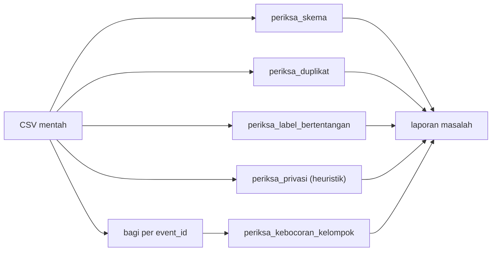

# Tahap B: Dataset, Provenance, dan Validasi

!!! abstract "Info materi"
    **Tingkat kesulitan:** Menengah. **Estimasi waktu:** 120 menit.
    **Jenis kode:** ringan (`examples/disaster-classification/proyek/tahap_b_dataset.py`, `nlp_hub/validasi_data.py`). Data: dua berkas **sintetis** di `examples/disaster-classification/data/`.

## Tujuan pembelajaran

- [ ] Menyebut skema minimal dataset (`text`, `label`) dan metadata opsional yang berguna (`event_id`, `source_id`).
- [ ] Membedakan dataset sintetis latihan dari data penelitian nyata, dan menjelaskan mengapa angka pada yang pertama tidak boleh dilaporkan sebagai hasil ilmiah.
- [ ] Membaca `DATA_CARD.md`: provenance, cara label ditetapkan, keterbatasan, dan penggunaan yang tidak sesuai.
- [ ] Menjalankan validasi skema, duplikat, label bertentangan, dan pemeriksaan privasi heuristik.
- [ ] Mendeteksi risiko kebocoran antarpostingan dari kejadian yang sama.
- [ ] Menyatakan syarat memakai data nyata (izin, anonimisasi, dokumentasi).

## Prasyarat

- [Tahap A](tahap-a-definisi-masalah.md).
- [CSV dan JSON](../level-1-python/csv-json.md), [pandas](../level-1-python/pandas-dasar.md), [Missing Values dan Duplikasi](../level-1-python/missing-values-duplikasi.md).

## Pengantar dan motivasi

Banyak kegagalan proyek NLP berasal dari data, bukan model: label tidak konsisten, teks yang sama muncul di latih dan uji, atau data pribadi ikut tersimpan. Tahap B menetapkan apa yang kita miliki, dari mana asalnya, dan apa yang tidak boleh disimpulkan darinya.

## Konsep dasar

| Istilah | Arti |
|---|---|
| **Skema** | Kolom dan tipe yang diharapkan |
| **Provenance** | Asal-usul data: siapa membuat, dengan cara apa, kapan |
| **Data sintetis** | Data buatan (di sini dari templat atau tulisan tangan), bukan cuplikan nyata |
| **Ground truth** | Label yang dianggap benar; pada data ini **tidak ada** ground truth independen |
| **`event_id` / grup** | Penanda kejadian yang sama; dipakai agar pos satu kejadian tidak terbelah ke latih dan uji |
| **Kebocoran antarpostingan** | Pos yang hampir sama muncul di latih dan uji sehingga skor uji terlalu optimistis |
| **PII** | Informasi yang dapat mengidentifikasi seseorang |
| **Data card** | Dokumen yang menjelaskan dataset |

## Penjelasan mendalam

### Dua berkas dataset

| Berkas | Isi | Cara dibuat | Fungsi |
|---|---|---|---|
| `synthetic_disaster_id.csv` | 574 baris, 10 duplikat disengaja, 35% Emergency | Dibangkitkan dari templat (`generate_dataset.py`, seed 20261023) | Latih/validasi/uji |
| `handwritten_challenge_id.csv` | 48 baris (24 Emergency, 24 Non-Emergency) | Ditulis tangan satu orang (`tulis_uji_tangan.py`) | Uji gaya berbeda |

### Skema dan metadata

Skema minimal sesuai spesifikasi: `text` dan `label` (`Emergency` atau `Non-Emergency`). Berkas sintetis menambah `source_id`, `event_id`, `post_type`, dan `template_id`. Metadata ini **ada karena datanya sintetis dan berguna untuk pembagian**; pada data nyata Anda tidak wajib (dan tidak boleh) mengungkapkan identitas pengguna, dan hanya memakai metadata yang sah serta benar-benar diperlukan.

### Keterbatasan yang tertulis di data card

- Label ditentukan oleh **jenis templat** (data templat) atau **satu orang** (tulis-tangan): tidak ada anotator independen dan tidak ada ukuran kesepakatan.
- Teks sangat berulang; variasi gaya (singkatan, huruf berulang, emoji, hashtag, URL) ditambahkan dengan peluang yang sama untuk kedua label.
- Hanya enam bahaya pada set latih (banjir, gempa, kebakaran, longsor, angin kencang, letusan gunung).
- Proporsi Emergency 35% dipilih penulis; bukan estimasi dunia nyata.
- Penggunaan yang tidak sesuai: mengklaim performa pada postingan nyata, melatih sistem tanggap darurat sungguhan, melaporkan skor sebagai hasil penelitian.

### Data nyata: syarat sebelum dipakai

Proyek ini **tidak mengunduh atau men-scrape** Twitter/X dan tidak mengunduh dataset eksternal secara otomatis. Jika Anda ingin memakai data nyata:

1. Periksa syarat layanan sumber dan izin penggunaan; dokumentasikan.
2. Catat provenance: sumber, tanggal pengambilan, metode, filter, jumlah, bahasa.
3. Hapus atau anonimkan identitas (nama pengguna, mention, tautan profil, nomor telepon, alamat); jangan menyimpan kredensial atau data mentah di repository publik.
4. Tentukan pelabel (≥2), pedoman ([Tahap A](tahap-a-definisi-masalah.md)), dan ukur kappa.
5. Tulis data card: kualitas label, bias, batasan penggunaan, risiko privasi.

## Cara kerja atau alur proses



## Contoh sederhana

Tabel kecil dengan satu label salah eja (`Darurat`), satu teks kosong, dan satu nomor telepon. Pemeriksa harus menandai ketiganya; bila tidak, kita tidak tahu ada masalah sampai model berperilaku aneh.

## Contoh dalam konteks Twitter/X kebencanaan

Bila seorang relawan mengumpulkan 500 pos dari laporan publik, tiga hal perlu diperiksa sebelum apa pun: apakah ada nomor telepon korban di teks, apakah satu kejadian menghasilkan puluhan pos hampir sama, dan apakah dua orang sepakat tentang label. Tahap B membuat pemeriksaan itu menjadi kode yang dapat diulang.

## Praktik Python

Berkas: `examples/disaster-classification/proyek/tahap_b_dataset.py`; fungsi di `nlp_hub/validasi_data.py`. Jalankan dari `examples/`.

### Bagian 1: memeriksa kedua berkas proyek

```python title="Bagian 1"
--8<-- "disaster-classification/proyek/tahap_b_dataset.py:periksa"
```

- `muat_dataset(hapus_duplikat=False)` memuat data **mentah** agar duplikat terlihat.
- `periksa_semua(df)` mengembalikan kamus `jenis pemeriksaan → daftar masalah`; daftar kosong berarti lolos.

```text title="Output nyata"
synthetic_disaster_id.csv (mentah): 574 baris, kolom ['source_id', 'event_id', 'post_type', 'template_id', 'text', 'label']
  skema              : lolos
  duplikat           : ['10 baris adalah duplikat persis dari baris sebelumnya']
  label_bertentangan : lolos
  privasi            : lolos
handwritten_challenge_id.csv: 48 baris, kolom ['source_id', 'text', 'label', 'catatan']
  skema              : lolos
  duplikat           : lolos
  label_bertentangan : lolos
  privasi            : lolos
```

Interpretasi: kedua berkas lolos skema, tidak ada label bertentangan, dan heuristik privasi tidak menemukan email, telepon, URL asing, atau mention asing. Dataset sintetis memang memuat **10 duplikat persis** (disengaja untuk meniru *retweet*). Lolosnya pemeriksaan privasi **bukan jaminan**: ia hanya mencari pola umum, dan pada data sintetis wajar bila bersih (URL berdomain `contoh.example`, akun berakhiran `_contoh`).

### Bagian 2: kebocoran kelompok

```python title="Bagian 2"
--8<-- "disaster-classification/proyek/tahap_b_dataset.py:bocor"
```

```text title="Output nyata"
pembagian per event_id    : tidak ada kebocoran kelompok
pembagian acak per baris  : ['61 event_id muncul di latih dan uji']
```

Interpretasi: pembagian per `event_id` tidak menyisakan kejadian yang sama di latih dan uji, sedangkan pembagian acak per baris menaruh **61** kejadian di kedua sisi. Namun jangan terlalu lega: pada [Tahap C](tahap-c-eda.md) kita melihat bahwa templat teks tetap beririsan.

### Bagian 3: pemeriksa menangkap data rusak

```python title="Bagian 3"
--8<-- "disaster-classification/proyek/tahap_b_dataset.py:rusak"
```

```text title="Output nyata"
  skema              : ['1 teks kosong atau hanya spasi', "label tidak dikenal: ['Darurat']"]
  duplikat           : ['1 baris adalah duplikat persis dari baris sebelumnya']
  label_bertentangan : ['1 teks identik punya label berbeda']
  privasi            : ['1 teks tampak memuat alamat email', '1 teks tampak memuat nomor telepon', '1 teks tampak memuat URL di luar contoh.example']
tanpa kolom label: {'skema': ["kolom wajib tidak ada: ['label']"]}
```

Interpretasi: tabel rusak enam baris menghasilkan semua peringatan yang diharapkan: teks kosong dan label `Darurat`; satu duplikat (`banjir` dua kali); satu teks identik dengan label berbeda; email, telepon, dan URL asing terdeteksi. Tanpa kolom `label`, pemeriksa berhenti lebih awal dengan pesan jelas. Catatan teknis: pola mention memakai *lookbehind* `(?<![\w.])@` agar bagian setelah `@` pada alamat email tidak dianggap mention; versi pertama menandainya (satu positif palsu) sehingga polanya diperbaiki dan dijaga tes.

## Kesalahan umum dan debugging

| Gejala | Penyebab | Perbaikan |
|---|---|---|
| `KeyError: 'label'` | Nama kolom salah (`Label`, `kelas`) | Periksa `df.columns`; pakai `periksa_skema` |
| `FileNotFoundError` | Jalur relatif salah | Jalankan dari `examples/`; pakai `FOLDER_DATA` |
| Skor uji sangat tinggi | Duplikat/kejadian sama di latih dan uji | Pembagian per grup; periksa kebocoran |
| Label berbeda untuk teks sama | Pelabelan tidak konsisten | Tinjau dengan aturan Tahap A |
| Data pribadi lolos pemeriksa | Heuristik terbatas (nama, alamat bebas) | Tinjau manusia, anonimisasi, kebijakan |
| Mengira data sintetis cukup untuk klaim ilmiah | Salah paham | Data card: penggunaan tidak sesuai |
| Data mentah nyata masuk ke git | Lupa `.gitignore` | Jangan commit; periksa riwayat |

## Kelebihan dan keterbatasan

**Kelebihan:** pemeriksaan berulang dan teruji; data card membuat batas klaim eksplisit.
**Keterbatasan:** heuristik privasi tidak lengkap; tidak memeriksa bias, kesalahan label halus, atau pelanggaran izin; data sintetis menyembunyikan masalah data nyata (misalnya typo yang tidak teratur, bahasa daerah).

## Latihan bertahap

1. **Konseptual.** Mengapa metadata `event_id` boleh ada di data sintetis tetapi harus dipertimbangkan hati-hati pada data nyata?
2. **Membaca output.** Apa arti "61 event_id muncul di latih dan uji" dan mengapa tidak muncul pada pembagian per `event_id`?
3. **Membaca kode.** Mengapa pemeriksaan privasi mengecualikan domain `contoh.example` dan akhiran `_contoh`?
4. **Debugging.** `periksa_semua` mengembalikan `{"skema": ["kolom wajib tidak ada: ['label']"]}`. Apa yang Anda periksa lebih dulu?
5. **Menulis.** Tambahkan pemeriksaan "teks lebih dari 280 karakter" dan ujikan.
6. **Mini-proyek.** Tulis data card satu halaman untuk dataset 100 pos fiktif yang Anda buat, memuat provenance, cara label, keterbatasan, dan penggunaan tidak sesuai.

## Kunci jawaban dan pembahasan

??? success "Jawaban 1"
    `event_id` membantu pembagian aman, tetapi pada data nyata ia dapat membuka identitas kejadian/lokasi atau pengguna. Gunakan hanya metadata yang sah, benar-benar diperlukan, dan teranonimkan.

??? success "Jawaban 2"
    Ada 61 kejadian fiktif yang pos-posnya terbagi ke latih dan uji pada pembagian acak per baris. Pembagian per `event_id` menempatkan seluruh pos satu kejadian pada sisi yang sama, sehingga irisannya nol.

??? success "Jawaban 3"
    Dataset sintetis memang memakai domain dan akun contoh yang aman. Tanpa pengecualian, pemeriksa akan menandai seluruh data sintetis sebagai masalah dan hasilnya tidak informatif. Pada data nyata pengecualian itu tidak berlaku.

??? success "Jawaban 4"
    Nama kolom: mungkin `Label`, `kelas`, atau `category`. Cetak `df.columns`, periksa pemisah CSV dan encoding (`sep`, `encoding`), lalu ganti nama kolom.

??? success "Jawaban 5"
    ```python
    def periksa_panjang(df, batas=280):
        n = int((df["text"].astype(str).str.len() > batas).sum())
        return [f"{n} teks lebih panjang dari {batas} karakter"] if n else []
    ```
    Uji: DataFrame dengan satu teks 281 karakter menghasilkan satu pesan; teks 280 karakter menghasilkan daftar kosong (batas inklusif).

??? success "Jawaban 6"
    Tidak ada kunci tunggal. Data card yang baik menyebut bahwa data fiktif, siapa pembuat, bagaimana label ditentukan, tidak ada ground truth, risiko salah pakai, dan tidak boleh dipakai melatih sistem nyata.

## Kuis singkat

**1.** Apakah dataset ini ground truth?

??? success "Jawaban"
    Tidak; label berasal dari templat atau satu penulis.

**2.** Mengapa duplikat tidak otomatis dibuang di pemeriksa?

??? success "Jawaban"
    Duplikat bisa wajar (mis. *retweet*) tetapi harus diketahui; keputusan membuangnya adalah keputusan peneliti.

**3.** Apakah lolos pemeriksaan privasi berarti aman?

??? success "Jawaban"
    Tidak; heuristik hanya menangkap pola umum.

## Ringkasan

- Dua dataset sintetis: 574 baris templat (10 duplikat disengaja) dan 48 tulis-tangan; tidak ada ground truth independen.
- Pemeriksa skema, duplikat, label bertentangan, privasi, dan kebocoran kelompok; semuanya diuji.
- Pembagian per kejadian: 0 kejadian beririsan; pembagian acak: 61.
- Data nyata memerlukan izin, anonimisasi, pelabel independen, dan data card.

## Glosarium istilah baru

Provenance
:   Asal-usul dan riwayat pembuatan data.

Data card
:   Dokumen yang menjelaskan dataset.

Ground truth
:   Label yang dianggap benar sebagai acuan evaluasi.

## Referensi

- Gebru, T., dkk. (2021). Datasheets for datasets. *Communications of the ACM*, 64(12) (makalah akademik; judul, penulis, dan tahun diperiksa via arXiv/Crossref/ACL Anthology; venue tidak diverifikasi terpisah).
- `examples/disaster-classification/DATA_CARD.md` (dokumen proyek).
- pandas, `DataFrame.duplicated`: <https://pandas.pydata.org/docs/reference/api/pandas.DataFrame.duplicated.html> (dokumentasi resmi).

## Materi berikutnya

[Tahap C: Exploratory Data Analysis](tahap-c-eda.md)
