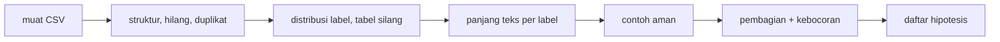

# Tahap C: Exploratory Data Analysis (EDA)

!!! abstract "Info materi"
    **Tingkat kesulitan:** Menengah. **Estimasi waktu:** 120 menit.
    **Jenis kode:** ringan: skrip `examples/disaster-classification/proyek/tahap_c_eda.py` dan notebook `tahap_c_eda.ipynb` (sudah dieksekusi dengan `build_notebooks.py 7`). Data: dataset **sintetis**.

## Tujuan pembelajaran

- [ ] Membaca dataset dan memeriksa struktur, tipe, nilai hilang, dan duplikat.
- [ ] Menghitung distribusi label dan menafsirkan ketidakseimbangan kelas.
- [ ] Menganalisis panjang teks per label dan mengenali jalan pintas (*shortcut*) yang mungkin.
- [ ] Menampilkan contoh teks secara aman.
- [ ] Mengidentifikasi risiko kebocoran data antara latih dan uji.
- [ ] Menuliskan temuan EDA sebagai hipotesis yang diuji kemudian, bukan kesimpulan.

## Prasyarat

- [Tahap B](tahap-b-dataset.md).
- [pandas](../level-1-python/pandas-dasar.md) (`groupby`, `value_counts`, `crosstab`), [Statistik Korpus](../level-3-representasi-teks/statistik-korpus.md).

## Pengantar dan motivasi

EDA adalah memeriksa data **sebelum** memodelkannya. Tujuannya bukan membuat grafik indah, melainkan menemukan hal yang akan menipu model atau evaluasi: kelas yang timpang, kolom yang bocor, teks yang bedanya hanya panjang, atau templat yang berulang.

## Konsep dasar

| Istilah | Arti |
|---|---|
| **EDA** | Analisis awal untuk memahami data dan mencari masalah |
| **Distribusi label** | Berapa banyak contoh tiap kelas |
| **Tabel silang** | Hitungan dua variabel kategorik sekaligus |
| **Statistik deskriptif** | Rata-rata, simpangan baku, kuartil, minimum, maksimum |
| **Shortcut** | Sifat yang berkorelasi dengan label tetapi bukan sinyal yang dimaksud (mis. panjang teks) |
| **Kebocoran** | Informasi uji yang ikut memengaruhi pelatihan |

## Penjelasan mendalam

EDA yang baik mengajukan pertanyaan tertentu, bukan melihat-lihat tanpa arah:

1. **Apakah struktur data sesuai harapan?** Kolom, tipe, nilai hilang, duplikat.
2. **Seberapa timpang kelasnya?** Menentukan metrik (akurasi menipu) dan baseline.
3. **Apakah label dapat ditebak dari sesuatu yang bukan teks?** Panjang, jenis templat, kolom metadata.
4. **Apakah pembagian latih/uji bersih?** Irisan kejadian, irisan templat, duplikat.
5. **Apakah contoh teks sesuai bayangan kita?** Lihat beberapa, dengan aman.

Hasil EDA dicatat sebagai **hipotesis** ("Emergency lebih panjang; model mungkin memakainya") yang diuji di tahap berikutnya.

## Cara kerja atau alur proses



## Contoh sederhana

Dataset 100 baris: 90 Non-Emergency, 10 Emergency. Model yang selalu menjawab Non-Emergency akurasinya 0,90 tanpa menemukan satu pun Emergency. EDA yang menghitung distribusi label menangkap hal ini sebelum metrik apa pun dilihat.

## Contoh dalam konteks Twitter/X kebencanaan

Pada dataset ini, Emergency (laporan, bantuan) cenderung lebih panjang karena memuat alamat dan detail, sementara pos tidak terkait lebih pendek. Jika model memakai panjang teks sebagai petunjuk, ia akan tampak baik tetapi gagal pada pesan darurat yang singkat ("Banjir! Tolong!").

## Praktik Python

Berkas: `examples/disaster-classification/proyek/tahap_c_eda.py` dan notebook `tahap_c_eda.ipynb` (berisi sel yang sama dengan penjelasan Markdown; jalankan dari atas ke bawah). Pustaka: **pandas** (tabel) dan `nlp_hub.data`. Jalankan dari `examples/`.

### Bagian 1: struktur dan kualitas

```python title="Bagian 1"
--8<-- "disaster-classification/proyek/tahap_c_eda.py:struktur"
```

- `df.dtypes` menampilkan tipe kolom; `df.isna().sum()` menghitung nilai hilang per kolom; `df["text"].duplicated()` menandai baris yang teksnya sudah muncul sebelumnya.

```text title="Output nyata"
bentuk: (574, 6)
source_id      str
event_id       str
post_type      str
template_id    str
text           str
label          str
nilai hilang per kolom: {'source_id': 0, 'event_id': 0, 'post_type': 0, 'template_id': 0, 'text': 0, 'label': 0}
duplikat teks persis  : 10
```

Interpretasi: 574 baris, enam kolom bertipe teks (`str`; pandas 3, pandas lama menampilkan `object`), tidak ada nilai hilang, 10 duplikat persis (disengaja).

### Bagian 2: distribusi label dan jenis postingan

```python title="Bagian 2"
--8<-- "disaster-classification/proyek/tahap_c_eda.py:label"
```

```text title="Output nyata"
label
Non-Emergency    373
Emergency        201
proporsi Emergency: 0.35
label          Emergency  Non-Emergency
post_type
bantuan               78              0
berita                 0             49
candaan                0             37
edukasi                0             43
info_lama              0             40
laporan              123              0
opini                  0             43
peringatan             0             39
tidak_terkait          0            122
```

Interpretasi: 373 Non-Emergency dan 201 Emergency; Emergency 35%. Model yang selalu menjawab Non-Emergency mendapat akurasi 373/574 = 0,650 (pada versi tanpa duplikat 0,661), jadi akurasi harus dibaca terhadap baseline ini. Tabel silang memperlihatkan **label ditentukan sepenuhnya oleh `post_type`**: semua `laporan` dan `bantuan` Emergency, sisanya Non-Emergency. Pada data nyata tabel ini tidak akan sebersih itu; ia mengingatkan bahwa label di dataset ini adalah konstruksi, bukan pengamatan.

### Bagian 3: panjang teks

```python title="Bagian 3"
--8<-- "disaster-classification/proyek/tahap_c_eda.py:panjang"
```

- `df.groupby("label")[[...]].describe()` menghitung statistik per label; `.T` membalik baris-kolom agar mudah dibaca.

```text title="Output nyata"
label          Emergency  Non-Emergency
panjang count      201.0          373.0
        mean        96.7           81.1
        std         16.5           20.8
        min         63.0           40.0
        25%         85.0           66.0
        50%         95.0           79.0
        75%        104.0           93.0
        max        148.0          145.0
n_kata  count      201.0          373.0
        mean        14.8           11.1
        std          2.1            2.3
        min         10.0            6.0
        25%         13.0            9.0
        50%         15.0           11.0
        75%         16.0           13.0
        max         21.0           18.0
```

Interpretasi: rata-rata panjang Emergency 96,7 karakter (14,8 kata) vs Non-Emergency 81,1 (11,1 kata). Distribusinya tumpang tindih (rentang 63–148 vs 40–145), jadi panjang bukan pemisah sempurna, tetapi cukup berbeda untuk menjadi **petunjuk kebetulan** (hipotesis H1: model dapat memakai panjang). Ini dari templat generator, bukan sifat pesan darurat nyata.

### Bagian 4: contoh yang aman

```python title="Bagian 4"
--8<-- "disaster-classification/proyek/tahap_c_eda.py:aman"
```

```text title="Output nyata"
contoh teks (sintetis; dipotong 70 karakter):
  [Emergency] Setelah gempa tadi, atap ruko di Gang Flamboyan RT 11 runtuh & ada yan
  [Emergency] Jalan menuju Kelurahan Bumi Indah tertutup longsor, ada mobil yang ter
  [Non-Emergency] Tips menghadapi banjir: kenali jalur evakuasi dan kumpulkan nomor daru
  [Non-Emergency] Musim pancaroba sudah dekat, waspada gempa ya semuanya. 😂
```

Interpretasi: contoh dipotong 70 karakter dan hanya sedikit yang ditampilkan. Pada data nyata, hindari mencetak banyak teks mentah ke notebook yang akan dibagikan; keluaran notebook ikut tersimpan di repository.

### Bagian 5: risiko kebocoran

```python title="Bagian 5"
--8<-- "disaster-classification/proyek/tahap_c_eda.py:bocor"
```

```text title="Output nyata"
baris latih/uji: 452 / 112
event_id beririsan: 0
templat uji yang juga ada di latih: 59 dari 61
```

Interpretasi: tidak ada `event_id` yang beririsan, tetapi **59 dari 61 templat uji juga ada di latih**. Kalimat dari templat yang sama hampir identik kecuali nama tempat dan gaya; skor uji sintetis yang sangat tinggi (F1 makro ≈ 0,98) karena itu mengukur "mengenali templat", bukan "memahami darurat". Inilah alasan set tulis-tangan dipertahankan.

### Daftar hipotesis dari EDA

| # | Hipotesis | Cara menguji | Tahap |
|---|---|---|---|
| H1 | Model memakai panjang teks | Latih dengan fitur panjang saja; bandingkan | E–F |
| H2 | Kata alamat (`rt`, `jalan`) menjadi penanda Emergency | Koefisien model ([Interpretabilitas](../level-7-advanced-nlp/interpretabilitas.md)) | F |
| H3 | Skor uji sintetis terlalu optimistis | Bandingkan dengan tulis-tangan | F |
| H4 | Normalisasi informal tidak banyak berpengaruh pada data bertemplat | Bandingkan strategi ([Tahap D](tahap-d-preprocessing.md)) | D |

## Kesalahan umum dan debugging

| Gejala | Penyebab | Perbaikan |
|---|---|---|
| Menganalisis seluruh data lalu membagi | Keputusan memakai informasi uji | Lakukan EDA pembentuk keputusan hanya pada data latih |
| Menyimpulkan dari grafik tanpa angka | Visual menipu | Sertakan jumlah dan statistik |
| Mencetak seluruh teks | Risiko privasi dan notebook besar | `head`, potong, hindari data nyata mentah |
| `describe()` mengabaikan kolom teks | Hanya numerik secara bawaan | Hitung panjang/kata dahulu |
| Mengira korelasi = sebab | EDA tidak menunjukkan kausalitas | Tulis sebagai hipotesis dan uji |
| Memakai distribusi label dataset sebagai prior dunia nyata | 35% adalah pilihan penulis | Nyatakan keterbatasan |

## Kelebihan dan keterbatasan

**Kelebihan:** murah, cepat, menemukan masalah sebelum biaya pemodelan.
**Keterbatasan:** EDA ini pada data sintetis sehingga tidak menggambarkan postingan nyata; panjang adalah satu dari banyak kemungkinan shortcut; tidak ada visualisasi grafis di halaman ini (hanya statistik).

## Latihan bertahap

1. **Konseptual.** Mengapa distribusi label harus dilihat sebelum memilih metrik?
2. **Membaca output.** Berapa akurasi baseline "selalu Non-Emergency" pada 574 baris mentah?
3. **Membaca kode.** Apa fungsi `.T` pada Bagian 3?
4. **Debugging.** `df.groupby("label")["panjang"].describe()` memberi `KeyError: 'panjang'`. Mengapa?
5. **Eksperimen.** Latih regresi logistik hanya dengan fitur panjang karakter. Seberapa jauh F1 makro dari model TF-IDF? Apa artinya?
6. **Mini-proyek.** Tambahkan dua hipotesis H5 dan H6 dari pengamatan Anda sendiri pada data, lengkap cara mengujinya.

## Kunci jawaban dan pembahasan

??? success "Jawaban 1"
    Metrik yang cocok bergantung pada proporsi kelas. Pada kelas timpang, akurasi menipu; recall/presisi kelas minoritas dan baseline lebih bermakna.

??? success "Jawaban 2"
    373/574 = 0,650. (Setelah duplikat dibuang, 0,661 seperti di Level 5.)

??? success "Jawaban 3"
    `.T` mentranspos tabel: statistik menjadi baris dan (kolom, label) menjadi kolom, sehingga lebih ringkas dibaca.

??? success "Jawaban 4"
    Kolom `panjang` belum dibuat pada DataFrame itu; ia dibuat lewat `df.assign(panjang=...)` pada Bagian 3. Jalankan sel pembuatnya lebih dulu dan simpan hasilnya ke variabel.

??? success "Jawaban 5"
    Jalankan sendiri: `LogisticRegression().fit(df[["panjang"]], y)` lalu evaluasi dengan protokol per kejadian. Harapan: lebih baik dari baseline tetapi jauh di bawah TF-IDF; hasil yang jauh di atas tebakan menandakan panjang memang shortcut. Laporkan angkanya dengan jujur; angka itu tidak ada di halaman ini.

??? success "Jawaban 6"
    Contoh: H5 "banyak pos Emergency memuat angka (RT/RW, jam)"; uji dengan menghitung fraksi pos memuat digit per label. H6 "emoji lebih sering pada Non-Emergency (candaan)"; uji dengan tabel silang. Nilai kualitas hipotesis: spesifik dan dapat disalahkan.

## Kuis singkat

**1.** Mengapa tabel silang `post_type` × `label` terlalu bersih?

??? success "Jawaban"
    Label dibentuk dari jenis templat; pada data nyata tidak sebersih itu.

**2.** Apa risiko 59 dari 61 templat uji ada di latih?

??? success "Jawaban"
    Skor uji mengukur pengenalan templat, bukan generalisasi.

**3.** EDA menghasilkan kesimpulan atau hipotesis?

??? success "Jawaban"
    Hipotesis yang diuji kemudian.

## Ringkasan

- 574 baris, tanpa nilai hilang, 10 duplikat; Emergency 35% (201 vs 373).
- Label ditentukan sepenuhnya oleh `post_type`; panjang rata-rata Emergency 96,7 vs 81,1 karakter.
- Tidak ada `event_id` beririsan, tetapi 59 dari 61 templat uji ada di latih.
- Empat hipotesis dicatat untuk diuji di tahap berikutnya.

## Glosarium istilah baru

EDA
:   Analisis data eksploratif.

Tabel silang
:   Hitungan dua variabel kategorik sekaligus.

Shortcut
:   Sifat kebetulan yang berkorelasi dengan label.

## Referensi

- Tukey, J. W. (1977). *Exploratory Data Analysis*. Addison-Wesley (buku; belum diperiksa daring).
- pandas, `groupby` dan `describe`: <https://pandas.pydata.org/docs/user_guide/groupby.html> (dokumentasi resmi).

## Materi berikutnya

[Tahap D: Preprocessing](tahap-d-preprocessing.md)
