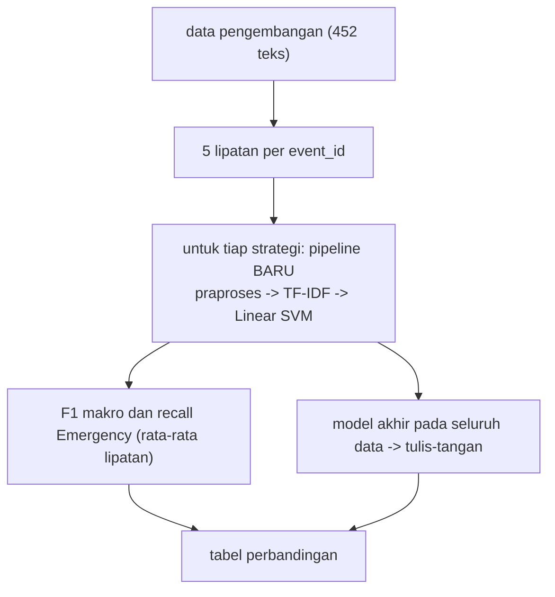

# Tahap D: Preprocessing yang Modular, Teruji, dan Dibandingkan

!!! abstract "Info materi"
    **Tingkat kesulitan:** Menengah. **Estimasi waktu:** 120 menit.
    **Jenis kode:** ringan (`examples/disaster-classification/proyek/tahap_d_praproses.py`; fungsi di `nlp_hub/preprocessing.py` yang dibangun dan diuji di [Level 2](../level-2-fondasi-teks/index.md)). Data: **sintetis**.

## Tujuan pembelajaran

- [ ] Menjelaskan prinsip preprocessing modular: fungsi kecil, tanpa keadaan, dapat diuji, dibungkus dalam pipeline.
- [ ] Membandingkan beberapa strategi preprocessing secara empiris dengan protokol yang sama.
- [ ] Menjelaskan mengapa tidak ada strategi yang boleh disebut "terbaik" sebelum eksperimen, dan mengapa hasil di sini tidak menetapkannya.
- [ ] Menempatkan semua langkah yang mempelajari statistik korpus di dalam pipeline pelatihan untuk mencegah kebocoran.
- [ ] Menafsirkan selisih kecil pada set kecil dengan hati-hati.

## Prasyarat

- [Level 2](../level-2-fondasi-teks/index.md), terutama [Perbandingan Pipeline](../level-2-fondasi-teks/perbandingan-pipeline.md) dan [Data Leakage Preprocessing](../level-2-fondasi-teks/leakage-preprocessing.md).
- [Tahap C](tahap-c-eda.md).

## Pengantar dan motivasi

Preprocessing sering dianggap "pasti membantu". Di data media sosial, ia bisa membantu (menormalkan `udh` → `sudah`), tidak berpengaruh, atau merugikan (membuang `tidak` sebagai stopword mengubah makna). Satu-satunya cara tahu adalah mengukur, dengan protokol yang adil.

## Konsep dasar

| Istilah | Arti |
|---|---|
| **Preprocessing modular** | Setiap langkah adalah fungsi kecil yang dapat diuji sendiri |
| **Tanpa keadaan (*stateless*)** | Hasil hanya bergantung pada masukan, tidak mempelajari apa pun dari korpus |
| **Mempelajari korpus** | Langkah seperti kosakata TF-IDF atau IDF; harus di-`fit` hanya pada data latih |
| **Ablation** | Menambah/membuang satu komponen untuk mengukur kontribusinya |
| **Protokol sama** | Data, pembagian, model, metrik tetap; hanya preprocessing yang berubah |

## Penjelasan mendalam

### Modular dan teruji

`nlp_hub/preprocessing.py` berisi fungsi kecil (`normalisasi_unicode`, `ganti_url`, `proses_hashtag`, `proses_emoji`, `kurangi_huruf_berulang`, `normalisasi_informal`, `tandai_negasi`, ...) yang digabung oleh `praproses_token(teks, KonfigurasiPraproses(...))`. Konfigurasi adalah objek *frozen dataclass*: ia mendeskripsikan pilihan, bukan menjalankannya, sehingga mudah dibandingkan dan dicatat. Pembungkus `PraprosesTeks` membuatnya menjadi tahap pipeline scikit-learn, **tanpa keadaan**: `fit` tidak mempelajari apa pun.

### Letak kebocoran

Langkah yang mempelajari korpus (kosakata, IDF, pemilihan fitur) harus berada **di dalam** pipeline dan di-`fit` hanya pada data latih tiap lipatan. Langkah tanpa keadaan aman dipakai di mana pun. Level 2 membuktikan bahwa `fit` TF-IDF pada seluruh data mengubah skor; di sini kita memakai `buat_pipeline`, yang membuat pipeline baru tiap lipatan.

### Strategi yang dibandingkan

| Strategi | Perubahan terhadap dasar |
|---|---|
| minimal | tanpa normalisasi informal dan tanpa pengurangan huruf berulang |
| dasar (bawaan) | Unicode, URL/mention, hashtag, emoji → kata, huruf kecil, normalisasi informal |
| + negasi | menandai kata setelah `tidak`/`bukan` dengan `neg_` |
| + angka/waktu/lokasi | mengganti angka, jam, alamat dengan token khusus |
| + stopword konservatif | membuang kata fungsi dengan daftar konservatif |

## Cara kerja atau alur proses



## Contoh sederhana

"udh banjir, tidak ada korban". Dasar: `sudah banjir tidak ada korban`. Dengan negasi: `sudah banjir tidak neg_ada korban`. Fitur `neg_ada` berbeda dari `ada`, sehingga model dapat membedakan "ada korban" dari "tidak ada korban". Apakah itu membantu pada data kita adalah pertanyaan empiris.

## Contoh dalam konteks Twitter/X kebencanaan

"Toloooong!! air udh masuk rmh 😭 #BanjirParah" menjadi `tolong air sudah masuk rumah emo_menangis banjir parah` (dibuktikan di [Latihan Level 2–3](../latihan/level-2-3.md)): huruf berulang, singkatan, emoji, dan hashtag semua dinormalkan. Tujuannya mengurangi jumlah kata berbeda untuk makna yang sama.

## Praktik Python

Berkas: `examples/disaster-classification/proyek/tahap_d_praproses.py`. Jalankan dari `examples/`.

```python title="Membandingkan strategi"
--8<-- "disaster-classification/proyek/tahap_d_praproses.py:strategi"
```

- `STRATEGI` adalah kamus nama → `KonfigurasiPraproses`. `lambda k=k: buat_pipeline("svm", konfigurasi=k)` membuat fungsi yang mengembalikan pipeline **baru** tiap dipanggil; `k=k` mengikat nilai saat ini (tanpa itu semua lambda akan memakai nilai terakhir `k`: jebakan klasik Python).
- `evaluasi_pipeline` (Level 5) membuat model baru di tiap lipatan dan mengevaluasinya, lalu melatih satu model pada seluruh data pengembangan dan mengujinya pada tulis-tangan.
- Format `{...:12.3f}` menampilkan bilangan dengan tiga desimal dalam lebar 12 karakter.

```text title="Output nyata"
strategi                                F1 makro CV  recall E CV  recall E tulis-tangan
minimal (tanpa normalisasi informal)          0.995        0.994                  0.625
dasar (bawaan)                                0.995        0.994                  0.625
+ negasi                                      0.998        1.000                  0.667
+ angka/waktu/lokasi                          0.998        0.994                  0.708
+ stopword konservatif                        0.998        1.000                  0.458
```

Interpretasi yang jujur:

| Strategi | F1 makro CV | recall E CV | recall E tulis-tangan |
|---|---|---|---|
| minimal | 0,995 | 0,994 | 0,625 |
| dasar | 0,995 | 0,994 | 0,625 |
| + negasi | 0,998 | 1,000 | 0,667 |
| + angka/waktu/lokasi | 0,998 | 0,994 | 0,708 |
| + stopword konservatif | 0,998 | 1,000 | 0,458 |

- Pada **validasi silang** semuanya hampir sama (0,995–0,998): data bertemplat tidak membedakan strategi.
- "minimal" dan "dasar" menghasilkan angka identik: normalisasi informal tidak mengubah hasil pada ukuran ini (H4 dari Tahap C terdukung, secara terbatas).
- Pada **tulis-tangan** angkanya bergerak: negasi 0,667 dan angka/waktu/lokasi 0,708 sedikit lebih tinggi dari 0,625, sedangkan stopword konservatif **menurunkan** recall menjadi 0,458. Selisih 0,625 → 0,708 setara dengan **2 pesan** dari 24 (15 → 17), sedangkan 0,625 → 0,458 setara dengan 4 pesan (15 → 11). Dengan 24 Emergency dan satu seed, perbedaan sekecil itu tidak dapat dibedakan dari kebetulan (Level 5 menghitung selang 95% recall sekitar [0,43; 0,81] untuk 0,625).
- **Kesimpulan yang sah:** tidak ada strategi yang terbukti lebih baik; stopword mungkin merugikan (dugaan: membuang kata seperti `sudah`/`ini` yang di data ini ikut membawa petunjuk waktu; belum diuji); negasi dan lokasi layak diuji lagi pada data lebih besar. **Jangan memilih "angka/waktu/lokasi" sebagai strategi terbaik berdasarkan 0,708 pada tulis-tangan**: itu memilih menurut set evaluasi.

### Skrip terpadu

Seluruh fungsi preprocessing diuji di `examples/tests/test_preprocessing.py` dan `test_proyek.py`; protokol evaluasi di `test_eksperimen.py`.

## Kesalahan umum dan debugging

| Gejala | Penyebab | Perbaikan |
|---|---|---|
| Semua `lambda` memakai konfigurasi terakhir | Penutupan menangkap variabel, bukan nilai | `lambda k=k: ...` |
| Pipeline dipakai ulang antar strategi | Objek lama sudah dilatih | Buat pipeline baru tiap lipatan |
| TF-IDF di-`fit` pada semua data | Kebocoran | Letakkan di dalam `Pipeline` |
| Strategi dipilih dari skor tulis-tangan | Kebocoran seleksi | Pilih di validasi/CV |
| `tidak` terbuang sebagai stopword | Daftar stopword terlalu agresif | Daftar konservatif; periksa dampak ke negasi |
| Angka identik antar strategi | Strategi tidak benar-benar berbeda, atau data terlalu mudah | Periksa teks hasil praproses |
| Kesimpulan "negasi membantu" dari selisih 2 pesan | Set kecil | Selang kepercayaan, lebih banyak data |

## Kelebihan dan keterbatasan

**Kelebihan:** pembandingan adil dengan konfigurasi eksplisit; hasil dapat diulang; negatif dilaporkan.
**Keterbatasan:** satu model (Linear SVM), satu seed pembagian, data bertemplat, tulis-tangan 48 teks; kombinasi strategi tidak dicoba; tidak ada uji statistik; tidak mewakili data nyata.

## Latihan bertahap

1. **Konseptual.** Mengapa `PraprosesTeks.fit` tidak mempelajari apa-apa?
2. **Membaca output.** Strategi mana yang menurunkan recall tulis-tangan, dan berapa pesan selisihnya?
3. **Membaca kode.** Mengapa `lambda k=k:` dan bukan `lambda:`?
4. **Debugging.** Anda menambah `stopword="sastrawi"` dan recall tulis-tangan jatuh. Hipotesis penyebab apa yang akan Anda uji dahulu?
5. **Eksperimen.** Tambahkan strategi "negasi + angka/waktu/lokasi" dan bandingkan. Apa yang Anda simpulkan, dan apa yang tidak?
6. **Mini-proyek.** Rancang percobaan yang memutuskan strategi preprocessing terbaik dengan adil pada data nyata.

## Kunci jawaban dan pembahasan

??? success "Jawaban 1"
    Langkah-langkahnya hanya bergantung pada teks masuk dan parameter (kamus, aturan). Tidak ada statistik korpus yang dipelajari, sehingga tidak ada risiko kebocoran dari memakainya sebelum pemisahan data.

??? success "Jawaban 2"
    Stopword konservatif: 0,625 → 0,458, selisih 4 pesan dari 24 (15 → 11).

??? success "Jawaban 3"
    Tanpa `k=k`, fungsi lambda mencari `k` saat dipanggil, yaitu nilai terakhir loop. Dengan nilai bawaan `k=k`, nilai pada saat lambda dibuat disimpan.

??? success "Jawaban 4"
    Daftar Sastrawi memuat kata penting seperti `tidak`, `belum`, `tolong` (Level 2 menunjukkannya). Periksa kata apa yang terbuang dari pesan Emergency yang jadi FN; bandingkan dengan daftar konservatif; uji ulang tanpa kata-kata itu.

??? success "Jawaban 5"
    Tambahkan entri `KonfigurasiPraproses(negasi=True, angka_waktu_lokasi=True)`. Yang dapat disimpulkan hanya bila selang kepercayaan terpisah; selisih beberapa pesan pada 24 Emergency tidak cukup. Jangan menyatakan kombinasi sebagai terbaik dari satu run.

??? success "Jawaban 6"
    Kumpulkan data nyata yang sah dan cukup besar; pembagian per kejadian/waktu; pilih strategi lewat validasi silang berkelompok dengan beberapa seed; laporkan rata-rata ± simpangan baku dan selang bootstrap; uji strategi terpilih sekali pada uji terpisah; periksa dampak per irisan.

## Kuis singkat

**1.** Langkah mana yang harus di-`fit` hanya pada data latih?

??? success "Jawaban"
    Yang mempelajari korpus: kosakata/IDF TF-IDF, pemilihan fitur.

**2.** Apakah "angka/waktu/lokasi" terbukti strategi terbaik?

??? success "Jawaban"
    Tidak; selisih 2 pesan pada set kecil dan dipilih dari set evaluasi.

**3.** Mengapa stopword konservatif mungkin merugikan?

??? success "Jawaban"
    Dugaan: kata yang dibuang membawa petunjuk; belum diuji.

## Ringkasan

- Preprocessing modular, tanpa keadaan, dan dibungkus pipeline.
- Validasi silang: semua strategi 0,995–0,998 F1 makro; tulis-tangan 0,458–0,708 recall Emergency.
- Tidak ada strategi yang terbukti terbaik; stopword konservatif menurunkan recall (4 pesan).
- Pilihan strategi tidak boleh dibuat dari set tulis-tangan.

## Glosarium istilah baru

Ablation
:   Menambah atau mencabut komponen untuk mengukur kontribusinya.

*Frozen dataclass*
:   Objek data yang tidak dapat diubah setelah dibuat; dipakai untuk konfigurasi.

## Referensi

- Python `dataclasses`: <https://docs.python.org/3/library/dataclasses.html> (dokumentasi resmi).
- scikit-learn, kesalahan umum (kebocoran data): <https://scikit-learn.org/stable/common_pitfalls.html> (dokumentasi resmi).

## Materi berikutnya

[Tahap E: Modeling](tahap-e-modeling.md)
