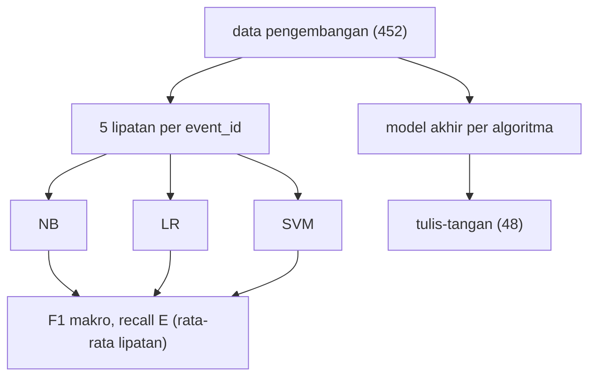

# Tahap E: Modeling Baseline (TF-IDF + NB, Regresi Logistik, Linear SVM)

!!! abstract "Info materi"
    **Tingkat kesulitan:** Menengah. **Estimasi waktu:** 150 menit.
    **Jenis kode:** ringan (`examples/disaster-classification/proyek/tahap_e_model.py`, `nlp_hub/modeling.py`, `nlp_hub/eksperimen.py`). Data: **sintetis**.

## Tujuan pembelajaran

- [ ] Membangun tiga baseline yang sebanding: TF-IDF + Multinomial Naive Bayes, Logistic Regression, dan Linear SVM.
- [ ] Menjelaskan mengapa pembagian dan evaluasi harus identik untuk perbandingan yang adil.
- [ ] Menjalankan validasi silang berkelompok per `event_id` dengan model baru di tiap lipatan.
- [ ] Menafsirkan perbedaan peringkat antara validasi silang dan set tulis-tangan.
- [ ] Menyebut mengapa tidak ada model yang boleh dipilih dari set tulis-tangan.
- [ ] Mengukur waktu latih dengan benar dan menyatakan batasnya.

## Prasyarat

- [Level 4](../level-4-machine-learning/index.md) (NB, LR, SVM, pipeline), [Level 5](../level-5-evaluasi/index.md).
- [Tahap D](tahap-d-preprocessing.md).

## Pengantar dan motivasi

Sebelum mencoba model rumit, kita butuh **baseline** yang kuat dan murah. Baseline menjawab: seberapa jauh kita dapat sampai dengan fitur sederhana? Tanpanya, hasil deep learning tidak punya pembanding.

## Konsep dasar

| Istilah | Arti |
|---|---|
| **Baseline** | Model sederhana sebagai pembanding |
| **Pipeline** | Rangkaian praproses → TF-IDF → model sebagai satu objek |
| **Validasi silang berkelompok** | Data dibagi ke $K$ lipatan; satu kejadian (`event_id`) selalu di lipatan yang sama |
| **Protokol yang sama** | Data, lipatan, seed, dan metrik identik untuk semua model |
| **Waktu latih** | Waktu `fit` satu model; bergantung mesin dan beban lain |

## Penjelasan mendalam

### Tiga model, satu cara membuatnya

`buat_pipeline(kode)` mengembalikan pipeline **baru** dan belum dilatih untuk `nb` (MultinomialNB), `lr` (LogisticRegression), atau `svm` (LinearSVC). Semua memakai praproses dasar dan `TfidfVectorizer` unigram yang sama; hanya algoritma yang berbeda.

- **Naive Bayes** menghitung peluang kelas dari frekuensi kata dengan asumsi kata saling bebas; cepat dan kuat pada teks pendek.
- **Regresi logistik** mempelajari bobot linear per kata dan mengubah skor menjadi peluang lewat sigmoid; regularisasi $C$ mengatur kerumitan.
- **Linear SVM** mencari hyperplane dengan margin terbesar; keluarannya skor jarak, bukan peluang.

### Protokol

`evaluasi_pipeline` (Level 5) membagi data pengembangan (452 teks) ke 5 lipatan menurut `event_id` (StratifiedGroupKFold), membuat model baru tiap lipatan, mengevaluasi di lipatan uji, lalu melatih satu model pada seluruh data pengembangan dan mengujinya pada tulis-tangan. Model Level 5 dipilih (Linear SVM) dari **F1 makro validasi silang**, bukan dari tulis-tangan.

## Cara kerja atau alur proses



## Contoh sederhana

Tiga model dilatih pada data yang sama; jika SVM mendapat F1 makro 0,995 dan LR 0,975 pada validasi silang, SVM unggul di sana. Itu tidak otomatis berarti SVM lebih baik pada data bergaya lain.

## Contoh dalam konteks Twitter/X kebencanaan

"Tolong, air banjir sudah masuk ke rumah kami." tampak mudah bagi ketiganya. "Astaga dapur tetangga meledak, apinya udah ngejalar ke atap" (tulis-tangan) tidak punya kata `tolong`/`banjir`; di sinilah baseline TF-IDF diuji.

## Praktik Python

Berkas: `examples/disaster-classification/proyek/tahap_e_model.py`. Jalankan dari `examples/`.

```python title="Bagian 1: validasi silang dan tulis-tangan"
--8<-- "disaster-classification/proyek/tahap_e_model.py:cv"
```

- `lambda n=nama: buat_pipeline(n)` membuat fungsi yang mengembalikan pipeline baru; `n=nama` mengikat nilai saat ini (lihat [Tahap D](tahap-d-preprocessing.md)).
- `hasil[nama]["cv_rata"]` berisi rata-rata metrik lipatan, `cv_std` simpangan baku lipatan, dan `tangan` metrik tulis-tangan.

```text title="Output nyata"
pembagian: 5 lipatan per event_id pada 452 teks pengembangan; model dibuat baru di tiap lipatan
nb   CV F1 makro 0.983 ± 0.010 | CV recall E 0.994 | tulis-tangan recall E 0.833
lr   CV F1 makro 0.975 ± 0.014 | CV recall E 0.941 | tulis-tangan recall E 0.417
svm  CV F1 makro 0.995 ± 0.006 | CV recall E 0.994 | tulis-tangan recall E 0.625
```

Interpretasi:

| Model | CV F1 makro | CV recall E | Tulis-tangan recall E |
|---|---|---|---|
| NB | 0,983 ± 0,010 | 0,994 | **0,833** |
| LR | 0,975 ± 0,014 | 0,941 | 0,417 |
| SVM | **0,995** ± 0,006 | 0,994 | 0,625 |

- Pada validasi silang ketiganya sangat tinggi dan peringkatnya SVM > NB > LR (selisih kecil, mendekati simpangan baku).
- Pada tulis-tangan peringkatnya **berbalik**: NB (0,833) > SVM (0,625) > LR (0,417). Skor validasi silang tidak meramalkan performa pada gaya lain.
- NB menemukan 20 dari 24 pesan darurat, LR hanya 10. Meski demikian, memilih NB "karena tulis-tangan" adalah memilih menurut set evaluasi: set kecil, satu pelabel, satu pembagian. Model Level 5 tetap SVM karena dipilih dari validasi silang; alasan peringkat berbalik tidak diselidiki di sini (dugaan: NB lebih tahan terhadap kata yang tidak terlihat karena penghalusan; belum diuji).

```python title="Bagian 2: waktu latih"
--8<-- "disaster-classification/proyek/tahap_e_model.py:waktu"
```

```text title="Output nyata: waktu berubah-ubah"
nb   waktu latih satu model pada 452 teks: 9 ms
lr   waktu latih satu model pada 452 teks: 11 ms
svm  waktu latih satu model pada 452 teks: 9 ms
```

Interpretasi: melatih satu model pada 452 teks memerlukan sekitar 9–12 milidetik di CPU penulis (tiga eksekusi berturut-turut: NB 9 ms, LR 11–12 ms, SVM 9 ms; mesin tanpa proses berat lain). Angka ini **bergantung mesin dan beban** dan hanya mengukur `fit` setelah data siap (bukan pemuatan data atau praproses panjang). Bandingkan dengan sekitar 1,5–3,5 menit per seed untuk fine-tuning IndoBERT pada 335 teks di [Tahap G](tahap-g-advanced-modeling.md).

## Kesalahan umum dan debugging

| Gejala | Penyebab | Perbaikan |
|---|---|---|
| Model dipakai ulang antar lipatan | Objek lama sudah dilatih | Buat model baru tiap lipatan (`buat_model` fungsi) |
| Perbandingan memakai pembagian berbeda | Hasil tidak sebanding | Satu fungsi evaluasi untuk semua |
| Memilih model terbaik dari tulis-tangan | Kebocoran seleksi | Pilih dari validasi silang |
| `ConvergenceWarning` pada LR | `max_iter` kecil | Naikkan `max_iter` (bawaan 1000 di `buat_pipeline`) |
| Waktu latih sangat bervariasi | Beban mesin lain, cache | Ulangi beberapa kali, laporkan median |
| Menafsirkan skor NB/SVM sebagai probabilitas | Hanya NB/LR berpeluang; SVM berskor | Lihat Tahap H |

## Kelebihan dan keterbatasan

**Kelebihan:** cepat (puluhan milidetik), mudah dijelaskan, dan protokolnya adil.
**Keterbatasan:** satu pembagian lipatan (seed 42); data bertemplat membuat validasi silang hampir jenuh; tulis-tangan hanya 48; tidak ada penalaan hyperparameter di halaman ini ([Tuning dan Cross-validation](../level-4-machine-learning/tuning-cross-validation.md)); tidak ada uji statistik antar model.

## Latihan bertahap

1. **Konseptual.** Mengapa `buat_model` berupa fungsi, bukan objek model?
2. **Membaca output.** Berapa pesan Emergency tulis-tangan yang ditemukan NB dan LR?
3. **Membaca kode.** Apa guna `cv_std`?
4. **Debugging.** Anda memakai satu objek `LogisticRegression` untuk semua lipatan dengan `fit` berulang. Mengapa itu berbahaya?
5. **Eksperimen.** Ubah `random_state` pembagian lipatan menjadi tiga nilai lain. Apakah peringkat CV berubah? Apakah peringkat tulis-tangan berubah?
6. **Analisis.** Mengapa peringkat berbalik pada tulis-tangan, dan hipotesis apa yang akan Anda uji?

## Kunci jawaban dan pembahasan

??? success "Jawaban 1"
    Agar tiap lipatan mendapat model segar tanpa keadaan dari lipatan sebelumnya. Memakai satu objek berulang dapat membocorkan informasi (untuk model yang mendukung `warm_start`) dan membuat hasil bergantung urutan.

??? success "Jawaban 2"
    NB: $0{,}833\times24=20$ pesan. LR: $0{,}417\times24=10$ pesan.

??? success "Jawaban 3"
    Simpangan baku antar lipatan menunjukkan stabilitas; selisih antar model yang lebih kecil dari simpangan baku tidak dapat dibedakan dari kebetulan.

??? success "Jawaban 4"
    Setelah `fit` pertama, objek menyimpan koefisien; pada beberapa estimator `fit` berikutnya memulai dari keadaan itu atau meninggalkan atribut yang tersisa; hasil lipatan bergantung pada urutan dan sulit diulang. Buat model baru.

??? success "Jawaban 5"
    Jalankan sendiri. Harapan umum: peringkat CV hampir tetap karena selisih kecil dan data bertemplat, sedangkan peringkat tulis-tangan dapat berubah karena bergantung pada set kecil dan pada model akhir; catat apa yang Anda lihat dan jangan menyimpulkan dari satu seed.

??? success "Jawaban 6"
    Hipotesis: (a) NB kurang tergantung pada kata yang kuat di data latih (mis. `rt`, `jalan`) karena asumsi bebas dan penghalusan Laplace; (b) LR/SVM menempatkan bobot besar pada kata alamat sehingga pesan tanpa alamat jatuh di bawah ambang. Uji: lihat koefisien/kontribusi ([Interpretabilitas](../level-7-advanced-nlp/interpretabilitas.md)), hapus kata alamat dari data latih, dan ulangi. Hipotesis ini belum diuji di halaman ini.

## Kuis singkat

**1.** Mengapa model tidak dipilih dari tulis-tangan?

??? success "Jawaban"
    Set kecil dan dipakai untuk pelaporan; memilih darinya adalah kebocoran seleksi.

**2.** Apa yang sama pada ketiga baseline?

??? success "Jawaban"
    Praproses, TF-IDF, pembagian, dan metrik; hanya algoritma yang berbeda.

**3.** Apakah SVM menghasilkan probabilitas?

??? success "Jawaban"
    Tidak; ia menghasilkan skor keputusan.

## Ringkasan

- Tiga baseline sebanding; protokol identik; model baru tiap lipatan.
- CV F1 makro: SVM 0,995, NB 0,983, LR 0,975. Tulis-tangan recall E: NB 0,833, SVM 0,625, LR 0,417 (peringkat berbalik).
- Memilih dari tulis-tangan bukan praktik yang sah; SVM tetap model rujukan.
- Waktu latih puluhan milidetik; ukur sendiri di mesin Anda.

## Glosarium istilah baru

Baseline
:   Model sederhana sebagai pembanding.

Validasi silang berkelompok
:   Validasi silang di mana kelompok (kejadian) tidak terpecah antar lipatan.

## Referensi

- scikit-learn, `StratifiedGroupKFold`: <https://scikit-learn.org/stable/modules/generated/sklearn.model_selection.StratifiedGroupKFold.html> (dokumentasi resmi).
- Wang, S., & Manning, C. D. (2012). Baselines and bigrams: Simple, good sentiment and topic classification. *ACL 2012* (makalah akademik; judul, penulis, dan tahun diperiksa via arXiv/Crossref/ACL Anthology; venue tidak diverifikasi terpisah).

## Materi berikutnya

[Tahap F: Evaluasi](tahap-f-evaluasi.md)
