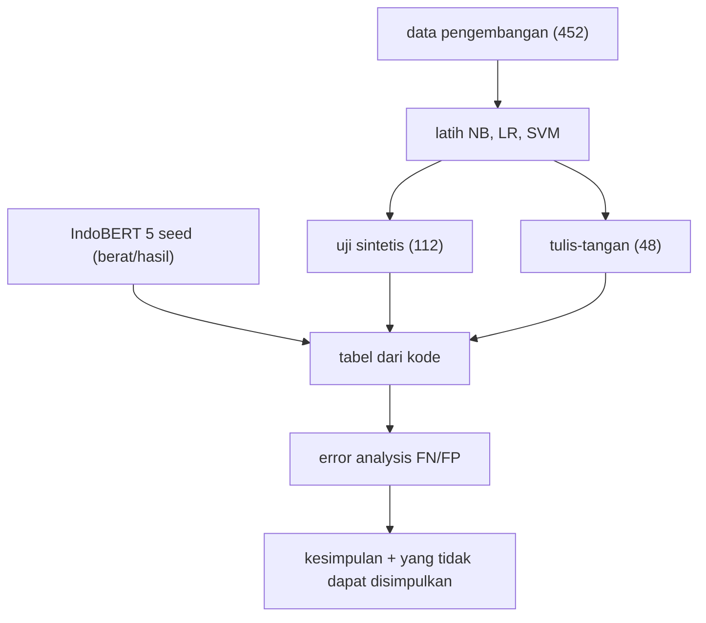

# Tahap F: Evaluasi, Tabel Perbandingan, dan Error Analysis

!!! abstract "Info materi"
    **Tingkat kesulitan:** Menengah–lanjut. **Estimasi waktu:** 180 menit.
    **Jenis kode:** ringan (`examples/disaster-classification/proyek/tahap_f_evaluasi.py`; angka IndoBERT dibaca dari `berat/hasil/` hasil eksekusi nyata). Data: **sintetis**.

## Tujuan pembelajaran

- [ ] Membuat tabel perbandingan yang **dihasilkan dari kode**: akurasi, presisi, recall, F1, F1 makro, FN, FP, dan waktu latih.
- [ ] Membedakan evaluasi pada uji sintetis (distribusi sama) dan tulis-tangan (gaya berbeda).
- [ ] Melakukan error analysis untuk false negative Emergency dan false positive Non-Emergency.
- [ ] Menempatkan hasil IndoBERT di tabel yang sama dengan melaporkan rentang antar seed.
- [ ] Menulis kesimpulan yang tidak melebihi bukti, termasuk daftar yang tidak dapat disimpulkan.

## Prasyarat

- [Level 5](../level-5-evaluasi/index.md) (metrik, ambang, error analysis, ketidakpastian).
- [Tahap E](tahap-e-modeling.md).

## Pengantar dan motivasi

Tahap F bukan menyusun angka tertinggi, melainkan menjawab: *seberapa jauh angka ini dapat dipercaya dan untuk apa?* Tabel dihasilkan oleh kode agar tidak ada angka yang diketik; error analysis dilakukan agar kita tahu bukan hanya berapa kesalahannya, tetapi **kesalahan macam apa**.

## Konsep dasar

| Istilah | Arti |
|---|---|
| **Uji sintetis** | 112 teks dari data yang sama distribusinya dengan latih (dibagi per kejadian) |
| **Tulis-tangan** | 48 teks gaya berbeda, dilabeli satu orang; ukuran uji ketahanan |
| **FN / FP** | Emergency terlewat / Non-Emergency yang salah ditandai Emergency |
| **Rentang antar seed** | Minimum–maksimum hasil beberapa pelatihan model acak |
| **Error analysis** | Membaca kesalahan dan mengelompokkannya untuk membuat hipotesis |

## Penjelasan mendalam

Prinsip pelaporan yang dipakai:

1. **Metrik kelas Emergency** (presisi, recall, F1) di samping F1 makro dan akurasi; akurasi dibaca terhadap baseline "selalu Non-Emergency".
2. **Dua set**: uji sintetis (bagus untuk mendeteksi bug, hampir jenuh karena templat) dan tulis-tangan (peka, tetapi kecil).
3. **FN dan FP dihitung**, tidak hanya rasio; FN pada Emergency adalah kesalahan yang paling mahal.
4. **Ketidakpastian**: rentang seed, selang bootstrap (Level 5), dan kata "tidak dapat disimpulkan".
5. **Tidak ada ambang produksi**: ambang bawaan 0 (SVM) atau 0,5 (softmax IndoBERT) hanya titik acuan.

## Cara kerja atau alur proses



## Contoh sederhana

Model A: recall E 0,98 pada uji sintetis; 0,40 pada tulis-tangan. Model B: 0,96 dan 0,70. Pilihan "terbaik" bergantung pada set mana yang paling mewakili penggunaan. Karena tidak ada set yang mewakili, laporan wajib menyajikan keduanya.

## Contoh dalam konteks Twitter/X kebencanaan

"Mohon bantuan, ibu hamil 8 bulan terjebak banjir di perumahan ..." jelas darurat bagi manusia, tetapi dalam hasil di bawah SVM memberinya skor −0,060: sedikit di bawah ambang 0, sehingga terlewat. Dugaan (belum diuji): kata `mohon` dan `terjebak` kurang mendapat bobot dibanding kata alamat dan `tolong`.

## Praktik Python

Berkas: `examples/disaster-classification/proyek/tahap_f_evaluasi.py`. Jalankan dari `examples/`.

### Bagian 1: tabel perbandingan

```python title="Bagian 1"
--8<-- "disaster-classification/proyek/tahap_f_evaluasi.py:tabel"
```

- Loop `for nama, kode in ((...), ...)` membuat dan melatih tiap model pada `X_dev` (452 teks) dan mencatat waktu `fit`.
- Pada tiap set, `metrik_emergency` menghitung metrik; `((y == 1) & (p == 0)).sum()` menghitung FN dan `((y == 0) & (p == 1)).sum()` menghitung FP (operator `&` pada array boolean).
- `pd.DataFrame(baris).round(3).to_string(index=False)` membuat tabel teks.

```text title="Output nyata"
              model          set  akurasi  presisi E  recall E  F1 E  F1 makro  FN  FP
     Multinomial NB uji sintetis    0.973      0.949     0.974 0.961     0.970   1   2
     Multinomial NB tulis-tangan    0.917      1.000     0.833 0.909     0.916   4   0
Logistic Regression uji sintetis    0.982      1.000     0.947 0.973     0.980   2   0
Logistic Regression tulis-tangan    0.708      1.000     0.417 0.588     0.681  14   0
         Linear SVM uji sintetis    0.982      0.950     1.000 0.974     0.980   0   2
         Linear SVM tulis-tangan    0.812      1.000     0.625 0.769     0.806   9   0
```

Interpretasi:

- **Uji sintetis:** ketiganya 0,970–0,980 F1 makro; FN 0–2 dan FP 0–2. Hampir tidak dapat dibedakan: data bertemplat.
- **Tulis-tangan:** SVM F1 makro 0,806 (FN 9, FP 0); NB 0,916 (FN 4); LR 0,681 (FN 14). **Tidak ada FP pada tulis-tangan untuk ketiganya**: kesalahan dominan adalah pesan darurat yang terlewat.
- Baseline "selalu Non-Emergency" pada tulis-tangan: akurasi 0,500, FN 24 (Level 5).

### Bagian 2: IndoBERT pada tabel yang sama

```python title="Bagian 2"
--8<-- "disaster-classification/proyek/tahap_f_evaluasi.py:indobert"
```

```text title="Output nyata"
IndoBERT (indobenchmark/indobert-base-p1), 5 seed; rata-rata (min-maks):
  uji sintetis  recall_e   0.979 (0.947-1.000)
  uji sintetis  presisi_e  0.984 (0.974-1.000)
  uji sintetis  f1_makro   0.986 (0.980-1.000)
  tulis-tangan  recall_e   0.825 (0.708-0.917)
  tulis-tangan  presisi_e  1.000 (1.000-1.000)
  tulis-tangan  f1_makro   0.911 (0.851-0.958)
```

Interpretasi: IndoBERT (`indobenchmark/indobert-base-p1`, lima seed 1–5, tiga epoch, CPU) mendapat recall Emergency tulis-tangan rata-rata **0,825** (0,708–0,917) dengan presisi 1,000 pada semua seed, dibanding SVM 0,625 dan NB 0,833. Ini hasil nyata, tetapi tafsirannya dibatasi di [Tahap G](tahap-g-advanced-modeling.md): IndoBERT dilatih hanya pada data latih (335 teks), SVM di tabel pada 452, tulis-tangan 24 Emergency, satu pelabel.

### Bagian 3: error analysis false negative

```python title="Bagian 3"
--8<-- "disaster-classification/proyek/tahap_f_evaluasi.py:galat"
```

- `sort_values("skor", ascending=False)` mengurutkan FN dari yang paling dekat ke ambang.
- `.iterrows()` mengulang baris DataFrame sebagai pasangan (indeks, baris).

```text title="Output nyata"
Linear SVM pada tulis-tangan: FN = 9, FP = 0
  FN skor -0.032 | Mohon info: jalur Puncak km 12 baru saja longsor, 2 mobil keseret ke j
  FN skor -0.043 | Ada bau gas menyengat di gang kami dan tabung bocor berdesis, jangan a
  FN skor -0.060 | Mohon bantuan, ibu hamil 8 bulan terjebak banjir di perumahan Griya As
  FN skor -0.065 | ledakan di bengkel las, 2 orang terbakar parah, kami nunggu ambulans d
catatan penulis pada FN: ['-', '-', '-', '-', '-', 'tidak ada permintaan bantuan eksplisit', '-', '-', '-']
```

Interpretasi dan kategori kesalahan:

| Pola FN (tulis-tangan, SVM) | Contoh | Hipotesis |
|---|---|---|
| **Skor dekat nol** | semua empat FN teratas berskor −0,03 sampai −0,07 | ambang 0 memotong tepat di bawah banyak pesan darurat: masalah **ambang/kalibrasi**, bukan kata asing |
| **Laporan tanpa kata permintaan** | "ledakan di bengkel las, 2 orang terbakar parah, kami nunggu ambulans" | model mengandalkan `tolong`/alamat; kalimat yang menyatakan kejadian tanpa kata itu kurang diberi bobot |
| **Sapaan/permohonan sopan** | "Mohon info: ..." / "Mohon bantuan, ..." | `mohon` jarang di data latih |
| **Tanpa permintaan eksplisit** | satu FN dicatat penulis "tidak ada permintaan bantuan eksplisit" | secara definisi mendekati batas; kasus ambigu |

Ini **hipotesis**, bukan kesimpulan: dua belum diuji (kata permintaan dan `mohon`). Sembilan FN ditampilkan empat teratas; pembacaan seluruhnya ada di [Error Analysis](../level-5-evaluasi/error-analysis.md). Kolom catatan penulis kosong pada delapan dari sembilan FN, dan satu bertuliskan "tidak ada permintaan bantuan eksplisit".

### Bagian 4: waktu latih

```python title="Bagian 4"
--8<-- "disaster-classification/proyek/tahap_f_evaluasi.py:waktu"
```

```text title="Output nyata: waktu berubah-ubah"
Multinomial NB       waktu latih 10 ms
Logistic Regression  waktu latih 13 ms
Linear SVM           waktu latih 9 ms
```

Interpretasi: waktu `fit` NB/LR/SVM pada 452 teks sekitar 9–16 milidetik (tiga eksekusi). Tidak ada perbedaan waktu yang bermakna antar baseline; yang membedakan IndoBERT adalah orde menit per seed.

## Kesimpulan yang sah dan yang tidak

**Dapat dinyatakan (dengan data ini):**

- Ketiga baseline TF-IDF hampir jenuh pada uji sintetis (F1 makro 0,970–0,980) dan melewatkan sebagian besar variasi pada tulis-tangan (recall E 0,417–0,833).
- Pada tulis-tangan tidak ada alarm palsu untuk ketiga baseline; kesalahan dominan adalah FN.
- FN SVM berskor dekat ambang (−0,03 sampai −0,07 untuk empat teratas), jadi ambang 0 menjadi faktor.
- IndoBERT p1 pada lima seed menemukan lebih banyak pesan darurat tulis-tangan daripada SVM dengan data latih yang sama, tanpa FP.

**Tidak dapat dinyatakan:**

- Bahwa model mana pun layak untuk tanggap darurat nyata.
- Bahwa IndoBERT lebih baik daripada TF-IDF secara umum (24 Emergency, satu pelabel, data bertemplat, satu pembagian).
- Bahwa ambang tertentu aman (tidak ada validasi representatif).
- Bahwa kesalahan tulis-tangan akan sama pada data nyata.

## Kesalahan umum dan debugging

| Gejala | Penyebab | Perbaikan |
|---|---|---|
| Angka di laporan berbeda dari kode | Diketik tangan | Hasilkan tabel dari kode |
| Akurasi tinggi dipuji | Tidak dibandingkan baseline | Laporkan baseline dan metrik kelas |
| Hanya rasio, tanpa jumlah FN/FP | Menyembunyikan kesalahan mahal | Laporkan FN dan FP |
| Satu seed neural dilaporkan | Variasi acak | Beberapa seed, rentang |
| Model dipilih dari set pelaporan | Kebocoran seleksi | Pilih di validasi |
| Membandingkan model dengan data latih berbeda | Tidak adil | Samakan data latih (lihat Tahap G) |
| Menyimpulkan sebab dari dua contoh | Anekdot | Hipotesis → uji |

## Kelebihan dan keterbatasan

**Kelebihan:** tabel dari kode, FN/FP eksplisit, dua set, hipotesis terpisah dari kesimpulan, daftar yang tidak dapat disimpulkan.
**Keterbatasan:** semua pada data sintetis; tulis-tangan kecil dan satu pelabel; tidak ada selang pada tabel ini (selang ada di Level 5); tidak ada uji statistik antar model; satu pembagian data.

## Latihan bertahap

1. **Konseptual.** Mengapa FN dan FP dilaporkan sebagai jumlah, bukan hanya rasio?
2. **Membaca tabel.** Berapa total kesalahan SVM pada tulis-tangan, dan berapa persen darinya adalah FN?
3. **Membaca output.** Mengapa empat FN teratas berskor −0,03 sampai −0,07 penting untuk pembahasan ambang?
4. **Debugging.** Laporan menyebut "IndoBERT 0,917 recall" dari seed 4. Apa yang salah?
5. **Eksperimen.** Hitung recall dan presisi SVM tulis-tangan pada ambang −0,1. Apakah boleh melaporkannya sebagai ambang pilihan?
6. **Analisis.** Tulis tiga hipotesis tentang FN "ledakan di bengkel las" dan cara menguji tiap hipotesis.

## Kunci jawaban dan pembahasan

??? success "Jawaban 1"
    Rasio menyembunyikan berapa pesan nyata yang terlewat dan skala masalah; jumlah (9 dari 24) lebih terasa dan lebih mudah dikaitkan dengan konsekuensi.

??? success "Jawaban 2"
    FN 9 + FP 0 = 9 kesalahan dari 48 (akurasi 0,812 = 39/48). 100% kesalahan adalah FN.

??? success "Jawaban 3"
    Karena pesan darurat tersebut hampir terdeteksi: menurunkan ambang sedikit akan menangkapnya. Tetapi ambang tidak boleh dipilih dari set yang sama dan efeknya pada FP di data nyata tidak diketahui ([Kalibrasi dan Threshold](../level-7-advanced-nlp/kalibrasi-threshold.md)).

??? success "Jawaban 4"
    Melaporkan seed terbaik (cherry-picking). Rentang seed 1–5 adalah 0,708–0,917, rata-rata 0,825; yang dilaporkan harus rata-rata dan rentang, bukan maksimum.

??? success "Jawaban 5"
    Hitung dengan `skor >= -0.1`. Hasil (Level 5 menjelajahi ambang serupa) hanya eksplorasi: memilih ambang dari set evaluasi yang sama adalah *data snooping* sehingga tidak boleh dilaporkan sebagai ambang pilihan.

??? success "Jawaban 6"
    (1) Model mengandalkan `tolong`/alamat: uji dengan menambah kata permintaan ke teks itu dan lihat skor. (2) `ledakan` jarang di latih: periksa frekuensinya. (3) Skor terlalu dekat ambang karena regularisasi: bandingkan dengan nilai `C` berbeda pada validasi. Tiap hipotesis harus dapat dibantah oleh hasil uji.

## Kuis singkat

**1.** Mengapa tabel dihasilkan oleh kode?

??? success "Jawaban"
    Agar tidak ada angka yang diketik dan hasil dapat diulang.

**2.** Apa kesalahan dominan pada tulis-tangan untuk ketiga baseline?

??? success "Jawaban"
    False negative; tidak ada false positive.

**3.** Bolehkah menyimpulkan IndoBERT lebih baik dari SVM secara umum?

??? success "Jawaban"
    Tidak; set kecil, satu pelabel, dan data bertemplat.

## Ringkasan

- Uji sintetis: semua baseline F1 makro 0,970–0,980. Tulis-tangan: NB 0,916, SVM 0,806, LR 0,681; FN 4 / 9 / 14; FP 0.
- IndoBERT p1 (5 seed): recall E tulis-tangan 0,825 (0,708–0,917), presisi 1,000.
- FN SVM terdekat berskor −0,03 sampai −0,07: faktor ambang; hipotesis lain belum diuji.
- Daftar kesimpulan yang sah dan yang tidak dapat dinyatakan menyertai tabel.

## Glosarium istilah baru

Cherry-picking
:   Melaporkan hasil terbaik dari beberapa percobaan tanpa menyebut sisanya.

Rentang antar seed
:   Minimum dan maksimum hasil beberapa pelatihan acak.

## Referensi

- scikit-learn, evaluasi model: <https://scikit-learn.org/stable/modules/model_evaluation.html> (dokumentasi resmi).
- Dietterich, T. G. (1998). Approximate statistical tests for comparing supervised classification learning algorithms. *Neural Computation*, 10(7) (makalah akademik; judul, penulis, dan tahun diperiksa via arXiv/Crossref/ACL Anthology; venue tidak diverifikasi terpisah).

## Materi berikutnya

[Tahap G: Advanced Modeling](tahap-g-advanced-modeling.md)
