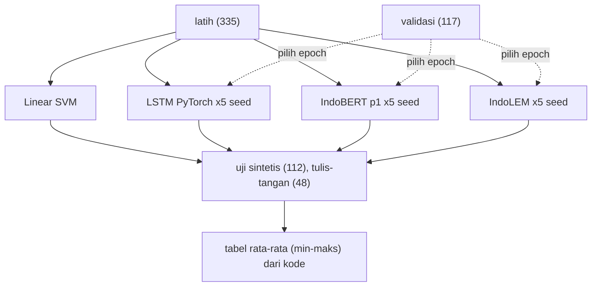

# Tahap G: Advanced Modeling dengan IndoBERT dan LSTM

!!! abstract "Info materi"
    **Tingkat kesulitan:** Lanjut. **Estimasi waktu:** 180 menit.
    **Jenis kode:** **eksperimen berat, dieksekusi penulis** di CPU pada 2026-10-23 (`examples/level-6-deep-learning/berat/12_finetune_indobert.py`, `10_lstm_pytorch.py`, `13_ulang_seed.py`). Tabel di halaman ini disertakan langsung dari berkas hasil di `berat/hasil/`, bukan diketik. Angka **tidak diperiksa otomatis** (bergantung unduhan model, versi, dan mesin).

## Tujuan pembelajaran

- [ ] Membandingkan kebutuhan data, komputasi, preprocessing, pelatihan, dan evaluasi antara baseline TF-IDF dan model neural.
- [ ] Menyusun perbandingan yang adil: data latih sama, beberapa seed, rentang dilaporkan.
- [ ] Membaca hasil IndoBERT (dua model berbeda), LSTM, dan SVM tanpa menyimpulkan lebih dari bukti.
- [ ] Menjelaskan mengapa pilihan model pra-latih memengaruhi hasil sebesar itu.
- [ ] Menjelaskan langkah yang diperlukan sebelum klaim keunggulan dapat dibuat.

## Prasyarat

- [Tahap F](tahap-f-evaluasi.md).
- [Tokenizer, BERT, IndoBERT](../level-6-deep-learning/tokenizer-bert-indobert.md), [Fine-tuning](../level-6-deep-learning/fine-tuning-transfer-learning.md), [RNN, LSTM, GRU](../level-6-deep-learning/rnn-lstm-gru.md).
- Lingkungan: `pip install -r requirements-dl.txt` (lihat [Komputasi](../level-6-deep-learning/ml-klasik-vs-dl-komputasi.md)).

## Pengantar dan motivasi

Model berbasis TF-IDF tidak mengenali kata yang tidak ada di data latih. Model bahasa pra-latih seperti IndoBERT sudah melihat korpus Indonesia yang besar dan memecah kata menjadi subword, sehingga secara teori lebih tahan terhadap variasi. Tahap G menguji **apakah itu terjadi pada data kita**, dengan protokol yang sama dengan baseline, bukan mengasumsikannya.

## Konsep dasar

| Istilah | Arti |
|---|---|
| **Model pra-latih** | Model yang sudah dilatih pada korpus besar (IndoBERT) |
| **Fine-tuning** | Melatih lanjut pada tugas dan data berlabel kita |
| **Seed** | Bilangan awal pengacak; mengubah inisialisasi dan urutan batch |
| **Rentang antar seed** | Minimum–maksimum hasil beberapa pelatihan |
| **Data latih sama** | Pembanding dilatih pada data yang persis sama (335 teks) |

## Penjelasan mendalam

### Perbedaan baseline klasik dan model neural pada proyek ini

| Aspek | TF-IDF + SVM/NB/LR | LSTM (PyTorch) | IndoBERT fine-tuning |
|---|---|---|---|
| **Data** | Cukup ratusan teks | Ratusan sampai ribuan; embedding dilatih dari nol | Ratusan teks cukup *kadang-kadang* karena pra-latih; tetap perlu uji |
| **Preprocessing** | Penting (normalisasi, negasi, dst.) | Token kata + kosakata dari latih (`<unk>` untuk kata baru) | Tokenizer WordPiece model; normalisasi manual belum tentu membantu (belum diuji) |
| **Komputasi** | Milidetik, CPU | Detik–menit, CPU cukup | Menit per seed di CPU untuk 335 teks; GPU sangat membantu untuk data besar |
| **Memori** | Megabyte | Megabyte | Sekitar 0,5 GB bobot + latihan beberapa kali lipat |
| **Dependensi** | scikit-learn | + PyTorch | + PyTorch + Transformers + unduhan model |
| **Reprodusibilitas** | Deterministik | Seed + versi | Seed + versi + perangkat; hasil bervariasi antar seed |
| **Penjelasan** | Koefisien kata | Sulit | Sulit (perlu oklusi/gradien) |

### Protokol perbandingan yang adil

1. **Data latih sama:** semua model dilatih pada `d.latih` (335 teks); validasi (117) untuk memilih epoch terbaik pada model neural; uji sintetis (112) dan tulis-tangan (48) hanya untuk pelaporan.
2. **Seed:** model neural dijalankan lima kali (seed 1–5); SVM deterministik, satu kali.
3. **Metrik:** recall dan presisi Emergency, F1 makro; rata-rata dan rentang.
4. **Tanpa seleksi dari tulis-tangan.**

Catatan: SVM di tabel ini dilatih pada 335 teks, berbeda dari model rujukan Level 5 (452 teks), sehingga recall tulis-tangan SVM di sini 0,583 (bukan 0,625).

## Cara kerja atau alur proses



## Contoh sederhana

Jika tiga seed IndoBERT memberi recall 0,70; 0,83; 0,92, kita melaporkan "0,82 (0,70–0,92)", bukan "0,92". Rentang selebar itu sendiri adalah informasi: model belum stabil pada data sebesar ini.

## Contoh dalam konteks Twitter/X kebencanaan

"Astaga dapur tetangga meledak, apinya udah ngejalar ke atap. Siapa punya APAR?" adalah FN bagi SVM (skor −0,067). Subword dan pengetahuan bahasa dapat membantu IndoBERT mengenali bahwa `meledak` + `apinya` + `atap` melaporkan kebakaran. Apakah itu yang terjadi, dan pada pesan lain, hanya dapat dilihat dari angka dan pembacaan kesalahan.

## Praktik Python

### Menjalankan (dieksekusi penulis)

```bash
# dari folder examples/, setelah pip install -r requirements-dl.txt
python level-6-deep-learning/berat/13_ulang_seed.py --seeds 1 2 3 4 5                       # IndoBERT p1, 5 seed
python level-6-deep-learning/berat/13_ulang_seed.py --model indolem/indobert-base-uncased   # model lain, 5 seed
python level-6-deep-learning/berat/13_ulang_seed.py --jenis lstm --seeds 1 2 3 4 5          # LSTM, 5 seed
python level-6-deep-learning/berat/13_ulang_seed.py --hanya-ringkas                         # susun ulang tabel dari JSON
```

```python title="13_ulang_seed.py: menjalankan satu seed"
--8<-- "level-6-deep-learning/berat/13_ulang_seed.py:jalankan"
```

- `subprocess.run([...], capture_output=True, text=True)` menjalankan skrip pelatihan sebagai proses terpisah dan menangkap keluarannya; setiap seed menjalankan model dari awal.
- Untuk IndoBERT, hasil dibaca dari `laporan.json` yang ditulis `12_finetune_indobert.py`; untuk LSTM, dari baris keluaran dengan regex.

```python title="13_ulang_seed.py: merangkum"
--8<-- "level-6-deep-learning/berat/13_ulang_seed.py:ringkas"
```

- SVM dilatih pada `d.latih` (data latih yang sama dengan model neural). `rangkum` menghitung rata-rata dan rentang antar seed.

### Hasil: IndoBERT `indobenchmark/indobert-base-p1`

--8<-- "level-6-deep-learning/berat/hasil/indobenchmark_indobert_base_p1.md"

### Hasil: IndoBERT `indolem/indobert-base-uncased`

--8<-- "level-6-deep-learning/berat/hasil/indolem_indobert_base_uncased.md"

### Hasil: LSTM PyTorch (embedding dari nol)

--8<-- "level-6-deep-learning/berat/hasil/lstm_pytorch.md"

### Interpretasi

Ringkasan lintas model (semua dilatih pada 335 teks latih; neural: rata-rata dan rentang lima seed):

| Model | Tulis-tangan: recall E | Tulis-tangan: presisi E | Uji sintetis: F1 makro |
|---|---|---|---|
| Linear SVM (1 model) | 0,583 | 1,000 | 0,980 |
| IndoBERT `indobenchmark/indobert-base-p1` | **0,825** (0,708–0,917) | 1,000 | 0,986 (0,980–1,000) |
| IndoBERT `indolem/indobert-base-uncased` | 0,442 (0,375–0,542) | 0,879 (0,786–1,000) | 0,915 (0,865–0,941) |
| LSTM PyTorch (embedding dari nol) | 0,192 (0,000–0,333) | 0,778 (0,000–1,000) | 0,974 (0,951–1,000) |

Apa yang dapat dikatakan:

1. **IndoBERT p1 lebih tinggi daripada SVM pada recall tulis-tangan pada kelima seed.** Seed terburuk (0,708, atau 17 dari 24 pesan) masih di atas SVM (0,583, atau 14 dari 24), dan presisi tetap 1,000 pada semua seed. Selisih rata-rata 0,24 setara dengan sekitar 6 pesan dari 24. Pada **uji sintetis** tidak ada perbedaan bermakna (F1 makro 0,986 vs 0,980): data bertemplat tidak membedakan model.
2. **Nama "IndoBERT" tidak menjamin hasil.** IndoLEM, dengan prosedur yang sama, lebih rendah daripada SVM pada kedua set: recall tulis-tangan 0,442 (maksimum 0,542 masih di bawah 0,583) dan F1 makro uji 0,915 (di bawah 0,980). Penyebabnya **tidak diselidiki**. Hipotesis yang belum diuji: perbedaan korpus pra-latih dan kosakata, atau hiperparameter (tiga epoch, LR 2e-5) yang kurang cocok untuk model ini; kami tidak menyetelnya.
3. **LSTM dari nol baik pada uji sintetis (F1 makro 0,974) tetapi runtuh pada tulis-tangan (recall rata-rata 0,192).** Pada satu seed recall 0,000 dan presisi 0,000: model tidak menandai satu pun pesan tulis-tangan sebagai Emergency. Dugaan (tidak diuji): embedding yang dilatih dari 335 teks bertemplat hanya menghafal kosakata templat, dan kata-kata tulis-tangan menjadi `<unk>`. Tanpa pra-latih, model neural tidak otomatis lebih baik daripada TF-IDF; di sini jauh lebih buruk.
4. **Waktu:** SVM ± 10 ms; LSTM sekitar 5–8 detik per seed; IndoBERT sekitar 1,9–3,6 menit per seed di CPU (termasuk pemuatan model dan, pada beberapa seed, proses lain yang berjalan bersamaan).

Apa yang **tidak** dapat dikatakan:

- Bahwa IndoBERT lebih baik daripada TF-IDF secara umum. Bukti: 24 pesan Emergency, satu pelabel yang juga menulis data latih, data sintetis bertemplat, lima seed, tanpa penalaan hiperparameter untuk kedua sisi (SVM tidak dituning), satu pembagian data, tanpa uji statistik.
- Bahwa IndoBERT p1 layak untuk tanggap darurat: recall rata-rata 0,825 masih berarti rata-rata sekitar 4 dari 24 pesan darurat terlewat, dan seed terburuk melewatkan 7.
- Bahwa penyebab keunggulan p1 adalah subword atau pra-latih: tidak ada percobaan yang memisahkan faktor-faktor itu (perbandingan dengan IndoLEM justru menunjukkan model pra-latih tidak otomatis unggul).
- Bahwa hasil sama pada perangkat/versi lain: torch 2.14.1 CPU dan transformers 5.20.2 di satu mesin.

Langkah berikutnya yang disarankan: data nyata yang sah dan pelabel independen; hiperparameter dipilih di validasi untuk SVM dan IndoBERT; ≥10 seed; selang bootstrap pada selisih; irisan gaya; pembandingan pembuangan/penambahan normalisasi informal pada IndoBERT.

## Kesalahan umum dan debugging

| Gejala | Penyebab | Perbaikan |
|---|---|---|
| Membandingkan SVM (452 teks) dengan IndoBERT (335 teks) | Data latih berbeda | Samakan data latih (tabel ini memakai 335 untuk keduanya) |
| Melaporkan seed terbaik | *Cherry-picking* | Rata-rata dan rentang |
| Model "IndoBERT" diganti tanpa dicatat | Ada lebih dari satu IndoBERT | Catat ID model persis; hasil keduanya berbeda jauh |
| Kesimpulan umum dari 48 teks | Set kecil, satu pelabel | Batasi klaim; data lebih besar dan pelabel independen |
| Waktu latih dibandingkan antar mesin | Mesin dan beban berbeda | Bandingkan pada mesin sama; catat beban |
| Hasil tidak dapat diulang di mesin lain | Versi library, perangkat, seed | Catat `torch`/`transformers`/perangkat (sudah di berkas hasil) |
| `OSError` saat memuat model | Tidak ada jaringan / ID salah | Unduh lebih dulu; periksa ID |

## Kelebihan dan keterbatasan

**Kelebihan IndoBERT:** pengetahuan bahasa pra-latih; subword menangani kata baru; pada percobaan ini recall tulis-tangan lebih tinggi daripada SVM untuk model p1.
**Keterbatasan percobaan ini:** data sintetis bertemplat; tulis-tangan 48 teks (24 Emergency) dilabeli satu orang; lima seed; satu hiperparameter (tiga epoch, LR 2e-5, panjang 64, batch 16) tanpa penalaan; hanya CPU; satu pembagian data; tidak ada uji statistik; tidak ada ablation preprocessing untuk IndoBERT; ambang 0,5 bawaan; SVM tidak dituning; tidak mewakili data nyata.

## Latihan bertahap

1. **Konseptual.** Mengapa SVM dilatih ulang pada 335 teks untuk perbandingan ini?
2. **Membaca tabel.** Berapa rentang recall tulis-tangan IndoBERT p1, dan apa yang dikatakan lebar rentang itu?
3. **Membaca tabel.** Bandingkan IndoBERT p1 dan IndoLEM. Hal apa yang tidak boleh diasumsikan dari nama "IndoBERT"?
4. **Debugging.** Teman Anda mendapat recall tulis-tangan 0,917 dari satu run dan menulis "IndoBERT 92%". Koreksi.
5. **Eksperimen.** Jalankan `12_finetune_indobert.py --seed 11 --epochs 5`. Apakah hasil berada dalam rentang lima seed sebelumnya?
6. **Analisis.** Rancang percobaan yang dapat membuktikan (bukan sekadar menunjukkan) bahwa IndoBERT lebih baik dari SVM pada tugas ini.

## Kunci jawaban dan pembahasan

??? success "Jawaban 1"
    Model neural hanya melihat data latih (335 teks); jika SVM memakai 452, ia mendapat 35% data lebih banyak sehingga perbandingan tidak adil. Menyamakan data latih mengisolasi perbedaan model.

??? success "Jawaban 2"
    0,708–0,917 (rata-rata 0,825). Rentang 0,2 dari 24 pesan (sekitar 5 pesan) menunjukkan hasil antar seed belum stabil pada data sebesar ini, jadi angka tunggal tidak dapat dipercaya.

??? success "Jawaban 3"
    Lihat tabel hasil kedua model di atas: perbedaannya besar pada recall tulis-tangan. Nama yang sama tidak menjamin kualitas yang sama; kedua model berbeda penulis, korpus, dan tokenizer. Catat ID persis dan ukur sendiri.

??? success "Jawaban 4"
    0,917 adalah maksimum dari lima seed (seed 4). Laporan yang benar: rata-rata 0,825 dengan rentang 0,708–0,917, pada 24 pesan Emergency, data sintetis. Menyebut "92%" adalah cherry-picking dan melebih-lebihkan.

??? success "Jawaban 5"
    Jalankan dan catat. Hasil di dalam rentang berarti konsisten; di luar rentang berarti rentang lima seed terlalu sempit. Seed dan jumlah epoch yang berbeda berarti tidak lagi membandingkan hal yang sama dengan tabel; laporkan sebagai percobaan terpisah.

??? success "Jawaban 6"
    Butuh: data nyata yang sah dan jauh lebih besar; pelabel independen (kappa); pembagian per waktu/kejadian; hiperparameter dipilih di validasi untuk kedua model (SVM dituning juga); ≥10 seed; uji berpasangan atau selang bootstrap pada selisih; irisan (informal/formal, bahaya baru); dan pelaporan negatif. "Membuktikan" selalu terbatas pada populasi data yang diuji.

## Kuis singkat

**1.** Mengapa laporan memuat rentang antar seed?

??? success "Jawaban"
    Inisialisasi dan urutan batch acak membuat hasil berbeda tiap seed; satu angka menyesatkan.

**2.** Apakah dua model bernama IndoBERT memberi hasil sama?

??? success "Jawaban"
    Tidak; terlihat dari tabel hasil keduanya.

**3.** Apakah hasil ini cukup untuk mengatakan IndoBERT lebih baik daripada SVM secara umum?

??? success "Jawaban"
    Tidak; data kecil, bertemplat, satu pelabel, lima seed.

## Ringkasan

- IndoBERT p1 (5 seed): recall E tulis-tangan 0,825 (0,708–0,917), presisi 1,000, vs SVM 0,583 pada data latih yang sama.
- Model IndoBERT lain memberi hasil jauh berbeda: pilihan model pra-latih sangat memengaruhi hasil.
- LSTM dari nol: hasil di tabel; embedding tanpa pra-latih lemah pada data sekecil ini.
- Semua kesimpulan dibatasi data sintetis, 48 teks tulis-tangan, satu pelabel, lima seed, tanpa penalaan; tidak ada klaim kelayakan operasional.

## Glosarium istilah baru

Cherry-picking
:   Melaporkan hasil terbaik saja.

Model pra-latih
:   Model yang sudah dilatih pada korpus besar sebelum disesuaikan.

## Referensi

- Wilie, B., dkk. (2020). IndoNLU. *AACL-IJCNLP 2020*, arXiv:2009.05387 (makalah akademik; judul, penulis, tahun diperiksa).
- Koto, F., dkk. (2020). IndoLEM and IndoBERT. *COLING 2020*, arXiv:2011.00677 (makalah akademik; judul, penulis, tahun diperiksa).
- Hugging Face, `transformers`: <https://huggingface.co/docs/transformers> (dokumentasi resmi).
- Dodge, J., dkk. (2020). Fine-tuning pretrained language models: Weight initializations, data orders, and early stopping. arXiv:2002.06305 (makalah akademik; judul diperiksa via arXiv API) — tentang variasi antar seed pada fine-tuning.

## Materi berikutnya

[Tahap H: Deployment](tahap-h-deployment.md)
