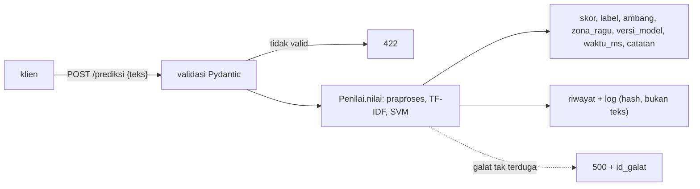

# Tahap H: Deployment dengan FastAPI

!!! abstract "Info materi"
    **Tingkat kesulitan:** Menengah–lanjut. **Estimasi waktu:** 120 menit.
    **Jenis kode:** ringan (`examples/disaster-classification/proyek/tahap_h_deployment.py`, `nlp_hub/api.py`). Model: Linear SVM (Level 5) pada data **sintetis**. Halaman ini merangkum dan melengkapi [Level 7](../level-7-advanced-nlp/fastapi-dasar.md) untuk proyek; **bukan** layanan siap produksi.

## Tujuan pembelajaran

- [ ] Menyebut apa yang harus dikembalikan layanan sesuai spesifikasi: label, skor model bila tersedia, versi model, dan waktu prediksi.
- [ ] Menjelaskan mengapa skor SVM tidak disebut probabilitas dan bagaimana respons mencegahnya.
- [ ] Membaca contoh request-response, kode status, dan penanganan error.
- [ ] Mengukur waktu prediksi dengan jujur (apa yang diukur dan apa yang tidak).
- [ ] Menjalankan pengujian endpoint dan menyatakan apa yang belum diuji.
- [ ] Menyebut syarat sebelum layanan dipakai di luar pembelajaran.

## Prasyarat

- [FastAPI: Layanan Prediksi](../level-7-advanced-nlp/fastapi-dasar.md) dan [Batch, Riwayat, Tes](../level-7-advanced-nlp/fastapi-batch-riwayat-tes.md).
- [Tahap F](tahap-f-evaluasi.md): model dan batas klaimnya.

## Pengantar dan motivasi

Tahap H menempatkan model Tahap E di belakang antarmuka yang dapat dipanggil aplikasi lain. Karena keluaran sistem ini dapat memengaruhi keputusan orang, respons dirancang agar **tidak dapat disalahartikan**: skor bukan probabilitas, ambang terlihat, versi model tercatat, dan catatan keterbatasan menyertai setiap hasil.

## Konsep dasar

| Istilah | Arti |
|---|---|
| **Endpoint** | Alamat HTTP tempat operasi tersedia (`POST /prediksi`) |
| **Skor keputusan** | Angka dari `decision_function` SVM; makin besar makin condong ke Emergency; bukan probabilitas |
| **Probabilitas terkalibrasi** | Angka 0–1 yang frekuensi nyatanya cocok; hanya sah bila model dikalibrasi dan divalidasi |
| **Versi model** | Nama unik model yang menghasilkan prediksi (tercatat di artefak dan respons) |
| **Waktu prediksi** | Waktu pemanggilan model; pada layanan ini diukur di dalam proses, bukan latensi jaringan |
| **Zona ragu** | Skor dekat ambang; saran memprioritaskan tinjauan manusia |

## Penjelasan mendalam

### Respons sesuai spesifikasi proyek

| Kebutuhan spesifikasi | Kolom respons |
|---|---|
| Prediksi label | `label` (`Emergency`/`Non-Emergency`) |
| Skor model bila tersedia | `skor` (skor keputusan SVM) + `ambang` |
| Model version | `versi_model` |
| Waktu prediksi bila diukur | `waktu_ms` |
| Batas klaim | `catatan`, `zona_ragu` |

**Probabilitas hanya bila valid.** Model ini Linear SVM. Spesifikasi menyatakan skor decision function tidak boleh disebut probabilitas; karena itu tidak ada kolom `probabilitas`, dan [Kalibrasi](../level-7-advanced-nlp/kalibrasi-threshold.md) menunjukkan mengapa kalibrasi dari data sintetis tidak berpindah ke gaya bahasa lain (ECE 0,186 pada tulis-tangan).

### Apa yang diukur oleh `waktu_ms`

Waktu antara awal dan akhir pemanggilan `Penilai.nilai` (praproses, TF-IDF, SVM). **Tidak** termasuk penerimaan HTTP, validasi Pydantic, penulisan riwayat, atau latensi jaringan. Angka ini berguna membandingkan model, bukan menjanjikan latensi ke pengguna.

### Penanganan error dan keamanan

Masukan tidak valid → 422; galat internal → 500 dengan `id_galat` tanpa jejak tumpukan; artefak rusak → server tidak mulai. Log hanya memuat sidik jari teks. Tidak ada autentikasi, HTTPS, atau pembatasan laju: **layanan tidak boleh dibuka ke jaringan tak tepercaya**.

## Cara kerja atau alur proses



## Contoh sederhana

Permintaan `{"teks": "Tolong, air banjir sudah masuk ke rumah kami."}` menghasilkan skor 0,3028 → `Emergency`. Skor 0,3028 berjarak 0,3028 dari ambang, tepat di luar margin 0,3, sehingga `zona_ragu` `false`; sebuah kalimat seperti "Gempa terasa kuat, warga diminta menjauhi bangunan yang rusak." mendapat skor −0,229 → `Non-Emergency` dengan `zona_ragu` `true`.

## Contoh dalam konteks Twitter/X kebencanaan

Seorang koordinator relawan mengirim pos yang dikumpulkan secara sah ke `POST /prediksi/batch` untuk melihat urutan yang disarankan. Pos berskor tinggi dan pos di zona ragu ditandai untuk ditinjau lebih dulu. Keputusan mengirim bantuan tidak pernah dibuat oleh layanan.

## Praktik Python

Berkas: `examples/disaster-classification/proyek/tahap_h_deployment.py`. Prasyarat: `requirements-ml.txt`. Jalankan dari `examples/`.

### Bagian 1: contoh request dan response

```python title="Bagian 1"
--8<-- "disaster-classification/proyek/tahap_h_deployment.py:contoh"
```

- `badan.pop("waktu_ms")` mengambil `waktu_ms` keluar dari kamus (nilainya berubah-ubah) supaya sisanya dicetak deterministik.
- `sorted(badan) + ["waktu_ms"]` menampilkan kolom respons secara berurutan.

```text title="Output nyata"
POST /prediksi {"teks": "Tolong, air banjir sudah masuk ke rumah kami."}
status: 200
{
  "skor": 0.3028,
  "label": "Emergency",
  "ambang": 0.0,
  "zona_ragu": false,
  "versi_model": "svm-tfidf-sintetis-0.1"
}
kolom respons: ['ambang', 'catatan', 'label', 'skor', 'versi_model', 'zona_ragu', 'waktu_ms']
skor probabilitas dikembalikan? False
```

Interpretasi: 200; label `Emergency`, skor 0,3028, ambang 0,0, tidak di zona ragu, versi `svm-tfidf-sintetis-0.1`. Kolom respons mencakup `catatan` dan `waktu_ms`; **tidak ada kolom probabilitas**.

### Bagian 2: error

```python title="Bagian 2"
--8<-- "disaster-classification/proyek/tahap_h_deployment.py:galat"
```

```text title="Output nyata"
masukan kosong     -> 422
kolom salah        -> 422
bukan JSON         -> 422
metode salah (GET) -> 405
alamat tidak ada   -> 404
```

Interpretasi: masukan kosong, kolom salah nama, dan badan yang bukan JSON semuanya 422 (validasi); `GET` pada endpoint `POST` 405; alamat tidak ada 404. Tidak ada yang menghasilkan 500.

### Bagian 3: waktu prediksi

```python title="Bagian 3"
--8<-- "disaster-classification/proyek/tahap_h_deployment.py:waktu"
```

```text title="Output nyata: waktu berubah-ubah"
waktu model per teks (50 permintaan tunggal): median 0.44 ms, maks 0.94 ms
satu batch 100 teks: 4.3 ms total (termasuk HTTP, validasi, dan pencatatan riwayat)
```

Interpretasi: pada mesin penulis tanpa beban lain, waktu pemanggilan model per teks median sekitar 0,45 ms (tiga eksekusi: 0,44–0,46 ms; maksimum 0,94–2,44 ms karena derau), dan satu batch 100 teks selesai dalam sekitar 4–5 ms termasuk HTTP (dalam proses), validasi, dan pencatatan riwayat. Ini `TestClient` di proses yang sama: **tidak** termasuk jaringan nyata dan tidak mencerminkan beban banyak pengguna. Waktu inferensi IndoBERT **tidak diukur** di halaman ini.

### Menjalankan sebagai server dan menguji

```bash
# dari folder examples/
python level-7-deployment/01_arsitektur_pipeline.py              # membuat artefak (sekali)
python -m uvicorn nlp_hub.api:buat_app --factory --port 8000
curl -X POST http://127.0.0.1:8000/prediksi -H "Content-Type: application/json" \
     -d '{"teks": "Tolong, air banjir sudah masuk ke rumah kami."}'
python -m pytest tests/test_api.py -q
```

Variabel lingkungan dan endpoint lain ada di `examples/level-7-deployment/README.md`. Tes API memakai `TestClient` (tanpa port) dan mencakup bentuk respons, validasi, batch, riwayat tanpa teks, galat 500, ambang, dan waktu.

### Yang belum diuji

Beban dan konkurensi, banyak proses (`--workers`), HTTPS, autentikasi, pembatasan laju, kontainer, dan perilaku jangka panjang riwayat. Daftar kesiapan ada di [Keamanan, Model Card, dan Roadmap](../level-7-advanced-nlp/keamanan-model-card-roadmap.md).

## Kesalahan umum dan debugging

| Gejala | Penyebab | Perbaikan |
|---|---|---|
| Menamai `skor` sebagai "probabilitas" | Salah tafsir `decision_function` | Pakai nama `skor`; kalibrasi dan validasi bila perlu probabilitas |
| Latensi pengguna jauh di atas `waktu_ms` | `waktu_ms` hanya model | Ukur ujung ke ujung secara terpisah |
| 422 padahal JSON benar | Nama kolom atau tipe salah | Baca `detail` pada respons |
| Server tidak mulai | Artefak hilang/checksum salah | Jalankan `01_arsitektur_pipeline.py` |
| Riwayat berisi teks pribadi | `NLP_HUB_SIMPAN_TEKS=1` tanpa kebijakan | Matikan; hash saja |
| Layanan terbuka ke internet | Tidak ada autentikasi | Jangan; tambahkan kontrol akses |
| Ambang diubah tanpa validasi | Mengejar recall | Pilih di validasi representatif, catat |

## Kelebihan dan keterbatasan

**Kelebihan:** antarmuka standar; respons yang menegakkan batas klaim; dapat diuji tanpa server; metadata dan versi tercatat.
**Keterbatasan:** model sintetis dan ambang tak tervalidasi; tanpa autentikasi/HTTPS; satu model; tidak diuji beban; waktu hanya model.

## Latihan bertahap

1. **Konseptual.** Mengapa respons memuat `ambang` dan `zona_ragu`?
2. **Membaca output.** Apa arti 405 dan 404 pada Bagian 2?
3. **Menulis tes.** Tulis tes yang memastikan respons `/prediksi` tidak memuat kolom `probabilitas`.
4. **Debugging.** Klien melaporkan "latensi 300 ms" padahal `waktu_ms` 1 ms. Di mana Anda mencari?
5. **Rancangan.** Rancang perubahan agar respons memuat probabilitas terkalibrasi secara valid. Apa syaratnya?
6. **Mini-proyek.** Tambahkan endpoint `GET /versi` yang mengembalikan versi model dan versi library, lengkap dengan tes.

## Kunci jawaban dan pembahasan

??? success "Jawaban 1"
    Agar klien melihat kebijakan yang dipakai (ambang) dan tahu kapan hasil berada di dekat batas sehingga perlu perhatian manusia. Ambang adalah kebijakan, bukan sifat model.

??? success "Jawaban 2"
    405: metode HTTP salah (`GET` pada endpoint yang hanya menerima `POST`). 404: alamat tidak ada. Keduanya kesalahan klien, bukan galat server.

??? success "Jawaban 3"
    Sudah ada di `test_api.py`: `assert "probabilitas" not in j`. Tes ini menjaga kontrak respons dari perubahan tak sengaja.

??? success "Jawaban 4"
    `waktu_ms` hanya mengukur model. Periksa jaringan, proxy, serialisasi, validasi, penulisan riwayat, antrean server, dan sisi klien. Ukur ujung ke ujung dengan pencatat waktu di klien dan di server.

??? success "Jawaban 5"
    Syaratnya: (1) kalibrasi (mis. Platt) dicocokkan pada data validasi representatif, (2) kalibrasi diuji pada data terpisah dari periode/gaya berbeda dengan ECE dan tabel reliabilitas, (3) disimpan di artefak bersama versi, (4) dokumentasi menyatakan kapan kalibrasi berlaku. Pada data sintetis ini syarat (1)–(2) tidak terpenuhi (ECE 0,186 pada tulis-tangan), sehingga kolom probabilitas tidak ditambahkan.

??? success "Jawaban 6"
    Tambahkan di `buat_app`: `@app.get("/versi")` yang mengembalikan `{"model": meta["model_version"], "scikit_learn": meta["scikit_learn"], "python": meta["python"]}` dan tes `klien.get("/versi").json()["model"] == "svm-tfidf-sintetis-0.1"`.

## Kuis singkat

**1.** Apakah `skor` pada respons adalah probabilitas?

??? success "Jawaban"
    Bukan; itu skor keputusan SVM.

**2.** Apa yang diukur `waktu_ms`?

??? success "Jawaban"
    Waktu pemanggilan model, tanpa HTTP, validasi, riwayat, atau jaringan.

**3.** Apakah layanan siap dibuka ke internet?

??? success "Jawaban"
    Tidak; tidak ada autentikasi, HTTPS, atau pembatasan laju.

## Ringkasan

- Respons: label, skor, ambang, zona ragu, versi model, `waktu_ms`, dan catatan; tanpa probabilitas.
- 422 untuk masukan buruk, 405/404 untuk metode/alamat salah, 500 hanya `id_galat`.
- `waktu_ms` hanya waktu model; latensi ujung ke ujung diukur terpisah.
- Beban, autentikasi, HTTPS, dan kontainer belum diuji.

## Glosarium istilah baru

Latensi
:   Waktu dari permintaan sampai jawaban diterima.

Kontrak respons
:   Kesepakatan kolom dan makna yang dijaga oleh tes.

## Referensi

- FastAPI, dokumentasi resmi: <https://fastapi.tiangolo.com/> (dokumentasi resmi).
- Mozilla MDN, kode status HTTP: <https://developer.mozilla.org/docs/Web/HTTP/Status> (dokumentasi).

## Materi berikutnya

[Latihan dan kuis proyek](../latihan/proyek.md), atau kembali ke [indeks proyek](index.md).
